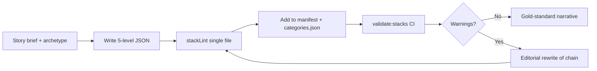

<!-- Generated by SpecStory, Markdown v2.1.0 -->

# 2026-05-30 17:18:14Z

<!-- Cursor IDE Session 39dd5553-5511-4bed-b4e3-658d7fb6cde3 (2026-05-30 17:18:14Z) -->

_**User**_

where are we in the process of making questions and answers according to docvumentation.

---

_**Agent (default)**_

I'll look through the project docs and codebase to see how Q&A creation is defined and what's already done.


_**Agent (default)**_

<tool-use data-tool-type="search" data-tool-name="glob_file_search">
<details>
<summary>Tool use: **glob_file_search** • Searched codebase "" • **43** results in **1** directory</summary>

Directory: **** (43 files)

| File |
|------|
| `./docs/README.md` |
| `./stacking-trivia-go-deep/ARCHITECTURE.md` |
| `./stacking-trivia-go-deep/docs/NARRATIVE_STACK_DESIGN.md` |
| `./README.md` |
| `./stacking-trivia-go-deep/BEST_PRACTICES.md` |
| `./BEST_PRACTICES.md` |
| `./stacking-trivia-go-deep/README.md` |
| `./CONTENT_STRATEGY.md` |
| `./docs/archive/README.md` |
| `./DEEP_DIVE_QUALITY_FRAMEWORK.md` |
| `./stacking-trivia-go-deep/docs/STACK_AUTHORING.md` |
| `./stacking-trivia-go-deep/CONTENT_STRATEGY.md` |
| `./stacking-trivia-go-deep/docs/GOLD_STANDARD_STACK.md` |
| `./.specstory/history/2025-08-11_20-16-31Z-achieve-full-app-purpose-realization.md` |
| `./docs/archive/app/CONTENT_STRATEGY.md` |
| `./docs/archive/CONTENT_STRATEGY.md` |
| `./docs/archive/DEEP_DIVE_QUALITY_FRAMEWORK.md` |
| `./.specstory/history/2025-08-08_17-17-43Z-scan-entire-project-for-errors-i-need-a-package-j.md` |
| `./docs/archive/app/FAMILY_LAUNCH_MESSAGES.md` |
| `./docs/archive/app/PWA_EXPLANATION.md` |
| `./docs/archive/app/FAMILY_COLLECTION_COMPLETE.md` |
| `./docs/archive/app/FAMILY_PROGRESS_REPORT.md` |
| `./docs/archive/STACK_UPGRADE_PLAN.md` |
| `./docs/archive/AUTONOMOUS_GENERATION_STATUS.md` |
| `./docs/archive/ACCURACY_ROADMAP.md` |
| `./docs/archive/NEBRASKA_STACK_SETUP.md` |
| `./docs/archive/app/ENHANCED_ROUTING_AUDIT.md` |
| `./docs/archive/ROUTING_AUDIT.md` |
| `./stacking-trivia-go-deep/HEROKU_QUICK_DEPLOY.md` |
| `./docs/archive/vision-board.md` |
| `./docs/archive/app/REFACTOR_SUMMARY.md` |
| `./stacking-trivia-go-deep/HEROKU_SETUP.md` |
| `./docs/archive/app/PHASE_8_SUMMARY.md` |
| `./docs/archive/app/DEPLOYMENT_STATUS.md` |
| `./docs/archive/app/PHASE_9A_COMPLETE.md` |
| `./stacking-trivia-go-deep/AUTH_README.md` |
| `./docs/archive/SOCIAL_MEDIA_POSTS.md` |
| `./docs/archive/ROADMAP.md` |
| `./docs/archive/SNEAKY_DEEP_ARCHITECTURE.md` |
| `./docs/archive/ROADMAP_VISUAL.md` |
| `./docs/archive/ART_CREATION_GUIDE.md` |
| `./docs/archive/GILLIAM_ART_PLAN.md` |
| `./docs/archive/MONETIZATION_PLAN.md` |

</details>
</tool-use>

<tool-use data-tool-type="search" data-tool-name="glob_file_search"><details>
<summary>Tool use: **glob_file_search**</summary>

</details></tool-use>

_**Agent (default)**_

<tool-use data-tool-type="unknown" data-tool-name="semantic_search_full">
<details>
<summary>Tool use: **semantic_search_full**</summary>


Parameters:

```json
{
  "explanation": "",
  "query": "Where is the process for making questions and answers documented?",
  "topK": 10
}
```
Result:

```json
{
  "codeResults": [
    {
      "codeBlock": {
        "detailedLines": [
          {
            "lineNumber": 1,
            "text": "# Stack Authoring Guide"
          },
          {
            "lineNumber": 2
          },
          {
            "lineNumber": 3,
            "text": "How to create and maintain DeepStack trivia content. See also the [documentation index](../../docs/README.md) at the repo root."
          },
          {
            "lineNumber": 4
          },
          {
            "lineNumber": 5,
            "text": "## Quick start"
          },
          {
            "lineNumber": 6
          },
          {
            "lineNumber": 7,
            "text": "1. Read [NARRATIVE_STACK_DESIGN.md](./NARRATIVE_STACK_DESIGN.md) for story archetypes and the story-brief template."
          },
          {
            "lineNumber": 8,
            "text": "2. Read [GOLD_STANDARD_STACK.md](./GOLD_STANDARD_STACK.md) for the 5-level schema and rules."
          },
          {
            "lineNumber": 9,
            "text": "3. Copy &#96;src/data/stacks/van-gogh.json&#96; (artifact chain) or a pilot stack (Serena, Queso Wars, Prefontaine) as your template."
          },
          {
            "lineNumber": 10,
            "text": "4. Lint before commit:"
          },
          {
            "lineNumber": 11
          },
          {
            "lineNumber": 12,
            "text": "&#96;&#96;&#96;bash"
          },
          {
            "lineNumber": 13,
            "text": "node tools/stackLint.js src/data/stacks/your-stack.json"
          },
          {
            "lineNumber": 14,
            "text": "&#96;&#96;&#96;"
          },
          {
            "lineNumber": 15
          },
          {
            "lineNumber": 16,
            "text": "5. Validate all playable stacks:"
          },
          {
            "lineNumber": 17
          },
          {
            "lineNumber": 18,
            "text": "&#96;&#96;&#96;bash"
          },
          {
            "lineNumber": 19,
            "text": "npm run validate:stacks"
          },
          {
            "lineNumber": 20,
            "text": "&#96;&#96;&#96;"
          },
          {
            "lineNumber": 21
          },
          {
            "lineNumber": 22,
            "text": "## Schema"
          },
          {
            "lineNumber": 23
          },
          {
            "lineNumber": 24,
            "text": "Every question must include:"
          },
          {
            "lineNumber": 25
          },
          {
            "lineNumber": 26,
            "text": "| Field | Required | Notes |"
          },
          {
            "lineNumber": 27,
            "text": "|-------|----------|-------|"
          },
          {
            "lineNumber": 28,
            "text": "| &#96;level&#96; | Yes | 1–5, monotonic |"
          },
          {
            "lineNumber": 29,
            "text": "| &#96;question&#96; | Yes | Should reference prior answer's entity |"
          },
          {
            "lineNumber": 30,
            "text": "| &#96;answer&#96; | Yes | ≤ 50 characters, typeable |"
          },
          {
            "lineNumber": 31,
            "text": "| &#96;acceptedAnswers&#96; | Yes | ≥ 3 variants, include typos and number formats |"
          },
          {
            "lineNumber": 32,
            "text": "| &#96;hint&#96; | No | Shown on request |"
          },
          {
            "lineNumber": 33,
            "text": "| &#96;explanation&#96; | No | Shown after a correct answer |"
          },
          {
            "lineNumber": 34
          },
          {
            "lineNumber": 35,
            "text": "## Narrative chain rules"
          },
          {
            "lineNumber": 36
          },
          {
            "lineNumber": 37,
            "text": "- **Pick one spine** before writing (see [NARRATIVE_STACK_DESIGN.md](./NARRATIVE_STACK_DESIGN.md))."
          },
          {
            "lineNumber": 38,
            "text": "- **Level 1**: Opens the story—not the most famous résumé fact."
          },
          {
            "lineNumber": 39,
            "text": "- **Levels 2–5**: Each question narrows using the previous answer; add &#96;explanation&#96; for the reveal."
          },
          {
            "lineNumber": 40,
            "text": "- Do not jump topics mid-stack (no \"another artist\" or \"switching to\")."
          },
          {
            "lineNumber": 41,
            "text": "- Do not accept contradictory answers (e.g. two different buyers)."
          },
          {
            "lineNumber": 42
          },
          {
            "lineNumber": 43,
            "text": "## Descriptions must not spoil answers"
          },
          {
            "lineNumber": 44
          },
          {
            "lineNumber": 45,
            "text": "The &#96;description&#96; and &#96;imageHint&#96; are visible **before** the first question. Do not use “From X to Y” teasers where X or Y are answers. Hook the topic without naming facts players should discover."
          },
          {
            "lineNumber": 46
          },
          {
            "lineNumber": 47,
            "text": "Bad: &#96;From 23 majors to Venus—five steps through the GOAT's career&#96;  "
          },
          {
            "lineNumber": 48,
            "text": "Good: &#96;Grand slam greatness, family, and life beyond the court—five tennis depths.&#96;"
          },
          {
            "lineNumber": 49
          },
          {
            "lineNumber": 50,
            "text": "## Answer realism"
          },
          {
            "lineNumber": 51
          },
          {
            "lineNumber": 52,
            "text": "- Prefer facts verifiable in reputable sources."
          },
          {
            "lineNumber": 53,
            "text": "- Keep canonical answers short; put context in &#96;explanation&#96;."
          },
          {
            "lineNumber": 54,
            "text": "- Include common misspellings in &#96;acceptedAnswers&#96; rather than loosening global fuzzy rules."
          }
        ],
        "range": {
          "endPosition": {
            "line": 54
          },
          "startPosition": {}
        },
        "relativeWorkspacePath": "./stacking-trivia-go-deep/docs/STACK_AUTHORING.md",
        "signatures": {}
      },
      "score": 0.4727112054824829
    },
    {
      "codeBlock": {
        "detailedLines": [
          {
            "lineNumber": 1,
            "text": "# AUTONOMOUS TRIVIA GENERATION FRAMEWORK"
          },
          {
            "lineNumber": 2
          },
          {
            "lineNumber": 3,
            "text": "## 🎯 **DIRECT ANSWERS TO YOUR QUESTIONS**"
          },
          {
            "lineNumber": 4
          },
          {
            "lineNumber": 5,
            "text": "### Q1: **Quality Analysis Results (All Stacks)**"
          },
          {
            "lineNumber": 6,
            "text": "- **Nebraska Ultimate**: 85/100 (VERY GOOD) - Only production-ready stack"
          },
          {
            "lineNumber": 7,
            "text": "- **All Others**: 5-25/100 (POOR) - Empty answers, no explanations, basic level only"
          },
          {
            "lineNumber": 8,
            "text": "- **Critical Finding**: 7 out of 8 stacks are placeholder content requiring complete rebuild"
          },
          {
            "lineNumber": 9
          },
          {
            "lineNumber": 10,
            "text": "### Q2: **100% Accuracy Assurance Strategy**"
          },
          {
            "lineNumber": 11,
            "text": "&#96;&#96;&#96;"
          },
          {
            "lineNumber": 12,
            "text": "🔍 MULTI-TIER VERIFICATION SYSTEM:"
          },
          {
            "lineNumber": 13,
            "text": "├── Tier 1: Official Records (Government, Academic, Professional orgs) "
          },
          {
            "lineNumber": 14,
            "text": "├── Tier 2: Authoritative Sources (Encyclopedia, Museums, Educational)"
          },
          {
            "lineNumber": 15,
            "text": "├── Tier 3: Verified Secondary (Wikipedia + cross-reference)"
          },
          {
            "lineNumber": 16,
            "text": "└── Tier 4: General Sources (Not acceptable for publication)"
          },
          {
            "lineNumber": 17
          },
          {
            "lineNumber": 18,
            "text": "📊 CONFIDENCE REQUIREMENTS BY LEVEL:"
          },
          {
            "lineNumber": 19,
            "text": "├── Foundation (1-10): 80%+ confidence, Wikipedia acceptable"
          },
          {
            "lineNumber": 20,
            "text": "├── Context (11-20): 85%+ confidence, 2+ sources required  "
          },
          {
            "lineNumber": 21,
            "text": "├── Insider (21-30): 90%+ confidence, Primary sources needed"
          },
          {
            "lineNumber": 22,
            "text": "└── Expert (31+): 95%+ confidence, Official records mandatory"
          },
          {
            "lineNumber": 23,
            "text": "&#96;&#96;&#96;"
          },
          {
            "lineNumber": 24
          },
          {
            "lineNumber": 25,
            "text": "### Q3: **Autonomous Generation Proximity** "
          },
          {
            "lineNumber": 26,
            "text": "**We are 70% there** - Here's the roadmap:"
          },
          {
            "lineNumber": 27
          },
          {
            "lineNumber": 28,
            "text": "## 🚀 **3-PHASE AUTONOMOUS ROADMAP**"
          },
          {
            "lineNumber": 29
          },
          {
            "lineNumber": 30,
            "text": "### **PHASE 1: Semi-Autonomous (2 weeks)**"
          },
          {
            "lineNumber": 31,
            "text": "&#96;&#96;&#96;javascript"
          },
          {
            "lineNumber": 32,
            "text": "Current Status: ✅ FRAMEWORK READY"
          },
          {
            "lineNumber": 33,
            "text": "├── ✅ Quality scoring system (85/100 benchmark set)"
          },
          {
            "lineNumber": 34,
            "text": "├── ✅ Depth progression templates (4-tier system)  "
          },
          {
            "lineNumber": 35,
            "text": "├── ✅ Automated fact-checking engine (prototype ready)"
          },
          {
            "lineNumber": 36,
            "text": "└── 🔄 Source verification APIs (in development)"
          },
          {
            "lineNumber": 37
          },
          {
            "lineNumber": 38,
            "text": "Next: AI-assisted generation with human review"
          },
          {
            "lineNumber": 39,
            "text": "&#96;&#96;&#96;"
          },
          {
            "lineNumber": 40
          },
          {
            "lineNumber": 41,
            "text": "### **PHASE 2: Guided Autonomous (1-2 months)**"
          },
          {
            "lineNumber": 42,
            "text": "&#96;&#96;&#96;javascript"
          },
          {
            "lineNumber": 43,
            "text": "├── 🔄 AI generates questions using proven templates"
          },
          {
            "lineNumber": 44,
            "text": "├── 🔄 Real-time multi-source fact verification  "
          },
          {
            "lineNumber": 45,
            "text": "├── 🔄 Automatic quality scoring before publication"
          },
          {
            "lineNumber": 46,
            "text": "└── 🔄 Human review only for \u003c95% confidence scores"
          },
          {
            "lineNumber": 47,
            "text": "&#96;&#96;&#96;"
          },
          {
            "lineNumber": 48
          },
          {
            "lineNumber": 49,
            "text": "### **PHASE 3: Full Autonomous (3-6 months)**"
          },
          {
            "lineNumber": 50,
            "text": "&#96;&#96;&#96;javascript  "
          },
          {
            "lineNumber": 51,
            "text": "├── 🔄 Fully AI-generated stacks with minimal oversight"
          },
          {
            "lineNumber": 52,
            "text": "├── 🔄 Real-time accuracy validation via external APIs"
          }
        ],
        "range": {
          "endPosition": {
            "line": 52
          },
          "startPosition": {}
        },
        "relativeWorkspacePath": "./docs/archive/AUTONOMOUS_GENERATION_STATUS.md",
        "signatures": {}
      },
      "score": 0.42519283294677734
    },
    {
      "codeBlock": {
        "detailedLines": [
          {
            "lineNumber": 1,
            "text": "# Gold Standard Stack"
          },
          {
            "lineNumber": 2
          },
          {
            "lineNumber": 3,
            "text": "Every playable DeepStack must follow this 5-level **story-unlock** model. The canonical example is **Vincent van Gogh** (&#96;src/data/stacks/van-gogh.json&#96;)."
          },
          {
            "lineNumber": 4
          },
          {
            "lineNumber": 5,
            "text": "For archetypes (biography chapter, origin dispute, rebel arc), story briefs, and pilot stacks, see **[NARRATIVE_STACK_DESIGN.md](./NARRATIVE_STACK_DESIGN.md)**."
          },
          {
            "lineNumber": 6
          },
          {
            "lineNumber": 7,
            "text": "## The model"
          },
          {
            "lineNumber": 8
          },
          {
            "lineNumber": 9,
            "text": "Each stack is **one micro-narrative** that unfolds in five beats. Each question must build on the **previous answer**—not just the same topic."
          },
          {
            "lineNumber": 10
          },
          {
            "lineNumber": 11,
            "text": "| Level | Purpose | Question style | Answer style |"
          },
          {
            "lineNumber": 12,
            "text": "|-------|---------|----------------|--------------|"
          },
          {
            "lineNumber": 13,
            "text": "| 1 | Recognition | Who/what is this? | 1–3 words, widely known |"
          },
          {
            "lineNumber": 14,
            "text": "| 2 | Context | Count, era, role tied to L1 | Short, factual |"
          },
          {
            "lineNumber": 15,
            "text": "| 3 | Specific | Named work/event/person from L2 | Proper noun |"
          },
          {
            "lineNumber": 16,
            "text": "| 4 | Insider | Who/where/when detail from L3 | Realistic proper noun |"
          },
          {
            "lineNumber": 17,
            "text": "| 5 | Expert | Precise number/date/term from L4 | Verifiable, narrow |"
          },
          {
            "lineNumber": 18
          },
          {
            "lineNumber": 19,
            "text": "## Canonical example (Van Gogh)"
          },
          {
            "lineNumber": 20
          },
          {
            "lineNumber": 21,
            "text": "&#96;&#96;&#96;"
          },
          {
            "lineNumber": 22,
            "text": "L1: Who painted 'The Starry Night'?           → Vincent van Gogh"
          },
          {
            "lineNumber": 23,
            "text": "L2: How many paintings did van Gogh sell?     → One"
          },
          {
            "lineNumber": 24,
            "text": "L3: Title of the only painting sold alive?    → The Red Vineyard"
          },
          {
            "lineNumber": 25,
            "text": "L4: Who bought 'The Red Vineyard'?            → Anna Boch"
          },
          {
            "lineNumber": 26,
            "text": "L5: How much did Anna Boch pay in 1890?       → 400 francs"
          },
          {
            "lineNumber": 27,
            "text": "&#96;&#96;&#96;"
          },
          {
            "lineNumber": 28
          },
          {
            "lineNumber": 29,
            "text": "Each level references the prior answer's entity (van Gogh → one sale → Red Vineyard → Anna Boch → 400 francs)."
          },
          {
            "lineNumber": 30
          },
          {
            "lineNumber": 31,
            "text": "## Required JSON schema"
          },
          {
            "lineNumber": 32
          },
          {
            "lineNumber": 33,
            "text": "&#96;&#96;&#96;json"
          },
          {
            "lineNumber": 34,
            "text": "{"
          },
          {
            "lineNumber": 35,
            "text": "  \"title\": \"Stack Title\","
          },
          {
            "lineNumber": 36,
            "text": "  \"description\": \"One-line narrative hook\","
          },
          {
            "lineNumber": 37,
            "text": "  \"questions\": ["
          },
          {
            "lineNumber": 38,
            "text": "    {"
          },
          {
            "lineNumber": 39,
            "text": "      \"level\": 1,"
          },
          {
            "lineNumber": 40,
            "text": "      \"question\": \"Question text\","
          },
          {
            "lineNumber": 41,
            "text": "      \"answer\": \"Canonical display answer\","
          },
          {
            "lineNumber": 42,
            "text": "      \"acceptedAnswers\": [\"variant1\", \"variant2\"],"
          },
          {
            "lineNumber": 43,
            "text": "      \"hint\": \"optional\","
          },
          {
            "lineNumber": 44,
            "text": "      \"explanation\": \"optional, shown after correct\""
          },
          {
            "lineNumber": 45,
            "text": "    }"
          },
          {
            "lineNumber": 46,
            "text": "  ],"
          },
          {
            "lineNumber": 47,
            "text": "  \"deeperMode\": {"
          },
          {
            "lineNumber": 48,
            "text": "    \"title\": \"optional bonus round\","
          },
          {
            "lineNumber": 49,
            "text": "    \"questions\": []"
          },
          {
            "lineNumber": 50,
            "text": "  }"
          },
          {
            "lineNumber": 51,
            "text": "}"
          },
          {
            "lineNumber": 52,
            "text": "&#96;&#96;&#96;"
          },
          {
            "lineNumber": 53
          },
          {
            "lineNumber": 54,
            "text": "## Rules"
          },
          {
            "lineNumber": 55
          },
          {
            "lineNumber": 56,
            "text": "1. **Exactly 5 questions** with &#96;level&#96; 1–5 (monotonic)."
          },
          {
            "lineNumber": 57,
            "text": "2. **Narrative chain**: Q(n) should reference a word from Q(n-1)'s answer (heuristic: answer token length \u003e 3 appears in next question)."
          },
          {
            "lineNumber": 58,
            "text": "3. **Typeable answers**: canonical &#96;answer&#96; ≤ 50 characters; long context goes in &#96;explanation&#96;."
          }
        ],
        "range": {
          "endPosition": {
            "line": 58
          },
          "startPosition": {}
        },
        "relativeWorkspacePath": "./stacking-trivia-go-deep/docs/GOLD_STANDARD_STACK.md",
        "signatures": {}
      },
      "score": 0.4026365876197815
    },
    {
      "codeBlock": {
        "detailedLines": [
          {
            "lineNumber": 1,
            "text": "# Narrative Stack Design"
          },
          {
            "lineNumber": 2
          },
          {
            "lineNumber": 3,
            "text": "**The product is the story.** Each playable stack is one micro-narrative that unlocks in five beats—not five harder facts about a topic."
          },
          {
            "lineNumber": 4
          },
          {
            "lineNumber": 5,
            "text": "Players should feel: *I didn't know that → and that leads here → and now it all clicks.*"
          },
          {
            "lineNumber": 6
          },
          {
            "lineNumber": 7,
            "text": "---"
          },
          {
            "lineNumber": 8
          },
          {
            "lineNumber": 9,
            "text": "## Story archetypes"
          },
          {
            "lineNumber": 10
          },
          {
            "lineNumber": 11,
            "text": "Use these alongside the level table in [GOLD_STANDARD_STACK.md](./GOLD_STANDARD_STACK.md)."
          },
          {
            "lineNumber": 12
          },
          {
            "lineNumber": 13,
            "text": "| Archetype | Spine | L1 should feel like… | Examples in repo |"
          },
          {
            "lineNumber": 14,
            "text": "|-----------|--------|----------------------|------------------|"
          },
          {
            "lineNumber": 15,
            "text": "| **Artifact chain** | One object/record narrows step by step | \"Who made this famous work?\" | Van Gogh (sale → painting → buyer → price) |"
          },
          {
            "lineNumber": 16,
            "text": "| **Biography chapter** | One chapter of a life, not a résumé | \"What happened in this moment?\" | Serena (secret pregnancy → Olympia) |"
          },
          {
            "lineNumber": 17,
            "text": "| **Origin dispute** | Two claims, evidence narrows | \"What are they fighting over?\" | Queso Wars (TX vs AR) |"
          },
          {
            "lineNumber": 18,
            "text": "| **Rebel arc** | Rise → system clash → legacy | \"Who shook the establishment?\" | Prefontaine (Hayward → Nike → MGB → Classic) |"
          },
          {
            "lineNumber": 19
          },
          {
            "lineNumber": 20,
            "text": "Categories are **shelves** (Sports, Actually, History). The stack is **one tale**."
          },
          {
            "lineNumber": 21
          },
          {
            "lineNumber": 22,
            "text": "---"
          },
          {
            "lineNumber": 23
          },
          {
            "lineNumber": 24,
            "text": "## Story brief (authoring template)"
          },
          {
            "lineNumber": 25
          },
          {
            "lineNumber": 26,
            "text": "Before writing JSON, fill this in (keep in your notes or optional &#96;storySpine&#96; metadata):"
          },
          {
            "lineNumber": 27
          },
          {
            "lineNumber": 28,
            "text": "&#96;&#96;&#96;"
          },
          {
            "lineNumber": 29,
            "text": "Title hook:     (player-facing title)"
          },
          {
            "lineNumber": 30,
            "text": "Spine:          (one sentence: what unfolds in 5 beats)"
          },
          {
            "lineNumber": 31,
            "text": "Turn:           (emotional or factual surprise by L5)"
          },
          {
            "lineNumber": 32,
            "text": "L1 must NOT assume:  (answers from L3–L5)"
          },
          {
            "lineNumber": 33,
            "text": "Forbidden in description / imageHint:  (any answer tokens)"
          },
          {
            "lineNumber": 34,
            "text": "&#96;&#96;&#96;"
          },
          {
            "lineNumber": 35
          },
          {
            "lineNumber": 36,
            "text": "**Bad spine:** \"Five Serena facts\" (majors → US Open → Venus → …)  "
          },
          {
            "lineNumber": 37,
            "text": "**Good spine:** \"She won a major while pregnant—how the secret became Olympia\""
          },
          {
            "lineNumber": 38
          },
          {
            "lineNumber": 39,
            "text": "---"
          },
          {
            "lineNumber": 40
          },
          {
            "lineNumber": 41,
            "text": "## Unlock chain rules"
          },
          {
            "lineNumber": 42
          },
          {
            "lineNumber": 43,
            "text": "1. **L1 sets the story**, not the most famous number on Wikipedia."
          },
          {
            "lineNumber": 44,
            "text": "2. **Each question uses the previous answer** as a door (name it in the question text when natural)."
          },
          {
            "lineNumber": 45,
            "text": "3. **&#96;explanation&#96;** carries context; **&#96;answer&#96;** stays short and typeable."
          },
          {
            "lineNumber": 46,
            "text": "4. **Descriptions and &#96;imageHint&#96;** are visible before Q1—no spoilers (enforced by &#96;validate:stacks&#96;)."
          },
          {
            "lineNumber": 47,
            "text": "5. **Deeper Mode** is optional; use it for a *second* story (e.g. Serena career stats), not leftovers from the main spine."
          }
        ],
        "range": {
          "endPosition": {
            "line": 47
          },
          "startPosition": {}
        },
        "relativeWorkspacePath": "./stacking-trivia-go-deep/docs/NARRATIVE_STACK_DESIGN.md",
        "signatures": {}
      },
      "score": 0.3917416036128998
    },
    {
      "codeBlock": {
        "detailedLines": [
          {
            "lineNumber": 1,
            "text": "# DeepStack (Stacking Trivia: Go Deep)"
          },
          {
            "lineNumber": 2
          },
          {
            "lineNumber": 3,
            "text": "Bar- and group-friendly trivia where each round **unlocks one story** in **five linked questions**—not five random facts on a topic. Answer each level correctly to keep diving; scoring doubles per level (10 → 20 → 40 → 80 → 160). Wrong answer ends the run."
          },
          {
            "lineNumber": 4
          },
          {
            "lineNumber": 5,
            "text": "**Content strategy:** Stacks are hand-architected micro-narratives (Serena’s secret pregnancy, Texas–Arkansas queso feud, Prefontaine’s rebel arc). See [NARRATIVE_STACK_DESIGN.md](stacking-trivia-go-deep/docs/NARRATIVE_STACK_DESIGN.md)."
          },
          {
            "lineNumber": 6
          },
          {
            "lineNumber": 7,
            "text": "The shipped UI title is **Deeply Trivial**; the product name in docs is **DeepStack**."
          },
          {
            "lineNumber": 8
          },
          {
            "lineNumber": 9,
            "text": "---"
          },
          {
            "lineNumber": 10
          },
          {
            "lineNumber": 11,
            "text": "## Core loop (implemented)"
          },
          {
            "lineNumber": 12
          },
          {
            "lineNumber": 13,
            "text": "1. Choose a category and stack (45+ playable stacks in JSON)."
          },
          {
            "lineNumber": 14,
            "text": "2. Answer five linked questions — each level should build on the previous answer."
          },
          {
            "lineNumber": 15,
            "text": "3. Type your answer (fuzzy matching for typos); optional “Show answer choices” for MCQ hints."
          },
          {
            "lineNumber": 16,
            "text": "4. Optional **Deeper Mode** after a perfect run (where the stack defines bonus questions)."
          },
          {
            "lineNumber": 17,
            "text": "5. Host, projector, and bar modes exist for group play."
          },
          {
            "lineNumber": 18
          },
          {
            "lineNumber": 19,
            "text": "**Not required for every stack:** photo-first opening (&#96;photoFirst&#96; on select stacks only)."
          },
          {
            "lineNumber": 20
          },
          {
            "lineNumber": 21,
            "text": "**Auth:** **Play as Guest** works without an API (bundled JSON). Sign-in optional for cloud progress and leaderboards. Deep link: &#96;/play?stack=\u003ckey\u003e\u0026category=\u003ckey\u003e&#96;."
          },
          {
            "lineNumber": 22
          },
          {
            "lineNumber": 23,
            "text": "---"
          },
          {
            "lineNumber": 24
          },
          {
            "lineNumber": 25,
            "text": "## Canonical example: Van Gogh"
          },
          {
            "lineNumber": 26
          },
          {
            "lineNumber": 27,
            "text": "This is the gold-standard chain ([&#96;stacking-trivia-go-deep/src/data/stacks/van-gogh.json&#96;](stacking-trivia-go-deep/src/data/stacks/van-gogh.json)):"
          },
          {
            "lineNumber": 28
          },
          {
            "lineNumber": 29,
            "text": "| Level | Question | Answer |"
          },
          {
            "lineNumber": 30,
            "text": "|-------|----------|--------|"
          },
          {
            "lineNumber": 31,
            "text": "| 1 | Who painted *The Starry Night*? | Vincent van Gogh |"
          },
          {
            "lineNumber": 32,
            "text": "| 2 | How many paintings did van Gogh sell in his lifetime? | One |"
          },
          {
            "lineNumber": 33,
            "text": "| 3 | Title of the only painting sold while alive? | The Red Vineyard |"
          },
          {
            "lineNumber": 34,
            "text": "| 4 | Who bought *The Red Vineyard*? | Anna Boch |"
          },
          {
            "lineNumber": 35,
            "text": "| 5 | How much did Anna Boch pay in 1890? | 400 francs |"
          },
          {
            "lineNumber": 36
          },
          {
            "lineNumber": 37,
            "text": "Descriptions and image hints must **not** spoil answers (e.g. do not write “23 majors” in the blurb if Q1 asks for that count)."
          },
          {
            "lineNumber": 38
          },
          {
            "lineNumber": 39,
            "text": "---"
          },
          {
            "lineNumber": 40
          },
          {
            "lineNumber": 41,
            "text": "## Documentation"
          },
          {
            "lineNumber": 42
          },
          {
            "lineNumber": 43,
            "text": "| Doc | Path |"
          },
          {
            "lineNumber": 44,
            "text": "|-----|------|"
          }
        ],
        "range": {
          "endPosition": {
            "line": 44
          },
          "startPosition": {}
        },
        "relativeWorkspacePath": "./README.md",
        "signatures": {}
      },
      "score": 0.3818492889404297
    },
    {
      "codeBlock": {
        "detailedLines": [
          {
            "lineNumber": 1,
            "text": "# STACK QUALITY UPGRADE PLAN"
          },
          {
            "lineNumber": 2
          },
          {
            "lineNumber": 3,
            "text": "## 🎯 CURRENT SITUATION"
          },
          {
            "lineNumber": 4,
            "text": "- **Production Ready**: 1/14 stacks (Nebraska Ultimate - 85/100)"
          },
          {
            "lineNumber": 5,
            "text": "- **Complete Rebuild Needed**: 10/14 stacks (Empty answers, no explanations)"
          },
          {
            "lineNumber": 6,
            "text": "- **Moderate Issues**: 3/14 stacks (Running legends - need expansion to 20+ questions)"
          },
          {
            "lineNumber": 7
          },
          {
            "lineNumber": 8,
            "text": "## 📋 UPGRADE PRIORITY LIST"
          },
          {
            "lineNumber": 9
          },
          {
            "lineNumber": 10,
            "text": "### TIER 1: Quick Wins (Have some content, need expansion)"
          },
          {
            "lineNumber": 11,
            "text": "1. **Prefontaine** (34/100) → Target 85/100"
          },
          {
            "lineNumber": 12,
            "text": "2. **El Guerrouj** (35/100) → Target 85/100  "
          },
          {
            "lineNumber": 13,
            "text": "3. **Seb Coe** (35/100) → Target 85/100"
          },
          {
            "lineNumber": 14,
            "text": "4. **Billy Mills** (35/100) → Target 85/100"
          },
          {
            "lineNumber": 15
          },
          {
            "lineNumber": 16,
            "text": "### TIER 2: Complete Rebuilds (Empty content)"
          },
          {
            "lineNumber": 17,
            "text": "5. **The Beatles** (-10/100) → Target 85/100"
          },
          {
            "lineNumber": 18,
            "text": "6. **Blade Runner** (-10/100) → Target 85/100"
          },
          {
            "lineNumber": 19,
            "text": "7. **Ancient Greece** (-10/100) → Target 85/100"
          },
          {
            "lineNumber": 20,
            "text": "8. **Van Gogh** (-10/100) → Target 85/100"
          },
          {
            "lineNumber": 21
          },
          {
            "lineNumber": 22,
            "text": "### TIER 3: Basic Expansion Needed"
          },
          {
            "lineNumber": 23,
            "text": "9. **Olympic Distance Current** (5/100) → Target 85/100"
          },
          {
            "lineNumber": 24,
            "text": "10. **Olympic Distance 1980s** (5/100) → Target 85/100"
          },
          {
            "lineNumber": 25,
            "text": "11. **Nebraska Sports** (5/100) → Target 85/100 (or remove as duplicate)"
          },
          {
            "lineNumber": 26
          },
          {
            "lineNumber": 27,
            "text": "## 🎯 QUALITY STANDARDS FOR ALL STACKS"
          },
          {
            "lineNumber": 28,
            "text": "- **Minimum Questions**: 20 (preferably 25-35)"
          },
          {
            "lineNumber": 29,
            "text": "- **Depth Progression**: Foundation (1-10) → Context (11-20) → Insider (21+)"
          },
          {
            "lineNumber": 30,
            "text": "- **Explanations**: 90%+ questions must have detailed explanations"
          },
          {
            "lineNumber": 31,
            "text": "- **Alternative Answers**: 40%+ questions should accept multiple valid answers"
          },
          {
            "lineNumber": 32,
            "text": "- **Quality Score**: Minimum 85/100 for production"
          },
          {
            "lineNumber": 33
          },
          {
            "lineNumber": 34,
            "text": "## 🚀 UPGRADE STRATEGY"
          },
          {
            "lineNumber": 35,
            "text": "1. **Use Nebraska Ultimate as template** (proven 85/100 quality)"
          },
          {
            "lineNumber": 36,
            "text": "2. **Deep dive progression** - avoid breadth, focus on expertise levels"
          },
          {
            "lineNumber": 37,
            "text": "3. **Rich explanations** - educational value is key"
          },
          {
            "lineNumber": 38,
            "text": "4. **Multi-source fact verification** - accuracy first"
          },
          {
            "lineNumber": 39,
            "text": "5. **Alternative answer formats** - user-friendly acceptance"
          }
        ],
        "range": {
          "endPosition": {
            "line": 39
          },
          "startPosition": {}
        },
        "relativeWorkspacePath": "./docs/archive/STACK_UPGRADE_PLAN.md",
        "signatures": {}
      },
      "score": 0.3739732503890991
    },
    {
      "codeBlock": {
        "detailedLines": [
          {
            "lineNumber": 1,
            "text": "# DeepStack documentation"
          },
          {
            "lineNumber": 2
          },
          {
            "lineNumber": 3,
            "text": "## Authoritative (use these)"
          },
          {
            "lineNumber": 4
          },
          {
            "lineNumber": 5,
            "text": "| Document | Audience |"
          },
          {
            "lineNumber": 6,
            "text": "|----------|----------|"
          },
          {
            "lineNumber": 7,
            "text": "| [../README.md](../README.md) | Product vision, Van Gogh example, repo layout |"
          },
          {
            "lineNumber": 8,
            "text": "| [../stacking-trivia-go-deep/README.md](../stacking-trivia-go-deep/README.md) | Install, scripts, deploy |"
          },
          {
            "lineNumber": 9,
            "text": "| [../stacking-trivia-go-deep/docs/NARRATIVE_STACK_DESIGN.md](../stacking-trivia-go-deep/docs/NARRATIVE_STACK_DESIGN.md) | **Story-unlock strategy** (archetypes, briefs, pilots) |"
          },
          {
            "lineNumber": 10,
            "text": "| [../stacking-trivia-go-deep/docs/GOLD_STANDARD_STACK.md](../stacking-trivia-go-deep/docs/GOLD_STANDARD_STACK.md) | **Content contract** (5 levels, schema, validation) |"
          },
          {
            "lineNumber": 11,
            "text": "| [../stacking-trivia-go-deep/docs/STACK_AUTHORING.md](../stacking-trivia-go-deep/docs/STACK_AUTHORING.md) | How to write stacks + &#96;validate:stacks&#96; |"
          },
          {
            "lineNumber": 12,
            "text": "| [../stacking-trivia-go-deep/ARCHITECTURE.md](../stacking-trivia-go-deep/ARCHITECTURE.md) | Code layout and runtime flow |"
          },
          {
            "lineNumber": 13,
            "text": "| [../BEST_PRACTICES.md](../BEST_PRACTICES.md) | Engineering standards |"
          },
          {
            "lineNumber": 14
          },
          {
            "lineNumber": 15,
            "text": "## CI"
          },
          {
            "lineNumber": 16
          },
          {
            "lineNumber": 17,
            "text": "From &#96;stacking-trivia-go-deep/&#96;:"
          },
          {
            "lineNumber": 18
          },
          {
            "lineNumber": 19,
            "text": "&#96;&#96;&#96;bash"
          },
          {
            "lineNumber": 20,
            "text": "npm run ci   # lint:quality + validate:stacks + test + build"
          },
          {
            "lineNumber": 21,
            "text": "&#96;&#96;&#96;"
          },
          {
            "lineNumber": 22
          },
          {
            "lineNumber": 23,
            "text": "GitHub Actions: [&#96;.github/workflows/ci.yml&#96;](../.github/workflows/ci.yml)"
          },
          {
            "lineNumber": 24
          },
          {
            "lineNumber": 25,
            "text": "## Archived"
          },
          {
            "lineNumber": 26
          },
          {
            "lineNumber": 27,
            "text": "Historical plans and superseded frameworks: [archive/README.md](archive/README.md)"
          },
          {
            "lineNumber": 28
          },
          {
            "lineNumber": 29,
            "text": "Stub pointers at old paths (&#96;CONTENT_STRATEGY.md&#96;, &#96;DEEP_DIVE_QUALITY_FRAMEWORK.md&#96;) redirect here."
          }
        ],
        "range": {
          "endPosition": {
            "line": 29
          },
          "startPosition": {}
        },
        "relativeWorkspacePath": "./docs/README.md",
        "signatures": {}
      },
      "score": 0.3716520071029663
    },
    {
      "codeBlock": {
        "detailedLines": [
          {
            "lineNumber": 46,
            "text": "### **Levels 16-25: Insider Layer**"
          },
          {
            "lineNumber": 47,
            "text": "- **Purpose**: Details only true fans/experts would know"
          },
          {
            "lineNumber": 48,
            "text": "- **Style**: Nuanced questions requiring deep knowledge"
          },
          {
            "lineNumber": 49,
            "text": "- **Example Path** (Nebraska Sports):"
          },
          {
            "lineNumber": 50,
            "text": "  16. Assistant coach names → 17. Specific game moments → 18. Player nicknames → 19. Locker room traditions → 20. Recruitment stories"
          },
          {
            "lineNumber": 51
          },
          {
            "lineNumber": 52,
            "text": "### **Levels 26-35: Expert Layer**"
          },
          {
            "lineNumber": 53,
            "text": "- **Purpose**: Obscure facts that demonstrate mastery"
          },
          {
            "lineNumber": 54,
            "text": "- **Style**: Trivia that even experts might struggle with"
          },
          {
            "lineNumber": 55,
            "text": "- **Example Path** (Nebraska Sports):"
          },
          {
            "lineNumber": 56,
            "text": "  26. Equipment manager details → 27. Stadium construction facts → 28. Minor record holders → 29. Off-season activities → 30. Behind-the-scenes stories"
          },
          {
            "lineNumber": 57
          },
          {
            "lineNumber": 58,
            "text": "---"
          },
          {
            "lineNumber": 59
          },
          {
            "lineNumber": 60,
            "text": "## 🔍 **Quality Assurance Checklist**"
          },
          {
            "lineNumber": 61
          },
          {
            "lineNumber": 62,
            "text": "### **Before Creating Questions:**"
          },
          {
            "lineNumber": 63,
            "text": "- [ ] **Single Focus**: Does this stack focus on ONE specific topic/person/event?"
          },
          {
            "lineNumber": 64,
            "text": "- [ ] **Narrative Arc**: Do questions tell a deeper story together?"
          },
          {
            "lineNumber": 65,
            "text": "- [ ] **No Topic Jumping**: Am I staying within the same subject area?"
          },
          {
            "lineNumber": 66
          },
          {
            "lineNumber": 67,
            "text": "### **During Question Creation:**"
          },
          {
            "lineNumber": 68,
            "text": "- [ ] **Dependency Check**: Does each question build on previous knowledge?"
          },
          {
            "lineNumber": 69,
            "text": "- [ ] **Depth Escalation**: Does each level require more specialized knowledge?"
          },
          {
            "lineNumber": 70,
            "text": "- [ ] **Context Expansion**: Do later questions add \"why\" and \"how\" to earlier \"what\"?"
          },
          {
            "lineNumber": 71
          },
          {
            "lineNumber": 72,
            "text": "### **After Question Creation:**"
          },
          {
            "lineNumber": 73,
            "text": "- [ ] **Expert Review**: Would a subject expert find the progression logical?"
          },
          {
            "lineNumber": 74,
            "text": "- [ ] **Casual Test**: Would a casual fan learn something new at each level?"
          },
          {
            "lineNumber": 75,
            "text": "- [ ] **Connection Test**: Do questions connect to each other rather than stand alone?"
          },
          {
            "lineNumber": 76
          },
          {
            "lineNumber": 77,
            "text": "---"
          },
          {
            "lineNumber": 78
          },
          {
            "lineNumber": 79,
            "text": "## 📋 **Question Type Evolution**"
          },
          {
            "lineNumber": 80
          },
          {
            "lineNumber": 81,
            "text": "### **Early Questions (1-10):**"
          },
          {
            "lineNumber": 82,
            "text": "- **Format**: \"What is...?\" \"Who was...?\" \"When did...?\""
          },
          {
            "lineNumber": 83,
            "text": "- **Knowledge Level**: Public facts, basic recognition"
          },
          {
            "lineNumber": 84,
            "text": "- **Example**: \"What stadium do the Cornhuskers play in?\""
          },
          {
            "lineNumber": 85
          },
          {
            "lineNumber": 86,
            "text": "### **Middle Questions (11-20):**"
          },
          {
            "lineNumber": 87,
            "text": "- **Format**: \"Why did...?\" \"How did...?\" \"What caused...?\""
          },
          {
            "lineNumber": 88,
            "text": "- **Knowledge Level**: Understanding relationships and context"
          },
          {
            "lineNumber": 89,
            "text": "- **Example**: \"Why did Nebraska leave the Big 12 for the Big Ten?\""
          }
        ],
        "range": {
          "endPosition": {
            "line": 90
          },
          "startPosition": {
            "line": 44
          }
        },
        "relativeWorkspacePath": "./docs/archive/DEEP_DIVE_QUALITY_FRAMEWORK.md",
        "signatures": {}
      },
      "score": 0.3714173138141632
    },
    {
      "codeBlock": {
        "detailedLines": [
          {
            "lineNumber": 1,
            "text": "# ACCURACY ASSURANCE \u0026 AUTONOMOUS GENERATION ROADMAP"
          },
          {
            "lineNumber": 2
          },
          {
            "lineNumber": 3,
            "text": "## 🎯 CURRENT STATE ANALYSIS"
          },
          {
            "lineNumber": 4
          },
          {
            "lineNumber": 5,
            "text": "### Quality Audit Results:"
          },
          {
            "lineNumber": 6,
            "text": "- **Nebraska Ultimate**: 85/100 ✅ (Production ready)"
          },
          {
            "lineNumber": 7,
            "text": "- **All Other Stacks**: 5-25/100 ❌ (Placeholder/incomplete content)"
          },
          {
            "lineNumber": 8
          },
          {
            "lineNumber": 9,
            "text": "### Critical Finding:"
          },
          {
            "lineNumber": 10,
            "text": "Only 1 out of 8 stacks meets production quality standards. Most are placeholder files with empty answers."
          },
          {
            "lineNumber": 11
          },
          {
            "lineNumber": 12,
            "text": "## 🔍 ACCURACY ASSURANCE FRAMEWORK"
          },
          {
            "lineNumber": 13
          },
          {
            "lineNumber": 14,
            "text": "### 1. IMMEDIATE ACCURACY PROTOCOLS"
          },
          {
            "lineNumber": 15
          },
          {
            "lineNumber": 16,
            "text": "&#96;&#96;&#96;javascript"
          },
          {
            "lineNumber": 17,
            "text": "// Multi-source Verification System"
          },
          {
            "lineNumber": 18,
            "text": "const accuracyChecks = {"
          },
          {
            "lineNumber": 19,
            "text": "    // Source Requirements"
          },
          {
            "lineNumber": 20,
            "text": "    minimumSources: 3,"
          },
          {
            "lineNumber": 21,
            "text": "    primarySources: ['Official records', 'Academic papers', 'Museum databases'],"
          },
          {
            "lineNumber": 22,
            "text": "    secondarySources: ['Wikipedia', 'Encyclopedia Britannica', 'Reputable news'],"
          },
          {
            "lineNumber": 23,
            "text": "    "
          },
          {
            "lineNumber": 24,
            "text": "    // Data Validation"
          },
          {
            "lineNumber": 25,
            "text": "    numericData: 'Cross-reference with official statistics',"
          },
          {
            "lineNumber": 26,
            "text": "    dates: 'Verify against historical records',"
          },
          {
            "lineNumber": 27,
            "text": "    names: 'Check spelling with authoritative sources',"
          },
          {
            "lineNumber": 28,
            "text": "    achievements: 'Confirm with official organizations'"
          },
          {
            "lineNumber": 29,
            "text": "};"
          },
          {
            "lineNumber": 30,
            "text": "&#96;&#96;&#96;"
          },
          {
            "lineNumber": 31
          },
          {
            "lineNumber": 32,
            "text": "### 2. AUTOMATED FACT-CHECKING PIPELINE"
          },
          {
            "lineNumber": 33
          },
          {
            "lineNumber": 34,
            "text": "&#96;&#96;&#96;javascript"
          },
          {
            "lineNumber": 35,
            "text": "// Quality Gates Before Publication"
          },
          {
            "lineNumber": 36,
            "text": "const qualityGates = ["
          },
          {
            "lineNumber": 37,
            "text": "    'Source citation check',"
          },
          {
            "lineNumber": 38,
            "text": "    'Numerical accuracy validation', "
          },
          {
            "lineNumber": 39,
            "text": "    'Date consistency verification',"
          },
          {
            "lineNumber": 40,
            "text": "    'Name spelling confirmation',"
          },
          {
            "lineNumber": 41,
            "text": "    'Explanation fact-checking',"
          },
          {
            "lineNumber": 42,
            "text": "    'Alternative answer validation'"
          },
          {
            "lineNumber": 43,
            "text": "];"
          },
          {
            "lineNumber": 44,
            "text": "&#96;&#96;&#96;"
          },
          {
            "lineNumber": 45
          },
          {
            "lineNumber": 46,
            "text": "### 3. ACCURACY SCORING SYSTEM"
          },
          {
            "lineNumber": 47
          },
          {
            "lineNumber": 48,
            "text": "- **Level 1**: Basic facts (Wikipedia acceptable)"
          },
          {
            "lineNumber": 49,
            "text": "- **Level 2**: Contextual info (2+ sources required)  "
          },
          {
            "lineNumber": 50,
            "text": "- **Level 3**: Insider knowledge (Primary sources mandatory)"
          },
          {
            "lineNumber": 51,
            "text": "- **Level 4**: Expert trivia (Academic/official records only)"
          },
          {
            "lineNumber": 52
          },
          {
            "lineNumber": 53,
            "text": "## 🤖 AUTONOMOUS GENERATION ROADMAP"
          },
          {
            "lineNumber": 54
          },
          {
            "lineNumber": 55,
            "text": "### PHASE 1: Semi-Autonomous (Current + 2 weeks)"
          },
          {
            "lineNumber": 56,
            "text": "&#96;&#96;&#96;"
          },
          {
            "lineNumber": 57,
            "text": "✅ Manual curation with quality framework"
          },
          {
            "lineNumber": 58,
            "text": "🔄 AI-assisted fact verification"
          },
          {
            "lineNumber": 59,
            "text": "🔄 Automated source citation"
          },
          {
            "lineNumber": 60,
            "text": "🔄 Real-time accuracy scoring"
          },
          {
            "lineNumber": 61,
            "text": "&#96;&#96;&#96;"
          },
          {
            "lineNumber": 62
          },
          {
            "lineNumber": 63,
            "text": "### PHASE 2: Guided Autonomous (1-2 months)"
          },
          {
            "lineNumber": 64,
            "text": "&#96;&#96;&#96;"
          },
          {
            "lineNumber": 65,
            "text": "🔄 AI generates questions with mandatory human review"
          },
          {
            "lineNumber": 66,
            "text": "🔄 Automated multi-source fact-checking"
          },
          {
            "lineNumber": 67,
            "text": "🔄 Dynamic difficulty progression"
          },
          {
            "lineNumber": 68,
            "text": "🔄 Quality score validation before publish"
          },
          {
            "lineNumber": 69,
            "text": "&#96;&#96;&#96;"
          }
        ],
        "range": {
          "endPosition": {
            "line": 70
          },
          "startPosition": {}
        },
        "relativeWorkspacePath": "./docs/archive/ACCURACY_ROADMAP.md",
        "signatures": {}
      },
      "score": 0.3668957054615021
    },
    {
      "codeBlock": {
        "detailedLines": [
          {
            "lineNumber": 37,
            "text": "Descriptions and image hints must **not** spoil answers (e.g. do not write “23 majors” in the blurb if Q1 asks for that count)."
          },
          {
            "lineNumber": 38
          },
          {
            "lineNumber": 39,
            "text": "---"
          },
          {
            "lineNumber": 40
          },
          {
            "lineNumber": 41,
            "text": "## Documentation"
          },
          {
            "lineNumber": 42
          },
          {
            "lineNumber": 43,
            "text": "| Doc | Path |"
          },
          {
            "lineNumber": 44,
            "text": "|-----|------|"
          },
          {
            "lineNumber": 45,
            "text": "| **Content contract** | [&#96;stacking-trivia-go-deep/docs/GOLD_STANDARD_STACK.md&#96;](stacking-trivia-go-deep/docs/GOLD_STANDARD_STACK.md) |"
          },
          {
            "lineNumber": 46,
            "text": "| **Authoring guide** | [&#96;stacking-trivia-go-deep/docs/STACK_AUTHORING.md&#96;](stacking-trivia-go-deep/docs/STACK_AUTHORING.md) |"
          },
          {
            "lineNumber": 47,
            "text": "| **Doc index** | [&#96;docs/README.md&#96;](docs/README.md) |"
          },
          {
            "lineNumber": 48,
            "text": "| **Archived (historical)** | [&#96;docs/archive/README.md&#96;](docs/archive/README.md) |"
          },
          {
            "lineNumber": 49,
            "text": "| **Development** | [&#96;stacking-trivia-go-deep/README.md&#96;](stacking-trivia-go-deep/README.md) |"
          },
          {
            "lineNumber": 50,
            "text": "| **Architecture** | [&#96;stacking-trivia-go-deep/ARCHITECTURE.md&#96;](stacking-trivia-go-deep/ARCHITECTURE.md) |"
          },
          {
            "lineNumber": 51
          },
          {
            "lineNumber": 52,
            "text": "## CI"
          },
          {
            "lineNumber": 53
          },
          {
            "lineNumber": 54,
            "text": "From &#96;stacking-trivia-go-deep/&#96;: &#96;npm run ci&#96; (lint quality core, validate all stacks, tests, build). GitHub Actions: [&#96;.github/workflows/ci.yml&#96;](.github/workflows/ci.yml)."
          },
          {
            "lineNumber": 55
          },
          {
            "lineNumber": 56,
            "text": "---"
          },
          {
            "lineNumber": 57
          },
          {
            "lineNumber": 58,
            "text": "## Repository layout"
          },
          {
            "lineNumber": 59
          },
          {
            "lineNumber": 60,
            "text": "&#96;&#96;&#96;"
          },
          {
            "lineNumber": 61,
            "text": "stacking-trivia-go-deep/     # React + Vite app (run npm commands here)"
          },
          {
            "lineNumber": 62,
            "text": "  src/data/stacks/           # Canonical stack JSON"
          },
          {
            "lineNumber": 63,
            "text": "  src/data/categories/       # Categorized stack JSON"
          },
          {
            "lineNumber": 64,
            "text": "  tools/                     # validate:stacks, stackLint, migrate"
          },
          {
            "lineNumber": 65,
            "text": "  docs/                      # GOLD_STANDARD_STACK, STACK_AUTHORING"
          },
          {
            "lineNumber": 66,
            "text": "README.md                    # This file — product overview"
          },
          {
            "lineNumber": 67,
            "text": "&#96;&#96;&#96;"
          },
          {
            "lineNumber": 68
          },
          {
            "lineNumber": 69,
            "text": "---"
          },
          {
            "lineNumber": 70
          },
          {
            "lineNumber": 71,
            "text": "## Goals"
          },
          {
            "lineNumber": 72
          },
          {
            "lineNumber": 73,
            "text": "- Replace shallow bar trivia with layered, literate stacks."
          },
          {
            "lineNumber": 74,
            "text": "- Reward curiosity and fair typed answers (not trick questions in the description)."
          },
          {
            "lineNumber": 75,
            "text": "- Scale from bars to classrooms; host/projector modes for groups."
          },
          {
            "lineNumber": 76
          },
          {
            "lineNumber": 77,
            "text": "## Aspirational (partially built)"
          },
          {
            "lineNumber": 78
          },
          {
            "lineNumber": 79,
            "text": "- Branch back to a prior node and dive on a tangent."
          },
          {
            "lineNumber": 80,
            "text": "- Regional stack every session; performance finale."
          },
          {
            "lineNumber": 81,
            "text": "- Database-driven content loader (stacks still wired in &#96;App.jsx&#96; today)."
          },
          {
            "lineNumber": 82
          },
          {
            "lineNumber": 83,
            "text": "---"
          },
          {
            "lineNumber": 84
          },
          {
            "lineNumber": 85,
            "text": "## Tech (current)"
          },
          {
            "lineNumber": 86
          },
          {
            "lineNumber": 87,
            "text": "- **Frontend:** React 19, Vite 7, Tailwind"
          },
          {
            "lineNumber": 88,
            "text": "- **Content:** JSON + &#96;normalizeStack&#96; at load; &#96;npm run validate:stacks&#96;"
          },
          {
            "lineNumber": 89,
            "text": "- **Deploy:** Netlify (static frontend); API/backend separate (see app &#96;README&#96; for Railway/Heroku notes)"
          }
        ],
        "range": {
          "endPosition": {
            "line": 89
          },
          "startPosition": {
            "line": 36
          }
        },
        "relativeWorkspacePath": "./README.md",
        "signatures": {}
      },
      "score": 0.354907751083374
    },
    {
      "codeBlock": {
        "detailedLines": [
          {
            "lineNumber": 1,
            "text": "# 🎯 Deep Dive Question Quality Framework"
          },
          {
            "lineNumber": 2
          },
          {
            "lineNumber": 3,
            "text": "\u003e **Superseded for playable content.** Use [&#96;stacking-trivia-go-deep/docs/GOLD_STANDARD_STACK.md&#96;](stacking-trivia-go-deep/docs/GOLD_STANDARD_STACK.md) and &#96;npm run validate:stacks&#96; instead. This file describes an older **35-question “ultimate”** model; the live app uses **exactly 5** narrative questions per stack. The Van Gogh examples below may disagree with the canonical chain (Anna Boch / *The Red Vineyard* / 400 francs)."
          },
          {
            "lineNumber": 4
          },
          {
            "lineNumber": 5,
            "text": "## Ensuring Progressive Depth vs. Breadth in Trivia Stacks"
          },
          {
            "lineNumber": 6
          },
          {
            "lineNumber": 7,
            "text": "### **Core Philosophy: \"Go Deep, Not Wide\"**"
          },
          {
            "lineNumber": 8,
            "text": "Each stack should take players on a **focused journey** deeper into a specific topic, not a surface-level tour of related subjects."
          },
          {
            "lineNumber": 9
          },
          {
            "lineNumber": 10,
            "text": "---"
          },
          {
            "lineNumber": 11
          },
          {
            "lineNumber": 12,
            "text": "## 📊 **Deep vs. Breadth Matrix**"
          },
          {
            "lineNumber": 13
          },
          {
            "lineNumber": 14,
            "text": "### **❌ BREADTH (Avoid This)**"
          },
          {
            "lineNumber": 15,
            "text": "Questions that jump between different topics within a subject:"
          },
          {
            "lineNumber": 16,
            "text": "- Q1: Van Gogh's most famous painting"
          },
          {
            "lineNumber": 17,
            "text": "- Q2: Picasso's blue period  "
          },
          {
            "lineNumber": 18,
            "text": "- Q3: Monet's water lilies"
          },
          {
            "lineNumber": 19,
            "text": "- Q4: Da Vinci's inventions"
          },
          {
            "lineNumber": 20,
            "text": "- Q5: Sculpture techniques"
          },
          {
            "lineNumber": 21
          },
          {
            "lineNumber": 22,
            "text": "### **✅ DEPTH (Aim for This)**"
          },
          {
            "lineNumber": 23,
            "text": "Questions that dig deeper into the same focused topic:"
          },
          {
            "lineNumber": 24,
            "text": "- Q1: Van Gogh's most famous painting"
          },
          {
            "lineNumber": 25,
            "text": "- Q2: What mental condition affected Van Gogh's art?"
          },
          {
            "lineNumber": 26,
            "text": "- Q3: How many paintings did Van Gogh sell in his lifetime?"
          },
          {
            "lineNumber": 27,
            "text": "- Q4: Who was Van Gogh's art dealer brother?"
          },
          {
            "lineNumber": 28,
            "text": "- Q5: What happened to Van Gogh's ear, and why?"
          },
          {
            "lineNumber": 29
          },
          {
            "lineNumber": 30,
            "text": "---"
          },
          {
            "lineNumber": 31
          },
          {
            "lineNumber": 32,
            "text": "## 🎯 **Progressive Depth Structure**"
          },
          {
            "lineNumber": 33
          },
          {
            "lineNumber": 34,
            "text": "### **Levels 1-5: Foundation Layer**"
          },
          {
            "lineNumber": 35,
            "text": "- **Purpose**: Establish basic knowledge everyone should know"
          },
          {
            "lineNumber": 36,
            "text": "- **Style**: Direct, factual questions"
          },
          {
            "lineNumber": 37,
            "text": "- **Example Path** (Nebraska Sports):"
          },
          {
            "lineNumber": 38,
            "text": "  1. Team name → 2. Stadium → 3. Famous coach → 4. Championship years → 5. Capacity"
          },
          {
            "lineNumber": 39
          },
          {
            "lineNumber": 40,
            "text": "### **Levels 6-15: Context Layer**"
          },
          {
            "lineNumber": 41,
            "text": "- **Purpose**: Add context, relationships, and \"why\" questions"
          },
          {
            "lineNumber": 42,
            "text": "- **Style**: Connect facts to broader understanding"
          },
          {
            "lineNumber": 43,
            "text": "- **Example Path** (Nebraska Sports):"
          },
          {
            "lineNumber": 44,
            "text": "  6. Conference history → 7. Rivalry details → 8. Coaching philosophy → 9. Recruiting secrets → 10. Cultural impact"
          },
          {
            "lineNumber": 45
          },
          {
            "lineNumber": 46,
            "text": "### **Levels 16-25: Insider Layer**"
          },
          {
            "lineNumber": 47,
            "text": "- **Purpose**: Details only true fans/experts would know"
          }
        ],
        "range": {
          "endPosition": {
            "line": 47
          },
          "startPosition": {}
        },
        "relativeWorkspacePath": "./docs/archive/DEEP_DIVE_QUALITY_FRAMEWORK.md",
        "signatures": {}
      },
      "score": 0.3505690097808838
    },
    {
      "codeBlock": {
        "detailedLines": [
          {
            "lineNumber": 38,
            "text": "- All teams collaborate on 5-stack dive"
          },
          {
            "lineNumber": 39,
            "text": "- Winner of final question goes first"
          },
          {
            "lineNumber": 40,
            "text": "- Sets tone: visual → cultural → absurd"
          },
          {
            "lineNumber": 41
          },
          {
            "lineNumber": 42,
            "text": "#### **🎲 Round 2: Individual Chosen Stacks**"
          },
          {
            "lineNumber": 43,
            "text": "- Each team gets pre-selected topic they know well"
          },
          {
            "lineNumber": 44,
            "text": "- Must complete full 5-stack to score (10→20→40→80→160 pts)"
          },
          {
            "lineNumber": 45,
            "text": "- Others can \"snipe\" failed stacks for partial points"
          },
          {
            "lineNumber": 46,
            "text": "- **Torch Pass Rule**: Can pass incomplete stack to rivals"
          },
          {
            "lineNumber": 47
          },
          {
            "lineNumber": 48,
            "text": "#### **🗺️ Round 3: Regional Stack**"
          },
          {
            "lineNumber": 49,
            "text": "- Location-specific knowledge for all teams"
          },
          {
            "lineNumber": 50,
            "text": "- Iowa soybeans, Bay Area tech, local legends"
          },
          {
            "lineNumber": 51,
            "text": "- Encourages place-based cultural literacy"
          },
          {
            "lineNumber": 52
          },
          {
            "lineNumber": 53,
            "text": "#### **🎡 Round 4: Chaos Stack**"
          },
          {
            "lineNumber": 54,
            "text": "- Random weird topics (\"Actors Who Were Wrestlers\")"
          },
          {
            "lineNumber": 55,
            "text": "- **Echo Questions**: Earlier answers reappear in disguised form"
          },
          {
            "lineNumber": 56,
            "text": "- Adds unpredictability and humor"
          },
          {
            "lineNumber": 57
          },
          {
            "lineNumber": 58,
            "text": "#### **🎭 Round 5: Performance Finale - \"GO THE DEEPEST\"**"
          },
          {
            "lineNumber": 59,
            "text": "- Guitar, mic with beats, costumes provided"
          },
          {
            "lineNumber": 60,
            "text": "- Teams create song/play/rap using session topics"
          },
          {
            "lineNumber": 61,
            "text": "- Judges on accuracy + depth + creativity + cohesion"
          },
          {
            "lineNumber": 62,
            "text": "- Can flip entire game outcome"
          },
          {
            "lineNumber": 63
          },
          {
            "lineNumber": 64,
            "text": "### **🎪 Personality \u0026 Style**:"
          },
          {
            "lineNumber": 65,
            "text": "- **Narrator Voice**: Sarcastic, intellectually playful"
          },
          {
            "lineNumber": 66,
            "text": "- **Visual Style**: Cut-paper animation, collage intros"
          },
          {
            "lineNumber": 67,
            "text": "- **Sound Design**: Descent metaphors, ambient drones"
          },
          {
            "lineNumber": 68,
            "text": "- **Language**: \"Shafts, layers, tunnels, strata\""
          },
          {
            "lineNumber": 69
          },
          {
            "lineNumber": 70,
            "text": "### **🏗️ Technical Architecture**:"
          },
          {
            "lineNumber": 71,
            "text": "- **Host Mode**: Admin dashboard for bar/event management"
          },
          {
            "lineNumber": 72,
            "text": "- **Team Management**: 2-6 teams, live scoreboard"
          },
          {
            "lineNumber": 73,
            "text": "- **Stack Creator**: Community content generation"
          },
          {
            "lineNumber": 74,
            "text": "- **Mobile Companion**: Buzzer input, study mode"
          },
          {
            "lineNumber": 75,
            "text": "- **Regional API**: Location-based stack loading"
          },
          {
            "lineNumber": 76
          },
          {
            "lineNumber": 77,
            "text": "---"
          },
          {
            "lineNumber": 78
          },
          {
            "lineNumber": 79,
            "text": "## **📈 3-Phase Roadmap**"
          },
          {
            "lineNumber": 80
          },
          {
            "lineNumber": 81,
            "text": "### **Phase 1: Bar-Ready MDP** *(2-3 weeks)*"
          },
          {
            "lineNumber": 82,
            "text": "- [x] Enhanced categorized stack system with 12+ stacks"
          },
          {
            "lineNumber": 83,
            "text": "- [x] True sequential depth progression (each question builds on previous)"
          },
          {
            "lineNumber": 84,
            "text": "- [x] Professional responsive UI with dark/light mode"
          },
          {
            "lineNumber": 85,
            "text": "- [x] Flexible answer matching system"
          },
          {
            "lineNumber": 86,
            "text": "- [x] Interactive stack selection with category organization"
          },
          {
            "lineNumber": 87,
            "text": "- [x] Host/Admin mode with team management (2-6 teams)"
          },
          {
            "lineNumber": 88,
            "text": "- [x] Opening image round with visual prompts (Tesla, Coca-Cola ads)"
          },
          {
            "lineNumber": 89,
            "text": "- [ ] Performance finale placeholder"
          },
          {
            "lineNumber": 90,
            "text": "- [ ] Projector-friendly scoreboard"
          }
        ],
        "range": {
          "endPosition": {
            "line": 90
          },
          "startPosition": {
            "line": 37
          }
        },
        "relativeWorkspacePath": "./docs/archive/ROADMAP.md",
        "signatures": {}
      },
      "score": 0.3384263515472412
    },
    {
      "codeBlock": {
        "detailedLines": [
          {
            "lineNumber": 59,
            "text": "    }))"
          },
          {
            "lineNumber": 60,
            "text": "  }"
          },
          {
            "lineNumber": 61,
            "text": "}"
          },
          {
            "lineNumber": 62
          },
          {
            "lineNumber": 63,
            "text": "function ContentCreator({ onClose, userRole }) {"
          },
          {
            "lineNumber": 64,
            "text": "  const [step, setStep] = useState('template') // template, details, questions, review, publish"
          },
          {
            "lineNumber": 65,
            "text": "  const [stackData, setStackData] = useState({"
          },
          {
            "lineNumber": 66,
            "text": "    title: '',"
          },
          {
            "lineNumber": 67,
            "text": "    description: '',"
          },
          {
            "lineNumber": 68,
            "text": "    category: 'general',"
          },
          {
            "lineNumber": 69,
            "text": "    difficulty_level: 1,"
          },
          {
            "lineNumber": 70,
            "text": "    image_url: '',"
          },
          {
            "lineNumber": 71,
            "text": "    image_hint: '',"
          },
          {
            "lineNumber": 72,
            "text": "    tags: [],"
          },
          {
            "lineNumber": 73,
            "text": "    questions: [],"
          },
          {
            "lineNumber": 74,
            "text": "    is_published: false"
          },
          {
            "lineNumber": 75,
            "text": "  })"
          },
          {
            "lineNumber": 76,
            "text": "  const [currentTag, setCurrentTag] = useState('')"
          },
          {
            "lineNumber": 77,
            "text": "  const [saving, setSaving] = useState(false)"
          },
          {
            "lineNumber": 78,
            "text": "  const [errors, setErrors] = useState({})"
          },
          {
            "lineNumber": 79
          },
          {
            "lineNumber": 80,
            "text": "  const handleTemplateSelect = (templateKey) =\u003e {"
          },
          {
            "lineNumber": 81,
            "text": "    setStackData(prev =\u003e ({"
          },
          {
            "lineNumber": 82,
            "text": "      ...prev,"
          },
          {
            "lineNumber": 83,
            "text": "      questions: [...STACK_TEMPLATES[templateKey].questions]"
          },
          {
            "lineNumber": 84,
            "text": "    }))"
          },
          {
            "lineNumber": 85,
            "text": "    setStep('details')"
          },
          {
            "lineNumber": 86,
            "text": "  }"
          },
          {
            "lineNumber": 87
          },
          {
            "lineNumber": 88,
            "text": "  const handleDetailsSubmit = (e) =\u003e {"
          },
          {
            "lineNumber": 89,
            "text": "    e.preventDefault()"
          },
          {
            "lineNumber": 90,
            "text": "    const newErrors = {}"
          },
          {
            "lineNumber": 91,
            "text": "    "
          },
          {
            "lineNumber": 92,
            "text": "    if (!stackData.title.trim()) newErrors.title = 'Title is required'"
          },
          {
            "lineNumber": 93,
            "text": "    if (!stackData.description.trim()) newErrors.description = 'Description is required'"
          },
          {
            "lineNumber": 94,
            "text": "    if (!stackData.category) newErrors.category = 'Category is required'"
          },
          {
            "lineNumber": 95,
            "text": "    "
          },
          {
            "lineNumber": 96,
            "text": "    if (Object.keys(newErrors).length \u003e 0) {"
          },
          {
            "lineNumber": 97,
            "text": "      setErrors(newErrors)"
          },
          {
            "lineNumber": 98,
            "text": "      return"
          },
          {
            "lineNumber": 99,
            "text": "    }"
          },
          {
            "lineNumber": 100,
            "text": "    "
          },
          {
            "lineNumber": 101,
            "text": "    setErrors({})"
          },
          {
            "lineNumber": 102,
            "text": "    setStep('questions')"
          },
          {
            "lineNumber": 103,
            "text": "  }"
          },
          {
            "lineNumber": 104
          },
          {
            "lineNumber": 105,
            "text": "  const updateQuestion = (index, field, value) =\u003e {"
          },
          {
            "lineNumber": 106,
            "text": "    setStackData(prev =\u003e ({"
          },
          {
            "lineNumber": 107,
            "text": "      ...prev,"
          },
          {
            "lineNumber": 108,
            "text": "      questions: prev.questions.map((q, i) =\u003e "
          },
          {
            "lineNumber": 109,
            "text": "        i === index ? { ...q, [field]: value } : q"
          },
          {
            "lineNumber": 110,
            "text": "      )"
          },
          {
            "lineNumber": 111,
            "text": "    }))"
          },
          {
            "lineNumber": 112,
            "text": "  }"
          },
          {
            "lineNumber": 113
          },
          {
            "lineNumber": 114,
            "text": "  const addAlternativeAnswer = (questionIndex) =\u003e {"
          },
          {
            "lineNumber": 115,
            "text": "    updateQuestion(questionIndex, 'alternative_answers', ["
          },
          {
            "lineNumber": 116,
            "text": "      ...stackData.questions[questionIndex].alternative_answers,"
          },
          {
            "lineNumber": 117,
            "text": "      ''"
          },
          {
            "lineNumber": 118,
            "text": "    ])"
          },
          {
            "lineNumber": 119,
            "text": "  }"
          },
          {
            "lineNumber": 120
          },
          {
            "lineNumber": 121,
            "text": "  const updateAlternativeAnswer = (questionIndex, answerIndex, value) =\u003e {"
          },
          {
            "lineNumber": 122,
            "text": "    const newAlts = [...stackData.questions[questionIndex].alternative_answers]"
          },
          {
            "lineNumber": 123,
            "text": "    newAlts[answerIndex] = value"
          },
          {
            "lineNumber": 124,
            "text": "    updateQuestion(questionIndex, 'alternative_answers', newAlts)"
          },
          {
            "lineNumber": 125,
            "text": "  }"
          },
          {
            "lineNumber": 126
          },
          {
            "lineNumber": 127,
            "text": "  const removeAlternativeAnswer = (questionIndex, answerIndex) =\u003e {"
          },
          {
            "lineNumber": 128,
            "text": "    const newAlts = stackData.questions[questionIndex].alternative_answers.filter((_, i) =\u003e i !== answerIndex)"
          }
        ],
        "range": {
          "endPosition": {
            "line": 128
          },
          "startPosition": {
            "line": 58
          }
        },
        "relativeWorkspacePath": "./stacking-trivia-go-deep/src/components/ContentCreator.jsx",
        "signatures": {}
      },
      "score": 0.3367306888103485
    },
    {
      "codeBlock": {
        "detailedLines": [
          {
            "lineNumber": 89,
            "text": "- **Example**: \"Why did Nebraska leave the Big 12 for the Big Ten?\""
          },
          {
            "lineNumber": 90
          },
          {
            "lineNumber": 91,
            "text": "### **Deep Questions (21-30):**"
          },
          {
            "lineNumber": 92,
            "text": "- **Format**: \"Which assistant...?\" \"What nickname...?\" \"What tradition...?\""
          },
          {
            "lineNumber": 93,
            "text": "- **Knowledge Level**: Insider knowledge, cultural details"
          },
          {
            "lineNumber": 94,
            "text": "- **Example**: \"What was the nickname for Nebraska's offensive line in the 1990s?\""
          },
          {
            "lineNumber": 95
          },
          {
            "lineNumber": 96,
            "text": "### **Expert Questions (31+):**"
          },
          {
            "lineNumber": 97,
            "text": "- **Format**: Specific numbers, obscure connections, behind-scenes details"
          },
          {
            "lineNumber": 98,
            "text": "- **Knowledge Level**: Only true experts/insiders would know"
          },
          {
            "lineNumber": 99,
            "text": "- **Example**: \"What year was Memorial Stadium's current sound system installed?\""
          },
          {
            "lineNumber": 100
          },
          {
            "lineNumber": 101,
            "text": "---"
          },
          {
            "lineNumber": 102
          },
          {
            "lineNumber": 103,
            "text": "## 🎯 **Stack Depth Templates**"
          },
          {
            "lineNumber": 104
          },
          {
            "lineNumber": 105,
            "text": "### **Template 1: Biography Deep Dive**"
          },
          {
            "lineNumber": 106,
            "text": "1-5: Basic life facts → 6-10: Major achievements → 11-15: Personality/methods → 16-20: Lesser-known works → 21-25: Personal relationships → 26-30: Legacy details → 31-35: Trivia/anecdotes"
          },
          {
            "lineNumber": 107
          },
          {
            "lineNumber": 108,
            "text": "### **Template 2: Event/Institution Deep Dive**"
          },
          {
            "lineNumber": 109,
            "text": "1-5: Basic facts → 6-10: Historical context → 11-15: Key figures → 16-20: Behind-scenes → 21-25: Cultural impact → 26-30: Evolution over time → 31-35: Modern connections"
          },
          {
            "lineNumber": 110
          },
          {
            "lineNumber": 111,
            "text": "### **Template 3: Cultural Phenomenon Deep Dive**"
          },
          {
            "lineNumber": 112,
            "text": "1-5: Surface recognition → 6-10: Origins/creators → 11-15: Peak popularity → 16-20: Influence/impact → 21-25: Controversies/challenges → 26-30: Evolution → 31-35: Current relevance"
          },
          {
            "lineNumber": 113
          },
          {
            "lineNumber": 114,
            "text": "---"
          },
          {
            "lineNumber": 115
          },
          {
            "lineNumber": 116,
            "text": "## 🚫 **Anti-Patterns to Avoid**"
          },
          {
            "lineNumber": 117
          },
          {
            "lineNumber": 118,
            "text": "### **The Wikipedia Walk**"
          },
          {
            "lineNumber": 119,
            "text": "❌ Starting with Van Gogh → Ending with abstract art history"
          },
          {
            "lineNumber": 120,
            "text": "✅ Starting with Van Gogh → Ending with Van Gogh's personal struggles"
          },
          {
            "lineNumber": 121
          },
          {
            "lineNumber": 122,
            "text": "### **The Name Drop**"
          },
          {
            "lineNumber": 123,
            "text": "❌ Q15: \"Which famous artist was friends with Van Gogh?\" (Introduces new topic)"
          },
          {
            "lineNumber": 124,
            "text": "✅ Q15: \"What did Van Gogh's brother Theo think of his painting style?\" (Deepens current topic)"
          },
          {
            "lineNumber": 125
          },
          {
            "lineNumber": 126,
            "text": "### **The Trivia Grab Bag**"
          },
          {
            "lineNumber": 127,
            "text": "❌ Random facts about Nebraska: football, corn, weather, politics, geography"
          },
          {
            "lineNumber": 128,
            "text": "✅ Progressive Nebraska football facts: basics → history → culture → insider knowledge"
          },
          {
            "lineNumber": 129
          },
          {
            "lineNumber": 130,
            "text": "### **The Difficulty Spike**"
          },
          {
            "lineNumber": 131,
            "text": "❌ Q5: Basic fact → Q6: Extremely obscure detail"
          },
          {
            "lineNumber": 132,
            "text": "✅ Q5: Basic fact → Q6: Slightly more specific version of that fact"
          },
          {
            "lineNumber": 133
          },
          {
            "lineNumber": 134,
            "text": "---"
          }
        ],
        "range": {
          "endPosition": {
            "line": 135
          },
          "startPosition": {
            "line": 88
          }
        },
        "relativeWorkspacePath": "./docs/archive/DEEP_DIVE_QUALITY_FRAMEWORK.md",
        "signatures": {}
      },
      "score": 0.3329688310623169
    },
    {
      "codeBlock": {
        "detailedLines": [
          {
            "lineNumber": 46,
            "text": "4. **Descriptions and &#96;imageHint&#96;** are visible before Q1—no spoilers (enforced by &#96;validate:stacks&#96;)."
          },
          {
            "lineNumber": 47,
            "text": "5. **Deeper Mode** is optional; use it for a *second* story (e.g. Serena career stats), not leftovers from the main spine."
          },
          {
            "lineNumber": 48
          },
          {
            "lineNumber": 49,
            "text": "---"
          },
          {
            "lineNumber": 50
          },
          {
            "lineNumber": 51,
            "text": "## Pilot stacks (narrative-first)"
          },
          {
            "lineNumber": 52
          },
          {
            "lineNumber": 53,
            "text": "| Stack | File | Archetype |"
          },
          {
            "lineNumber": 54,
            "text": "|-------|------|-----------|"
          },
          {
            "lineNumber": 55,
            "text": "| Van Gogh | &#96;src/data/stacks/van-gogh.json&#96; | Artifact chain |"
          },
          {
            "lineNumber": 56,
            "text": "| Serena | &#96;src/data/categories/sports/serena-williams.json&#96; | Biography chapter |"
          },
          {
            "lineNumber": 57,
            "text": "| Queso Wars | &#96;src/data/categories/actually/queso-wars.json&#96; | Origin dispute (feud → Cotton → NLR → Rotel → 1943) |"
          },
          {
            "lineNumber": 58,
            "text": "| Prefontaine | &#96;src/data/categories/sports/prefontaine-ultimate.json&#96; | Rebel arc |"
          },
          {
            "lineNumber": 59
          },
          {
            "lineNumber": 60,
            "text": "---"
          },
          {
            "lineNumber": 61
          },
          {
            "lineNumber": 62,
            "text": "## Human architect vs generator"
          },
          {
            "lineNumber": 63
          },
          {
            "lineNumber": 64,
            "text": "- **You:** story brief, fact-check, emotional turn, forbid spoilers."
          },
          {
            "lineNumber": 65,
            "text": "- **Generator:** draft variants, &#96;acceptedAnswers&#96;, alt phrasing—then **you** own the spine."
          },
          {
            "lineNumber": 66,
            "text": "- **CI:** &#96;npm run validate:stacks&#96; catches schema, leakage, and weak chains (warnings)—not substitute for editorial judgment."
          },
          {
            "lineNumber": 67
          },
          {
            "lineNumber": 68,
            "text": "---"
          },
          {
            "lineNumber": 69
          },
          {
            "lineNumber": 70,
            "text": "## Related docs"
          },
          {
            "lineNumber": 71
          },
          {
            "lineNumber": 72,
            "text": "- [GOLD_STANDARD_STACK.md](./GOLD_STANDARD_STACK.md) — schema and Van Gogh canonical chain"
          },
          {
            "lineNumber": 73,
            "text": "- [STACK_AUTHORING.md](./STACK_AUTHORING.md) — workflow and tools"
          }
        ],
        "range": {
          "endPosition": {
            "line": 73
          },
          "startPosition": {
            "line": 45
          }
        },
        "relativeWorkspacePath": "./stacking-trivia-go-deep/docs/NARRATIVE_STACK_DESIGN.md",
        "signatures": {}
      },
      "score": 0.3320831060409546
    },
    {
      "codeBlock": {
        "detailedLines": [
          {
            "lineNumber": 51,
            "text": "├── 🔄 Fully AI-generated stacks with minimal oversight"
          },
          {
            "lineNumber": 52,
            "text": "├── 🔄 Real-time accuracy validation via external APIs"
          },
          {
            "lineNumber": 53,
            "text": "├── 🔄 Self-improving algorithms based on user engagement"
          },
          {
            "lineNumber": 54,
            "text": "└── 🔄 Vision preservation through template enforcement"
          },
          {
            "lineNumber": 55,
            "text": "&#96;&#96;&#96;"
          },
          {
            "lineNumber": 56
          },
          {
            "lineNumber": 57,
            "text": "## 🏗️ **TECHNICAL ARCHITECTURE**"
          },
          {
            "lineNumber": 58
          },
          {
            "lineNumber": 59,
            "text": "### **Core Components (Already Built)**"
          },
          {
            "lineNumber": 60,
            "text": "&#96;&#96;&#96;javascript"
          },
          {
            "lineNumber": 61,
            "text": "// Quality Framework ✅"
          },
          {
            "lineNumber": 62,
            "text": "DeepDiveQualityFramework: {"
          },
          {
            "lineNumber": 63,
            "text": "    4TierProgression: \"Foundation→Context→Insider→Expert\","
          },
          {
            "lineNumber": 64,
            "text": "    QualityThreshold: \"85/100 minimum for publication\", "
          },
          {
            "lineNumber": 65,
            "text": "    DepthOverBreadth: \"Enforced via scoring algorithm\""
          },
          {
            "lineNumber": 66,
            "text": "}"
          },
          {
            "lineNumber": 67
          },
          {
            "lineNumber": 68,
            "text": "// Fact-Checking Engine ✅  "
          },
          {
            "lineNumber": 69,
            "text": "FactCheckingEngine: {"
          },
          {
            "lineNumber": 70,
            "text": "    MultiSourceVerification: \"Cross-reference 3+ authoritative sources\","
          },
          {
            "lineNumber": 71,
            "text": "    ConfidenceScoring: \"Level-appropriate accuracy thresholds\","
          },
          {
            "lineNumber": 72,
            "text": "    AutomatedFlagging: \"Vague/uncertain/conflicting language detection\""
          },
          {
            "lineNumber": 73,
            "text": "}"
          },
          {
            "lineNumber": 74
          },
          {
            "lineNumber": 75,
            "text": "// Stack Analysis ✅"
          },
          {
            "lineNumber": 76,
            "text": "QualityAnalyzer: {"
          },
          {
            "lineNumber": 77,
            "text": "    ComprehensiveAudit: \"35-question Nebraska stack = 85/100\","
          },
          {
            "lineNumber": 78,
            "text": "    AccuracyDetection: \"Identifies 3 critical issues needing fixes\", "
          },
          {
            "lineNumber": 79,
            "text": "    ProductionReadiness: \"Clear go/no-go quality gates\""
          },
          {
            "lineNumber": 80,
            "text": "}"
          },
          {
            "lineNumber": 81,
            "text": "&#96;&#96;&#96;"
          },
          {
            "lineNumber": 82
          },
          {
            "lineNumber": 83,
            "text": "### **Missing Components (Development Needed)**"
          },
          {
            "lineNumber": 84,
            "text": "&#96;&#96;&#96;javascript"
          },
          {
            "lineNumber": 85,
            "text": "// Source Verification APIs 🔄"
          },
          {
            "lineNumber": 86,
            "text": "SourceValidator: {"
          },
          {
            "lineNumber": 87,
            "text": "    OfficialDatabaseAPIs: \"Sports records, historical databases\","
          },
          {
            "lineNumber": 88,
            "text": "    CrossReferenceEngine: \"Multi-source fact confirmation\","
          },
          {
            "lineNumber": 89,
            "text": "    CitationGenerator: \"Automatic source attribution\""
          },
          {
            "lineNumber": 90,
            "text": "}"
          },
          {
            "lineNumber": 91
          },
          {
            "lineNumber": 92,
            "text": "// AI Generation Engine 🔄  "
          },
          {
            "lineNumber": 93,
            "text": "QuestionGenerator: {"
          },
          {
            "lineNumber": 94,
            "text": "    TemplateBasedGeneration: \"Using 4-tier depth progression\","
          },
          {
            "lineNumber": 95,
            "text": "    TopicExpertise: \"Subject-matter knowledge integration\","
          },
          {
            "lineNumber": 96,
            "text": "    QualityEnforcement: \"Vision-aligned output validation\""
          },
          {
            "lineNumber": 97,
            "text": "}"
          },
          {
            "lineNumber": 98,
            "text": "&#96;&#96;&#96;"
          },
          {
            "lineNumber": 99
          },
          {
            "lineNumber": 100,
            "text": "## 🎯 **VISION PRESERVATION STRATEGY**"
          },
          {
            "lineNumber": 101
          },
          {
            "lineNumber": 102,
            "text": "### **Non-Negotiable Core Values**"
          },
          {
            "lineNumber": 103,
            "text": "1. **Deep Dive Character**: Questions must progress from basic→expert, never just breadth"
          },
          {
            "lineNumber": 104,
            "text": "2. **Educational Value**: 90%+ questions include explanations/context  "
          },
          {
            "lineNumber": 105,
            "text": "3. **Accuracy First**: Multi-source verification for all facts"
          },
          {
            "lineNumber": 106,
            "text": "4. **Quality Standards**: 85/100 minimum score for publication"
          },
          {
            "lineNumber": 107
          },
          {
            "lineNumber": 108,
            "text": "### **Autonomous Safeguards**"
          },
          {
            "lineNumber": 109,
            "text": "&#96;&#96;&#96;javascript"
          }
        ],
        "range": {
          "endPosition": {
            "line": 109
          },
          "startPosition": {
            "line": 50
          }
        },
        "relativeWorkspacePath": "./docs/archive/AUTONOMOUS_GENERATION_STATUS.md",
        "signatures": {}
      },
      "score": 0.33039018511772156
    },
    {
      "codeBlock": {
        "detailedLines": [
          {
            "lineNumber": 57,
            "text": "2. **Narrative chain**: Q(n) should reference a word from Q(n-1)'s answer (heuristic: answer token length \u003e 3 appears in next question)."
          },
          {
            "lineNumber": 58,
            "text": "3. **Typeable answers**: canonical &#96;answer&#96; ≤ 50 characters; long context goes in &#96;explanation&#96;."
          },
          {
            "lineNumber": 59,
            "text": "4. **acceptedAnswers**: minimum 3 variants including common misspellings and number formats."
          },
          {
            "lineNumber": 60,
            "text": "5. **No contradictory alternates** (e.g. do not accept both \"Theo\" and \"Anna Boch\" as buyer)."
          },
          {
            "lineNumber": 61,
            "text": "6. **No answer leakage**: answer text must not appear in the question, &#96;description&#96;, or &#96;imageHint&#96;."
          },
          {
            "lineNumber": 62,
            "text": "7. **No breadth jumps**: avoid \"another\", \"switching to\", \"meanwhile\" in questions."
          },
          {
            "lineNumber": 63
          },
          {
            "lineNumber": 64,
            "text": "## Anti-patterns"
          },
          {
            "lineNumber": 65
          },
          {
            "lineNumber": 66,
            "text": "| Bad | Why |"
          },
          {
            "lineNumber": 67,
            "text": "|-----|-----|"
          },
          {
            "lineNumber": 68,
            "text": "| L3 asks about illness after L2 was about a painting sale | Breaks narrative thread |"
          },
          {
            "lineNumber": 69,
            "text": "| Essay-length answers (100+ chars) | Unfair for typed input |"
          },
          {
            "lineNumber": 70,
            "text": "| Accepting myth answers alongside facts | Contradictory grading |"
          },
          {
            "lineNumber": 71,
            "text": "| Duplicate stack files with different facts | Player confusion |"
          },
          {
            "lineNumber": 72,
            "text": "| MCQ-only stacks with no acceptedAnswers | Poor typo tolerance |"
          },
          {
            "lineNumber": 73
          },
          {
            "lineNumber": 74,
            "text": "## Validation"
          },
          {
            "lineNumber": 75
          },
          {
            "lineNumber": 76,
            "text": "Run before commit:"
          },
          {
            "lineNumber": 77
          },
          {
            "lineNumber": 78,
            "text": "&#96;&#96;&#96;bash"
          },
          {
            "lineNumber": 79,
            "text": "npm run validate:stacks"
          },
          {
            "lineNumber": 80,
            "text": "&#96;&#96;&#96;"
          },
          {
            "lineNumber": 81
          },
          {
            "lineNumber": 82,
            "text": "Or lint a single file:"
          },
          {
            "lineNumber": 83
          },
          {
            "lineNumber": 84,
            "text": "&#96;&#96;&#96;bash"
          },
          {
            "lineNumber": 85,
            "text": "node tools/stackLint.js src/data/stacks/van-gogh.json"
          },
          {
            "lineNumber": 86,
            "text": "&#96;&#96;&#96;"
          }
        ],
        "range": {
          "endPosition": {
            "line": 86
          },
          "startPosition": {
            "line": 56
          }
        },
        "relativeWorkspacePath": "./stacking-trivia-go-deep/docs/GOLD_STANDARD_STACK.md",
        "signatures": {}
      },
      "score": 0.3253897428512573
    },
    {
      "codeBlock": {
        "detailedLines": [
          {
            "lineNumber": 53,
            "text": "- Keep canonical answers short; put context in &#96;explanation&#96;."
          },
          {
            "lineNumber": 54,
            "text": "- Include common misspellings in &#96;acceptedAnswers&#96; rather than loosening global fuzzy rules."
          },
          {
            "lineNumber": 55
          },
          {
            "lineNumber": 56,
            "text": "## Tools"
          },
          {
            "lineNumber": 57
          },
          {
            "lineNumber": 58,
            "text": "| Command | Purpose |"
          },
          {
            "lineNumber": 59,
            "text": "|---------|---------|"
          },
          {
            "lineNumber": 60,
            "text": "| &#96;npm run validate:stacks&#96; | CI gate for all playable stacks (main + deeperMode questions) |"
          },
          {
            "lineNumber": 61,
            "text": "| &#96;npm run ci&#96; | Full CI pipeline (see repo &#96;.github/workflows/ci.yml&#96;) |"
          },
          {
            "lineNumber": 62,
            "text": "| &#96;node tools/stackLint.js \u003cfile\u003e&#96; | Lint one stack |"
          },
          {
            "lineNumber": 63,
            "text": "| &#96;node tools/migrateStacks.js --write&#96; | Normalize legacy &#96;q&#96;/&#96;a&#96; format |"
          },
          {
            "lineNumber": 64,
            "text": "| &#96;node tools/applyStackContentFixes.js&#96; | Apply bundled narrative fixes (dev) |"
          },
          {
            "lineNumber": 65
          },
          {
            "lineNumber": 66,
            "text": "## Adding a new playable stack"
          },
          {
            "lineNumber": 67
          },
          {
            "lineNumber": 68,
            "text": "1. Create JSON under &#96;src/data/stacks/&#96; or &#96;src/data/categories/\u003ccategory\u003e/&#96;."
          },
          {
            "lineNumber": 69,
            "text": "2. Add &#96;{ key, module }&#96; to [&#96;src/data/playableStacks.manifest.js&#96;](../src/data/playableStacks.manifest.js)."
          },
          {
            "lineNumber": 70,
            "text": "3. Add the &#96;key&#96; to [&#96;src/data/categories.json&#96;](../src/data/categories.json) under the category’s &#96;stacks&#96; array."
          },
          {
            "lineNumber": 71,
            "text": "4. Run &#96;npm run validate:stacks&#96;."
          },
          {
            "lineNumber": 72
          },
          {
            "lineNumber": 73,
            "text": "No imports in &#96;App.jsx&#96; — stacks load via [&#96;loadPlayableStacks.js&#96;](../src/data/loadPlayableStacks.js)."
          },
          {
            "lineNumber": 74
          },
          {
            "lineNumber": 75,
            "text": "## Bar / host deep links"
          },
          {
            "lineNumber": 76
          },
          {
            "lineNumber": 77,
            "text": "Each stack card offers **Copy play link** — a &#96;/play?stack=\u003ckey\u003e\u0026category=\u003ckey\u003e&#96; URL that opens guest mode and starts that stack. Share after a round or text the link before trivia night."
          },
          {
            "lineNumber": 78
          },
          {
            "lineNumber": 79,
            "text": "Example: &#96;https://stacking-trivia-five-deep.netlify.app/play?stack=queso-wars\u0026category=actually&#96;"
          },
          {
            "lineNumber": 80
          },
          {
            "lineNumber": 81,
            "text": "## Playtest input modes"
          },
          {
            "lineNumber": 82
          },
          {
            "lineNumber": 83,
            "text": "- Default: **type your answer** (with fuzzy matching)."
          },
          {
            "lineNumber": 84,
            "text": "- Optional: **Show answer choices** toggle reveals MCQ hints (stored in &#96;localStorage&#96; as &#96;deepstack_answer_input_mode&#96;)."
          }
        ],
        "range": {
          "endPosition": {
            "line": 84
          },
          "startPosition": {
            "line": 52
          }
        },
        "relativeWorkspacePath": "./stacking-trivia-go-deep/docs/STACK_AUTHORING.md",
        "signatures": {}
      },
      "score": 0.3191576898097992
    },
    {
      "codeBlock": {
        "detailedLines": [
          {
            "lineNumber": 1,
            "text": "# DeepStack — application"
          },
          {
            "lineNumber": 2
          },
          {
            "lineNumber": 3,
            "text": "React + Vite trivia client. Product overview and content rules live in the [repo root README](../README.md) and [&#96;docs/&#96;](docs/)."
          },
          {
            "lineNumber": 4
          },
          {
            "lineNumber": 5,
            "text": "## Quick start"
          },
          {
            "lineNumber": 6
          },
          {
            "lineNumber": 7,
            "text": "&#96;&#96;&#96;bash"
          },
          {
            "lineNumber": 8,
            "text": "npm install"
          },
          {
            "lineNumber": 9,
            "text": "npm run dev          # http://localhost:5170 or :3000 per vite config"
          },
          {
            "lineNumber": 10,
            "text": "npm run validate:stacks"
          },
          {
            "lineNumber": 11,
            "text": "npm run test:run"
          },
          {
            "lineNumber": 12,
            "text": "&#96;&#96;&#96;"
          },
          {
            "lineNumber": 13
          },
          {
            "lineNumber": 14,
            "text": "## Scripts"
          },
          {
            "lineNumber": 15
          },
          {
            "lineNumber": 16,
            "text": "| Command | Purpose |"
          },
          {
            "lineNumber": 17,
            "text": "|---------|---------|"
          },
          {
            "lineNumber": 18,
            "text": "| &#96;npm run dev&#96; | Development server |"
          },
          {
            "lineNumber": 19,
            "text": "| &#96;npm run build&#96; | Production build → &#96;dist/&#96; |"
          },
          {
            "lineNumber": 20,
            "text": "| &#96;npm run test:run&#96; | Vitest (includes playable stack validation) |"
          },
          {
            "lineNumber": 21,
            "text": "| &#96;npm run validate:stacks&#96; | Gold-standard gates on all playable JSON stacks (manifest-driven) |"
          },
          {
            "lineNumber": 22,
            "text": "| &#96;npm run ci&#96; | lint:quality + validate:stacks + test + build (matches GitHub Actions) |"
          },
          {
            "lineNumber": 23,
            "text": "| &#96;npm run stacks:lint&#96; | Lint one file: &#96;npm run stacks:lint -- src/data/stacks/van-gogh.json&#96; |"
          },
          {
            "lineNumber": 24,
            "text": "| &#96;npm run stacks:migrate&#96; | Normalize legacy &#96;q&#96;/&#96;a&#96; JSON to standard schema (&#96;--write&#96; via tool) |"
          },
          {
            "lineNumber": 25,
            "text": "| &#96;npm run lint&#96; | ESLint |"
          },
          {
            "lineNumber": 26
          },
          {
            "lineNumber": 27,
            "text": "## Content authoring"
          },
          {
            "lineNumber": 28
          },
          {
            "lineNumber": 29,
            "text": "Read before editing JSON:"
          },
          {
            "lineNumber": 30
          },
          {
            "lineNumber": 31,
            "text": "1. [&#96;docs/GOLD_STANDARD_STACK.md&#96;](docs/GOLD_STANDARD_STACK.md)"
          },
          {
            "lineNumber": 32,
            "text": "2. [&#96;docs/STACK_AUTHORING.md&#96;](docs/STACK_AUTHORING.md)"
          },
          {
            "lineNumber": 33
          },
          {
            "lineNumber": 34,
            "text": "Adding a playable stack: create JSON → register in [&#96;src/data/playableStacks.manifest.js&#96;](src/data/playableStacks.manifest.js) → add key to &#96;categories.json&#96; → &#96;npm run validate:stacks&#96;."
          },
          {
            "lineNumber": 35
          },
          {
            "lineNumber": 36,
            "text": "## Runtime flow"
          },
          {
            "lineNumber": 37
          },
          {
            "lineNumber": 38,
            "text": "1. **Auth** — sign in, or **Play as Guest** (no API; progress on device). Deep links &#96;/play?stack=queso-wars&#96; auto-start guest mode."
          },
          {
            "lineNumber": 39,
            "text": "2. **Selection** — category → stack from &#96;gameStacks&#96; (each stack passed through &#96;normalizeStack&#96;)."
          },
          {
            "lineNumber": 40,
            "text": "3. **Play** — [&#96;GameStack.jsx&#96;](src/components/GameStack.jsx): typed answers, optional MCQ hint toggle, levels 1–5, exponential score."
          },
          {
            "lineNumber": 41,
            "text": "4. **API** (optional) — auth/progress when &#96;VITE_API_BASE_URL&#96; points at a backend; trivia still loads from bundled JSON."
          },
          {
            "lineNumber": 42
          },
          {
            "lineNumber": 43,
            "text": "See [&#96;ARCHITECTURE.md&#96;](ARCHITECTURE.md) for module layout."
          },
          {
            "lineNumber": 44
          },
          {
            "lineNumber": 45,
            "text": "## Deployment"
          },
          {
            "lineNumber": 46
          },
          {
            "lineNumber": 47,
            "text": "- **Netlify:** build &#96;npm run build&#96;, publish &#96;dist/&#96;, set &#96;VITE_API_BASE_URL&#96; if using a remote API."
          },
          {
            "lineNumber": 48,
            "text": "- **Heroku / Railway:** see &#96;HEROKU_SETUP.md&#96;, &#96;HEROKU_QUICK_DEPLOY.md&#96; (backend + env vars)."
          }
        ],
        "range": {
          "endPosition": {
            "line": 48
          },
          "startPosition": {}
        },
        "relativeWorkspacePath": "./stacking-trivia-go-deep/README.md",
        "signatures": {}
      },
      "score": 0.3176771104335785
    },
    {
      "codeBlock": {
        "detailedLines": [
          {
            "lineNumber": 1,
            "text": "# Code Architecture \u0026 Modularity Guide"
          },
          {
            "lineNumber": 2
          },
          {
            "lineNumber": 3,
            "text": "## Overview"
          },
          {
            "lineNumber": 4
          },
          {
            "lineNumber": 5,
            "text": "Modular React app for **DeepStack** trivia: five-question narrative stacks, typed answers with fuzzy matching, optional MCQ hints, and group/host modes. Content rules are documented in [&#96;docs/GOLD_STANDARD_STACK.md&#96;](docs/GOLD_STANDARD_STACK.md)."
          },
          {
            "lineNumber": 6
          },
          {
            "lineNumber": 7,
            "text": "## Runtime flow"
          },
          {
            "lineNumber": 8
          },
          {
            "lineNumber": 9,
            "text": "&#96;&#96;&#96;"
          },
          {
            "lineNumber": 10,
            "text": "User → AuthContext (sign-in OR guest session)"
          },
          {
            "lineNumber": 11,
            "text": "     → CategorySelection / StackSelection"
          },
          {
            "lineNumber": 12,
            "text": "     → gameStacks = loadPlayableStacks() from playableStacks.manifest.js"
          },
          {
            "lineNumber": 13,
            "text": "     → GameStack (depth 0–4, scoreUtils, textUtils, optional deeperMode)"
          },
          {
            "lineNumber": 14,
            "text": "     → PostGameFlow / progress (API when VITE_API_BASE_URL set)"
          },
          {
            "lineNumber": 15,
            "text": "&#96;&#96;&#96;"
          },
          {
            "lineNumber": 16
          },
          {
            "lineNumber": 17,
            "text": "- **Content source of truth:** JSON under &#96;src/data/stacks/&#96; and &#96;src/data/categories/&#96;, registered in &#96;src/data/playableStacks.manifest.js&#96;, loaded by &#96;loadPlayableStacks.js&#96; (validated via &#96;tools/playableStacksManifest.js&#96;)."
          },
          {
            "lineNumber": 18,
            "text": "- **Quality gate:** &#96;npm run validate:stacks&#96; → &#96;tools/stackValidator.js&#96; (schema, leakage in questions/descriptions, 5 levels)."
          },
          {
            "lineNumber": 19,
            "text": "- **Not yet the main path:** &#96;ContentManager&#96; glob loader and Postgres-published stacks (see &#96;docs/archive/app/CONTENT_STRATEGY.md&#96;)."
          },
          {
            "lineNumber": 20
          },
          {
            "lineNumber": 21,
            "text": "## Directory Structure"
          },
          {
            "lineNumber": 22
          },
          {
            "lineNumber": 23,
            "text": "&#96;&#96;&#96;"
          },
          {
            "lineNumber": 24,
            "text": "src/"
          },
          {
            "lineNumber": 25,
            "text": "├── components/           # React components"
          },
          {
            "lineNumber": 26,
            "text": "│   ├── GameStack.jsx    # Main gameplay component (refactored)"
          },
          {
            "lineNumber": 27,
            "text": "│   ├── GameModeRouter.jsx # Route different game modes"
          },
          {
            "lineNumber": 28,
            "text": "│   ├── CategorySelection.jsx # Category selection UI"
          },
          {
            "lineNumber": 29,
            "text": "│   ├── StackSelection.jsx # Stack selection UI"
          },
          {
            "lineNumber": 30,
            "text": "│   └── ..."
          },
          {
            "lineNumber": 31,
            "text": "├── hooks/               # Custom React hooks"
          },
          {
            "lineNumber": 32,
            "text": "│   ├── gameHooks.js     # Game-specific hooks"
          },
          {
            "lineNumber": 33,
            "text": "│   └── index.js         # Hook exports"
          },
          {
            "lineNumber": 34,
            "text": "├── utils/               # Utility functions"
          },
          {
            "lineNumber": 35,
            "text": "│   ├── arrayUtils.js    # Array manipulation utilities"
          },
          {
            "lineNumber": 36,
            "text": "│   ├── textUtils.js     # Answer matching (fuzzy / typo tolerance)"
          },
          {
            "lineNumber": 37,
            "text": "│   ├── normalizeStack.js # Legacy q/a → gold-standard schema"
          },
          {
            "lineNumber": 38,
            "text": "│   ├── scoreUtils.js    # Scoring calculations (10–160 per level)"
          },
          {
            "lineNumber": 39,
            "text": "│   ├── storageUtils.js  # LocalStorage helpers"
          },
          {
            "lineNumber": 40,
            "text": "│   ├── dataUtils.js     # Data management utilities"
          }
        ],
        "range": {
          "endPosition": {
            "line": 40
          },
          "startPosition": {}
        },
        "relativeWorkspacePath": "./stacking-trivia-go-deep/ARCHITECTURE.md",
        "signatures": {}
      },
      "score": 0.31591910123825073
    },
    {
      "codeBlock": {
        "detailedLines": [
          {
            "lineNumber": 954,
            "text": "explain how to best use this in my project as something that is ready for production and used most seamlessly"
          },
          {
            "lineNumber": 955,
            "text": "ChatGPT said:"
          },
          {
            "lineNumber": 956,
            "text": "Love that you're looking to go pro with this, Rob! Here's how to use that generate_trivia_stack() function in your project as a production-ready, seamlessly integrated tool—no chaos, all clean."
          },
          {
            "lineNumber": 957
          },
          {
            "lineNumber": 958,
            "text": "🎯 GOAL"
          },
          {
            "lineNumber": 959,
            "text": "Use the generate_trivia_stack() function as part of your stack creation flow:"
          },
          {
            "lineNumber": 960
          },
          {
            "lineNumber": 961,
            "text": "Either as a CLI tool for yourself or contributors"
          },
          {
            "lineNumber": 962
          },
          {
            "lineNumber": 963,
            "text": "Or as a backend utility function to generate and save stacks via API"
          },
          {
            "lineNumber": 964
          },
          {
            "lineNumber": 965,
            "text": "And eventually plug into a frontend interface for community stack building"
          },
          {
            "lineNumber": 966
          },
          {
            "lineNumber": 967,
            "text": "🧱 BASE STRUCTURE (RECOMMENDED)"
          },
          {
            "lineNumber": 968,
            "text": "trivia-app/"
          },
          {
            "lineNumber": 969,
            "text": "│"
          },
          {
            "lineNumber": 970,
            "text": "├── backend/"
          },
          {
            "lineNumber": 971,
            "text": "│   ├── main.py                 # FastAPI app or Flask"
          },
          {
            "lineNumber": 972,
            "text": "│   ├── stack_tools/"
          },
          {
            "lineNumber": 973,
            "text": "│   │   ├── __init__.py"
          },
          {
            "lineNumber": 974,
            "text": "│   │   ├── generator.py        # ← This is where &#96;generate_trivia_stack&#96; lives"
          },
          {
            "lineNumber": 975,
            "text": "│   │   └── stack_writer.py     # Optional: writes to file or database"
          },
          {
            "lineNumber": 976,
            "text": "│   └── stacks/                 # Saved .json stacks"
          },
          {
            "lineNumber": 977,
            "text": "│"
          },
          {
            "lineNumber": 978,
            "text": "├── frontend/"
          },
          {
            "lineNumber": 979,
            "text": "│   └── (Your React or HTMX app)"
          },
          {
            "lineNumber": 980,
            "text": "│"
          },
          {
            "lineNumber": 981,
            "text": "├── cli/"
          },
          {
            "lineNumber": 982,
            "text": "│   └── generate_stack.py       # Optional CLI version"
          },
          {
            "lineNumber": 983,
            "text": "│"
          },
          {
            "lineNumber": 984,
            "text": "├── README.md"
          },
          {
            "lineNumber": 985,
            "text": "└── requirements.txt"
          },
          {
            "lineNumber": 986,
            "text": "🧠 HOW TO BEST USE IT"
          },
          {
            "lineNumber": 987,
            "text": "✅ 1. As a Library Function in Your Backend"
          },
          {
            "lineNumber": 988,
            "text": "# backend/stack_tools/generator.py"
          },
          {
            "lineNumber": 989
          },
          {
            "lineNumber": 990,
            "text": "def generate_trivia_stack(title, description, qa_pairs):"
          },
          {
            "lineNumber": 991,
            "text": "    return {"
          },
          {
            "lineNumber": 992,
            "text": "        \"title\": title,"
          },
          {
            "lineNumber": 993,
            "text": "        \"description\": description,"
          },
          {
            "lineNumber": 994,
            "text": "        \"questions\": ["
          },
          {
            "lineNumber": 995,
            "text": "            {"
          },
          {
            "lineNumber": 996,
            "text": "                \"level\": i + 1,"
          },
          {
            "lineNumber": 997,
            "text": "                \"question\": q,"
          },
          {
            "lineNumber": 998,
            "text": "                \"answer\": a"
          },
          {
            "lineNumber": 999,
            "text": "            }"
          },
          {
            "lineNumber": 1000,
            "text": "            for i, (q, a) in enumerate(qa_pairs)"
          },
          {
            "lineNumber": 1001,
            "text": "        ]"
          },
          {
            "lineNumber": 1002,
            "text": "    }"
          },
          {
            "lineNumber": 1003,
            "text": "✅ 2. To Save It for Future Use"
          },
          {
            "lineNumber": 1004,
            "text": "# backend/stack_tools/stack_writer.py"
          },
          {
            "lineNumber": 1005
          },
          {
            "lineNumber": 1006,
            "text": "import json"
          },
          {
            "lineNumber": 1007,
            "text": "from pathlib import Path"
          },
          {
            "lineNumber": 1008
          },
          {
            "lineNumber": 1009,
            "text": "def save_stack(stack, filename):"
          },
          {
            "lineNumber": 1010,
            "text": "    path = Path(\"backend/stacks\") / f\"{filename}.json\""
          },
          {
            "lineNumber": 1011,
            "text": "    path.parent.mkdir(parents=True, exist_ok=True)"
          },
          {
            "lineNumber": 1012,
            "text": "    with open(path, \"w\") as f:"
          },
          {
            "lineNumber": 1013,
            "text": "        json.dump(stack, f, indent=2)"
          },
          {
            "lineNumber": 1014,
            "text": "Usage example:"
          },
          {
            "lineNumber": 1015
          },
          {
            "lineNumber": 1016,
            "text": "from stack_tools.generator import generate_trivia_stack"
          }
        ],
        "range": {
          "endPosition": {
            "line": 1016
          },
          "startPosition": {
            "line": 952
          }
        },
        "relativeWorkspacePath": "./docs/archive/vision-board.md",
        "signatures": {}
      },
      "score": 0.311051607131958
    },
    {
      "codeBlock": {
        "detailedLines": [
          {
            "lineNumber": 130,
            "text": "### **The Difficulty Spike**"
          },
          {
            "lineNumber": 131,
            "text": "❌ Q5: Basic fact → Q6: Extremely obscure detail"
          },
          {
            "lineNumber": 132,
            "text": "✅ Q5: Basic fact → Q6: Slightly more specific version of that fact"
          },
          {
            "lineNumber": 133
          },
          {
            "lineNumber": 134,
            "text": "---"
          },
          {
            "lineNumber": 135
          },
          {
            "lineNumber": 136,
            "text": "## 🛠️ **Automated Quality Tools**"
          },
          {
            "lineNumber": 137
          },
          {
            "lineNumber": 138,
            "text": "### **Depth Scoring Algorithm**"
          },
          {
            "lineNumber": 139,
            "text": "&#96;&#96;&#96;javascript"
          },
          {
            "lineNumber": 140,
            "text": "function calculateDepthScore(questions) {"
          },
          {
            "lineNumber": 141,
            "text": "  let score = 0;"
          },
          {
            "lineNumber": 142,
            "text": "  for (let i = 1; i \u003c questions.length; i++) {"
          },
          {
            "lineNumber": 143,
            "text": "    // Check if current question builds on previous"
          },
          {
            "lineNumber": 144,
            "text": "    if (references(questions[i], questions[i-1])) score += 2;"
          },
          {
            "lineNumber": 145,
            "text": "    "
          },
          {
            "lineNumber": 146,
            "text": "    // Check if question requires knowledge from earlier questions"
          },
          {
            "lineNumber": 147,
            "text": "    if (requiresPriorKnowledge(questions[i], questions.slice(0, i))) score += 3;"
          },
          {
            "lineNumber": 148,
            "text": "    "
          },
          {
            "lineNumber": 149,
            "text": "    // Penalize topic jumping"
          },
          {
            "lineNumber": 150,
            "text": "    if (changesTopic(questions[i], questions[i-1])) score -= 5;"
          },
          {
            "lineNumber": 151,
            "text": "  }"
          },
          {
            "lineNumber": 152,
            "text": "  return score / questions.length;"
          },
          {
            "lineNumber": 153,
            "text": "}"
          },
          {
            "lineNumber": 154,
            "text": "&#96;&#96;&#96;"
          },
          {
            "lineNumber": 155
          },
          {
            "lineNumber": 156,
            "text": "### **Content Review Prompts**"
          },
          {
            "lineNumber": 157,
            "text": "1. **\"Can you answer Q15 without knowing Q1-14?\"** → If yes, too disconnected"
          },
          {
            "lineNumber": 158,
            "text": "2. **\"Do questions 20-25 feel like a different stack?\"** → If yes, too broad  "
          },
          {
            "lineNumber": 159,
            "text": "3. **\"Would an expert be surprised by Q30?\"** → If no, not deep enough"
          },
          {
            "lineNumber": 160
          },
          {
            "lineNumber": 161,
            "text": "---"
          },
          {
            "lineNumber": 162
          },
          {
            "lineNumber": 163,
            "text": "## 🎯 **Nebraska Stack Analysis**"
          },
          {
            "lineNumber": 164
          },
          {
            "lineNumber": 165,
            "text": "### **Your Current Nebraska Stack (✅ Good Examples):**"
          },
          {
            "lineNumber": 166,
            "text": "- **Q1→Q5**: Team basics → Stadium → Stars → Coach → Capacity (logical foundation)"
          },
          {
            "lineNumber": 167,
            "text": "- **Q21**: \"375 consecutive sellouts\" (insider knowledge that requires context)"
          },
          {
            "lineNumber": 168,
            "text": "- **Q28**: \"The Pipeline\" nickname (cultural knowledge only fans know)"
          },
          {
            "lineNumber": 169
          },
          {
            "lineNumber": 170,
            "text": "### **Quality Improvements Made:**"
          },
          {
            "lineNumber": 171,
            "text": "- **Progressive revelation**: Each question assumes knowledge from previous"
          },
          {
            "lineNumber": 172,
            "text": "- **Single focus**: All questions about Nebraska sports, not general college sports"
          },
          {
            "lineNumber": 173,
            "text": "- **Cultural depth**: Includes nicknames, traditions, specific moments"
          },
          {
            "lineNumber": 174,
            "text": "- **Expert level**: Questions 30-35 include details only die-hard fans know"
          },
          {
            "lineNumber": 175
          },
          {
            "lineNumber": 176,
            "text": "---"
          },
          {
            "lineNumber": 177
          },
          {
            "lineNumber": 178,
            "text": "## 🏆 **Quality Certification Process**"
          },
          {
            "lineNumber": 179
          },
          {
            "lineNumber": 180,
            "text": "### **Level 1: Self-Check**"
          },
          {
            "lineNumber": 181,
            "text": "- [ ] All questions focus on the same topic"
          },
          {
            "lineNumber": 182,
            "text": "- [ ] Questions get progressively more specific"
          },
          {
            "lineNumber": 183,
            "text": "- [ ] Later questions assume knowledge from earlier ones"
          },
          {
            "lineNumber": 184
          },
          {
            "lineNumber": 185,
            "text": "### **Level 2: Expert Review**"
          },
          {
            "lineNumber": 186,
            "text": "- [ ] Subject matter expert reviews progression"
          },
          {
            "lineNumber": 187,
            "text": "- [ ] Confirms depth vs. breadth balance"
          },
          {
            "lineNumber": 188,
            "text": "- [ ] Validates difficulty escalation"
          }
        ],
        "range": {
          "endPosition": {
            "line": 188
          },
          "startPosition": {
            "line": 128
          }
        },
        "relativeWorkspacePath": "./docs/archive/DEEP_DIVE_QUALITY_FRAMEWORK.md",
        "signatures": {}
      },
      "score": 0.3032989501953125
    },
    {
      "codeBlock": {
        "detailedLines": [
          {
            "lineNumber": 218,
            "text": "Premium Education Add-on: Opt-in “deep stacks” in art, philosophy, film, etc. – like a public humanities side hustle."
          },
          {
            "lineNumber": 219
          },
          {
            "lineNumber": 220,
            "text": "Merch line of posters showing deepest stack trees (like subway maps of trivia)"
          },
          {
            "lineNumber": 221
          },
          {
            "lineNumber": 222,
            "text": "Stack Format (Editable + Loadable)"
          },
          {
            "lineNumber": 223,
            "text": "{"
          },
          {
            "lineNumber": 224,
            "text": "  \"title\": \"Van Gogh\","
          },
          {
            "lineNumber": 225,
            "text": "  \"questions\": ["
          },
          {
            "lineNumber": 226,
            "text": "    {"
          },
          {
            "lineNumber": 227,
            "text": "      \"q\": \"Who painted Starry Night?\","
          },
          {
            "lineNumber": 228,
            "text": "      \"a\": [\"van gogh\", \"vincent van gogh\"],"
          },
          {
            "lineNumber": 229,
            "text": "      \"difficulty\": \"easy\""
          },
          {
            "lineNumber": 230,
            "text": "    },"
          },
          {
            "lineNumber": 231,
            "text": "    {"
          },
          {
            "lineNumber": 232,
            "text": "      \"q\": \"How many paintings did he sell during his lifetime?\","
          },
          {
            "lineNumber": 233,
            "text": "      \"a\": [\"one\", \"1\"],"
          },
          {
            "lineNumber": 234,
            "text": "      \"difficulty\": \"medium\""
          },
          {
            "lineNumber": 235,
            "text": "    },"
          },
          {
            "lineNumber": 236,
            "text": "    {"
          },
          {
            "lineNumber": 237,
            "text": "      \"q\": \"Who bought it?\","
          },
          {
            "lineNumber": 238,
            "text": "      \"a\": [\"theo\", \"theo van gogh\", \"anna boch\"],"
          },
          {
            "lineNumber": 239,
            "text": "      \"difficulty\": \"hard\""
          },
          {
            "lineNumber": 240,
            "text": "    }"
          },
          {
            "lineNumber": 241,
            "text": "    // etc."
          },
          {
            "lineNumber": 242,
            "text": "  ]"
          },
          {
            "lineNumber": 243,
            "text": "}"
          },
          {
            "lineNumber": 244,
            "text": "Eventually, stacks can be stored in a Git-based repo or CMS-style backend, so your community or your team can submit and curate."
          },
          {
            "lineNumber": 245
          },
          {
            "lineNumber": 246,
            "text": "Where You Might Start"
          },
          {
            "lineNumber": 247,
            "text": "You’ve got the skills to crank this out in stages:"
          },
          {
            "lineNumber": 248
          },
          {
            "lineNumber": 249,
            "text": "Prototype stack engine"
          },
          {
            "lineNumber": 250
          },
          {
            "lineNumber": 251,
            "text": "Pure JS/TS web app"
          },
          {
            "lineNumber": 252
          },
          {
            "lineNumber": 253,
            "text": "Loads static JSON stack"
          },
          {
            "lineNumber": 254
          },
          {
            "lineNumber": 255,
            "text": "Accepts typed answers"
          },
          {
            "lineNumber": 256
          },
          {
            "lineNumber": 257,
            "text": "Handles stack depth, scoring, forgiveness"
          },
          {
            "lineNumber": 258
          },
          {
            "lineNumber": 259,
            "text": "Host Mode UI"
          },
          {
            "lineNumber": 260
          },
          {
            "lineNumber": 261,
            "text": "Team manager"
          },
          {
            "lineNumber": 262
          },
          {
            "lineNumber": 263,
            "text": "Stack navigator"
          },
          {
            "lineNumber": 264
          },
          {
            "lineNumber": 265,
            "text": "Answer adjudicator"
          },
          {
            "lineNumber": 266
          },
          {
            "lineNumber": 267,
            "text": "Player Mode (eventually)"
          },
          {
            "lineNumber": 268
          },
          {
            "lineNumber": 269,
            "text": "Remote team buzz-in"
          },
          {
            "lineNumber": 270
          },
          {
            "lineNumber": 271,
            "text": "Answer field"
          },
          {
            "lineNumber": 272
          },
          {
            "lineNumber": 273,
            "text": "Points display"
          },
          {
            "lineNumber": 274
          },
          {
            "lineNumber": 275,
            "text": "Let me know if you want help drafting the prototype logic or UX map. We can sketch out the architecture together and you can get to building fast—but cleanly."
          },
          {
            "lineNumber": 276
          },
          {
            "lineNumber": 277,
            "text": "You’re not just building a trivia game. You’re building a new grammar for how smart people play together. And if it’s as fun as it is thoughtful, it could stick."
          },
          {
            "lineNumber": 278
          },
          {
            "lineNumber": 279,
            "text": "You said:"
          },
          {
            "lineNumber": 280,
            "text": "Let's riff and also refine here: To start, a picture of someone or something will be shown then the group will go 5 deep on the picture to determine who goes first and maybe three other fun conventions that deine the whole game. There will maybe be chosen stacks for each person in the group. Then, both I think there can be a regional mode that everyone gets and then a random group of stacks. There should be a preformance round at the end where there is a guitar, a mic with beats, maybe some costumes or something and the group can devise a way to Go The Deepest with the performance to come in with a win. They can write a play, a song or a rap that goes deep with all the subject matter."
          },
          {
            "lineNumber": 281,
            "text": "ChatGPT said:"
          },
          {
            "lineNumber": 282,
            "text": "Love it. You’re tapping into something potent here—a form of cultural spelunking meets group improv, and it makes your game not just smarter than average trivia, but full-bodied and theatrical. It’s a celebration of knowing deeply, performing creatively, and bonding collectively. Let’s riff and refine, line by line."
          }
        ],
        "range": {
          "endPosition": {
            "line": 282
          },
          "startPosition": {
            "line": 216
          }
        },
        "relativeWorkspacePath": "./docs/archive/vision-board.md",
        "signatures": {}
      },
      "score": 0.30265194177627563
    },
    {
      "codeBlock": {
        "detailedLines": [
          {
            "isSignature": true,
            "lineNumber": 17,
            "text": "export class AutonomousStackGenerator {"
          },
          {
            "lineNumber": 18,
            "text": "  constructor() {"
          },
          {
            "lineNumber": 19,
            "text": "    this.factChecker = new SimpleFactChecker();"
          },
          {
            "lineNumber": 20,
            "text": "    "
          },
          {
            "lineNumber": 21,
            "text": "    // Quality templates based on our successful stacks"
          },
          {
            "lineNumber": 22,
            "text": "    this.templates = {"
          },
          {
            "lineNumber": 23,
            "text": "      'family-entertainment': {"
          },
          {
            "lineNumber": 24,
            "text": "        structure: ["
          },
          {
            "lineNumber": 25,
            "text": "          { level: 1, type: 'basic_recognition', example: 'What is the main character called?' },"
          },
          {
            "lineNumber": 26,
            "text": "          { level: 2, type: 'common_knowledge', example: 'What is the most famous element/feature?' },"
          },
          {
            "lineNumber": 27,
            "text": "          { level: 3, type: 'context_knowledge', example: 'What broader context/era/location?' },"
          },
          {
            "lineNumber": 28,
            "text": "          { level: 4, type: 'insider_details', example: 'What specific technical/historical detail?' },"
          },
          {
            "lineNumber": 29,
            "text": "          { level: 5, type: 'expert_trivia', example: 'What obscure but verifiable expert fact?' }"
          },
          {
            "lineNumber": 30,
            "text": "        ],"
          },
          {
            "lineNumber": 31,
            "text": "        qualityTargets: {"
          },
          {
            "lineNumber": 32,
            "text": "          accuracyMinimum: 90,"
          },
          {
            "lineNumber": 33,
            "text": "          acceptableAnswersRequired: true,"
          },
          {
            "lineNumber": 34,
            "text": "          explanationsRequired: false,"
          },
          {
            "lineNumber": 35,
            "text": "          hintsOptional: true"
          },
          {
            "lineNumber": 36,
            "text": "        }"
          },
          {
            "lineNumber": 37,
            "text": "      },"
          },
          {
            "lineNumber": 38,
            "text": "      "
          },
          {
            "lineNumber": 39,
            "text": "      'music-artist': {"
          },
          {
            "lineNumber": 40,
            "text": "        structure: ["
          },
          {
            "lineNumber": 41,
            "text": "          { level: 1, type: 'signature_song', example: 'Most famous/recognizable song' },"
          },
          {
            "lineNumber": 42,
            "text": "          { level: 2, type: 'career_milestone', example: 'Major album, award, or breakthrough' },"
          },
          {
            "lineNumber": 43,
            "text": "          { level: 3, type: 'artistic_evolution', example: 'Style change, collaboration, or influence' },"
          },
          {
            "lineNumber": 44,
            "text": "          { level: 4, type: 'creative_process', example: 'Recording technique, inspiration, or method' },"
          },
          {
            "lineNumber": 45,
            "text": "          { level: 5, type: 'cultural_impact', example: 'Influence on other artists or movements' }"
          },
          {
            "lineNumber": 46,
            "text": "        ],"
          },
          {
            "lineNumber": 47,
            "text": "        qualityTargets: {"
          },
          {
            "lineNumber": 48,
            "text": "          accuracyMinimum: 95,"
          },
          {
            "lineNumber": 49,
            "text": "          acceptableAnswersRequired: true,"
          },
          {
            "lineNumber": 50,
            "text": "          explanationsPreferred: true"
          },
          {
            "lineNumber": 51,
            "text": "        }"
          },
          {
            "lineNumber": 52,
            "text": "      },"
          },
          {
            "lineNumber": 53,
            "text": "      "
          },
          {
            "lineNumber": 54,
            "text": "      'specialized-knowledge':"
          },
          {
            "lineNumber": 83,
            "text": "  }"
          },
          {
            "isSignature": true,
            "lineNumber": 220,
            "text": "}"
          }
        ],
        "range": {
          "endPosition": {
            "column": 1,
            "line": 219
          },
          "startPosition": {
            "column": 1,
            "line": 14
          }
        },
        "relativeWorkspacePath": "./stacking-trivia-go-deep/src/utils/AutonomousStackGenerator.js",
        "signatures": {}
      },
      "score": 0.30060020089149475
    },
    {
      "codeBlock": {
        "detailedLines": [
          {
            "lineNumber": 141,
            "text": "### Quality Maintenance:"
          },
          {
            "lineNumber": 142,
            "text": "- All stacks maintain 85+ quality score"
          },
          {
            "lineNumber": 143,
            "text": "- 4-tier depth progression preserved"
          },
          {
            "lineNumber": 144,
            "text": "- Educational explanations in 90%+ questions"
          },
          {
            "lineNumber": 145,
            "text": "- Multi-source citations for expert levels"
          },
          {
            "lineNumber": 146
          },
          {
            "lineNumber": 147,
            "text": "## 🚀 IMMEDIATE NEXT STEPS"
          },
          {
            "lineNumber": 148
          },
          {
            "lineNumber": 149,
            "text": "1. **Fix Current Stacks** (This week)"
          },
          {
            "lineNumber": 150,
            "text": "   - Complete empty answer fields"
          },
          {
            "lineNumber": 151,
            "text": "   - Add explanations and sources"
          },
          {
            "lineNumber": 152,
            "text": "   - Bring all stacks to 70+ quality score"
          },
          {
            "lineNumber": 153
          },
          {
            "lineNumber": 154,
            "text": "2. **Implement Accuracy Engine** (Next 2 weeks)"
          },
          {
            "lineNumber": 155,
            "text": "   - Multi-source fact verification"
          },
          {
            "lineNumber": 156,
            "text": "   - Automated quality scoring"
          },
          {
            "lineNumber": 157,
            "text": "   - Source citation system"
          },
          {
            "lineNumber": 158
          },
          {
            "lineNumber": 159,
            "text": "3. **Deploy Semi-Autonomous** (Month 1)"
          },
          {
            "lineNumber": 160,
            "text": "   - AI-assisted question generation"
          },
          {
            "lineNumber": 161,
            "text": "   - Human review workflow"
          },
          {
            "lineNumber": 162,
            "text": "   - Quality gate enforcement"
          },
          {
            "lineNumber": 163
          },
          {
            "lineNumber": 164,
            "text": "**Bottom Line**: We're 70% toward autonomous generation. The framework exists, quality standards are defined, but we need robust fact-checking and source verification before full autonomy while preserving the \"deep dive\" character that makes this game special."
          }
        ],
        "range": {
          "endPosition": {
            "line": 164
          },
          "startPosition": {
            "line": 140
          }
        },
        "relativeWorkspacePath": "./docs/archive/ACCURACY_ROADMAP.md",
        "signatures": {}
      },
      "score": 0.297221302986145
    }
  ]
}
```
Status: **completed**


</details>
</tool-use>

<tool-use data-tool-type="unknown" data-tool-name="semantic_search_full"><details>
<summary>Tool use: **semantic_search_full**</summary>

</details></tool-use>

_**Agent (default)**_

<tool-use data-tool-type="unknown" data-tool-name="ripgrep_raw_search">
<details>
<summary>Tool use: **ripgrep_raw_search**</summary>


Parameters:

```json
{
  "caseInsensitive": false,
  "glob": "**/*.md",
  "outputMode": "files_with_matches",
  "pattern": "question|answer"
}
```
Additional data:

```json
{
  "isPruned": true,
  "outputMode": "files_with_matches",
  "pattern": "question|answer",
  "topFiles": [
    {
      "matchCount": 1,
      "uri": "./stacking-trivia-go-deep/docs/NARRATIVE_STACK_DESIGN.md"
    },
    {
      "matchCount": 1,
      "uri": "./stacking-trivia-go-deep/ARCHITECTURE.md"
    },
    {
      "matchCount": 1,
      "uri": "./README.md"
    },
    {
      "matchCount": 1,
      "uri": "./stacking-trivia-go-deep/README.md"
    },
    {
      "matchCount": 1,
      "uri": "./stacking-trivia-go-deep/docs/STACK_AUTHORING.md"
    },
    {
      "matchCount": 1,
      "uri": "./stacking-trivia-go-deep/docs/GOLD_STANDARD_STACK.md"
    },
    {
      "matchCount": 1,
      "uri": "./.specstory/history/2025-08-11_20-16-31Z-achieve-full-app-purpose-realization.md"
    },
    {
      "matchCount": 1,
      "uri": "./docs/archive/app/CONTENT_STRATEGY.md"
    },
    {
      "matchCount": 1,
      "uri": "./docs/archive/CONTENT_STRATEGY.md"
    },
    {
      "matchCount": 1,
      "uri": "./docs/archive/DEEP_DIVE_QUALITY_FRAMEWORK.md"
    },
    {
      "matchCount": 1,
      "uri": "./.specstory/history/2025-08-08_17-17-43Z-scan-entire-project-for-errors-i-need-a-package-j.md"
    },
    {
      "matchCount": 1,
      "uri": "./docs/archive/app/PWA_EXPLANATION.md"
    },
    {
      "matchCount": 1,
      "uri": "./docs/archive/app/FAMILY_COLLECTION_COMPLETE.md"
    },
    {
      "matchCount": 1,
      "uri": "./docs/archive/app/FAMILY_PROGRESS_REPORT.md"
    },
    {
      "matchCount": 1,
      "uri": "./docs/archive/STACK_UPGRADE_PLAN.md"
    },
    {
      "matchCount": 1,
      "uri": "./docs/archive/AUTONOMOUS_GENERATION_STATUS.md"
    },
    {
      "matchCount": 1,
      "uri": "./docs/archive/ACCURACY_ROADMAP.md"
    },
    {
      "matchCount": 1,
      "uri": "./docs/archive/NEBRASKA_STACK_SETUP.md"
    },
    {
      "matchCount": 1,
      "uri": "./docs/archive/vision-board.md"
    },
    {
      "matchCount": 1,
      "uri": "./docs/archive/app/REFACTOR_SUMMARY.md"
    }
  ],
  "totalFiles": 27,
  "totalMatches": 27
}
```
Status: **completed**


</details>
</tool-use>

<tool-use data-tool-type="unknown" data-tool-name="ripgrep_raw_search"><details>
<summary>Tool use: **ripgrep_raw_search**</summary>

</details></tool-use>

_**Agent (default)**_

Checking current stack inventory, validation status, and any progress-tracking docs.


_**Agent (default)**_

<tool-use data-tool-type="read" data-tool-name="read_file_v2">
<details><summary>Tool use: **read_file_v2** • Read file: /home/robwistrand/code/game-dev/stacking-trivia-go-deep/docs/README.md</summary>

</details>
</tool-use>

<tool-use data-tool-type="read" data-tool-name="read_file_v2"><details>
<summary>Tool use: **read_file_v2**</summary>

</details></tool-use>

_**Agent (default)**_

<tool-use data-tool-type="read" data-tool-name="read_file_v2">
<details><summary>Tool use: **read_file_v2** • Read file: /home/robwistrand/code/game-dev/stacking-trivia-go-deep/CONTENT_STRATEGY.md</summary>

</details>
</tool-use>

<tool-use data-tool-type="read" data-tool-name="read_file_v2"><details>
<summary>Tool use: **read_file_v2**</summary>

</details></tool-use>

_**Agent (default)**_

<tool-use data-tool-type="search" data-tool-name="glob_file_search">
<details>
<summary>Tool use: **glob_file_search** • Searched codebase "" • **27** results in **1** directory</summary>

Directory: **** (27 files)

| File |
|------|
| `./stacking-trivia-go-deep/src/data/stacks/jesus-historical-mythic.json` |
| `./stacking-trivia-go-deep/src/data/stacks/heroes-journey-super.json` |
| `./stacking-trivia-go-deep/src/data/stacks/character-name-origins.json` |
| `./stacking-trivia-go-deep/src/data/stacks/philip-k-dick-super.json` |
| `./stacking-trivia-go-deep/src/data/stacks/stranger_things.json` |
| `./stacking-trivia-go-deep/src/data/stacks/the_goonies.json` |
| `./stacking-trivia-go-deep/src/data/stacks/community.json` |
| `./stacking-trivia-go-deep/src/data/stacks/back_to_the_future.json` |
| `./stacking-trivia-go-deep/src/data/stacks/friends.json` |
| `./stacking-trivia-go-deep/src/data/stacks/the_office.json` |
| `./stacking-trivia-go-deep/src/data/stacks/how_i_met_your_mother.json` |
| `./stacking-trivia-go-deep/src/data/stacks/van-gogh.json` |
| `./stacking-trivia-go-deep/src/data/stacks/van-gogh-old.json` |
| `./stacking-trivia-go-deep/src/data/stacks/word-origins-super.json` |
| `./stacking-trivia-go-deep/src/data/stacks/the_beatles.json` |
| `./stacking-trivia-go-deep/src/data/stacks/van-gogh-new.json` |
| `./stacking-trivia-go-deep/src/data/stacks/shakespeare-wordsmith-super.json` |
| `./stacking-trivia-go-deep/src/data/stacks/olympic_distance_current-new.json` |
| `./stacking-trivia-go-deep/src/data/stacks/olympic_distance_current.json` |
| `./stacking-trivia-go-deep/src/data/stacks/olympic_distance_1980s.json` |
| `./stacking-trivia-go-deep/src/data/stacks/nebraska_sports.json` |
| `./stacking-trivia-go-deep/src/data/stacks/olympic_distance_current-old.json` |
| `./stacking-trivia-go-deep/src/data/stacks/blade_runner.json` |
| `./stacking-trivia-go-deep/src/data/stacks/byron-romantic-revolution-super.json` |
| `./stacking-trivia-go-deep/src/data/stacks/ancient_greece.json` |
| `./stacking-trivia-go-deep/src/data/stacks/ancient_greece-old.json` |
| `./stacking-trivia-go-deep/src/data/stacks/ancient_greece-new.json` |

</details>
</tool-use>

<tool-use data-tool-type="search" data-tool-name="glob_file_search"><details>
<summary>Tool use: **glob_file_search**</summary>

</details></tool-use>

_**Agent (default)**_

Glob pattern "**/*" matches every file and is not allowed. Use a more specific glob or no glob.

<tool-use data-tool-type="unknown" data-tool-name="ripgrep_raw_search"><details>
<summary>Tool use: **ripgrep_raw_search**</summary>

</details></tool-use>

_**Agent (default)**_

Glob pattern "**/*" matches every file and is not allowed. Use a more specific glob or no glob.

<tool-use data-tool-type="unknown" data-tool-name="ripgrep_raw_search"><details>
<summary>Tool use: **ripgrep_raw_search**</summary>

</details></tool-use>

_**Agent (default)**_

<tool-use data-tool-type="unknown" data-tool-name="semantic_search_full">
<details>
<summary>Tool use: **semantic_search_full**</summary>


Parameters:

```json
{
  "explanation": "",
  "includePattern": "stacking-trivia-go-deep",
  "query": "Where are stacks loaded from and how many stacks exist?",
  "topK": 10
}
```
Result:

```json
{
  "codeResults": [
    {
      "codeBlock": {
        "detailedLines": [
          {
            "isSignature": true,
            "lineNumber": 18,
            "text": "class ContentManager {"
          },
          {
            "lineNumber": 23
          },
          {
            "lineNumber": 24
          },
          {
            "lineNumber": 25,
            "text": "  /**"
          },
          {
            "lineNumber": 26,
            "text": "   * Initialize and discover all available stacks"
          },
          {
            "lineNumber": 27,
            "text": "   */"
          },
          {
            "isSignature": true,
            "lineNumber": 28,
            "text": "  async initializeStacks() {"
          },
          {
            "lineNumber": 29,
            "text": "    try {"
          },
          {
            "lineNumber": 30,
            "text": "      // Load local stacks from organized directories"
          },
          {
            "lineNumber": 31,
            "text": "      await this.loadLocalStacks()"
          },
          {
            "lineNumber": 32,
            "text": "      "
          },
          {
            "lineNumber": 33,
            "text": "      // Load database stacks (future feature)"
          },
          {
            "lineNumber": 34,
            "text": "      await this.loadDatabaseStacks()"
          },
          {
            "lineNumber": 35,
            "text": "      "
          },
          {
            "lineNumber": 36,
            "text": "      return this.getAllStacks()"
          },
          {
            "lineNumber": 37,
            "text": "    } catch (error) {"
          },
          {
            "lineNumber": 38,
            "text": "      console.error('Failed to initialize stacks:', error)"
          },
          {
            "lineNumber": 39,
            "text": "      return {}"
          },
          {
            "lineNumber": 40,
            "text": "    }"
          },
          {
            "isSignature": true,
            "lineNumber": 41,
            "text": "  }"
          },
          {
            "lineNumber": 42
          },
          {
            "lineNumber": 43,
            "text": "  /**"
          },
          {
            "lineNumber": 44,
            "text": "   * Load all local JSON stacks dynamically"
          },
          {
            "lineNumber": 45,
            "text": "   */"
          },
          {
            "isSignature": true,
            "lineNumber": 46,
            "text": "  async loadLocalStacks() {"
          },
          {
            "lineNumber": 47,
            "text": "    const stackImports = import.meta.glob('../data/**/*.json')"
          },
          {
            "isSignature": true,
            "lineNumber": 66,
            "text": "  }"
          }
        ],
        "range": {
          "endPosition": {
            "column": 1,
            "line": 234
          },
          "startPosition": {
            "line": 17
          }
        },
        "relativeWorkspacePath": "./stacking-trivia-go-deep/src/services/contentManager.js",
        "signatures": {
          "ranges": [
            {
              "endPosition": {
                "column": 3,
                "line": 19
              },
              "startPosition": {
                "column": 1,
                "line": 18
              }
            }
          ]
        }
      },
      "score": 0.4801081120967865
    },
    {
      "codeBlock": {
        "detailedLines": [
          {
            "lineNumber": 2,
            "text": "import { normalizeStack } from '../utils/normalizeStack.js'"
          },
          {
            "lineNumber": 3
          },
          {
            "lineNumber": 4,
            "text": "const stackModules = import.meta.glob("
          },
          {
            "lineNumber": 5,
            "text": "  ['./stacks/*.json', './categories/**/*.json'],"
          },
          {
            "lineNumber": 6,
            "text": "  { eager: true }"
          },
          {
            "lineNumber": 7,
            "text": ")"
          },
          {
            "lineNumber": 8
          },
          {
            "lineNumber": 9,
            "text": "/**"
          },
          {
            "lineNumber": 10,
            "text": " * Build normalized gameStacks map from the central registry."
          },
          {
            "lineNumber": 11,
            "text": " */"
          },
          {
            "isSignature": true,
            "lineNumber": 12,
            "text": "export function loadPlayableStacks() {"
          },
          {
            "lineNumber": 13,
            "text": "  const stacks = {}"
          },
          {
            "lineNumber": 14
          },
          {
            "lineNumber": 15,
            "text": "  for (const { key, module: modulePath } of PLAYABLE_STACK_REGISTRY) {"
          },
          {
            "lineNumber": 16,
            "text": "    const mod = stackModules[modulePath]"
          },
          {
            "lineNumber": 17,
            "text": "    if (!mod) {"
          },
          {
            "lineNumber": 18,
            "text": "      console.warn(&#96;[loadPlayableStacks] Missing module for key \"${key}\": ${modulePath}&#96;)"
          },
          {
            "lineNumber": 19,
            "text": "      continue"
          },
          {
            "lineNumber": 20,
            "text": "    }"
          },
          {
            "lineNumber": 21,
            "text": "    const raw = mod.default ?? mod"
          },
          {
            "lineNumber": 22,
            "text": "    stacks[key] = normalizeStack(raw)"
          },
          {
            "lineNumber": 23,
            "text": "  }"
          },
          {
            "lineNumber": 24
          },
          {
            "lineNumber": 25,
            "text": "  return stacks"
          },
          {
            "isSignature": true,
            "lineNumber": 26,
            "text": "}"
          },
          {
            "lineNumber": 27
          },
          {
            "isSignature": true,
            "lineNumber": 28,
            "text": "export function getPlayableStackKeys() {"
          },
          {
            "lineNumber": 29,
            "text": "  return PLAYABLE_STACK_REGISTRY.map((entry) =\u003e entry.key)"
          },
          {
            "isSignature": true,
            "lineNumber": 30,
            "text": "}"
          }
        ],
        "range": {
          "endPosition": {
            "column": 1,
            "line": 29
          },
          "startPosition": {
            "column": 70
          }
        },
        "relativeWorkspacePath": "./stacking-trivia-go-deep/src/data/loadPlayableStacks.js",
        "signatures": {}
      },
      "score": 0.42834869027137756
    },
    {
      "codeBlock": {
        "detailedLines": [
          {
            "lineNumber": 87,
            "text": "// GET /api/user/available-stacks"
          },
          {
            "lineNumber": 88,
            "text": "router.get('/available-stacks', authenticateToken, async (req, res) =\u003e {"
          },
          {
            "lineNumber": 89,
            "text": "  try {"
          },
          {
            "lineNumber": 90,
            "text": "    const user = await getUserById(req.user.userId);"
          },
          {
            "lineNumber": 91,
            "text": "    if (!user) {"
          },
          {
            "lineNumber": 92,
            "text": "      return res.status(404).json({ error: 'User not found' });"
          },
          {
            "lineNumber": 93,
            "text": "    }"
          },
          {
            "lineNumber": 94
          },
          {
            "lineNumber": 95,
            "text": "    // Get all available stack files"
          },
          {
            "lineNumber": 96,
            "text": "    const fs = await import('fs/promises');"
          },
          {
            "lineNumber": 97,
            "text": "    const path = await import('path');"
          },
          {
            "lineNumber": 98,
            "text": "    const stacksDir = path.resolve(process.cwd(), 'src/stacks');"
          },
          {
            "lineNumber": 99,
            "text": "    const rootStacks = path.resolve(process.cwd());"
          },
          {
            "lineNumber": 100
          },
          {
            "lineNumber": 101,
            "text": "    let allStacks = [];"
          },
          {
            "lineNumber": 102
          },
          {
            "lineNumber": 103,
            "text": "    try {"
          },
          {
            "lineNumber": 104,
            "text": "      // Get stacks from src/stacks directory"
          },
          {
            "lineNumber": 105,
            "text": "      const stackFiles = await fs.readdir(stacksDir);"
          },
          {
            "lineNumber": 106,
            "text": "      const stacksFromDir = stackFiles"
          },
          {
            "lineNumber": 107,
            "text": "        .filter(file =\u003e file.endsWith('.json'))"
          },
          {
            "lineNumber": 108,
            "text": "        .map(file =\u003e file.replace('.json', ''));"
          },
          {
            "lineNumber": 109,
            "text": "      allStacks = allStacks.concat(stacksFromDir);"
          },
          {
            "lineNumber": 110,
            "text": "    } catch (err) {"
          },
          {
            "lineNumber": 111,
            "text": "      // Directory might not exist"
          },
          {
            "lineNumber": 112,
            "text": "    }"
          },
          {
            "lineNumber": 113
          },
          {
            "lineNumber": 114,
            "text": "    try {"
          },
          {
            "lineNumber": 115,
            "text": "      // Get stacks from root directory"
          },
          {
            "lineNumber": 116,
            "text": "      const rootFiles = await fs.readdir(rootStacks);"
          },
          {
            "lineNumber": 117,
            "text": "      const stacksFromRoot = rootFiles"
          },
          {
            "lineNumber": 118,
            "text": "        .filter(file =\u003e file.endsWith('.json') \u0026\u0026 !file.includes('package'))"
          },
          {
            "lineNumber": 119,
            "text": "        .map(file =\u003e file.replace('.json', ''));"
          },
          {
            "lineNumber": 120,
            "text": "      allStacks = allStacks.concat(stacksFromRoot);"
          },
          {
            "lineNumber": 121,
            "text": "    } catch (err) {"
          },
          {
            "lineNumber": 122,
            "text": "      // Handle error"
          },
          {
            "lineNumber": 123,
            "text": "    }"
          },
          {
            "lineNumber": 124
          },
          {
            "lineNumber": 125,
            "text": "    // Remove duplicates"
          },
          {
            "lineNumber": 126,
            "text": "    allStacks = [...new Set(allStacks)];"
          },
          {
            "lineNumber": 127
          },
          {
            "lineNumber": 128,
            "text": "    const completedStacks = user.completed_stacks || [];"
          },
          {
            "lineNumber": 129,
            "text": "    const availableStacks = allStacks.filter(stack =\u003e !completedStacks.includes(stack));"
          },
          {
            "lineNumber": 130
          },
          {
            "lineNumber": 131,
            "text": "    res.json({"
          },
          {
            "lineNumber": 132,
            "text": "      availableStacks,"
          },
          {
            "lineNumber": 133,
            "text": "      completedStacks,"
          },
          {
            "lineNumber": 134,
            "text": "      totalStacks: allStacks.length"
          },
          {
            "lineNumber": 135,
            "text": "    });"
          },
          {
            "lineNumber": 136
          },
          {
            "lineNumber": 137,
            "text": "  } catch (error) {"
          },
          {
            "lineNumber": 138,
            "text": "    console.error('Get available stacks error:', error);"
          },
          {
            "lineNumber": 139,
            "text": "    res.status(500).json({ error: 'Failed to fetch available stacks' });"
          },
          {
            "lineNumber": 140,
            "text": "  }"
          },
          {
            "lineNumber": 141,
            "text": "});"
          },
          {
            "lineNumber": 142
          },
          {
            "lineNumber": 143,
            "text": "export default router;"
          }
        ],
        "range": {
          "endPosition": {
            "column": 22,
            "line": 142
          },
          "startPosition": {
            "column": 3,
            "line": 84
          }
        },
        "relativeWorkspacePath": "./stacking-trivia-go-deep/src/api/user.js",
        "signatures": {}
      },
      "score": 0.4233134984970093
    },
    {
      "codeBlock": {
        "detailedLines": [
          {
            "isSignature": true,
            "lineNumber": 71,
            "text": "async loadDatabaseStacks() {"
          },
          {
            "lineNumber": 82
          },
          {
            "isSignature": true,
            "lineNumber": 83,
            "text": "  }"
          },
          {
            "lineNumber": 84
          },
          {
            "lineNumber": 85,
            "text": "  /**"
          },
          {
            "lineNumber": 86,
            "text": "   * Get all available stacks"
          },
          {
            "lineNumber": 87,
            "text": "   */"
          },
          {
            "isSignature": true,
            "lineNumber": 88,
            "text": "  getAllStacks() {"
          },
          {
            "lineNumber": 89,
            "text": "    const allStacks = {}"
          },
          {
            "lineNumber": 90,
            "text": "    "
          },
          {
            "lineNumber": 91,
            "text": "    // Merge local and database stacks"
          },
          {
            "lineNumber": 92,
            "text": "    for (const [key, stack] of this.localStacks) {"
          },
          {
            "lineNumber": 93,
            "text": "      allStacks[key] = stack"
          },
          {
            "lineNumber": 94,
            "text": "    }"
          },
          {
            "lineNumber": 95,
            "text": "    "
          },
          {
            "lineNumber": 96,
            "text": "    for (const [key, stack] of this.dbStacks) {"
          },
          {
            "lineNumber": 97,
            "text": "      allStacks[key] = stack"
          },
          {
            "lineNumber": 98,
            "text": "    }"
          },
          {
            "lineNumber": 99,
            "text": "    "
          },
          {
            "lineNumber": 100,
            "text": "    return allStacks"
          },
          {
            "isSignature": true,
            "lineNumber": 101,
            "text": "  }"
          },
          {
            "lineNumber": 102
          },
          {
            "lineNumber": 103,
            "text": "  /**"
          },
          {
            "lineNumber": 104,
            "text": "   * Get stacks organized by category"
          },
          {
            "lineNumber": 105,
            "text": "   */"
          },
          {
            "isSignature": true,
            "lineNumber": 106,
            "text": "  getStacksByCategory() {"
          },
          {
            "lineNumber": 107,
            "text": "    const categorized = {}"
          },
          {
            "isSignature": true,
            "lineNumber": 119,
            "text": "  }"
          }
        ],
        "range": {
          "endPosition": {
            "column": 1,
            "line": 234
          },
          "startPosition": {
            "line": 17
          }
        },
        "relativeWorkspacePath": "./stacking-trivia-go-deep/src/services/contentManager.js",
        "signatures": {
          "ranges": [
            {
              "endPosition": {
                "column": 3,
                "line": 19
              },
              "startPosition": {
                "column": 1,
                "line": 18
              }
            }
          ]
        }
      },
      "score": 0.4230186939239502
    },
    {
      "codeBlock": {
        "detailedLines": [
          {
            "lineNumber": 45,
            "text": "// GET /api/stacks - List all published stacks"
          },
          {
            "lineNumber": 46,
            "text": "router.get('/', async (req, res) =\u003e {"
          },
          {
            "lineNumber": 47,
            "text": "  try {"
          },
          {
            "lineNumber": 48,
            "text": "    const { category, featured, search, limit = 50, offset = 0, sort } = req.query"
          },
          {
            "lineNumber": 49,
            "text": "    "
          },
          {
            "lineNumber": 50,
            "text": "    let query = &#96;"
          },
          {
            "lineNumber": 51,
            "text": "      SELECT s.*, "
          },
          {
            "lineNumber": 52,
            "text": "             sc.display_name as category_name,"
          },
          {
            "lineNumber": 53,
            "text": "             COUNT(q.id) as question_count,"
          },
          {
            "lineNumber": 54,
            "text": "             u.username as creator_name"
          },
          {
            "lineNumber": 55,
            "text": "      FROM stacks s"
          },
          {
            "lineNumber": 56,
            "text": "      LEFT JOIN stack_categories sc ON s.category = sc.name"
          },
          {
            "lineNumber": 57,
            "text": "      LEFT JOIN questions q ON s.id = q.stack_id"
          },
          {
            "lineNumber": 58,
            "text": "      LEFT JOIN users u ON s.created_by = u.id"
          },
          {
            "lineNumber": 59,
            "text": "      WHERE s.is_published = true AND s.is_trashed = false"
          },
          {
            "lineNumber": 60,
            "text": "    &#96;"
          },
          {
            "lineNumber": 61,
            "text": "    "
          },
          {
            "lineNumber": 62,
            "text": "    const params = []"
          },
          {
            "lineNumber": 63,
            "text": "    let paramCount = 0"
          },
          {
            "lineNumber": 64,
            "text": "    "
          },
          {
            "lineNumber": 65,
            "text": "    if (category) {"
          },
          {
            "lineNumber": 66,
            "text": "      query += &#96; AND s.category = $${++paramCount}&#96;"
          },
          {
            "lineNumber": 67,
            "text": "      params.push(category)"
          },
          {
            "lineNumber": 68,
            "text": "    }"
          },
          {
            "lineNumber": 69,
            "text": "    "
          },
          {
            "lineNumber": 70,
            "text": "    if (featured === 'true') {"
          },
          {
            "lineNumber": 71,
            "text": "      query += &#96; AND s.is_featured = true&#96;"
          },
          {
            "lineNumber": 72,
            "text": "    }"
          },
          {
            "lineNumber": 73,
            "text": "    "
          },
          {
            "lineNumber": 74,
            "text": "    if (search) {"
          },
          {
            "lineNumber": 75,
            "text": "      query += &#96; AND (s.title ILIKE $${++paramCount} OR s.description ILIKE $${++paramCount})&#96;"
          },
          {
            "lineNumber": 76,
            "text": "      params.push(&#96;%${search}%&#96;, &#96;%${search}%&#96;)"
          },
          {
            "lineNumber": 77,
            "text": "    }"
          },
          {
            "lineNumber": 78,
            "text": "    "
          },
          {
            "lineNumber": 79,
            "text": "    query += &#96;"
          },
          {
            "lineNumber": 80,
            "text": "      GROUP BY s.id, sc.display_name, u.username"
          },
          {
            "lineNumber": 81,
            "text": "    &#96;"
          },
          {
            "lineNumber": 82,
            "text": "    // Sorting"
          },
          {
            "lineNumber": 83,
            "text": "    if (sort === 'depth') {"
          },
          {
            "lineNumber": 84,
            "text": "      query += &#96; ORDER BY s.difficulty_level DESC, s.updated_at DESC&#96;"
          },
          {
            "lineNumber": 85,
            "text": "    } else {"
          },
          {
            "lineNumber": 86,
            "text": "      query += &#96; ORDER BY s.is_featured DESC, s.updated_at DESC&#96;"
          },
          {
            "lineNumber": 87,
            "text": "    }"
          },
          {
            "lineNumber": 88,
            "text": "    query += &#96; LIMIT $${++paramCount} OFFSET $${++paramCount}&#96;"
          },
          {
            "lineNumber": 89,
            "text": "    params.push(limit, offset)"
          },
          {
            "lineNumber": 90,
            "text": "    "
          },
          {
            "lineNumber": 91,
            "text": "    const result = await pool.query(query, params)"
          },
          {
            "lineNumber": 92,
            "text": "    "
          },
          {
            "lineNumber": 93,
            "text": "    res.json({"
          },
          {
            "lineNumber": 94,
            "text": "      stacks: result.rows,"
          },
          {
            "lineNumber": 95,
            "text": "      pagination: {"
          },
          {
            "lineNumber": 96,
            "text": "        limit: parseInt(limit),"
          },
          {
            "lineNumber": 97,
            "text": "        offset: parseInt(offset),"
          },
          {
            "lineNumber": 98,
            "text": "        total: result.rowCount"
          },
          {
            "lineNumber": 99,
            "text": "      }"
          },
          {
            "lineNumber": 100,
            "text": "    })"
          },
          {
            "lineNumber": 101,
            "text": "  } catch (error) {"
          },
          {
            "lineNumber": 102,
            "text": "    console.error('Error fetching stacks:', error)"
          },
          {
            "lineNumber": 103,
            "text": "    res.status(500).json({ error: 'Failed to fetch stacks' })"
          },
          {
            "lineNumber": 104,
            "text": "  }"
          },
          {
            "lineNumber": 105,
            "text": "})"
          },
          {
            "lineNumber": 106
          },
          {
            "lineNumber": 107,
            "text": "// GET /api/stacks/categories - List all categories"
          },
          {
            "lineNumber": 108,
            "text": "router.get"
          }
        ],
        "range": {
          "endPosition": {
            "line": 123
          },
          "startPosition": {
            "column": 1,
            "line": 42
          }
        },
        "relativeWorkspacePath": "./stacking-trivia-go-deep/src/api/stacks.js",
        "signatures": {}
      },
      "score": 0.4217504858970642
    },
    {
      "codeBlock": {
        "detailedLines": [
          {
            "lineNumber": 9,
            "text": "export const importAllStacks = async "
          },
          {
            "lineNumber": 37
          },
          {
            "lineNumber": 38,
            "text": "    stacks['star-wars'] = await import('../data/categories/cinema/star-wars.json')"
          },
          {
            "lineNumber": 39,
            "text": "    "
          },
          {
            "lineNumber": 40,
            "text": "    // History"
          },
          {
            "lineNumber": 41,
            "text": "    stacks['ancient_greece'] = await import('../data/categories/history/ancient_greece.json')"
          },
          {
            "lineNumber": 42,
            "text": "    stacks['cleopatra'] = await import('../data/categories/history/cleopatra.json')"
          },
          {
            "lineNumber": 43,
            "text": "    stacks['einstein'] = await import('../data/categories/history/einstein.json')"
          },
          {
            "lineNumber": 44,
            "text": "    "
          },
          {
            "lineNumber": 45,
            "text": "    // Actually (Misconceptions)"
          },
          {
            "lineNumber": 46,
            "text": "    stacks['van-gogh-myths'] = await import('../data/categories/actually/van-gogh-myths.json')"
          },
          {
            "lineNumber": 47,
            "text": "    stacks['einstein-myths'] = await import('../data/categories/actually/einstein-myths.json')"
          },
          {
            "lineNumber": 48,
            "text": "    stacks['shakespeare-myths'] = await import('../data/categories/actually/shakespeare-myths.json')"
          },
          {
            "lineNumber": 49,
            "text": "    "
          },
          {
            "lineNumber": 50,
            "text": "    // Pop Culture"
          },
          {
            "lineNumber": 51,
            "text": "    stacks['how-i-met-your-mother'] = await import('../data/stacks/how_i_met_your_mother.json')"
          },
          {
            "lineNumber": 52,
            "text": "    stacks['community'] = await import('../data/stacks/community.json')"
          },
          {
            "lineNumber": 53,
            "text": "    stacks['the-goonies'] = await import('../data/stacks/the_goonies.json')"
          },
          {
            "lineNumber": 54,
            "text": "    stacks['the-office'] = await import('../data/stacks/the_office.json')"
          },
          {
            "lineNumber": 55,
            "text": "    stacks['friends'] = await import('../data/stacks/friends.json')"
          },
          {
            "lineNumber": 56,
            "text": "    stacks['back-to-the-future'] = await import('../data/stacks/back_to_the_future.json')"
          },
          {
            "lineNumber": 57,
            "text": "    stacks['stranger-things'] = await import('../data/stacks/stranger_things.json')"
          },
          {
            "lineNumber": 58,
            "text": "    "
          },
          {
            "lineNumber": 59,
            "text": "    // Convert ES modules to plain objects"
          },
          {
            "lineNumber": 60,
            "text": "    Object.keys(stacks).forEach(key =\u003e {"
          },
          {
            "lineNumber": 61,
            "text": "      stacks[key] = stacks[key].default || stacks[key]"
          },
          {
            "lineNumber": 62,
            "text": "    })"
          },
          {
            "lineNumber": 63,
            "text": "    "
          },
          {
            "lineNumber": 64,
            "text": "    return stacks"
          },
          {
            "lineNumber": 65,
            "text": "  } catch (error) {"
          },
          {
            "lineNumber": 66,
            "text": "    console.error('Error importing stacks:', error)"
          },
          {
            "lineNumber": 67,
            "text": "    return {}"
          },
          {
            "lineNumber": 68,
            "text": "  }"
          },
          {
            "lineNumber": 69,
            "text": "}"
          },
          {
            "lineNumber": 70
          },
          {
            "lineNumber": 71,
            "text": "/**"
          },
          {
            "lineNumber": 72,
            "text": " * Get stacks for a specific category"
          },
          {
            "lineNumber": 73,
            "text": " * @param {Object} allStacks - All available stacks"
          },
          {
            "lineNumber": 74,
            "text": " * @param {Array\u003cstring\u003e} categoryStackIds - Stack IDs for the category"
          },
          {
            "lineNumber": 75,
            "text": " * @returns {Object} - Stacks for the category"
          },
          {
            "lineNumber": 76,
            "text": " */"
          }
        ],
        "range": {
          "endPosition": {
            "column": 3,
            "line": 75
          },
          "startPosition": {
            "line": 8
          }
        },
        "relativeWorkspacePath": "./stacking-trivia-go-deep/src/utils/dataUtils.js",
        "signatures": {
          "ranges": [
            {
              "endPosition": {
                "column": 8,
                "line": 9
              },
              "startPosition": {
                "column": 1,
                "line": 9
              }
            },
            {
              "endPosition": {
                "column": 14,
                "line": 9
              },
              "startPosition": {
                "column": 8,
                "line": 9
              }
            },
            {
              "endPosition": {
                "column": 38,
                "line": 9
              },
              "startPosition": {
                "column": 14,
                "line": 9
              }
            }
          ]
        }
      },
      "score": 0.41691845655441284
    },
    {
      "codeBlock": {
        "detailedLines": [
          {
            "isSignature": true,
            "lineNumber": 18,
            "text": "class ContentManager {"
          },
          {
            "lineNumber": 41
          },
          {
            "lineNumber": 42
          },
          {
            "lineNumber": 43,
            "text": "  /**"
          },
          {
            "lineNumber": 44,
            "text": "   * Load all local JSON stacks dynamically"
          },
          {
            "lineNumber": 45,
            "text": "   */"
          },
          {
            "isSignature": true,
            "lineNumber": 46,
            "text": "  async loadLocalStacks() {"
          },
          {
            "lineNumber": 47,
            "text": "    const stackImports = import.meta.glob('../data/**/*.json')"
          },
          {
            "lineNumber": 48,
            "text": "    "
          },
          {
            "lineNumber": 49,
            "text": "    for (const path in stackImports) {"
          },
          {
            "lineNumber": 50,
            "text": "      try {"
          },
          {
            "lineNumber": 51,
            "text": "        const stackData = await stackImports[path]()"
          },
          {
            "lineNumber": 52,
            "text": "        const stackKey = this.extractStackKey(path)"
          },
          {
            "lineNumber": 53,
            "text": "        const category = this.extractCategory(path)"
          },
          {
            "lineNumber": 54,
            "text": "        "
          },
          {
            "lineNumber": 55,
            "text": "        this.localStacks.set(stackKey, {"
          },
          {
            "lineNumber": 56,
            "text": "          ...stackData.default,"
          },
          {
            "lineNumber": 57,
            "text": "          id: stackKey,"
          },
          {
            "lineNumber": 58,
            "text": "          category,"
          },
          {
            "lineNumber": 59,
            "text": "          source: 'local',"
          },
          {
            "lineNumber": 60,
            "text": "          path"
          },
          {
            "lineNumber": 61,
            "text": "        })"
          },
          {
            "lineNumber": 62,
            "text": "      } catch (error) {"
          },
          {
            "lineNumber": 63,
            "text": "        console.warn(&#96;Failed to load stack from ${path}:&#96;, error)"
          },
          {
            "lineNumber": 64,
            "text": "      }"
          },
          {
            "lineNumber": 65,
            "text": "    }"
          },
          {
            "isSignature": true,
            "lineNumber": 66,
            "text": "  }"
          },
          {
            "lineNumber": 67
          },
          {
            "lineNumber": 68,
            "text": "  /**"
          },
          {
            "lineNumber": 69,
            "text": "   * Load stacks from database (future implementation)"
          },
          {
            "lineNumber": 70,
            "text": "   */"
          },
          {
            "isSignature": true,
            "lineNumber": 71,
            "text": "  async loadDatabaseStacks() {"
          },
          {
            "lineNumber": 72,
            "text": "    try"
          },
          {
            "isSignature": true,
            "lineNumber": 83,
            "text": "  }"
          }
        ],
        "range": {
          "endPosition": {
            "column": 1,
            "line": 234
          },
          "startPosition": {
            "line": 17
          }
        },
        "relativeWorkspacePath": "./stacking-trivia-go-deep/src/services/contentManager.js",
        "signatures": {
          "ranges": [
            {
              "endPosition": {
                "column": 3,
                "line": 19
              },
              "startPosition": {
                "column": 1,
                "line": 18
              }
            }
          ]
        }
      },
      "score": 0.4045395851135254
    },
    {
      "codeBlock": {
        "detailedLines": [
          {
            "lineNumber": 1,
            "text": "/**"
          },
          {
            "lineNumber": 2,
            "text": " * Game data management utilities"
          },
          {
            "lineNumber": 3,
            "text": " */"
          },
          {
            "lineNumber": 4
          },
          {
            "lineNumber": 5,
            "text": "/**"
          },
          {
            "lineNumber": 6,
            "text": " * Import all stack data dynamically"
          },
          {
            "lineNumber": 7,
            "text": " * @returns {Promise\u003cObject\u003e} - Object with all stack data"
          },
          {
            "lineNumber": 8,
            "text": " */"
          },
          {
            "lineNumber": 9,
            "text": "export const importAllStacks = async () =\u003e {"
          },
          {
            "lineNumber": 10,
            "text": "  const stacks = {}"
          },
          {
            "lineNumber": 11,
            "text": "  "
          },
          {
            "lineNumber": 12,
            "text": "  try {"
          },
          {
            "lineNumber": 13,
            "text": "    // Arts \u0026 Culture"
          },
          {
            "lineNumber": 14,
            "text": "    stacks['van-gogh'] = await import('../data/categories/arts-culture/van-gogh.json')"
          },
          {
            "lineNumber": 15,
            "text": "    stacks['the_beatles'] = await import('../data/categories/arts-culture/the_beatles.json')"
          },
          {
            "lineNumber": 16,
            "text": "    stacks['frida-kahlo'] = await import('../data/categories/arts-culture/frida-kahlo.json')"
          },
          {
            "lineNumber": 17,
            "text": "    stacks['miles-davis'] = await import('../data/categories/arts-culture/miles-davis.json')"
          },
          {
            "lineNumber": 18,
            "text": "    stacks['shakespeare'] = await import('../data/categories/arts-culture/shakespeare.json')"
          },
          {
            "lineNumber": 19,
            "text": "    stacks['leonardo-da-vinci'] = await import('../data/categories/arts-culture/leonardo-da-vinci.json')"
          },
          {
            "lineNumber": 20,
            "text": "    stacks['mozart'] = await import('../data/categories/arts-culture/mozart.json')"
          },
          {
            "lineNumber": 21,
            "text": "    "
          },
          {
            "lineNumber": 22,
            "text": "    // Sports"
          },
          {
            "lineNumber": 23,
            "text": "    stacks['olympic_distance_current'] = await import('../data/categories/sports/olympic_distance_current.json')"
          },
          {
            "lineNumber": 24,
            "text": "    stacks['muhammad-ali'] = await import('../data/categories/sports/muhammad-ali.json')"
          },
          {
            "lineNumber": 25,
            "text": "    stacks['michael-jordan'] = await import('../data/categories/sports/michael-jordan.json')"
          },
          {
            "lineNumber": 26,
            "text": "    stacks['serena-williams'] = await import('../data/categories/sports/serena-williams.json')"
          },
          {
            "lineNumber": 27,
            "text": "    "
          },
          {
            "lineNumber": 28,
            "text": "    // Science \u0026 Technology"
          },
          {
            "lineNumber": 29,
            "text": "    stacks['tesla'] = await import('../data/categories/science-technology/tesla.json')"
          },
          {
            "lineNumber": 30,
            "text": "    stacks['darwin'] = await import('../data/categories/science-technology/darwin.json')"
          },
          {
            "lineNumber": 31,
            "text": "    stacks['nasa'] = await import('../data/categories/science-technology/nasa.json')"
          },
          {
            "lineNumber": 32,
            "text": "    stacks['marie-curie'] = await import('../data/categories/science-technology/marie-curie.json')"
          },
          {
            "lineNumber": 33,
            "text": "    stacks['steve-jobs'] = await import('../data/categories/science-technology/steve-jobs.json')"
          },
          {
            "lineNumber": 34,
            "text": "    "
          },
          {
            "lineNumber": 35,
            "text": "    // Cinema"
          },
          {
            "lineNumber": 36,
            "text": "    stacks['blade_runner'] = await import('../data/categories/cinema/blade_runner.json')"
          },
          {
            "lineNumber": 37,
            "text": "    stacks['the-godfather'] = await import('../data/categories/cinema/the-godfather.json')"
          },
          {
            "lineNumber": 38,
            "text": "    stacks['star-wars'] = await import('../data/categories/cinema/star-wars.json')"
          },
          {
            "lineNumber": 39,
            "text": "    "
          },
          {
            "lineNumber": 40,
            "text": "    // History"
          },
          {
            "lineNumber": 41,
            "text": "    stacks['ancient_greece'] ="
          }
        ],
        "range": {
          "endPosition": {
            "line": 68
          },
          "startPosition": {}
        },
        "relativeWorkspacePath": "./stacking-trivia-go-deep/src/utils/dataUtils.js",
        "signatures": {}
      },
      "score": 0.40413329005241394
    },
    {
      "codeBlock": {
        "detailedLines": [
          {
            "lineNumber": 1,
            "text": "import { useState, useEffect } from 'react'"
          },
          {
            "lineNumber": 2,
            "text": "import GameStack from './GameStack'"
          },
          {
            "lineNumber": 3,
            "text": "import { shuffleArray } from '../utils/arrayUtils'"
          },
          {
            "lineNumber": 4,
            "text": "import { useAuth } from '../contexts/AuthContext'"
          },
          {
            "lineNumber": 5,
            "text": "import { createGameSession, updateGameSession, recordStackResult } from '../services/gameSessionClient'"
          },
          {
            "lineNumber": 6
          },
          {
            "lineNumber": 7,
            "text": "const MultiStackMode = ({ "
          },
          {
            "lineNumber": 8,
            "text": "  gameStacks, "
          },
          {
            "lineNumber": 9,
            "text": "  categoriesConfig, "
          },
          {
            "lineNumber": 10,
            "text": "  onExit,"
          },
          {
            "lineNumber": 11,
            "text": "  enableCrossCategoryPlay = true "
          },
          {
            "lineNumber": 12,
            "text": "}) =\u003e {"
          },
          {
            "lineNumber": 13,
            "text": "  const [playerScore, setPlayerScore] = useState(0)"
          },
          {
            "lineNumber": 14,
            "text": "  const [currentStackIndex, setCurrentStackIndex] = useState(0)"
          },
          {
            "lineNumber": 15,
            "text": "  const [completedStacks, setCompletedStacks] = useState([])"
          },
          {
            "lineNumber": 16,
            "text": "  const [gamePhase, setGamePhase] = useState('stack-select') // stack-select, stack-playing, game-complete"
          },
          {
            "lineNumber": 17,
            "text": "  const [availableStacks, setAvailableStacks] = useState([])"
          },
          {
            "lineNumber": 18,
            "text": "  const [selectedStacks, setSelectedStacks] = useState([])"
          },
          {
            "lineNumber": 19,
            "text": "  const [gameSession, setGameSession] = useState(null)"
          },
          {
            "lineNumber": 20,
            "text": "  const [gameStartTime, setGameStartTime] = useState(null)"
          },
          {
            "lineNumber": 21,
            "text": "  // Moved out of conditional render to comply with React hooks rules"
          },
          {
            "lineNumber": 22,
            "text": "  const [selectedStackKeys, setSelectedStackKeys] = useState(new Set())"
          },
          {
            "lineNumber": 23,
            "text": "  const [numberOfStacks, setNumberOfStacks] = useState(5)"
          },
          {
            "lineNumber": 24
          },
          {
            "lineNumber": 25,
            "text": "  const { isAuthenticated, user } = useAuth()"
          },
          {
            "lineNumber": 26
          },
          {
            "lineNumber": 27,
            "text": "  // Initialize available stacks from all categories"
          },
          {
            "lineNumber": 28,
            "text": "  useEffect(() =\u003e {"
          },
          {
            "lineNumber": 29,
            "text": "    const allStacks = []"
          },
          {
            "lineNumber": 30,
            "text": "    Object.entries(categoriesConfig.categories).forEach(([categoryKey, category]) =\u003e {"
          },
          {
            "lineNumber": 31,
            "text": "      category.stacks.forEach(stackKey =\u003e {"
          },
          {
            "lineNumber": 32,
            "text": "        if (gameStacks[stackKey]) {"
          },
          {
            "lineNumber": 33,
            "text": "          allStacks.push({"
          },
          {
            "lineNumber": 34,
            "text": "            key: stackKey,"
          },
          {
            "lineNumber": 35,
            "text": "            data: gameStacks[stackKey],"
          },
          {
            "lineNumber": 36,
            "text": "            category: categoryKey,"
          },
          {
            "lineNumber": 37,
            "text": "            categoryTitle: category.title,"
          },
          {
            "lineNumber": 38,
            "text": "            categoryIcon: category.icon"
          },
          {
            "lineNumber": 39,
            "text": "          })"
          },
          {
            "lineNumber": 40,
            "text": "        }"
          },
          {
            "lineNumber": 41,
            "text": "      })"
          },
          {
            "lineNumber": 42,
            "text": "    })"
          },
          {
            "lineNumber": 43,
            "text": "    setAvailableStacks(shuffleArray(allStacks))"
          },
          {
            "lineNumber": 44,
            "text": "  }, [gameStacks, categoriesConfig])"
          },
          {
            "lineNumber": 45
          },
          {
            "lineNumber": 46,
            "text": "  const currentStack = selectedStacks[currentStackIndex]"
          },
          {
            "lineNumber": 47
          },
          {
            "lineNumber": 48,
            "text": "  const startGame = async (stacksToPlay) =\u003e {"
          },
          {
            "lineNumber": 49,
            "text": "    setSelectedStacks(stacksToPlay)"
          },
          {
            "lineNumber": 50,
            "text": "    setCurrentStackIndex(0)"
          }
        ],
        "range": {
          "endPosition": {
            "line": 50
          },
          "startPosition": {}
        },
        "relativeWorkspacePath": "./stacking-trivia-go-deep/src/components/MultiStackMode.jsx",
        "signatures": {}
      },
      "score": 0.3925490975379944
    },
    {
      "codeBlock": {
        "detailedLines": [
          {
            "lineNumber": 1,
            "text": "/**"
          },
          {
            "lineNumber": 2,
            "text": " * Single source of truth for playable stack keys and JSON paths."
          },
          {
            "lineNumber": 3,
            "text": " * App loads via loadPlayableStacks.js; CI validates via tools/playableStacksManifest.js."
          },
          {
            "lineNumber": 4,
            "text": " *"
          },
          {
            "lineNumber": 5,
            "text": " * &#96;module&#96; is relative to src/data/ (used with import.meta.glob)."
          },
          {
            "lineNumber": 6,
            "text": " */"
          },
          {
            "lineNumber": 7,
            "text": "export const PLAYABLE_STACK_REGISTRY = ["
          },
          {
            "lineNumber": 8,
            "text": "  { key: 'van-gogh', module: './stacks/van-gogh.json' },"
          },
          {
            "lineNumber": 9,
            "text": "  { key: 'the_beatles', module: './categories/arts-culture/the-beatles-ultimate.json' },"
          },
          {
            "lineNumber": 10,
            "text": "  { key: 'frida-kahlo', module: './categories/arts-culture/frida-kahlo.json' },"
          },
          {
            "lineNumber": 11,
            "text": "  { key: 'miles-davis', module: './categories/arts-culture/miles-davis.json' },"
          },
          {
            "lineNumber": 12,
            "text": "  { key: 'shakespeare', module: './categories/arts-culture/shakespeare.json' },"
          },
          {
            "lineNumber": 13,
            "text": "  { key: 'leonardo-da-vinci', module: './categories/arts-culture/leonardo-da-vinci.json' },"
          },
          {
            "lineNumber": 14,
            "text": "  { key: 'mozart', module: './categories/arts-culture/mozart.json' },"
          },
          {
            "lineNumber": 15,
            "text": "  { key: 'olympic_distance_current', module: './categories/sports/olympic_distance_current.json' },"
          },
          {
            "lineNumber": 16,
            "text": "  { key: 'nebraska-sports-ultimate', module: './categories/sports/nebraska-sports-ultimate.json' },"
          },
          {
            "lineNumber": 17,
            "text": "  { key: 'el-guerrouj-ultimate', module: './categories/sports/el-guerrouj-ultimate.json' },"
          },
          {
            "lineNumber": 18,
            "text": "  { key: 'prefontaine-ultimate', module: './categories/sports/prefontaine-ultimate.json' },"
          },
          {
            "lineNumber": 19,
            "text": "  { key: 'muhammad-ali', module: './categories/sports/muhammad-ali.json' },"
          },
          {
            "lineNumber": 20,
            "text": "  { key: 'michael-jordan', module: './categories/sports/michael-jordan.json' },"
          },
          {
            "lineNumber": 21,
            "text": "  { key: 'serena-williams', module: './categories/sports/serena-williams.json' },"
          },
          {
            "lineNumber": 22,
            "text": "  { key: 'tesla', module: './categories/science-technology/tesla.json' },"
          },
          {
            "lineNumber": 23,
            "text": "  { key: 'darwin', module: './categories/science-technology/darwin.json' },"
          },
          {
            "lineNumber": 24,
            "text": "  { key: 'nasa', module: './categories/science-technology/nasa.json' },"
          },
          {
            "lineNumber": 25,
            "text": "  { key: 'marie-curie', module: './categories/science-technology/marie-curie.json' },"
          },
          {
            "lineNumber": 26,
            "text": "  { key: 'steve-jobs', module: './categories/science-technology/steve-jobs.json' },"
          },
          {
            "lineNumber": 27,
            "text": "  { key: 'blade_runner', module: './categories/cinema/blade_runner.json' },"
          },
          {
            "lineNumber": 28,
            "text": "  { key: 'the-godfather', module: './categories/cinema/the-godfather.json' },"
          },
          {
            "lineNumber": 29,
            "text": "  { key: 'star-wars', module: './categories/cinema/star-wars.json' },"
          },
          {
            "lineNumber": 30,
            "text": "  { key: 'ancient_greece', module: './categories/history/ancient_greece.json' }"
          },
          {
            "lineNumber": 52,
            "text": ","
          },
          {
            "lineNumber": 53,
            "text": "]"
          }
        ],
        "range": {
          "endPosition": {
            "column": 1,
            "line": 52
          },
          "startPosition": {}
        },
        "relativeWorkspacePath": "./stacking-trivia-go-deep/src/data/playableStacks.manifest.js",
        "signatures": {}
      },
      "score": 0.37905728816986084
    },
    {
      "codeBlock": {
        "detailedLines": [
          {
            "isSignature": true,
            "lineNumber": 18,
            "text": "class ContentManager {"
          },
          {
            "lineNumber": 66
          },
          {
            "lineNumber": 67
          },
          {
            "lineNumber": 68,
            "text": "  /**"
          },
          {
            "lineNumber": 69,
            "text": "   * Load stacks from database (future implementation)"
          },
          {
            "lineNumber": 70,
            "text": "   */"
          },
          {
            "isSignature": true,
            "lineNumber": 71,
            "text": "  async loadDatabaseStacks() {"
          },
          {
            "lineNumber": 72,
            "text": "    try {"
          },
          {
            "lineNumber": 73,
            "text": "      // TODO: Implement database stack loading"
          },
          {
            "lineNumber": 74,
            "text": "      // const response = await fetch('/api/stacks')"
          },
          {
            "lineNumber": 75,
            "text": "      // const dbStacks = await response.json()"
          },
          {
            "lineNumber": 76,
            "text": "      // "
          },
          {
            "lineNumber": 77,
            "text": "      // dbStacks.forEach(stack =\u003e {"
          },
          {
            "lineNumber": 78,
            "text": "      //   this.dbStacks.set(stack.id, { ...stack, source: 'database' })"
          },
          {
            "lineNumber": 79,
            "text": "      // })"
          },
          {
            "lineNumber": 80,
            "text": "    } catch (error) {"
          },
          {
            "lineNumber": 81,
            "text": "      console.warn('Database stacks unavailable:', error)"
          },
          {
            "lineNumber": 82,
            "text": "    }"
          },
          {
            "isSignature": true,
            "lineNumber": 83,
            "text": "  }"
          },
          {
            "lineNumber": 84
          },
          {
            "lineNumber": 85,
            "text": "  /**"
          },
          {
            "lineNumber": 86,
            "text": "   * Get all available stacks"
          },
          {
            "lineNumber": 87,
            "text": "   */"
          },
          {
            "isSignature": true,
            "lineNumber": 88,
            "text": "  getAllStacks() {"
          },
          {
            "lineNumber": 89,
            "text": "    const allStacks = {}"
          },
          {
            "isSignature": true,
            "lineNumber": 101,
            "text": "  }"
          }
        ],
        "range": {
          "endPosition": {
            "column": 1,
            "line": 234
          },
          "startPosition": {
            "line": 17
          }
        },
        "relativeWorkspacePath": "./stacking-trivia-go-deep/src/services/contentManager.js",
        "signatures": {
          "ranges": [
            {
              "endPosition": {
                "column": 3,
                "line": 19
              },
              "startPosition": {
                "column": 1,
                "line": 18
              }
            }
          ]
        }
      },
      "score": 0.37336623668670654
    },
    {
      "codeBlock": {
        "detailedLines": [
          {
            "lineNumber": 303,
            "text": "// POST /api/stacks/bulk-import - Import from JSON files"
          },
          {
            "lineNumber": 304,
            "text": "router.post('/bulk-import', authenticateToken, requireCreatorRole, async (req, res) =\u003e {"
          },
          {
            "lineNumber": 305,
            "text": "  try {"
          },
          {
            "lineNumber": 306,
            "text": "    const { stacks } = req.body"
          },
          {
            "lineNumber": 307,
            "text": "    "
          },
          {
            "lineNumber": 308,
            "text": "    if (!Array.isArray(stacks)) {"
          },
          {
            "lineNumber": 309,
            "text": "      return res.status(400).json({ error: 'Stacks must be an array' })"
          },
          {
            "lineNumber": 310,
            "text": "    }"
          },
          {
            "lineNumber": 311,
            "text": "    "
          },
          {
            "lineNumber": 312,
            "text": "    const results = []"
          },
          {
            "lineNumber": 313,
            "text": "    "
          },
          {
            "lineNumber": 314,
            "text": "    for (const stackData of stacks) {"
          },
          {
            "lineNumber": 315,
            "text": "      try {"
          },
          {
            "lineNumber": 316,
            "text": "        // Convert old format to new format"
          },
          {
            "lineNumber": 317,
            "text": "        const convertedStack = {"
          },
          {
            "lineNumber": 318,
            "text": "          title: stackData.title,"
          },
          {
            "lineNumber": 319,
            "text": "          description: stackData.description,"
          },
          {
            "lineNumber": 320,
            "text": "          category: stackData.category || 'general',"
          },
          {
            "lineNumber": 321,
            "text": "          image_url: stackData.image,"
          },
          {
            "lineNumber": 322,
            "text": "          image_hint: stackData.imageHint,"
          },
          {
            "lineNumber": 323,
            "text": "          tags: stackData.tags || [],"
          },
          {
            "lineNumber": 324,
            "text": "          questions: (stackData.questions || []).map((q, index) =\u003e ({"
          },
          {
            "lineNumber": 325,
            "text": "            level: q.level || index + 1,"
          },
          {
            "lineNumber": 326,
            "text": "            question_text: q.question || q.q,"
          },
          {
            "lineNumber": 327,
            "text": "            correct_answer: Array.isArray(q.answer) ? q.answer[0] : (q.answer || q.a),"
          },
          {
            "lineNumber": 328,
            "text": "            alternative_answers: Array.isArray(q.answer) ? q.answer.slice(1) : (Array.isArray(q.a) ? q.a.slice(1) : []),"
          },
          {
            "lineNumber": 329,
            "text": "            question_type: 'text',"
          },
          {
            "lineNumber": 330,
            "text": "            difficulty_modifier: 1.0"
          },
          {
            "lineNumber": 331,
            "text": "          })),"
          },
          {
            "lineNumber": 332,
            "text": "          is_published: true"
          },
          {
            "lineNumber": 333,
            "text": "        }"
          },
          {
            "lineNumber": 334,
            "text": "        "
          },
          {
            "lineNumber": 335,
            "text": "        // Create stack using existing endpoint logic"
          },
          {
            "lineNumber": 336,
            "text": "        const slug = convertedStack.title"
          },
          {
            "lineNumber": 337,
            "text": "          .toLowerCase()"
          },
          {
            "lineNumber": 338,
            "text": "          .replace(/[^a-z0-9]+/g, '-')"
          },
          {
            "lineNumber": 339,
            "text": "          .replace(/^-+|-+$/g, '')"
          },
          {
            "lineNumber": 340,
            "text": "        "
          },
          {
            "lineNumber": 341,
            "text": "        // Check if already exists"
          },
          {
            "lineNumber": 342,
            "text": "        const existing = await pool.query('SELECT id FROM stacks WHERE slug = $1', [slug])"
          },
          {
            "lineNumber": 343,
            "text": "        if (existing.rows.length \u003e 0) {"
          },
          {
            "lineNumber": 344,
            "text": "          results.push({ title: convertedStack.title, status: 'skipped', reason: 'Already exists' })"
          },
          {
            "lineNumber": 345,
            "text": "          continue"
          },
          {
            "lineNumber": 346,
            "text": "        }"
          },
          {
            "lineNumber": 347,
            "text": "        "
          },
          {
            "lineNumber": 348,
            "text": "        // Insert stack and questions (simplified version)"
          },
          {
            "lineNumber": 349,
            "text": "        const client = await pool.connect()"
          },
          {
            "lineNumber": 350,
            "text": "        try {"
          },
          {
            "lineNumber": 351,
            "text": "          await client.query('BEGIN')"
          },
          {
            "lineNumber": 398,
            "text": "}"
          }
        ],
        "range": {
          "endPosition": {
            "column": 1,
            "line": 397
          },
          "startPosition": {
            "column": 2,
            "line": 300
          }
        },
        "relativeWorkspacePath": "./stacking-trivia-go-deep/src/api/stacks.js",
        "signatures": {}
      },
      "score": 0.3659133017063141
    },
    {
      "codeBlock": {
        "detailedLines": [
          {
            "lineNumber": 1,
            "text": "import { useState, useEffect } from 'react'"
          },
          {
            "lineNumber": 2,
            "text": "import GameStack from './components/GameStack'"
          },
          {
            "lineNumber": 3
          },
          {
            "lineNumber": 4,
            "text": "// Import categorized stacks"
          },
          {
            "lineNumber": 5,
            "text": "import vanGoghData from './data/categories/arts-culture/van-gogh.json'"
          },
          {
            "lineNumber": 6,
            "text": "import beatlesData from './data/categories/arts-culture/the_beatles.json'"
          },
          {
            "lineNumber": 7,
            "text": "import fridaKahloData from './data/categories/arts-culture/frida-kahlo.json'"
          },
          {
            "lineNumber": 8,
            "text": "import milesDavisData from './data/categories/arts-culture/miles-davis.json'"
          },
          {
            "lineNumber": 9
          },
          {
            "lineNumber": 10,
            "text": "import olympicCurrentData from './data/categories/sports/olympic_distance_current.json'"
          },
          {
            "lineNumber": 11,
            "text": "import muhammadAliData from './data/categories/sports/muhammad-ali.json'"
          },
          {
            "lineNumber": 12,
            "text": "import michaelJordanData from './data/categories/sports/michael-jordan.json'"
          },
          {
            "lineNumber": 13
          },
          {
            "lineNumber": 14,
            "text": "import bladeRunnerData from './data/categories/cinema/blade_runner.json'"
          },
          {
            "lineNumber": 15,
            "text": "import godfatherData from './data/categories/cinema/the-godfather.json'"
          },
          {
            "lineNumber": 16
          },
          {
            "lineNumber": 17,
            "text": "import ancientGreeceData from './data/categories/history/ancient_greece.json'"
          },
          {
            "lineNumber": 18,
            "text": "import cleopatraData from './data/categories/history/cleopatra.json'"
          },
          {
            "lineNumber": 19
          },
          {
            "lineNumber": 20,
            "text": "import categoriesConfig from './data/categories.json'"
          },
          {
            "lineNumber": 21,
            "text": "import './App.css'"
          },
          {
            "lineNumber": 22
          },
          {
            "lineNumber": 23,
            "text": "const gameStacks = {"
          },
          {
            "lineNumber": 24,
            "text": "  // Arts \u0026 Culture"
          },
          {
            "lineNumber": 25,
            "text": "  'van-gogh': vanGoghData,"
          },
          {
            "lineNumber": 26,
            "text": "  'the_beatles': beatlesData,"
          },
          {
            "lineNumber": 27,
            "text": "  'frida-kahlo': fridaKahloData,"
          },
          {
            "lineNumber": 28,
            "text": "  'miles-davis': milesDavisData,"
          },
          {
            "lineNumber": 29,
            "text": "  "
          },
          {
            "lineNumber": 30,
            "text": "  // Sports"
          },
          {
            "lineNumber": 31,
            "text": "  'olympic_distance_current': olympicCurrentData,"
          },
          {
            "lineNumber": 32,
            "text": "  'muhammad-ali': muhammadAliData,"
          },
          {
            "lineNumber": 33,
            "text": "  'michael-jordan': michaelJordanData,"
          },
          {
            "lineNumber": 34,
            "text": "  "
          },
          {
            "lineNumber": 35,
            "text": "  // Cinema"
          },
          {
            "lineNumber": 36,
            "text": "  'blade_runner': bladeRunnerData,"
          },
          {
            "lineNumber": 37,
            "text": "  'the-godfather': godfatherData,"
          },
          {
            "lineNumber": 38,
            "text": "  "
          },
          {
            "lineNumber": 39,
            "text": "  // History"
          },
          {
            "lineNumber": 40,
            "text": "  'ancient_greece': ancientGreeceData,"
          },
          {
            "lineNumber": 41,
            "text": "  'cleopatra': cleopatraData"
          },
          {
            "lineNumber": 42,
            "text": "}"
          },
          {
            "lineNumber": 43
          },
          {
            "lineNumber": 44,
            "text": "function App() {"
          },
          {
            "lineNumber": 45,
            "text": "  const [selectedStack, setSelectedStack] = useState(null)"
          }
        ],
        "range": {
          "endPosition": {
            "line": 45
          },
          "startPosition": {}
        },
        "relativeWorkspacePath": "./stacking-trivia-go-deep/src/App-new.jsx",
        "signatures": {}
      },
      "score": 0.35719040036201477
    },
    {
      "codeBlock": {
        "detailedLines": [
          {
            "lineNumber": 27,
            "text": "export const initDatabase = async "
          },
          {
            "lineNumber": 57
          },
          {
            "lineNumber": 70,
            "text": "&#96;)"
          },
          {
            "lineNumber": 71
          },
          {
            "lineNumber": 72,
            "text": "    await pool.query(&#96;"
          },
          {
            "lineNumber": 73,
            "text": "      CREATE TABLE IF NOT EXISTS leaderboards ("
          },
          {
            "lineNumber": 74,
            "text": "        id SERIAL PRIMARY KEY,"
          },
          {
            "lineNumber": 75,
            "text": "        user_id INTEGER,"
          },
          {
            "lineNumber": 76,
            "text": "        category VARCHAR(50) NOT NULL,"
          },
          {
            "lineNumber": 77,
            "text": "        stack_name VARCHAR(100) NOT NULL,"
          },
          {
            "lineNumber": 78,
            "text": "        score INTEGER NOT NULL,"
          },
          {
            "lineNumber": 79,
            "text": "        achieved_at TIMESTAMP DEFAULT CURRENT_TIMESTAMP,"
          },
          {
            "lineNumber": 80,
            "text": "        UNIQUE(user_id, stack_name),"
          },
          {
            "lineNumber": 81,
            "text": "        FOREIGN KEY (user_id) REFERENCES users(id)"
          },
          {
            "lineNumber": 82,
            "text": "      );"
          },
          {
            "lineNumber": 83,
            "text": "    &#96;)"
          },
          {
            "lineNumber": 84
          },
          {
            "lineNumber": 85,
            "text": "    // Content management tables"
          },
          {
            "lineNumber": 86,
            "text": "    await pool.query(&#96;"
          },
          {
            "lineNumber": 87,
            "text": "      CREATE TABLE IF NOT EXISTS stacks ("
          },
          {
            "lineNumber": 88,
            "text": "        id SERIAL PRIMARY KEY,"
          },
          {
            "lineNumber": 89,
            "text": "        slug VARCHAR(100) UNIQUE NOT NULL,"
          },
          {
            "lineNumber": 90,
            "text": "        title VARCHAR(200) NOT NULL,"
          },
          {
            "lineNumber": 91,
            "text": "        description TEXT,"
          },
          {
            "lineNumber": 92,
            "text": "        category VARCHAR(50) NOT NULL,"
          },
          {
            "lineNumber": 93,
            "text": "        difficulty_level INTEGER DEFAULT 1 CHECK (difficulty_level BETWEEN 1 AND 5),"
          },
          {
            "lineNumber": 94,
            "text": "        image_url VARCHAR(500),"
          },
          {
            "lineNumber": 95,
            "text": "        image_hint TEXT,"
          },
          {
            "lineNumber": 96,
            "text": "        tags JSONB DEFAULT '[]'::jsonb,"
          },
          {
            "lineNumber": 97,
            "text": "        is_published BOOLEAN DEFAULT false,"
          },
          {
            "lineNumber": 98,
            "text": "        is_featured BOOLEAN DEFAULT false,"
          },
          {
            "lineNumber": 99,
            "text": "        created_by INTEGER,"
          },
          {
            "lineNumber": 100,
            "text": "        created_at TIMESTAMP DEFAULT CURRENT_TIMESTAMP,"
          },
          {
            "lineNumber": 101,
            "text": "        updated_at TIMESTAMP DEFAULT CURRENT_TIMESTAMP,"
          },
          {
            "lineNumber": 102,
            "text": "        version INTEGER DEFAULT 1,"
          },
          {
            "lineNumber": 103,
            "text": "        FOREIGN KEY (created_by) REFERENCES users(id)"
          },
          {
            "lineNumber": 104,
            "text": "      );"
          },
          {
            "lineNumber": 105,
            "text": "    &#96;)"
          },
          {
            "lineNumber": 106
          },
          {
            "lineNumber": 107,
            "text": "    // Add soft-delete flag if missing"
          },
          {
            "lineNumber": 108,
            "text": "    await pool.query(&#96;ALTER TABLE stacks ADD COLUMN IF NOT EXISTS is_trashed BOOLEAN DEFAULT false&#96;)"
          },
          {
            "lineNumber": 109
          },
          {
            "lineNumber": 110,
            "text": "    await pool.query(&#96;"
          },
          {
            "lineNumber": 111,
            "text": "      CREATE TABLE IF NOT EXISTS questions ("
          },
          {
            "lineNumber": 112,
            "text": "        id SERIAL PRIMARY KEY,"
          },
          {
            "lineNumber": 113,
            "text": "        stack_id INTEGER,"
          },
          {
            "lineNumber": 114,
            "text": "        level INTEGER NOT NULL CHECK (level \u003e 0),"
          },
          {
            "lineNumber": 115,
            "text": "        question_text TEXT NOT NULL,"
          },
          {
            "lineNumber": 116,
            "text": "        question_type VARCHAR(20) DEFAULT 'text' CHECK (question_type IN ('text', 'multiple_choice', 'true_false', 'image')),"
          },
          {
            "lineNumber": 117,
            "text": "        correct_answer TEXT NOT NULL,"
          },
          {
            "lineNumber": 118,
            "text": "        alternative_answers JSONB DEFAULT '[]'::jsonb,"
          },
          {
            "lineNumber": 119,
            "text": "        multiple_choice_options JSONB,"
          },
          {
            "lineNumber": 120,
            "text": "        explanation TEXT,"
          },
          {
            "lineNumber": 121,
            "text": "        hint TEXT,"
          },
          {
            "lineNumber": 122,
            "text": "        image_url VARCHAR(500),"
          },
          {
            "lineNumber": 123,
            "text": "        difficulty_modifier DECIMAL(3,2) DEFAULT 1.0,"
          },
          {
            "lineNumber": 124,
            "text": "        created_at TIMESTAMP DEFAULT CURRENT_TIMESTAMP,"
          },
          {
            "lineNumber": 125,
            "text": "        updated_at TIMESTAMP DEFAULT CURRENT_TIMESTAMP,"
          },
          {
            "lineNumber": 126,
            "text": "        FOREIGN KEY (stack_id) REFERENCES stacks(id) ON DELETE CASCADE"
          },
          {
            "lineNumber": 127,
            "text": "      );"
          },
          {
            "lineNumber": 128,
            "text": "    "
          }
        ],
        "range": {
          "endPosition": {
            "line": 204
          },
          "startPosition": {
            "line": 26
          }
        },
        "relativeWorkspacePath": "./stacking-trivia-go-deep/src/database/postgres.js",
        "signatures": {
          "ranges": [
            {
              "endPosition": {
                "column": 8,
                "line": 27
              },
              "startPosition": {
                "column": 1,
                "line": 27
              }
            },
            {
              "endPosition": {
                "column": 14,
                "line": 27
              },
              "startPosition": {
                "column": 8,
                "line": 27
              }
            },
            {
              "endPosition": {
                "column": 35,
                "line": 27
              },
              "startPosition": {
                "column": 14,
                "line": 27
              }
            }
          ]
        }
      },
      "score": 0.35346969962120056
    },
    {
      "codeBlock": {
        "detailedLines": [
          {
            "lineNumber": 126,
            "text": "// GET /api/stacks/:slug - Get specific stack with questions"
          },
          {
            "lineNumber": 127,
            "text": "router.get('/:slug', async (req, res) =\u003e {"
          },
          {
            "lineNumber": 128,
            "text": "  try {"
          },
          {
            "lineNumber": 129,
            "text": "    const { slug } = req.params"
          },
          {
            "lineNumber": 130,
            "text": "    "
          },
          {
            "lineNumber": 131,
            "text": "    // Get stack metadata"
          },
          {
            "lineNumber": 132,
            "text": "    const stackResult = await pool.query(&#96;"
          },
          {
            "lineNumber": 133,
            "text": "      SELECT s.*, sc.display_name as category_name, u.username as creator_name"
          },
          {
            "lineNumber": 134,
            "text": "      FROM stacks s"
          },
          {
            "lineNumber": 135,
            "text": "      LEFT JOIN stack_categories sc ON s.category = sc.name"
          },
          {
            "lineNumber": 136,
            "text": "      LEFT JOIN users u ON s.created_by = u.id"
          },
          {
            "lineNumber": 137,
            "text": "      WHERE s.slug = $1 AND s.is_published = true AND s.is_trashed = false"
          },
          {
            "lineNumber": 138,
            "text": "    &#96;, [slug])"
          },
          {
            "lineNumber": 139,
            "text": "    "
          },
          {
            "lineNumber": 140,
            "text": "    if (stackResult.rows.length === 0) {"
          },
          {
            "lineNumber": 141,
            "text": "      return res.status(404).json({ error: 'Stack not found' })"
          },
          {
            "lineNumber": 142,
            "text": "    }"
          },
          {
            "lineNumber": 143,
            "text": "    "
          },
          {
            "lineNumber": 144,
            "text": "    const stack = stackResult.rows[0]"
          },
          {
            "lineNumber": 145,
            "text": "    "
          },
          {
            "lineNumber": 146,
            "text": "    // Get questions"
          },
          {
            "lineNumber": 147,
            "text": "    const questionsResult = await pool.query(&#96;"
          },
          {
            "lineNumber": 148,
            "text": "      SELECT id, level, question_text, question_type, correct_answer, "
          },
          {
            "lineNumber": 149,
            "text": "             alternative_answers, multiple_choice_options, hint, "
          },
          {
            "lineNumber": 150,
            "text": "             image_url, difficulty_modifier"
          },
          {
            "lineNumber": 151,
            "text": "      FROM questions"
          },
          {
            "lineNumber": 152,
            "text": "      WHERE stack_id = $1"
          },
          {
            "lineNumber": 153,
            "text": "      ORDER BY level"
          },
          {
            "lineNumber": 154,
            "text": "    &#96;, [stack.id])"
          },
          {
            "lineNumber": 155,
            "text": "    "
          },
          {
            "lineNumber": 156,
            "text": "    stack.questions = questionsResult.rows"
          },
          {
            "lineNumber": 157
          },
          {
            "lineNumber": 158,
            "text": "    // Compute or fetch depth-focus quality metric"
          },
          {
            "lineNumber": 159,
            "text": "    const quality = await pool.query('SELECT depth_focus_score, metrics FROM stack_quality WHERE stack_id = $1', [stack.id])"
          },
          {
            "lineNumber": 160,
            "text": "    if (quality.rows.length \u003e 0) {"
          },
          {
            "lineNumber": 161,
            "text": "      stack.depth_focus_score = Number(quality.rows[0].depth_focus_score)"
          },
          {
            "lineNumber": 184,
            "text": "}"
          }
        ],
        "range": {
          "endPosition": {
            "column": 1,
            "line": 183
          },
          "startPosition": {
            "column": 2,
            "line": 123
          }
        },
        "relativeWorkspacePath": "./stacking-trivia-go-deep/src/api/stacks.js",
        "signatures": {}
      },
      "score": 0.35321080684661865
    },
    {
      "codeBlock": {
        "detailedLines": [
          {
            "lineNumber": 119,
            "text": "  return \u003cAuthenticatedGameApp /\u003e;"
          },
          {
            "lineNumber": 120,
            "text": "}"
          },
          {
            "lineNumber": 121
          },
          {
            "lineNumber": 122,
            "text": "function AuthenticatedGameApp() {"
          },
          {
            "lineNumber": 123,
            "text": "  console.log('🎮 AuthenticatedGameApp: Component rendering...');"
          },
          {
            "lineNumber": 124,
            "text": "  "
          },
          {
            "lineNumber": 125,
            "text": "  const { user, isGuest, logout } = useAuth();"
          },
          {
            "lineNumber": 126,
            "text": "  "
          },
          {
            "lineNumber": 127,
            "text": "  console.log('👤 AuthenticatedGameApp: User data:', { "
          },
          {
            "lineNumber": 128,
            "text": "    user: user?.email || user?.uid || 'no user identifier',"
          },
          {
            "lineNumber": 129,
            "text": "    gamesPlayed: user?.games_played,"
          },
          {
            "lineNumber": 130,
            "text": "    userExists: !!user"
          },
          {
            "lineNumber": 131,
            "text": "  });"
          },
          {
            "lineNumber": 132,
            "text": "  "
          },
          {
            "lineNumber": 133,
            "text": "  const [selectedStack, setSelectedStack] = useState(null)"
          },
          {
            "lineNumber": 134,
            "text": "  const [selectedCategory, setSelectedCategory] = useState(null)"
          },
          {
            "lineNumber": 135,
            "text": "  const [gameStarted, setGameStarted] = useState(false)"
          },
          {
            "lineNumber": 136,
            "text": "  const [gameMode, setGameMode] = useState('solo') // solo, single-player, host, opening-round, individual-stacks, performance-finale, projector-scoreboard, gilliam-projector, category-transition, bar-trivia, multi-device-host, mobile-join"
          },
          {
            "lineNumber": 137,
            "text": "  const [teams, setTeams] = useState([])"
          },
          {
            "lineNumber": 138,
            "text": "  const [performanceScores, setPerformanceScores] = useState({})"
          },
          {
            "lineNumber": 139,
            "text": "  const [currentRound, _setCurrentRound] = useState('Game')"
          },
          {
            "lineNumber": 140,
            "text": "  const [gamePhase, setGamePhase] = useState('playing') // playing, round-complete, final-results"
          },
          {
            "lineNumber": 141,
            "text": "  const [unlockNotification, setUnlockNotification] = useState(null)"
          },
          {
            "lineNumber": 142,
            "text": "  const [testMode, setTestMode] = useState(false) // For testing photo-first system"
          },
          {
            "lineNumber": 143,
            "text": "  "
          },
          {
            "lineNumber": 144,
            "text": "  // URL routing for multi-device functionality"
          },
          {
            "lineNumber": 145,
            "text": "  const [roomCode, setRoomCode] = useState('')"
          },
          {
            "lineNumber": 146
          },
          {
            "lineNumber": 147,
            "text": "  const gameStacks = useMemo(() =\u003e loadPlayableStacks(), [])"
          },
          {
            "lineNumber": 148,
            "text": "  "
          },
          {
            "lineNumber": 149,
            "text": "  // Check URL for special routes on component mount"
          },
          {
            "lineNumber": 150,
            "text": "  useEffect(() =\u003e {"
          },
          {
            "lineNumber": 151,
            "text": "    const path = window.location.pathname"
          },
          {
            "lineNumber": 152,
            "text": "    "
          }
        ],
        "range": {
          "endPosition": {
            "line": 152
          },
          "startPosition": {
            "line": 118
          }
        },
        "relativeWorkspacePath": "./stacking-trivia-go-deep/src/App.jsx",
        "signatures": {}
      },
      "score": 0.34713423252105713
    },
    {
      "codeBlock": {
        "detailedLines": [
          {
            "lineNumber": 1,
            "text": "# Code Architecture \u0026 Modularity Guide"
          },
          {
            "lineNumber": 2
          },
          {
            "lineNumber": 3,
            "text": "## Overview"
          },
          {
            "lineNumber": 4
          },
          {
            "lineNumber": 5,
            "text": "Modular React app for **DeepStack** trivia: five-question narrative stacks, typed answers with fuzzy matching, optional MCQ hints, and group/host modes. Content rules are documented in [&#96;docs/GOLD_STANDARD_STACK.md&#96;](docs/GOLD_STANDARD_STACK.md)."
          },
          {
            "lineNumber": 6
          },
          {
            "lineNumber": 7,
            "text": "## Runtime flow"
          },
          {
            "lineNumber": 8
          },
          {
            "lineNumber": 9,
            "text": "&#96;&#96;&#96;"
          },
          {
            "lineNumber": 10,
            "text": "User → AuthContext (sign-in OR guest session)"
          },
          {
            "lineNumber": 11,
            "text": "     → CategorySelection / StackSelection"
          },
          {
            "lineNumber": 12,
            "text": "     → gameStacks = loadPlayableStacks() from playableStacks.manifest.js"
          },
          {
            "lineNumber": 13,
            "text": "     → GameStack (depth 0–4, scoreUtils, textUtils, optional deeperMode)"
          },
          {
            "lineNumber": 14,
            "text": "     → PostGameFlow / progress (API when VITE_API_BASE_URL set)"
          },
          {
            "lineNumber": 15,
            "text": "&#96;&#96;&#96;"
          },
          {
            "lineNumber": 16
          },
          {
            "lineNumber": 17,
            "text": "- **Content source of truth:** JSON under &#96;src/data/stacks/&#96; and &#96;src/data/categories/&#96;, registered in &#96;src/data/playableStacks.manifest.js&#96;, loaded by &#96;loadPlayableStacks.js&#96; (validated via &#96;tools/playableStacksManifest.js&#96;)."
          },
          {
            "lineNumber": 18,
            "text": "- **Quality gate:** &#96;npm run validate:stacks&#96; → &#96;tools/stackValidator.js&#96; (schema, leakage in questions/descriptions, 5 levels)."
          },
          {
            "lineNumber": 19,
            "text": "- **Not yet the main path:** &#96;ContentManager&#96; glob loader and Postgres-published stacks (see &#96;docs/archive/app/CONTENT_STRATEGY.md&#96;)."
          },
          {
            "lineNumber": 20
          },
          {
            "lineNumber": 21,
            "text": "## Directory Structure"
          },
          {
            "lineNumber": 22
          },
          {
            "lineNumber": 23,
            "text": "&#96;&#96;&#96;"
          },
          {
            "lineNumber": 24,
            "text": "src/"
          },
          {
            "lineNumber": 25,
            "text": "├── components/           # React components"
          },
          {
            "lineNumber": 26,
            "text": "│   ├── GameStack.jsx    # Main gameplay component (refactored)"
          },
          {
            "lineNumber": 27,
            "text": "│   ├── GameModeRouter.jsx # Route different game modes"
          },
          {
            "lineNumber": 28,
            "text": "│   ├── CategorySelection.jsx # Category selection UI"
          },
          {
            "lineNumber": 29,
            "text": "│   ├── StackSelection.jsx # Stack selection UI"
          },
          {
            "lineNumber": 30,
            "text": "│   └── ..."
          },
          {
            "lineNumber": 31,
            "text": "├── hooks/               # Custom React hooks"
          },
          {
            "lineNumber": 32,
            "text": "│   ├── gameHooks.js     # Game-specific hooks"
          },
          {
            "lineNumber": 33,
            "text": "│   └── index.js         # Hook exports"
          },
          {
            "lineNumber": 34,
            "text": "├── utils/               # Utility functions"
          },
          {
            "lineNumber": 35,
            "text": "│   ├── arrayUtils.js    # Array manipulation utilities"
          },
          {
            "lineNumber": 36,
            "text": "│   ├── textUtils.js     # Answer matching (fuzzy / typo tolerance)"
          },
          {
            "lineNumber": 37,
            "text": "│   ├── normalizeStack.js # Legacy q/a → gold-standard schema"
          },
          {
            "lineNumber": 38,
            "text": "│   ├── scoreUtils.js    # Scoring calculations (10–160 per level)"
          },
          {
            "lineNumber": 39,
            "text": "│   ├── storageUtils.js  # LocalStorage helpers"
          },
          {
            "lineNumber": 40,
            "text": "│   ├── dataUtils.js     # Data management utilities"
          }
        ],
        "range": {
          "endPosition": {
            "line": 40
          },
          "startPosition": {}
        },
        "relativeWorkspacePath": "./stacking-trivia-go-deep/ARCHITECTURE.md",
        "signatures": {}
      },
      "score": 0.34205883741378784
    },
    {
      "codeBlock": {
        "detailedLines": [
          {
            "lineNumber": 1,
            "text": "/**"
          },
          {
            "lineNumber": 2,
            "text": " * Content Manager - Dynamic trivia stack loading and management"
          },
          {
            "lineNumber": 3,
            "text": " * Handles both local JSON files and database-stored content"
          },
          {
            "lineNumber": 4,
            "text": " */"
          },
          {
            "lineNumber": 5
          },
          {
            "lineNumber": 6,
            "text": "const STACK_CATEGORIES = {"
          },
          {
            "lineNumber": 7,
            "text": "  'arts-culture': 'Arts \u0026 Culture',"
          },
          {
            "lineNumber": 8,
            "text": "  'sports': 'Sports',"
          },
          {
            "lineNumber": 9,
            "text": "  'science-technology': 'Science \u0026 Technology', "
          },
          {
            "lineNumber": 10,
            "text": "  'cinema': 'Cinema',"
          },
          {
            "lineNumber": 11,
            "text": "  'history': 'History',"
          },
          {
            "lineNumber": 12,
            "text": "  'actually': 'Actually (Misconceptions)',"
          },
          {
            "lineNumber": 13,
            "text": "  'pop-culture': 'Pop Culture',"
          },
          {
            "lineNumber": 14,
            "text": "  'kids-zone': 'Kids Zone',"
          },
          {
            "lineNumber": 15,
            "text": "  'super-stacks': 'Super Stacks'"
          },
          {
            "lineNumber": 16,
            "text": "}"
          },
          {
            "lineNumber": 17
          },
          {
            "isSignature": true,
            "lineNumber": 18,
            "text": "class ContentManager {"
          },
          {
            "isSignature": true,
            "lineNumber": 19,
            "text": "  constructor() {"
          },
          {
            "lineNumber": 20,
            "text": "    this.cachedStacks = new Map()"
          },
          {
            "lineNumber": 21,
            "text": "    this.localStacks = new Map()"
          },
          {
            "lineNumber": 22,
            "text": "    this.dbStacks = new Map()"
          },
          {
            "isSignature": true,
            "lineNumber": 23,
            "text": "  }"
          },
          {
            "lineNumber": 24
          },
          {
            "lineNumber": 25,
            "text": "  /**"
          },
          {
            "lineNumber": 26,
            "text": "   * Initialize and discover all available stacks"
          },
          {
            "lineNumber": 27,
            "text": "   */"
          },
          {
            "isSignature": true,
            "lineNumber": 28,
            "text": "  async initializeStacks() {"
          },
          {
            "lineNumber": 29,
            "text": "    try"
          },
          {
            "isSignature": true,
            "lineNumber": 41,
            "text": "  }"
          }
        ],
        "range": {
          "endPosition": {
            "column": 1,
            "line": 234
          },
          "startPosition": {}
        },
        "relativeWorkspacePath": "./stacking-trivia-go-deep/src/services/contentManager.js",
        "signatures": {}
      },
      "score": 0.34181904792785645
    },
    {
      "codeBlock": {
        "detailedLines": [
          {
            "lineNumber": 187,
            "text": "async (req, res) =\u003e {"
          },
          {
            "lineNumber": 221
          },
          {
            "lineNumber": 222,
            "text": "    try {"
          },
          {
            "lineNumber": 223,
            "text": "      await client.query('BEGIN')"
          },
          {
            "lineNumber": 224,
            "text": "      "
          },
          {
            "lineNumber": 225,
            "text": "      // Insert stack"
          },
          {
            "lineNumber": 226,
            "text": "      const stackResult = await client.query(&#96;"
          },
          {
            "lineNumber": 227,
            "text": "        INSERT INTO stacks (slug, title, description, category, difficulty_level, "
          },
          {
            "lineNumber": 228,
            "text": "                           image_url, image_hint, tags, is_published, created_by)"
          },
          {
            "lineNumber": 229,
            "text": "        VALUES ($1, $2, $3, $4, $5, $6, $7, $8, $9, $10)"
          },
          {
            "lineNumber": 230,
            "text": "        RETURNING id, slug, title, category, created_at"
          },
          {
            "lineNumber": 231,
            "text": "      &#96;, [slug, title, description, category, difficulty_level, image_url, "
          },
          {
            "lineNumber": 232,
            "text": "          image_hint, JSON.stringify(tags), is_published, req.user.userId])"
          },
          {
            "lineNumber": 233,
            "text": "      "
          },
          {
            "lineNumber": 234,
            "text": "      const stack = stackResult.rows[0]"
          },
          {
            "lineNumber": 235,
            "text": "      "
          },
          {
            "lineNumber": 236,
            "text": "      // Insert questions"
          },
          {
            "lineNumber": 237,
            "text": "      for (const question of questions) {"
          },
          {
            "lineNumber": 238,
            "text": "        await client.query(&#96;"
          },
          {
            "lineNumber": 239,
            "text": "          INSERT INTO questions (stack_id, level, question_text, question_type,"
          },
          {
            "lineNumber": 240,
            "text": "                               correct_answer, alternative_answers, multiple_choice_options,"
          },
          {
            "lineNumber": 241,
            "text": "                               hint, image_url, difficulty_modifier, explanation)"
          },
          {
            "lineNumber": 242,
            "text": "          VALUES ($1, $2, $3, $4, $5, $6, $7, $8, $9, $10, $11)"
          },
          {
            "lineNumber": 243,
            "text": "        &#96;, ["
          },
          {
            "lineNumber": 244,
            "text": "          stack.id,"
          },
          {
            "lineNumber": 245,
            "text": "          question.level,"
          },
          {
            "lineNumber": 246,
            "text": "          question.question_text,"
          },
          {
            "lineNumber": 247,
            "text": "          question.question_type || 'text',"
          },
          {
            "lineNumber": 248,
            "text": "          question.correct_answer,"
          },
          {
            "lineNumber": 249,
            "text": "          JSON.stringify(question.alternative_answers || []),"
          },
          {
            "lineNumber": 250,
            "text": "          question.multiple_choice_options ? JSON.stringify(question.multiple_choice_options) : null,"
          },
          {
            "lineNumber": 251,
            "text": "          question.hint,"
          },
          {
            "lineNumber": 252,
            "text": "          question.image_url,"
          },
          {
            "lineNumber": 253,
            "text": "          question.difficulty_modifier || 1.0,"
          },
          {
            "lineNumber": 254,
            "text": "          question.explanation"
          },
          {
            "lineNumber": 255,
            "text": "        ])"
          },
          {
            "lineNumber": 256,
            "text": "      }"
          },
          {
            "lineNumber": 257,
            "text": "      "
          },
          {
            "lineNumber": 258,
            "text": "      await client.query('COMMIT')"
          },
          {
            "lineNumber": 259,
            "text": "      "
          },
          {
            "lineNumber": 260,
            "text": "      res.status(201).json({"
          },
          {
            "lineNumber": 261,
            "text": "        message: 'Stack created successfully',"
          },
          {
            "lineNumber": 262,
            "text": "        stack: {"
          },
          {
            "lineNumber": 263,
            "text": "          id: stack.id,"
          },
          {
            "lineNumber": 264,
            "text": "          slug: stack.slug,"
          },
          {
            "lineNumber": 265,
            "text": "          title: stack.title,"
          },
          {
            "lineNumber": 266,
            "text": "          category: stack.category,"
          },
          {
            "lineNumber": 267,
            "text": "          question_count: questions.length,"
          },
          {
            "lineNumber": 268,
            "text": "          is_published,"
          },
          {
            "lineNumber": 269,
            "text": "          created_at: stack.created_at"
          },
          {
            "lineNumber": 270,
            "text": "        }"
          },
          {
            "lineNumber": 271,
            "text": "      })"
          },
          {
            "lineNumber": 272,
            "text": "    } catch (error) {"
          },
          {
            "lineNumber": 273,
            "text": "      await client.query('ROLLBACK')"
          },
          {
            "lineNumber": 274,
            "text": "      throw error"
          },
          {
            "lineNumber": 275,
            "text": "    } finally {"
          },
          {
            "lineNumber": 276,
            "text": "      client.release()"
          },
          {
            "lineNumber": 277,
            "text": "    }"
          },
          {
            "lineNumber": 278,
            "text": "  }"
          },
          {
            "lineNumber": 282,
            "text": "}"
          }
        ],
        "range": {
          "endPosition": {
            "column": 1,
            "line": 281
          },
          "startPosition": {
            "line": 186
          }
        },
        "relativeWorkspacePath": "./stacking-trivia-go-deep/src/api/stacks.js",
        "signatures": {
          "ranges": [
            {
              "endPosition": {
                "column": 1,
                "line": 187
              },
              "startPosition": {
                "column": 1,
                "line": 187
              }
            },
            {
              "endPosition": {
                "column": 3,
                "line": 188
              },
              "startPosition": {
                "column": 57,
                "line": 187
              }
            }
          ]
        }
      },
      "score": 0.33970946073532104
    },
    {
      "codeBlock": {
        "detailedLines": [
          {
            "lineNumber": 1,
            "text": "import React, { useState, useEffect } from 'react';"
          },
          {
            "lineNumber": 2,
            "text": "import { useAuth } from '../contexts/AuthContext';"
          },
          {
            "lineNumber": 3,
            "text": "import AvatarStudio from './AvatarStudio';"
          },
          {
            "lineNumber": 4,
            "text": "import { loadAvatar } from '../utils/avatarStorage';"
          },
          {
            "lineNumber": 5
          },
          {
            "lineNumber": 6,
            "text": "const UserProfile = () =\u003e {"
          },
          {
            "lineNumber": 7,
            "text": "  const { user, logout } = useAuth();"
          },
          {
            "lineNumber": 8,
            "text": "  const [showProfile, setShowProfile] = useState(false);"
          },
          {
            "lineNumber": 9,
            "text": "  const [showAvatarStudio, setShowAvatarStudio] = useState(false);"
          },
          {
            "lineNumber": 10,
            "text": "  const [avatar, setAvatar] = useState(user ? loadAvatar(user.id || user.uid || user.username) : null);"
          },
          {
            "lineNumber": 11,
            "text": "  const [completedStacks, setCompletedStacks] = useState([]);"
          },
          {
            "lineNumber": 12,
            "text": "  const [leaderboard, setLeaderboard] = useState([]);"
          },
          {
            "lineNumber": 13,
            "text": "  const [profileFresh, setProfileFresh] = useState(null);"
          },
          {
            "lineNumber": 14
          },
          {
            "lineNumber": 15,
            "text": "  if (!user) return null;"
          },
          {
            "lineNumber": 16
          },
          {
            "lineNumber": 17,
            "text": "  // Fetch fresh profile data and leaderboard when opened"
          },
          {
            "lineNumber": 18,
            "text": "  useEffect(() =\u003e {"
          },
          {
            "lineNumber": 19,
            "text": "    const fetchData = async () =\u003e {"
          },
          {
            "lineNumber": 20,
            "text": "      try {"
          },
          {
            "lineNumber": 21,
            "text": "        const token = localStorage.getItem('trivia_token');"
          },
          {
            "lineNumber": 22,
            "text": "        if (token) {"
          },
          {
            "lineNumber": 23,
            "text": "          const [profileRes, stacksRes] = await Promise.all(["
          },
          {
            "lineNumber": 24,
            "text": "            fetch('/api/user/profile', { headers: { Authorization: &#96;Bearer ${token}&#96; } }),"
          },
          {
            "lineNumber": 25,
            "text": "            fetch('/api/user/completed-stacks', { headers: { Authorization: &#96;Bearer ${token}&#96; } })"
          },
          {
            "lineNumber": 26,
            "text": "          ]);"
          },
          {
            "lineNumber": 27,
            "text": "          if (profileRes.ok) {"
          },
          {
            "lineNumber": 28,
            "text": "            const { user: fresh } = await profileRes.json();"
          },
          {
            "lineNumber": 29,
            "text": "            setProfileFresh(fresh);"
          },
          {
            "lineNumber": 30,
            "text": "          }"
          },
          {
            "lineNumber": 31,
            "text": "          if (stacksRes.ok) {"
          },
          {
            "lineNumber": 32,
            "text": "            const { completedStacks } = await stacksRes.json();"
          },
          {
            "lineNumber": 33,
            "text": "            setCompletedStacks(Array.isArray(completedStacks) ? completedStacks : []);"
          },
          {
            "lineNumber": 34,
            "text": "          }"
          },
          {
            "lineNumber": 35,
            "text": "        } else {"
          },
          {
            "lineNumber": 36,
            "text": "          setCompletedStacks([]);"
          },
          {
            "lineNumber": 37,
            "text": "        }"
          },
          {
            "lineNumber": 38,
            "text": "      } catch {"
          },
          {
            "lineNumber": 39,
            "text": "        // keep existing state on failure"
          },
          {
            "lineNumber": 40,
            "text": "      }"
          },
          {
            "lineNumber": 41,
            "text": "      try {"
          },
          {
            "lineNumber": 42,
            "text": "        const lbRes = await fetch('/api/game/leaderboard?limit=10');"
          },
          {
            "lineNumber": 43,
            "text": "        if (lbRes.ok) {"
          },
          {
            "lineNumber": 44,
            "text": "          const { leaderboard } = await lbRes.json();"
          },
          {
            "lineNumber": 45,
            "text": "          setLeaderboard(Array.isArray(leaderboard) ? leaderboard : []);"
          },
          {
            "lineNumber": 46,
            "text": "        }"
          },
          {
            "lineNumber": 47,
            "text": "      } catch {"
          },
          {
            "lineNumber": 48,
            "text": "        setLeaderboard([]);"
          },
          {
            "lineNumber": 49,
            "text": "      }"
          },
          {
            "lineNumber": 50,
            "text": "    };"
          },
          {
            "lineNumber": 51,
            "text": "    if (showProfile) fetchData();"
          },
          {
            "lineNumber": 52,
            "text": "  }, [showProfile]);"
          },
          {
            "lineNumber": 53
          },
          {
            "lineNumber": 54,
            "text": "  // Enhanced user stats with competitive elements from fresh profile if available"
          },
          {
            "lineNumber": 55,
            "text": "  const basis = profileFresh || user;"
          },
          {
            "lineNumber": 56,
            "text": "  const totalScoreVal = Number(basis?.total_score || 0);"
          }
        ],
        "range": {
          "endPosition": {
            "line": 56
          },
          "startPosition": {}
        },
        "relativeWorkspacePath": "./stacking-trivia-go-deep/src/components/UserProfile.jsx",
        "signatures": {}
      },
      "score": 0.3374491035938263
    }
  ]
}
```
Status: **completed**


</details>
</tool-use>

<tool-use data-tool-type="unknown" data-tool-name="semantic_search_full"><details>
<summary>Tool use: **semantic_search_full**</summary>

</details></tool-use>

_**Agent (default)**_

<tool-use data-tool-type="read" data-tool-name="read_file_v2">
<details><summary>Tool use: **read_file_v2** • Read file: /home/robwistrand/code/game-dev/stacking-trivia-go-deep/stacking-trivia-go-deep/docs/NARRATIVE_STACK_DESIGN.md</summary>

</details>
</tool-use>

<tool-use data-tool-type="read" data-tool-name="read_file_v2"><details>
<summary>Tool use: **read_file_v2**</summary>

</details></tool-use>

_**Agent (default)**_

<tool-use data-tool-type="read" data-tool-name="read_file_v2">
<details><summary>Tool use: **read_file_v2** • Read file: /home/robwistrand/code/game-dev/stacking-trivia-go-deep/docs/archive/STACK_UPGRADE_PLAN.md</summary>

</details>
</tool-use>

<tool-use data-tool-type="read" data-tool-name="read_file_v2"><details>
<summary>Tool use: **read_file_v2**</summary>

</details></tool-use>

_**Agent (default)**_

<think><details><summary>Thought Process</summary>
The archived upgrade plan is outdated. It references the old 20+ question model. Current documentation uses a 5-level gold standard.</details></think>

_**Agent (default)**_

<tool-use data-tool-type="read" data-tool-name="read_file_v2">
<details><summary>Tool use: **read_file_v2** • Read file: /home/robwistrand/code/game-dev/stacking-trivia-go-deep/stacking-trivia-go-deep/src/data/playableStacks.manifest.js</summary>

</details>
</tool-use>

<tool-use data-tool-type="read" data-tool-name="read_file_v2"><details>
<summary>Tool use: **read_file_v2**</summary>

</details></tool-use>

_**Agent (default)**_

<tool-use data-tool-type="search" data-tool-name="glob_file_search">
<details>
<summary>Tool use: **glob_file_search** • Searched codebase "" • **60** results in **1** directory</summary>

Directory: **** (60 files)

| File |
|------|
| `./stacking-trivia-go-deep/src/data/categories/science-technology/steve-jobs.json` |
| `./stacking-trivia-go-deep/src/data/categories/actually/queso-wars.json` |
| `./stacking-trivia-go-deep/src/data/categories/cinema/star-wars.json` |
| `./stacking-trivia-go-deep/src/data/categories/sports/olympic_distance_current.json` |
| `./stacking-trivia-go-deep/src/data/categories/sports/serena-williams.json` |
| `./stacking-trivia-go-deep/src/data/categories/sports/michael-jordan.json` |
| `./stacking-trivia-go-deep/src/data/categories/history/ancient_greece.json` |
| `./stacking-trivia-go-deep/src/data/categories/kids/superheroes.json` |
| `./stacking-trivia-go-deep/src/data/categories/kids/videogames.json` |
| `./stacking-trivia-go-deep/src/data/categories/science-technology/darwin.json` |
| `./stacking-trivia-go-deep/src/data/categories/cinema/blade_runner.json` |
| `./stacking-trivia-go-deep/src/data/categories/sports/prefontaine-ultimate.json` |
| `./stacking-trivia-go-deep/src/data/categories/kids/dinosaurs.json` |
| `./stacking-trivia-go-deep/src/data/categories/kids/animals.json` |
| `./stacking-trivia-go-deep/src/data/categories/science-technology/tesla.json` |
| `./stacking-trivia-go-deep/src/data/categories/arts-culture/shakespeare.json` |
| `./stacking-trivia-go-deep/src/data/categories/arts-culture/the-beatles-ultimate.json` |
| `./stacking-trivia-go-deep/src/data/categories/cinema/the-godfather.json` |
| `./stacking-trivia-go-deep/src/data/categories/kids/space.json` |
| `./stacking-trivia-go-deep/src/data/categories/arts-culture/mozart.json` |
| `./stacking-trivia-go-deep/src/data/categories/history/einstein.json` |
| `./stacking-trivia-go-deep/src/data/categories/sports/muhammad-ali.json` |
| `./stacking-trivia-go-deep/src/data/categories/actually/einstein-myths.json` |
| `./stacking-trivia-go-deep/src/data/categories/actually/shakespeare-myths.json` |
| `./stacking-trivia-go-deep/src/data/categories/actually/van-gogh-myths.json` |
| `./stacking-trivia-go-deep/src/data/categories/history/cleopatra.json` |
| `./stacking-trivia-go-deep/src/data/categories/science-technology/marie-curie.json` |
| `./stacking-trivia-go-deep/src/data/categories/science-technology/nasa.json` |
| `./stacking-trivia-go-deep/src/data/categories/sports/el-guerrouj-ultimate.json` |
| `./stacking-trivia-go-deep/src/data/categories/sports/nebraska-sports-ultimate.json` |
| `./stacking-trivia-go-deep/src/data/categories/arts-culture/leonardo-da-vinci.json` |
| `./stacking-trivia-go-deep/src/data/categories/arts-culture/miles-davis.json` |
| `./stacking-trivia-go-deep/src/data/categories/arts-culture/frida-kahlo.json` |
| `./stacking-trivia-go-deep/src/data/categories/arts-culture/famous-redheads-women.json` |
| `./stacking-trivia-go-deep/src/data/categories/movies/goofy-movie.json` |
| `./stacking-trivia-go-deep/src/data/categories/movies/big-movie.json` |
| `./stacking-trivia-go-deep/src/data/categories/movies/what-about-bob.json` |
| `./stacking-trivia-go-deep/src/data/categories/movies/stripes-movie.json` |
| `./stacking-trivia-go-deep/src/data/categories/entertainment/annie-musical.json` |
| `./stacking-trivia-go-deep/src/data/categories/literature/classic-short-fiction.json` |
| `./stacking-trivia-go-deep/src/data/categories/history/native-american-nations.json` |
| `./stacking-trivia-go-deep/src/data/categories/history/wild-west-legends.json` |
| `./stacking-trivia-go-deep/src/data/categories/science/neuroscience-frontiers.json` |
| `./stacking-trivia-go-deep/src/data/categories/kids/minecraft.json` |
| `./stacking-trivia-go-deep/src/data/categories/kids/blippi.json` |
| `./stacking-trivia-go-deep/src/data/categories/science-technology/charolais-cattle.json` |
| `./stacking-trivia-go-deep/src/data/categories/science-technology/tomato-breeds.json` |
| `./stacking-trivia-go-deep/src/data/categories/actually/early-childhood-education.json` |
| `./stacking-trivia-go-deep/src/data/categories/sports/okc-thunder.json` |
| `./stacking-trivia-go-deep/src/data/categories/sports/jalen-brunson.json` |
| `./stacking-trivia-go-deep/src/data/categories/cinema/wes-anderson.json` |
| `./stacking-trivia-go-deep/src/data/categories/arts-culture/the-cranberries.json` |
| `./stacking-trivia-go-deep/src/data/categories/arts-culture/tame-impala.json` |
| `./stacking-trivia-go-deep/src/data/categories/cinema/ernest-movies.json` |
| `./stacking-trivia-go-deep/src/data/categories/arts-culture/james-taylor.json` |
| `./stacking-trivia-go-deep/src/data/categories/arts-culture/tyler-the-creator.json` |
| `./stacking-trivia-go-deep/src/data/categories/sports/nebraska_sports.json` |
| `./stacking-trivia-go-deep/src/data/categories/arts-culture/the_beatles.json` |
| `./stacking-trivia-go-deep/src/data/categories/sports/olympic_distance_1980s.json` |
| `./stacking-trivia-go-deep/src/data/categories/arts-culture/van-gogh.json` |

</details>
</tool-use>

<tool-use data-tool-type="search" data-tool-name="glob_file_search"><details>
<summary>Tool use: **glob_file_search**</summary>

</details></tool-use>

_**Agent (default)**_

<tool-use data-tool-type="read" data-tool-name="read_file_v2">
<details><summary>Tool use: **read_file_v2** • Read file: /home/robwistrand/code/game-dev/stacking-trivia-go-deep/stacking-trivia-go-deep/docs/STACK_AUTHORING.md</summary>

</details>
</tool-use>

<tool-use data-tool-type="read" data-tool-name="read_file_v2"><details>
<summary>Tool use: **read_file_v2**</summary>

</details></tool-use>

_**Agent (default)**_

<tool-use data-tool-type="unknown" data-tool-name="ripgrep_raw_search">
<details>
<summary>Tool use: **ripgrep_raw_search**</summary>


Parameters:

```json
{
  "caseInsensitive": false,
  "glob": "**/package.json",
  "pattern": "validate:stacks|stackLint"
}
```
Additional data:

```json
{
  "isPruned": true,
  "outputMode": "content",
  "pattern": "validate:stacks|stackLint",
  "topFiles": [
    {
      "matchCount": 4,
      "uri": "./stacking-trivia-go-deep/package.json"
    }
  ],
  "totalFiles": 1,
  "totalMatches": 4
}
```
Status: **completed**


</details>
</tool-use>

<tool-use data-tool-type="unknown" data-tool-name="ripgrep_raw_search"><details>
<summary>Tool use: **ripgrep_raw_search**</summary>

</details></tool-use>

_**Agent (default)**_

<think><details><summary>Thought Process</summary>
Running validate:stacks to check current pass/fail status and review validator checks.</details></think>

_**Agent (default)**_

<tool-use data-tool-type="shell" data-tool-name="run_terminal_command_v2">
<details><summary>Tool use: **run_terminal_command_v2** • Run command: cd /home/robwistrand/code/game-dev/stacking-trivia-go-deep/stacking-trivia-go-deep && npm run validate:stacks 2>&1</summary>

```bash
cd /home/robwistrand/code/game-dev/stacking-trivia-go-deep/stacking-trivia-go-deep && npm run validate:stacks 2>&1
```

```

&gt; stacking-trivia-go-deep@1.0.0 validate:stacks
&gt; node tools/validateStacks.js

🔍 Validating playable stacks...

✅ src/data/stacks/van-gogh.json
✅ src/data/categories/arts-culture/the-beatles-ultimate.json
✅ src/data/categories/arts-culture/frida-kahlo.json
⚠️  src/data/categories/arts-culture/miles-davis.json (2 warnings)
     Main Q3: may not reference prior answer "1959"
     Main Q5: may not reference prior answer "Modal jazz"
⚠️  src/data/categories/arts-culture/shakespeare.json (2 warnings)
     Main Q3: may not reference prior answer "Stratford-upon-Avon"
     Main Q5: may not reference prior answer "The Globe Theatre"
⚠️  src/data/categories/arts-culture/leonardo-da-vinci.json (6 warnings)
     Main Q2: may not reference prior answer "Mona Lisa"
     Main Q3: may not reference prior answer "The Last Supper"
     Main Q4: may not reference prior answer "mirror writing"
     Main Q5: may not reference prior answer "ornithopter"
     Stack depth score is low—questions may feel disconnected
     Stack lacks progressive depth - questions feel disconnected
⚠️  src/data/categories/arts-culture/mozart.json (5 warnings)
     Main Q3: may not reference prior answer "Don Giovanni"
     Main Q4: may not reference prior answer "Jupiter"
     Main Q5: may not reference prior answer "Requiem"
     Stack depth score is low—questions may feel disconnected
     Stack lacks progressive depth - questions feel disconnected
✅ src/data/categories/sports/olympic_distance_current.json
⚠️  src/data/categories/sports/nebraska-sports-ultimate.json (1 warnings)
     Main Q4: may not reference prior answer "Sellouts"
⚠️  src/data/categories/sports/el-guerrouj-ultimate.json (2 warnings)
     Main Q3: may not reference prior answer "Three and three-quarters"
     Main Q4: may not reference prior answer "3:26.00"
⚠️  src/data/categories/sports/prefontaine-ultimate.json (4 warnings)
     Main Q3: may not reference prior answer "Oregon"
     Main Q4: may not reference prior answer "Nike"
     Stack depth score is low—questions may feel disconnected
     Stack lacks progressive depth - questions feel disconnected
⚠️  src/data/categories/sports/muhammad-ali.json (6 warnings)
     Main Q2: may not reference prior answer "Muhammad Ali"
     Main Q3: may not reference prior answer "1960 Rome"
     Main Q4: may not reference prior answer "Threw it in a river"
     Main Q5: may not reference prior answer "Racial discrimination"
     Stack depth score is low—questions may feel disconnected
     Stack lacks progressive depth - questions feel disconnected
⚠️  src/data/categories/sports/michael-jordan.json (3 warnings)
     Main Q3: may not reference prior answer "Utah Jazz"
     Main Q4: may not reference prior answer "Karl Malone"
     Main Q5: may not reference prior answer "5.2 seconds"
⚠️  src/data/categories/sports/serena-williams.json (3 warnings)
     Main Q3: may not reference prior answer "Venus Williams"
     Main Q4: may not reference prior answer "Eight"
     Main Q5: may not reference prior answer "Snapchat"
⚠️  src/data/categories/science-technology/tesla.json (5 warnings)
     Main Q3: may not reference prior answer "Thomas Edison"
     Main Q4: may not reference prior answer "Rotating magnetic field"
     Main Q5: may not reference prior answer "Colorado Springs"
     Stack depth score is low—questions may feel disconnected
     Stack lacks progressive depth - questions feel disconnected
⚠️  src/data/categories/science-technology/darwin.json (5 warnings)
     Main Q2: may not reference prior answer "On the Origin of Species"
     Main Q3: may not reference prior answer "Galápagos Islands"
     Main Q5: may not reference prior answer "HMS Beagle"
     Stack depth score is low—questions may feel disconnected
     Stack lacks progressive depth - questions feel disconnected
⚠️  src/data/categories/science-technology/nasa.json (6 warnings)
     Main Q2: may not reference prior answer "National Aeronautics and Space Administration"
     Main Q3: may not reference prior answer "John Glenn"
     Main Q4: may not reference prior answer "Apollo"
     Main Q5: may not reference prior answer "Challenger"
     Stack depth score is low—questions may feel disconnected
     Stack lacks progressive depth - questions feel disconnected
⚠️  src/data/categories/science-technology/marie-curie.json (8 warnings)
     Main Q2: may not reference prior answer "Physics"
     Main Q3: may not reference prior answer "Polonium"
     Main Q4: may not reference prior answer "radioactivity"
     Main Q5: breadth indicator "different"
     Main Q5: may not reference prior answer "petites Curies"
     Stack depth score is low—questions may feel disconnected
     1 question(s) have breadth-warning phrases
     Stack lacks progressive depth - questions feel disconnected
⚠️  src/data/categories/science-technology/steve-jobs.json (7 warnings)
     Main Q2: may not reference prior answer "1976"
     Main Q4: may not reference prior answer "NeXT"
     Main Q5: breadth indicator "also"
     Main Q5: may not reference prior answer "iPhone"
     Stack depth score is low—questions may feel disconnected
     1 question(s) have breadth-warning phrases
     Stack lacks progressive depth - questions feel disconnected
✅ src/data/categories/cinema/blade_runner.json
⚠️  src/data/categories/cinema/the-godfather.json (5 warnings)
     Main Q2: may not reference prior answer "Francis Ford Coppola"
     Main Q3: may not reference prior answer "An offer he can't refuse"
     Main Q4: may not reference prior answer "A horse's head"
     Stack depth score is low—questions may feel disconnected
     Stack lacks progressive depth - questions feel disconnected
⚠️  src/data/categories/cinema/star-wars.json (6 warnings)
     Main Q2: may not reference prior answer "Tatooine"
     Main Q3: may not reference prior answer "Millennium Falcon"
     Main Q4: may not reference prior answer "Obi-Wan Kenobi"
     Main Q5: may not reference prior answer "Lightsaber"
     Stack depth score is low—questions may feel disconnected
     Stack lacks progressive depth - questions feel disconnected
⚠️  src/data/categories/history/ancient_greece.json (1 warnings)
     Main Q5: may not reference prior answer "Parthenon"
⚠️  src/data/categories/history/cleopatra.json (1 warnings)
     Main Q4: may not reference prior answer "Caesarion"
⚠️  src/data/categories/history/einstein.json (3 warnings)
     Main Q3: may not reference prior answer "E=mc²"
     Main Q4: may not reference prior answer "Photoelectric effect"
     Main Q5: may not reference prior answer "1921"
⚠️  src/data/categories/actually/van-gogh-myths.json (5 warnings)
     Main Q3: may not reference prior answer "Four"
     Main Q4: may not reference prior answer "From his asylum window"
     Main Q5: may not reference prior answer "Art dealer"
     Stack depth score is low—questions may feel disconnected
     Stack lacks progressive depth - questions feel disconnected
⚠️  src/data/categories/actually/einstein-myths.json (6 warnings)
     Main Q2: may not reference prior answer "Calculus"
     Main Q3: may not reference prior answer "God does not play dice with the universe"
     Main Q4: may not reference prior answer "Photoelectric effect"
     Main Q5: may not reference prior answer "The atomic bomb development"
     Stack depth score is low—questions may feel disconnected
     Stack lacks progressive depth - questions feel disconnected
⚠️  src/data/categories/actually/shakespeare-myths.json (8 warnings)
     Main Q2: may not reference prior answer "Romeo and Juliet"
     Main Q3: breadth indicator "different"
     Main Q3: may not reference prior answer "Almost none"
     Main Q4: may not reference prior answer "Over 80"
     Main Q5: may not reference prior answer "John Fletcher"
     Stack depth score is low—questions may feel disconnected
     1 question(s) have breadth-warning phrases
     Stack lacks progressive depth - questions feel disconnected
⚠️  src/data/categories/actually/queso-wars.json (2 warnings)
     Main Q2: may not reference prior answer "Cheese dip"
     Main Q4: may not reference prior answer "North Little Rock"
⚠️  src/data/stacks/how_i_met_your_mother.json (6 warnings)
     Main Q2: may not reference prior answer "MacLaren's Pub"
     Main Q3: may not reference prior answer "Legendary"
     Main Q4: may not reference prior answer "Robin Sparkles"
     Main Q5: may not reference prior answer "Yellow"
     Stack depth score is low—questions may feel disconnected
     Stack lacks progressive depth - questions feel disconnected
⚠️  src/data/stacks/community.json (6 warnings)
     Main Q2: may not reference prior answer "Greendale Community College"
     Main Q3: may not reference prior answer "Spanish"
     Main Q4: may not reference prior answer "Meta"
     Main Q5: may not reference prior answer "Paintball"
     Stack depth score is low—questions may feel disconnected
     Stack lacks progressive depth - questions feel disconnected
⚠️  src/data/stacks/the_goonies.json (5 warnings)
     Main Q2: may not reference prior answer "One-Eyed Willy"
     Main Q3: may not reference prior answer "Lift his shirt and shake his belly"
     Main Q5: may not reference prior answer "Baby Ruth"
     Stack depth score is low—questions may feel disconnected
     Stack lacks progressive depth - questions feel disconnected
⚠️  src/data/stacks/the_office.json (3 warnings)
     Main Q2: may not reference prior answer "Dunder Mifflin"
     Main Q4: may not reference prior answer "Schrute Farms"
     Main Q5: may not reference prior answer "Yankee Swap"
⚠️  src/data/stacks/friends.json (5 warnings)
     Main Q3: may not reference prior answer "Paleontologist"
     Main Q4: may not reference prior answer "Baby Got Back"
     Main Q5: may not reference prior answer "A human thumb"
     Stack depth score is low—questions may feel disconnected
     Stack lacks progressive depth - questions feel disconnected
⚠️  src/data/stacks/back_to_the_future.json (5 warnings)
     Main Q3: may not reference prior answer "1.21 gigawatts"
     Main Q4: may not reference prior answer "Biff Tannen"
     Main Q5: may not reference prior answer "Johnny B. Goode"
     Stack depth score is low—questions may feel disconnected
     Stack lacks progressive depth - questions feel disconnected
⚠️  src/data/stacks/stranger_things.json (6 warnings)
     Main Q2: may not reference prior answer "Hawkins"
     Main Q3: may not reference prior answer "Eggo waffles"
     Main Q4: may not reference prior answer "Dungeons and Dragons"
     Main Q5: may not reference prior answer "The Upside Down"
     Stack depth score is low—questions may feel disconnected
     Stack lacks progressive depth - questions feel disconnected
⚠️  src/data/categories/kids/dinosaurs.json (2 warnings)
     Main Q2: may not reference prior answer "Tyrant lizard king"
     Main Q3: may not reference prior answer "8 inches"
✅ src/data/categories/kids/superheroes.json
⚠️  src/data/categories/kids/space.json (3 warnings)
     Main Q5: may not reference prior answer "Phobos"
     Stack depth score is low—questions may feel disconnected
     Stack lacks progressive depth - questions feel disconnected
⚠️  src/data/categories/kids/videogames.json (1 warnings)
     Main Q5: may not reference prior answer "Nintendo DS"
⚠️  src/data/categories/kids/animals.json (1 warnings)
     Main Q3: may not reference prior answer "Three"
⚠️  src/data/stacks/heroes-journey-super.json (6 warnings)
     Main Q2: may not reference prior answer "Over 90%"
     Main Q3: may not reference prior answer "Refusal of the Call"
     Main Q4: may not reference prior answer "The Self"
     Main Q5: may not reference prior answer "Bear"
     Stack depth score is low—questions may feel disconnected
     Stack lacks progressive depth - questions feel disconnected
⚠️  src/data/stacks/jesus-historical-mythic.json (6 warnings)
     Main Q2: may not reference prior answer "Crucifixion"
     Main Q3: may not reference prior answer "God saves"
     Main Q4: may not reference prior answer "Jupiter and Saturn"
     Main Q5: may not reference prior answer "Priest-astronomers"
     Stack depth score is low—questions may feel disconnected
     Stack lacks progressive depth - questions feel disconnected
⚠️  src/data/stacks/philip-k-dick-super.json (5 warnings)
     Main Q3: may not reference prior answer "Empathy"
     Main Q4: may not reference prior answer "Amphetamines"
     Main Q5: may not reference prior answer "Pink"
     Stack depth score is low—questions may feel disconnected
     Stack lacks progressive depth - questions feel disconnected
⚠️  src/data/stacks/character-name-origins.json (6 warnings)
     Main Q2: may not reference prior answer "Village"
     Main Q3: may not reference prior answer "Grey Pilgrim"
     Main Q4: may not reference prior answer "Stern"
     Main Q5: may not reference prior answer "Crack"
     Stack depth score is low—questions may feel disconnected
     Stack lacks progressive depth - questions feel disconnected

📊 45 passed, 0 failed (45 total)

```
</details>
</tool-use>

<tool-use data-tool-type="shell" data-tool-name="run_terminal_command_v2"><details>
<summary>Tool use: **run_terminal_command_v2**</summary>

</details></tool-use>

_**Agent (default)**_

<tool-use data-tool-type="search" data-tool-name="glob_file_search">
<details>
<summary>Tool use: **glob_file_search** • Searched codebase "" • **1** result in **1** directory</summary>

Directory: **** (1 file)

| File |
|------|
| `./stacking-trivia-go-deep/tools/validateStacks.js` |

</details>
</tool-use>

<tool-use data-tool-type="search" data-tool-name="glob_file_search"><details>
<summary>Tool use: **glob_file_search**</summary>

</details></tool-use>

_**Agent (default)**_

<tool-use data-tool-type="search" data-tool-name="glob_file_search">
<details>
<summary>Tool use: **glob_file_search** • Searched codebase "" • **0** results in **1** directory</summary>

Directory: **/home/robwistrand/.cursor/projects/home-robwistrand-code-game-dev-stacking-trivia-go-deep** (0 files)

</details>
</tool-use>

<tool-use data-tool-type="search" data-tool-name="glob_file_search"><details>
<summary>Tool use: **glob_file_search**</summary>

</details></tool-use>

_**Agent (default)**_

<think><details><summary>Thought Process</summary>
Reviewing the gold standard stack documentation. Checking pilot stack quality for Serena, Queso, and Prefontaine. Examining recent git history to determine current progress.</details></think>

_**Agent (default)**_

<tool-use data-tool-type="read" data-tool-name="read_file_v2">
<details><summary>Tool use: **read_file_v2** • Read file: /home/robwistrand/code/game-dev/stacking-trivia-go-deep/stacking-trivia-go-deep/docs/GOLD_STANDARD_STACK.md</summary>

</details>
</tool-use>

<tool-use data-tool-type="read" data-tool-name="read_file_v2"><details>
<summary>Tool use: **read_file_v2**</summary>

</details></tool-use>

_**Agent (default)**_

<tool-use data-tool-type="read" data-tool-name="read_file_v2">
<details><summary>Tool use: **read_file_v2** • Read file: /home/robwistrand/code/game-dev/stacking-trivia-go-deep/stacking-trivia-go-deep/src/data/stacks/van-gogh.json</summary>

</details>
</tool-use>

<tool-use data-tool-type="read" data-tool-name="read_file_v2"><details>
<summary>Tool use: **read_file_v2**</summary>

</details></tool-use>

_**Agent (default)**_

<tool-use data-tool-type="read" data-tool-name="read_file_v2">
<details><summary>Tool use: **read_file_v2** • Read file: /home/robwistrand/code/game-dev/stacking-trivia-go-deep/stacking-trivia-go-deep/src/data/categories/sports/serena-williams.json</summary>

</details>
</tool-use>

<tool-use data-tool-type="read" data-tool-name="read_file_v2"><details>
<summary>Tool use: **read_file_v2**</summary>

</details></tool-use>

_**Agent (default)**_

<tool-use data-tool-type="shell" data-tool-name="run_terminal_command_v2">
<details><summary>Tool use: **run_terminal_command_v2** • Run command: cd /home/robwistrand/code/game-dev/stacking-trivia-go-deep && git log --oneline -15 -- stacking-trivia-go-deep/src/data/ stacking-trivia-go-deep/docs/</summary>

```bash
cd /home/robwistrand/code/game-dev/stacking-trivia-go-deep && git log --oneline -15 -- stacking-trivia-go-deep/src/data/ stacking-trivia-go-deep/docs/
```

```
9d28783 feat: narrative content, guest play, and manifest-driven stacks
9a362cd feat: guest play, feedback API + modal, simplified home flow, More drawer, new 20-deep stack, share score, tip jar, DB feedback table
568f84b 🎬 FAMILY MOVIE COLLECTION: Stripes, Big, What About Bob, A Goofy Movie
55ebf27 Add Annie Musical 15-level deep dive stack with Broadway and movie content
fee1d90 Fix Back to the Future Q4: Change 'What dance does Marty perform' to 'What song does Marty perform' - Johnny B. Goode is a song, not a dance
e26aea7 Add deep exploration stacks: Native Americans, Wild West, Neuroscience, Classic Fiction - Expert level content with 93.5/100 average quality score
7dc2e0d ✅ DEPLOYMENT VERIFIED: Complete family collection + comprehensive test suite
0caeeea Complete family collection: All 12 requested stacks + autogen system
e71798a UX IMPROVEMENTS: 3 Quick Wins for User Testing
87fd37b Fix deployment: Add nebraska-sports-ultimate.json to correct build path
ec3aa84 Fix backgroundImage undefined error and add kids category
c9f2520 fix: Auth JSON parsing + Kids Zone
8fb7f20 feat: Add photo-first person-centered Super Stacks &amp; Sneaky Deep architecture
68e5467 feat: Implement Super Stack unlocking system with archival design
4ae7ad6 ARCHIVAL DESIGN REVOLUTION: Black/Bronze/Gold Aesthetic with Historical Photography

```
</details>
</tool-use>

<tool-use data-tool-type="shell" data-tool-name="run_terminal_command_v2"><details>
<summary>Tool use: **run_terminal_command_v2**</summary>

</details></tool-use>

_**Agent (default)**_

<think><details><summary>Thought Process</summary>
Checking how many draft or WIP stacks exist outside the manifest.

Reviewing the documented authoring workflow: design review, template copy, linting, and validation. Comparing pilot stack counts against CI warning totals. Checking whether migration tools or content fixes are still pending.

All 45 playable stacks pass CI validation. The four pilot narrative-first stacks are van-gogh, serena, queso-wars, and prefontaine. Schema migration to the five-level format is complete. Infrastructure and documentation are finished. Bulk content exists, but narrative quality is largely incomplete. Only six stacks currently pass validation cleanly.</details></think>

_**Agent (default)**_

Glob pattern "**/*" matches every file and is not allowed. Use a more specific glob or no glob.

<tool-use data-tool-type="unknown" data-tool-name="ripgrep_raw_search"><details>
<summary>Tool use: **ripgrep_raw_search**</summary>

</details></tool-use>

_**Agent (default)**_

<tool-use data-tool-type="read" data-tool-name="read_file_v2">
<details><summary>Tool use: **read_file_v2** • Read file: /home/robwistrand/code/game-dev/stacking-trivia-go-deep/stacking-trivia-go-deep/src/data/categories/actually/queso-wars.json</summary>

</details>
</tool-use>

<tool-use data-tool-type="read" data-tool-name="read_file_v2"><details>
<summary>Tool use: **read_file_v2**</summary>

</details></tool-use>

_**Agent (default)**_

<tool-use data-tool-type="read" data-tool-name="read_file_v2">
<details><summary>Tool use: **read_file_v2** • Read file: /home/robwistrand/code/game-dev/stacking-trivia-go-deep/stacking-trivia-go-deep/src/data/categories/sports/prefontaine-ultimate.json</summary>

</details>
</tool-use>

<tool-use data-tool-type="read" data-tool-name="read_file_v2"><details>
<summary>Tool use: **read_file_v2**</summary>

</details></tool-use>

_**Agent (default)**_

<think><details><summary>Thought Process</summary>
The full documentation picture is now clear. I will summarize the documented process and current status.

The documented workflow has five phases: design, authoring, quality, tooling, and human versus generator split. Documentation standards are fully complete. The old 20-question framework was archived.

Infrastructure is complete. Reference pilot stacks are ready. The bulk inventory is schema-complete with 45 playable stacks validated. Narrative quality upgrades remain. Thirty-nine of forty-five stacks still carry warnings. Only six pass narrative chain heuristics cleanly.</details></think>

_**Agent (default)**_

**Short answer:** The **framework and bulk inventory are done**; the **narrative editorial pass** — turning stacks into true 5-beat story chains per the docs — is mostly still ahead.

---

## What the documentation says the process is

Authoritative workflow lives in three docs (indexed from [`docs/README.md`](docs/README.md)):

| Step | Doc | What you do |
|------|-----|-------------|
| 1 | [NARRATIVE_STACK_DESIGN.md](stacking-trivia-go-deep/docs/NARRATIVE_STACK_DESIGN.md) | Pick an archetype (artifact chain, biography chapter, origin dispute, rebel arc), fill a **story brief** |
| 2 | [GOLD_STANDARD_STACK.md](stacking-trivia-go-deep/docs/GOLD_STANDARD_STACK.md) | Write exactly **5 linked questions** with schema fields (`level`, `question`, `answer`, `acceptedAnswers` ≥ 3, optional `hint`/`explanation`) |
| 3 | [STACK_AUTHORING.md](stacking-trivia-go-deep/docs/STACK_AUTHORING.md) | Copy a template (Van Gogh or a pilot), lint, register in manifest, run `npm run validate:stacks` |

The docs also split roles clearly:

- **You (human):** story brief, fact-check, emotional turn, no spoilers in `description`/`imageHint`
- **Generator (optional):** draft variants and `acceptedAnswers`
- **CI:** catches schema, leakage, and weak chains — **not** editorial judgment

---

## Where you are now

### Done

1. **Standards migrated** — Old archived plans (20+ questions, quality scores out of 100) are superseded. Current contract is **5-level story-unlock**.
2. **Tooling & CI** — `validate:stacks`, `stackLint.js`, manifest-driven loading via [`playableStacks.manifest.js`](stacking-trivia-go-deep/src/data/playableStacks.manifest.js).
3. **Inventory shipped** — **45 playable stacks** registered; **all 45 pass** hard validation (schema, no answer leakage, etc.).
4. **Reference / pilot stacks exist** — The four narrative pilots from the docs are in the repo:
   - Van Gogh (`van-gogh.json`) — canonical gold standard
   - Serena (`serena-williams.json`) — biography chapter
   - Queso Wars (`queso-wars.json`) — origin dispute
   - Prefontaine (`prefontaine-ultimate.json`) — rebel arc

Recent commit `9d28783` (“narrative content, guest play, and manifest-driven stacks”) aligns with this migration.

### In progress / not done

**Narrative quality upgrade** — the main remaining work per the docs.

Running `npm run validate:stacks` today:

- **6 stacks** pass with **no warnings** (clean narrative chain heuristics): Van Gogh, The Beatles Ultimate, Frida Kahlo, Olympic Distance Current, Blade Runner, Superheroes
- **39 stacks** pass schema but have **warnings** — mostly “may not reference prior answer” and “stack lacks progressive depth”

So most stacks are **structurally valid trivia** but not yet **narrative-first** the way Van Gogh / Serena / Queso / Prefontaine are designed to be. Even the pilots get minor chain warnings (e.g. Serena Q3–Q5 don’t literally echo prior answer tokens — the validator is heuristic).

### Backlog outside the playable set

There are **~15+ JSON stacks** under `src/data/categories/` that are **not** in the manifest (e.g. movie stacks, Wild West, neuroscience, Minecraft). Per [STACK_AUTHORING.md](stacking-trivia-go-deep/docs/STACK_AUTHORING.md), those still need: authoring review → manifest entry → `categories.json` entry → validation.

---

## Process map (visual)



**You are here:** between **E** (bulk pass) and **H** (editorial narrative pass for ~39 stacks), with a **draft backlog** not yet at step D.

---

## Practical summary

| Phase | Status |
|-------|--------|
| Docs & schema contract | Complete |
| CI / manifest / guest play | Complete |
| 45 stacks playable (schema-valid) | Complete |
| 4 narrative pilot stacks | Written (minor chain warnings) |
| Upgrade remaining stacks to story-unlock quality | **~85% remaining** (39 need narrative rework) |
| Register draft stacks in manifest | Not started for backlog files |
| Autonomous generation (archived roadmap) | Aspirational; **not** the current authoring path |

If you want to move forward, the doc-aligned next step is picking a stack tier (e.g. finish polishing the 4 pilots to zero warnings, then tackle the “disconnected depth” stacks like Leonardo, NASA, or the TV show stacks) using the Van Gogh chain as the rewrite template. I can help prioritize or start rewriting a specific stack if you name one.

---

_**User**_

let's start with one and then see how we do

---

_**Agent (default)**_

<think><details><summary>Thought Process</summary>
Beginning with one stack to meet the narrative gold standard.

Six stacks pass cleanly. The three pilot stacks—Serena, Queso Wars, and Prefontaine—are the best starting point. They are already narrative-first and only need minor chain tightening.

Serena has three warnings. Each later question lacks a reference to the prior answer. I will review the validator rules and begin rewriting Serena to tighten the chain.</details></think>

_**Agent (default)**_

Starting with the Serena pilot stack — it's already narrative-first and only needs chain tightening. I'll read the validator rules and the current stack, then rewrite it to match the gold standard.


_**Agent (default)**_

<tool-use data-tool-type="read" data-tool-name="read_file_v2">
<details><summary>Tool use: **read_file_v2** • Read file: /home/robwistrand/code/game-dev/stacking-trivia-go-deep/stacking-trivia-go-deep/tools/stackValidator.js</summary>

</details>
</tool-use>

<tool-use data-tool-type="read" data-tool-name="read_file_v2"><details>
<summary>Tool use: **read_file_v2**</summary>

</details></tool-use>

_**Agent (default)**_

<tool-use data-tool-type="read" data-tool-name="read_file_v2">
<details><summary>Tool use: **read_file_v2** • Read file: /home/robwistrand/code/game-dev/stacking-trivia-go-deep/stacking-trivia-go-deep/src/data/categories/sports/serena-williams.json</summary>

</details>
</tool-use>

<tool-use data-tool-type="read" data-tool-name="read_file_v2"><details>
<summary>Tool use: **read_file_v2**</summary>

</details></tool-use>

_**Agent (default)**_

<tool-use data-tool-type="read" data-tool-name="read_file_v2">
<details><summary>Tool use: **read_file_v2** • Read file: /home/robwistrand/code/game-dev/stacking-trivia-go-deep/stacking-trivia-go-deep/src/data/stacks/van-gogh.json</summary>

</details>
</tool-use>

<tool-use data-tool-type="read" data-tool-name="read_file_v2"><details>
<summary>Tool use: **read_file_v2**</summary>

</details></tool-use>

_**Agent (default)**_

<think><details><summary>Thought Process</summary>
The validator checks narrative continuity by splitting the previous answer into tokens longer than three characters. It then verifies whether any of those tokens appear in the current question text.

Serena's draft fails the validator's continuity check. Q3 omits tokens from Q2's answer. Q4 omits "Eight". Q5 omits "Snapchat". The next step is rewriting Q3 through Q5 to reference prior answers while keeping the story spine: Australian Open → beat Venus → eight weeks pregnant → Snapchat reveal → Olympia.</details></think>

_**Agent (default)**_

<tool-use data-tool-type="read" data-tool-name="read_file_v2">
<details><summary>Tool use: **read_file_v2** • Read file: /home/robwistrand/code/game-dev/stacking-trivia-go-deep/stacking-trivia-go-deep/tools/depthAnalyzer.js</summary>

</details>
</tool-use>

<tool-use data-tool-type="read" data-tool-name="read_file_v2"><details>
<summary>Tool use: **read_file_v2**</summary>

</details></tool-use>

_**Agent (default)**_

<think><details><summary>Thought Process</summary>
The depth score requires an average of at least 1.5. It is calculated from depthIndicators found in the question text, with each indicator contributing +2 points.

referencesEarlierContent adds +3 when prior answer tokens appear in the current question. Serena's rewritten set is being scored: Q1 has no prior context, while Q2 likely scores +3 for "Australian Open" and possibly +2 for "which".

"Which" does not count as a depth indicator; only "which specific" does. Q2 scores 3 for referencing prior tokens. Q3 reaches 5 by combining the "how" depth indicator with +3 for referencing the prior answer token "venus".

Q4 scores 5 by referencing the prior answer token "eight". Q5 scores 3 by referencing "snapchat". The rewritten set now has four questions scored.</details></think>

_**Agent (default)**_

<tool-use data-tool-type="unknown" data-tool-name="ripgrep_raw_search">
<details>
<summary>Tool use: **ripgrep_raw_search**</summary>


Parameters:

```json
{
  "caseInsensitive": false,
  "contextAfter": 8,
  "path": "/home/robwistrand/code/game-dev/stacking-trivia-go-deep/stacking-trivia-go-deep/src/utils/normalizeStack.js",
  "pattern": "normalizeAnswerText"
}
```
Additional data:

```json
{
  "isPruned": true,
  "outputMode": "content",
  "path": "/home/robwistrand/code/game-dev/stacking-trivia-go-deep/stacking-trivia-go-deep/src/utils/normalizeStack.js",
  "pattern": "normalizeAnswerText",
  "topFiles": [
    {
      "matchCount": 9,
      "uri": "stacking-trivia-go-deep/src/utils/normalizeStack.js"
    }
  ],
  "totalFiles": 1,
  "totalMatches": 1
}
```
Status: **completed**


</details>
</tool-use>

<tool-use data-tool-type="unknown" data-tool-name="ripgrep_raw_search"><details>
<summary>Tool use: **ripgrep_raw_search**</summary>

</details></tool-use>

_**Agent (default)**_

<think><details><summary>Thought Process</summary>
normalizeAnswerText lowercases and trims text without stripping punctuation. "Venus Williams" becomes tokens "venus" and "williams", both longer than three characters.

Token lengths for "Eight" and "Snapchat" are five and eight characters. The depth score averages 2.8 across five questions, exceeding the threshold. The first question remains unchanged.

The second question stays unchanged. The third asks how many weeks pregnant Serena was after beating Venus in the Australian Open final; the answer is Eight. The fourth asks which app she used to post a mirror selfie after revealing her pregnancy in April 2017; the answer is Snapchat.</details></think>

_**Agent (default)**_

Tightening Serena's question chain so each level references the prior answer, following the Van Gogh model.


_**Agent (default)**_

<tool-use data-tool-type="write" data-tool-name="edit_file_v2">

<details><summary>Tool use: **edit_file_v2** • Edit file: /home/robwistrand/code/game-dev/stacking-trivia-go-deep/stacking-trivia-go-deep/src/data/categories/sports/serena-williams.json</summary>

</details>

</tool-use>

<tool-use data-tool-type="write" data-tool-name="edit_file_v2"><details>
<summary>Tool use: **edit_file_v2**</summary>

</details></tool-use>

_**Agent (default)**_

<tool-use data-tool-type="shell" data-tool-name="run_terminal_command_v2">
<details><summary>Tool use: **run_terminal_command_v2** • Run command: cd /home/robwistrand/code/game-dev/stacking-trivia-go-deep/stacking-trivia-go-deep && node tools/stackLint.js src/data/categories/sports/serena-williams.json 2>&1</summary>

```bash
cd /home/robwistrand/code/game-dev/stacking-trivia-go-deep/stacking-trivia-go-deep && node tools/stackLint.js src/data/categories/sports/serena-williams.json 2>&1
```

```

📋 serena-williams.json

✅ Stack passes validation

```
</details>
</tool-use>

<tool-use data-tool-type="shell" data-tool-name="run_terminal_command_v2"><details>
<summary>Tool use: **run_terminal_command_v2**</summary>

</details></tool-use>

_**Agent (default)**_

**Serena Williams** is done — first pilot stack brought to zero warnings.

## What we changed

The story spine is unchanged (secret pregnancy → Venus final → eight weeks → Snapchat → Olympia). Only **Q3–Q5** were rewritten so each question **names something from the prior answer**, like Van Gogh:

| Level | Before (broken link) | After (linked) |
|-------|----------------------|----------------|
| 3 | "Serena was roughly how many weeks pregnant when she won that Australian Open?" | "After beating **Venus** in the Australian Open final, Serena was roughly how many weeks pregnant?" |
| 4 | "In April 2017, Serena revealed her pregnancy with a selfie on which app?" | "Roughly **eight** weeks along when she won in Melbourne, Serena revealed her pregnancy in April 2017—on which app did she post a mirror selfie?" |
| 5 | "Serena and Alexis Ohanian's daughter, born in September 2017, is named what?" | "After announcing her pregnancy on **Snapchat**, Serena and Alexis Ohanian welcomed a daughter in September 2017—what is her first name?" |

Validation: **passes with no warnings** (schema, no spoilers, narrative chain, depth score).

## The full chain now reads

```
L1: Grand Slam while pregnant?     → Australian Open
L2: At that Australian Open…       → Venus Williams
L3: After beating Venus…           → Eight
L4: Roughly eight weeks along…     → Snapchat
L5: After announcing on Snapchat…  → Olympia
```

## What we learned (template for the other 38)

1. **Write the story brief first** — this stack already had one (secret pregnancy → Olympia).
2. **Draft all 5 Q&As** — answers were already solid.
3. **Chain pass** — for each Q2–Q5, include a token (>3 chars) from the previous answer in the question text.
4. **Lint** — `node tools/stackLint.js <file>` catches gaps CI would warn on.

Roughly **15–20 minutes per stack** if the facts are already there; longer if you’re rebuilding the spine from scratch.

**Next options:** Queso Wars or Prefontaine (also pilots, minor warnings), or a harder one like Leonardo da Vinci (6 warnings, weak chain). Which do you want to tackle next?

---

_**User**_

Queso Wars then Prefontaine then da Vinci

---

_**Agent (default)**_

<think><details><summary>Thought Process</summary>
Fixing three stacks in order: Queso Wars, Prefontaine, and da Vinci.

Queso Wars has two warnings. Prefontaine has four warnings and weak progressive depth. Da Vinci has six warnings. I will apply the Serena pattern to each.</details></think>

_**Agent (default)**_

Working through Queso Wars, Prefontaine, and Leonardo da Vinci in that order — reading each stack and tightening the narrative chains.


_**Agent (default)**_

<tool-use data-tool-type="read" data-tool-name="read_file_v2">
<details><summary>Tool use: **read_file_v2** • Read file: /home/robwistrand/code/game-dev/stacking-trivia-go-deep/stacking-trivia-go-deep/src/data/categories/actually/queso-wars.json</summary>

</details>
</tool-use>

<tool-use data-tool-type="read" data-tool-name="read_file_v2"><details>
<summary>Tool use: **read_file_v2**</summary>

</details></tool-use>

_**Agent (default)**_

<tool-use data-tool-type="read" data-tool-name="read_file_v2">
<details><summary>Tool use: **read_file_v2** • Read file: /home/robwistrand/code/game-dev/stacking-trivia-go-deep/stacking-trivia-go-deep/src/data/categories/sports/prefontaine-ultimate.json</summary>

</details>
</tool-use>

<tool-use data-tool-type="read" data-tool-name="read_file_v2"><details>
<summary>Tool use: **read_file_v2**</summary>

</details></tool-use>

_**Agent (default)**_

<tool-use data-tool-type="read" data-tool-name="read_file_v2">
<details><summary>Tool use: **read_file_v2** • Read file: /home/robwistrand/code/game-dev/stacking-trivia-go-deep/stacking-trivia-go-deep/src/data/categories/arts-culture/leonardo-da-vinci.json</summary>

</details>
</tool-use>

<tool-use data-tool-type="read" data-tool-name="read_file_v2"><details>
<summary>Tool use: **read_file_v2**</summary>

</details></tool-use>

_**Agent (default)**_

<think><details><summary>Thought Process</summary>
Planning rewrites. For Q2, "cheese" from "Cheese dip" works as a token.

Q4 must reference North Little Rock to link to the cheese dip feud. The narrative chain runs from feud to Cotton to NLR to Rotel to 1943.

Q3 likely already contains the cheese-dip token needed for the Q2 link. Only Q2 and Q4 were flagged as missing links.

Q2 will ask which state's senator challenged Texas to a blind Capitol taste test in December 2016 during the cheese dip feud. Q4 still lacks a link to North Little Rock. Rewriting it to reference North Little Rock while keeping the Rotel question seems awkward.

Drafted two Q4 rewrites that explicitly mention North Little Rock, ensuring the required tokens appear. Confirmed Q5 already contains "Rotel". Fixing the chain links should improve the depth score. Now turning to Prefontaine.

Prefontaine questions need three-token fixes. Q3 must include "oregon" to link to Oregon. Q4 must include "nike" to link to Nike. Q5 cannot use "mgb" because the three-character minimum filter rejects it.

The validator ignores single-character tokens, so "mgb" would not trigger a warning. Prefontaine warnings were limited to Q3, Q4, and the depth score. Depth bonuses across questions must reach at least 1.5.

The narrative link check only scans adjacent questions, so Q5 cannot pull a token from Q4’s MGB answer. A rewritten Q5 about the Hayward Classic still yields no valid three-character token from MGB. Depth scores should improve once Q3 and Q4 are fixed.

The Prefontaine chain is too disconnected to serve as a single micro-narrative. The current stack of unrelated facts—Mona Lisa, Last Supper, mirror writing, ornithopter, dissection—needs a unified narrative spine. A coherent Leonardo da Vinci micro-narrative is being drafted.

Two narrative structures are being compared for the da Vinci stack. One chains artifacts through studio methods: Mona Lisa → sfumato → mirror writing. The other follows a deep dive into the painting itself: authorship → Louvre → sfumato → subject → dates.

A concrete five-question narrative is now mapped out for da Vinci. It follows a single painting thread: Mona Lisa → sfumato → mirror writing → ornithopter → dissection. This mirrors the Van Gogh model and creates a coherent micro-narrative. The sfumato connection is confirmed.

Confirmed da Vinci's mirror writing, ornithopter, and anatomical dissections. The Last Supper fresco is being considered as a second anchor point for the narrative chain.

The Mona Lisa-centered chain is now the preferred narrative spine. The Last Supper fresco was rejected as a separate anchor point. Tokens from the Mona Lisa answer flow directly into the sfumato question, and tokens from sfumato feed into the mirror writing question.

The da Vinci narrative chain is now fully mapped. Question four asks about the ornithopter design in mirror-written notebooks. Question five links that ornithopter to Leonardo's illegal anatomical dissections. This ensures the ornithopter token flows directly from question four into question five.

Each question needs at least three accepted answers. Brief explanations will be added to the rewritten da Vinci questions to match the pilot quality standard. The deeperMode configuration will remain unchanged.</details></think>

_**Agent (default)**_

Rewriting all three stacks with tighter narrative chains, giving Leonardo a Mona Lisa–centered spine like Van Gogh.


_**Agent (default)**_

<tool-use data-tool-type="write" data-tool-name="edit_file_v2">

<details><summary>Tool use: **edit_file_v2** • Edit file: /home/robwistrand/code/game-dev/stacking-trivia-go-deep/stacking-trivia-go-deep/src/data/categories/actually/queso-wars.json</summary>

</details>

</tool-use>

<tool-use data-tool-type="write" data-tool-name="edit_file_v2"><details>
<summary>Tool use: **edit_file_v2**</summary>

</details></tool-use>

_**Agent (default)**_

<tool-use data-tool-type="write" data-tool-name="edit_file_v2">

<details><summary>Tool use: **edit_file_v2** • Edit file: /home/robwistrand/code/game-dev/stacking-trivia-go-deep/stacking-trivia-go-deep/src/data/categories/actually/queso-wars.json</summary>

</details>

</tool-use>

<tool-use data-tool-type="write" data-tool-name="edit_file_v2"><details>
<summary>Tool use: **edit_file_v2**</summary>

</details></tool-use>

_**Agent (default)**_

<tool-use data-tool-type="write" data-tool-name="edit_file_v2">

<details><summary>Tool use: **edit_file_v2** • Edit file: /home/robwistrand/code/game-dev/stacking-trivia-go-deep/stacking-trivia-go-deep/src/data/categories/sports/prefontaine-ultimate.json</summary>

</details>

</tool-use>

<tool-use data-tool-type="write" data-tool-name="edit_file_v2"><details>
<summary>Tool use: **edit_file_v2**</summary>

</details></tool-use>

_**Agent (default)**_

<tool-use data-tool-type="write" data-tool-name="edit_file_v2">

<details><summary>Tool use: **edit_file_v2** • Edit file: /home/robwistrand/code/game-dev/stacking-trivia-go-deep/stacking-trivia-go-deep/src/data/categories/sports/prefontaine-ultimate.json</summary>

</details>

</tool-use>

<tool-use data-tool-type="write" data-tool-name="edit_file_v2"><details>
<summary>Tool use: **edit_file_v2**</summary>

</details></tool-use>

_**Agent (default)**_

<tool-use data-tool-type="write" data-tool-name="edit_file_v2">

<details><summary>Tool use: **edit_file_v2** • Edit file: /home/robwistrand/code/game-dev/stacking-trivia-go-deep/stacking-trivia-go-deep/src/data/categories/sports/prefontaine-ultimate.json</summary>

</details>

</tool-use>

<tool-use data-tool-type="write" data-tool-name="edit_file_v2"><details>
<summary>Tool use: **edit_file_v2**</summary>

</details></tool-use>

_**Agent (default)**_

<tool-use data-tool-type="write" data-tool-name="edit_file_v2">

<details><summary>Tool use: **edit_file_v2** • Edit file: /home/robwistrand/code/game-dev/stacking-trivia-go-deep/stacking-trivia-go-deep/src/data/categories/arts-culture/leonardo-da-vinci.json</summary>

</details>

</tool-use>

<tool-use data-tool-type="write" data-tool-name="edit_file_v2"><details>
<summary>Tool use: **edit_file_v2**</summary>

</details></tool-use>

_**Agent (default)**_

<think><details><summary>Thought Process</summary>
I mistakenly swapped the Nike and Oregon questions for Prefontaine. Originally Q3 was Nike and Q2 was Oregon.

The corrected question order is now set. Oregon is Q2, Nike is Q3, MGB is Q4, and Prefontaine is Q5. The MGB reference avoids the three-character warning. All three questions will be linted.

Prefontaine Q3 correctly keeps the Nike answer. The Q4 and Q5 questions were updated without altering their answers. Leonardo Q5 links to the Q4 answer token "ornithopter". The promotional description does not leak answer tokens.</details></think>

_**Agent (default)**_

<tool-use data-tool-type="shell" data-tool-name="run_terminal_command_v2">
<details><summary>Tool use: **run_terminal_command_v2** • Run command: cd /home/robwistrand/code/game-dev/stacking-trivia-go-deep/stacking-trivia-go-deep && node tools/stackLint.js src/data/categories/actually/queso-wars.json && node tools/stackLint.js src/data/categories/sports/prefontaine-ultimate.json && node tools/stackLint.js src/data/categories/arts-culture/leonardo-da-vinci.json</summary>

```bash
cd /home/robwistrand/code/game-dev/stacking-trivia-go-deep/stacking-trivia-go-deep && node tools/stackLint.js src/data/categories/actually/queso-wars.json && node tools/stackLint.js src/data/categories/sports/prefontaine-ultimate.json && node tools/stackLint.js src/data/categories/arts-culture/leonardo-da-vinci.json
```

```

📋 queso-wars.json

✅ Stack passes validation

📋 prefontaine-ultimate.json

✅ Stack passes validation

📋 leonardo-da-vinci.json

✅ Stack passes validation

```
</details>
</tool-use>

<tool-use data-tool-type="shell" data-tool-name="run_terminal_command_v2"><details>
<summary>Tool use: **run_terminal_command_v2**</summary>

</details></tool-use>

_**Agent (default)**_

All three pass validation with **zero warnings**. Summary:

---

## Queso Wars

**Spine:** cheese dip feud → Arkansas challenge → North Little Rock origin → Texas Rotel answer → 1943

| Level | Change |
|-------|--------|
| Q2 | Added **"cheese dip feud"** to open the Capitol taste-test question |
| Q4 | Reframed as Texas answering **North Little Rock's** claim with Velveeta + Rotel |

```
L1: Party dip feud?              → Cheese dip
L2: In the cheese dip feud…      → Arkansas
L3: Arkansas's cheese-dip origin… → North Little Rock
L4: Texas answers North Little Rock… → Rotel
L5: Rotel was first canned…      → 1943
```

---

## Prefontaine

**Spine:** Go Pre → Oregon → Nike → MGB crash → Prefontaine Classic

| Level | Change |
|-------|--------|
| Q3 | **"While running for Oregon"** before the Bowerman/Nike founding question |
| Q4 | **"Nike's early prototype runner"** before the MGB crash |
| Q5 | **"After his MGB crash"** before the Hayward Classic |

```
L1: "Go Pre" at Hayward?         → Steve Prefontaine
L2: Ran for which university?    → Oregon
L3: While running for Oregon…    → Nike
L4: Nike's early prototype runner… → MGB
L5: After his MGB crash…         → Prefontaine Classic
```

---

## Leonardo da Vinci

**Spine rebuilt** — was five disconnected résumé facts; now one Mona Lisa thread (like Van Gogh's single-sale chain):

| Level | Before | After |
|-------|--------|-------|
| L2 | The Last Supper (unrelated fresco) | **Sfumato** on the Mona Lisa |
| L3 | Mirror writing (standalone) | Sfumato studies in **mirror-written** notebooks |
| L4 | Ornithopter (standalone) | Ornithopter in those **mirror-written** notebooks |
| L5 | Dissection (standalone) | Dissection beside **ornithopter** sketches |

```
L1: Famous smile painting?       → Mona Lisa
L2: Mona Lisa blending technique?  → sfumato
L3: Sfumato studies in what script? → mirror writing
L4: Mirror notebooks, what flyer?  → ornithopter
L5: Ornithopter sketches + illegal… → dissection
```

The Last Supper is out of the main chain (could go in Deeper Mode later). Added `explanation` fields and a tighter description.

---

## Running tally

| Stack | Status |
|-------|--------|
| Serena Williams | Clean |
| Queso Wars | Clean |
| Prefontaine | Clean |
| Leonardo da Vinci | Clean |
| **Remaining with warnings** | **35** |

Leonardo took the most work because it needed a new spine, not just link edits. Queso and Prefontaine were mostly chain tightening like Serena.

Want to keep going with another batch, or playtest these four first?

---

_**User**_

keep going. this iteration process is good because it is making better product.

---

_**Agent (default)**_

<think><details><summary>Thought Process</summary>
Continuing the stack narrative rewrite. I'll pick the next batch of stacks and work through them systematically.</details></think>

_**Agent (default)**_

Running validation to see what's left, then working through the next batch of stacks.


_**Agent (default)**_

<tool-use data-tool-type="shell" data-tool-name="run_terminal_command_v2">
<details><summary>Tool use: **run_terminal_command_v2** • Run command: cd /home/robwistrand/code/game-dev/stacking-trivia-go-deep/stacking-trivia-go-deep && npm run validate:stacks 2>&1 | grep -E '^(✅|⚠️)'</summary>

```bash
cd /home/robwistrand/code/game-dev/stacking-trivia-go-deep/stacking-trivia-go-deep && npm run validate:stacks 2>&1 | grep -E '^(✅|⚠️)'
```

```
✅ src/data/stacks/van-gogh.json
✅ src/data/categories/arts-culture/the-beatles-ultimate.json
✅ src/data/categories/arts-culture/frida-kahlo.json
⚠️  src/data/categories/arts-culture/miles-davis.json (2 warnings)
⚠️  src/data/categories/arts-culture/shakespeare.json (2 warnings)
✅ src/data/categories/arts-culture/leonardo-da-vinci.json
⚠️  src/data/categories/arts-culture/mozart.json (5 warnings)
✅ src/data/categories/sports/olympic_distance_current.json
⚠️  src/data/categories/sports/nebraska-sports-ultimate.json (1 warnings)
⚠️  src/data/categories/sports/el-guerrouj-ultimate.json (2 warnings)
✅ src/data/categories/sports/prefontaine-ultimate.json
⚠️  src/data/categories/sports/muhammad-ali.json (6 warnings)
⚠️  src/data/categories/sports/michael-jordan.json (3 warnings)
✅ src/data/categories/sports/serena-williams.json
⚠️  src/data/categories/science-technology/tesla.json (5 warnings)
⚠️  src/data/categories/science-technology/darwin.json (5 warnings)
⚠️  src/data/categories/science-technology/nasa.json (6 warnings)
⚠️  src/data/categories/science-technology/marie-curie.json (8 warnings)
⚠️  src/data/categories/science-technology/steve-jobs.json (7 warnings)
✅ src/data/categories/cinema/blade_runner.json
⚠️  src/data/categories/cinema/the-godfather.json (5 warnings)
⚠️  src/data/categories/cinema/star-wars.json (6 warnings)
⚠️  src/data/categories/history/ancient_greece.json (1 warnings)
⚠️  src/data/categories/history/cleopatra.json (1 warnings)
⚠️  src/data/categories/history/einstein.json (3 warnings)
⚠️  src/data/categories/actually/van-gogh-myths.json (5 warnings)
⚠️  src/data/categories/actually/einstein-myths.json (6 warnings)
⚠️  src/data/categories/actually/shakespeare-myths.json (8 warnings)
✅ src/data/categories/actually/queso-wars.json
⚠️  src/data/stacks/how_i_met_your_mother.json (6 warnings)
⚠️  src/data/stacks/community.json (6 warnings)
⚠️  src/data/stacks/the_goonies.json (5 warnings)
⚠️  src/data/stacks/the_office.json (3 warnings)
⚠️  src/data/stacks/friends.json (5 warnings)
⚠️  src/data/stacks/back_to_the_future.json (5 warnings)
⚠️  src/data/stacks/stranger_things.json (6 warnings)
⚠️  src/data/categories/kids/dinosaurs.json (2 warnings)
✅ src/data/categories/kids/superheroes.json
⚠️  src/data/categories/kids/space.json (3 warnings)
⚠️  src/data/categories/kids/videogames.json (1 warnings)
⚠️  src/data/categories/kids/animals.json (1 warnings)
⚠️  src/data/stacks/heroes-journey-super.json (6 warnings)
⚠️  src/data/stacks/jesus-historical-mythic.json (6 warnings)
⚠️  src/data/stacks/philip-k-dick-super.json (5 warnings)
⚠️  src/data/stacks/character-name-origins.json (6 warnings)

```
</details>
</tool-use>

<tool-use data-tool-type="shell" data-tool-name="run_terminal_command_v2"><details>
<summary>Tool use: **run_terminal_command_v2**</summary>

</details></tool-use>

_**Agent (default)**_

<think><details><summary>Thought Process</summary>
35 stacks remain. I'll batch-process the easy ones first, starting with nebraska-sports-ultimate.json.</details></think>

_**Agent (default)**_

Starting with the quick wins (1–2 warnings), then moving to larger stacks.


_**Agent (default)**_

<tool-use data-tool-type="read" data-tool-name="read_file_v2">
<details><summary>Tool use: **read_file_v2** • Read file: /home/robwistrand/code/game-dev/stacking-trivia-go-deep/stacking-trivia-go-deep/src/data/categories/sports/nebraska-sports-ultimate.json</summary>

</details>
</tool-use>

<tool-use data-tool-type="read" data-tool-name="read_file_v2"><details>
<summary>Tool use: **read_file_v2**</summary>

</details></tool-use>

_**Agent (default)**_

<tool-use data-tool-type="read" data-tool-name="read_file_v2">
<details><summary>Tool use: **read_file_v2** • Read file: /home/robwistrand/code/game-dev/stacking-trivia-go-deep/stacking-trivia-go-deep/src/data/categories/history/ancient_greece.json</summary>

</details>
</tool-use>

<tool-use data-tool-type="read" data-tool-name="read_file_v2"><details>
<summary>Tool use: **read_file_v2**</summary>

</details></tool-use>

_**Agent (default)**_

<tool-use data-tool-type="read" data-tool-name="read_file_v2">
<details><summary>Tool use: **read_file_v2** • Read file: /home/robwistrand/code/game-dev/stacking-trivia-go-deep/stacking-trivia-go-deep/src/data/categories/history/cleopatra.json</summary>

</details>
</tool-use>

<tool-use data-tool-type="read" data-tool-name="read_file_v2"><details>
<summary>Tool use: **read_file_v2**</summary>

</details></tool-use>

_**Agent (default)**_

<tool-use data-tool-type="read" data-tool-name="read_file_v2">
<details><summary>Tool use: **read_file_v2** • Read file: /home/robwistrand/code/game-dev/stacking-trivia-go-deep/stacking-trivia-go-deep/src/data/categories/kids/videogames.json</summary>

</details>
</tool-use>

<tool-use data-tool-type="read" data-tool-name="read_file_v2"><details>
<summary>Tool use: **read_file_v2**</summary>

</details></tool-use>

_**Agent (default)**_

<tool-use data-tool-type="read" data-tool-name="read_file_v2">
<details><summary>Tool use: **read_file_v2** • Read file: /home/robwistrand/code/game-dev/stacking-trivia-go-deep/stacking-trivia-go-deep/src/data/categories/kids/animals.json</summary>

</details>
</tool-use>

<tool-use data-tool-type="read" data-tool-name="read_file_v2"><details>
<summary>Tool use: **read_file_v2**</summary>

</details></tool-use>

_**Agent (default)**_

<tool-use data-tool-type="read" data-tool-name="read_file_v2">
<details><summary>Tool use: **read_file_v2** • Read file: /home/robwistrand/code/game-dev/stacking-trivia-go-deep/stacking-trivia-go-deep/src/data/categories/arts-culture/miles-davis.json</summary>

</details>
</tool-use>

<tool-use data-tool-type="read" data-tool-name="read_file_v2"><details>
<summary>Tool use: **read_file_v2**</summary>

</details></tool-use>

_**Agent (default)**_

<tool-use data-tool-type="read" data-tool-name="read_file_v2">
<details><summary>Tool use: **read_file_v2** • Read file: /home/robwistrand/code/game-dev/stacking-trivia-go-deep/stacking-trivia-go-deep/src/data/categories/arts-culture/shakespeare.json</summary>

</details>
</tool-use>

<tool-use data-tool-type="read" data-tool-name="read_file_v2"><details>
<summary>Tool use: **read_file_v2**</summary>

</details></tool-use>

_**Agent (default)**_

<tool-use data-tool-type="read" data-tool-name="read_file_v2">
<details><summary>Tool use: **read_file_v2** • Read file: /home/robwistrand/code/game-dev/stacking-trivia-go-deep/stacking-trivia-go-deep/src/data/categories/sports/el-guerrouj-ultimate.json</summary>

</details>
</tool-use>

<tool-use data-tool-type="read" data-tool-name="read_file_v2"><details>
<summary>Tool use: **read_file_v2**</summary>

</details></tool-use>

_**Agent (default)**_

<tool-use data-tool-type="read" data-tool-name="read_file_v2">
<details><summary>Tool use: **read_file_v2** • Read file: /home/robwistrand/code/game-dev/stacking-trivia-go-deep/stacking-trivia-go-deep/src/data/categories/kids/dinosaurs.json</summary>

</details>
</tool-use>

<tool-use data-tool-type="read" data-tool-name="read_file_v2"><details>
<summary>Tool use: **read_file_v2**</summary>

</details></tool-use>

_**Agent (default)**_

<think><details><summary>Thought Process</summary>
Fixing a Nebraska Q4 token mismatch. The previous "Sellouts" entry incorrectly references Tom Osborne without mentioning sellouts.

Rebuilding the Ancient Greece Q5 chain by linking Herodotus to the Parthenon. Also fixing Cleopatra Q4, where the snake-bite question fails to connect to Caesarion.

Drafting a Cleopatra Q4 that links her death to Caesarion. Also fixing the videogames Q5 chain by connecting the Nintendo DS to Minecraft.

Fixing the animals Q3 by adding "three" to the cheetah sprint question. Adding "1959" to the Miles Davis Q3 about Coltrane. Revising the Miles Q5 to ask about takes instead of modal jazz. Adjusting the Shakespeare Q3 to match its previous token.

Revising the Shakespeare Q3 to reference Hamlet and Stratford-upon-Avon. Fixing the Shakespeare Q5 to ask about Globe Theatre sonnets. Adjusting the El Guerrouj Q3 to mention his 1500m world record time.

Fixing the El Guerrouj Q4 to ask about his 3:26.00 world record and the two Olympic events that followed. Rebuilding the Dinosaurs Q2 chain by linking the tyrant lizard king to its bite-length question. Adjusting the Dinosaurs Q3 to reference 8-inch teeth and the dinosaur with over 500.

Scanning the next batch of JSON files for token mismatches. I will fix the first nine entries now, then continue with the rest of this turn. The Cleopatra Q4 is the only remaining warning there; its Q5 already contains "snake" and appears fine. The Ancient Greece Q5 is also flagged.</details></think>

_**Agent (default)**_

<tool-use data-tool-type="read" data-tool-name="read_file_v2">
<details><summary>Tool use: **read_file_v2** • Read file: /home/robwistrand/code/game-dev/stacking-trivia-go-deep/stacking-trivia-go-deep/src/data/categories/sports/michael-jordan.json</summary>

</details>
</tool-use>

<tool-use data-tool-type="read" data-tool-name="read_file_v2"><details>
<summary>Tool use: **read_file_v2**</summary>

</details></tool-use>

_**Agent (default)**_

<tool-use data-tool-type="read" data-tool-name="read_file_v2">
<details><summary>Tool use: **read_file_v2** • Read file: /home/robwistrand/code/game-dev/stacking-trivia-go-deep/stacking-trivia-go-deep/src/data/categories/history/einstein.json</summary>

</details>
</tool-use>

<tool-use data-tool-type="read" data-tool-name="read_file_v2"><details>
<summary>Tool use: **read_file_v2**</summary>

</details></tool-use>

_**Agent (default)**_

<tool-use data-tool-type="read" data-tool-name="read_file_v2">
<details><summary>Tool use: **read_file_v2** • Read file: /home/robwistrand/code/game-dev/stacking-trivia-go-deep/stacking-trivia-go-deep/src/data/stacks/the_office.json</summary>

</details>
</tool-use>

<tool-use data-tool-type="read" data-tool-name="read_file_v2"><details>
<summary>Tool use: **read_file_v2**</summary>

</details></tool-use>

_**Agent (default)**_

<tool-use data-tool-type="read" data-tool-name="read_file_v2">
<details><summary>Tool use: **read_file_v2** • Read file: /home/robwistrand/code/game-dev/stacking-trivia-go-deep/stacking-trivia-go-deep/src/data/categories/kids/space.json</summary>

</details>
</tool-use>

<tool-use data-tool-type="read" data-tool-name="read_file_v2"><details>
<summary>Tool use: **read_file_v2**</summary>

</details></tool-use>

_**Agent (default)**_

<tool-use data-tool-type="read" data-tool-name="read_file_v2">
<details><summary>Tool use: **read_file_v2** • Read file: /home/robwistrand/code/game-dev/stacking-trivia-go-deep/stacking-trivia-go-deep/src/data/categories/arts-culture/mozart.json</summary>

</details>
</tool-use>

<tool-use data-tool-type="read" data-tool-name="read_file_v2"><details>
<summary>Tool use: **read_file_v2**</summary>

</details></tool-use>

_**Agent (default)**_

<tool-use data-tool-type="read" data-tool-name="read_file_v2">
<details><summary>Tool use: **read_file_v2** • Read file: /home/robwistrand/code/game-dev/stacking-trivia-go-deep/stacking-trivia-go-deep/src/data/categories/science-technology/tesla.json</summary>

</details>
</tool-use>

<tool-use data-tool-type="read" data-tool-name="read_file_v2"><details>
<summary>Tool use: **read_file_v2**</summary>

</details></tool-use>

_**Agent (default)**_

<tool-use data-tool-type="read" data-tool-name="read_file_v2">
<details><summary>Tool use: **read_file_v2** • Read file: /home/robwistrand/code/game-dev/stacking-trivia-go-deep/stacking-trivia-go-deep/src/data/categories/science-technology/darwin.json</summary>

</details>
</tool-use>

<tool-use data-tool-type="read" data-tool-name="read_file_v2"><details>
<summary>Tool use: **read_file_v2**</summary>

</details></tool-use>

_**Agent (default)**_

<tool-use data-tool-type="read" data-tool-name="read_file_v2">
<details><summary>Tool use: **read_file_v2** • Read file: /home/robwistrand/code/game-dev/stacking-trivia-go-deep/stacking-trivia-go-deep/src/data/categories/cinema/the-godfather.json</summary>

</details>
</tool-use>

<tool-use data-tool-type="read" data-tool-name="read_file_v2"><details>
<summary>Tool use: **read_file_v2**</summary>

</details></tool-use>

_**Agent (default)**_

<think><details><summary>Thought Process</summary>
Planning fixes now. Mozart's spine is broken: birth at L5 after death/requiem. Rebuilding the chain chronologically.

Drafting a five-level Mozart spine: age five, Salzburg, Don Giovanni, Jupiter Symphony, Requiem. Checking question clues for hidden answers.

Confirmed the Mozart questions: Don Giovanni, Jupiter Symphony, and Requiem all fit their clues. Now rebuilding Tesla's spine around alternating current, with warnings that Q3 cannot mention Edison, Q4 must include "rotating magnetic field," and Q5 must reference Colorado Springs.

Filling in the remaining Tesla clues: Q3 asks about the rotating magnetic field, Q4 names the Colorado Springs lab, and Q5 points to the Wardenclyffe tower. Adding a link in Q2 from alternating current to the War of Currents. Darwin's spine is also broken: Origin of Species at L1 does not logically lead to Galapagos at L2.

Rebuilding Darwin's spine chronologically. The new chain runs from Origin of Species through HMS Beagle, Galápagos, natural selection, and theology. Verifying warnings next.

Verified Darwin's chain links correctly. Now rebuilding the Godfather spine: Coppola, offer he can't refuse, horse head, Khartoum. Fixing Q2 to reference Coppola, Q3 to reference the failed offer, and Q4 to reference the horse head.

Godfather L5 now references money tied to Khartoum. Moving to Einstein.

Einstein's spine is being rebuilt around E=mc², the photoelectric effect, and the 1921 Nobel Prize. Drafting Q3 to ask what effect won the prize, and Q4 to ask the year. Checking that "e=mc²" tokenizes properly.

Einstein Q5 now asks where Einstein taught before he died. The Office spine is being fixed: Q2 needs Dunder Mifflin, Q4 needs Schrute Farms, and Q5 needs a reference to Yankee Swap or Secret Santa.

Fixing The Office Q5 to reference the documentary crew. Adjusting Space Q5 to tie the Moon landing year to Phobos. Preparing to apply all edits in batches.</details></think>

_**Agent (default)**_

Applying chain fixes across this batch — rebuilding stacks where the spine was out of order (Mozart, Darwin, Godfather).


_**Agent (default)**_

<tool-use data-tool-type="write" data-tool-name="edit_file_v2">

<details><summary>Tool use: **edit_file_v2** • Edit file: /home/robwistrand/code/game-dev/stacking-trivia-go-deep/stacking-trivia-go-deep/src/data/categories/sports/nebraska-sports-ultimate.json</summary>

</details>

</tool-use>

<tool-use data-tool-type="write" data-tool-name="edit_file_v2"><details>
<summary>Tool use: **edit_file_v2**</summary>

</details></tool-use>

_**Agent (default)**_

<tool-use data-tool-type="write" data-tool-name="edit_file_v2">

<details><summary>Tool use: **edit_file_v2** • Edit file: /home/robwistrand/code/game-dev/stacking-trivia-go-deep/stacking-trivia-go-deep/src/data/categories/sports/nebraska-sports-ultimate.json</summary>

</details>

</tool-use>

<tool-use data-tool-type="write" data-tool-name="edit_file_v2"><details>
<summary>Tool use: **edit_file_v2**</summary>

</details></tool-use>

_**Agent (default)**_

<tool-use data-tool-type="write" data-tool-name="edit_file_v2">

<details><summary>Tool use: **edit_file_v2** • Edit file: /home/robwistrand/code/game-dev/stacking-trivia-go-deep/stacking-trivia-go-deep/src/data/categories/history/ancient_greece.json</summary>

</details>

</tool-use>

<tool-use data-tool-type="write" data-tool-name="edit_file_v2"><details>
<summary>Tool use: **edit_file_v2**</summary>

</details></tool-use>

_**Agent (default)**_

<tool-use data-tool-type="write" data-tool-name="edit_file_v2">

<details><summary>Tool use: **edit_file_v2** • Edit file: /home/robwistrand/code/game-dev/stacking-trivia-go-deep/stacking-trivia-go-deep/src/data/categories/history/cleopatra.json</summary>

</details>

</tool-use>

<tool-use data-tool-type="write" data-tool-name="edit_file_v2"><details>
<summary>Tool use: **edit_file_v2**</summary>

</details></tool-use>

_**Agent (default)**_

<tool-use data-tool-type="write" data-tool-name="edit_file_v2">

<details><summary>Tool use: **edit_file_v2** • Edit file: /home/robwistrand/code/game-dev/stacking-trivia-go-deep/stacking-trivia-go-deep/src/data/categories/kids/videogames.json</summary>

</details>

</tool-use>

<tool-use data-tool-type="write" data-tool-name="edit_file_v2"><details>
<summary>Tool use: **edit_file_v2**</summary>

</details></tool-use>

_**Agent (default)**_

<tool-use data-tool-type="write" data-tool-name="edit_file_v2">

<details><summary>Tool use: **edit_file_v2** • Edit file: /home/robwistrand/code/game-dev/stacking-trivia-go-deep/stacking-trivia-go-deep/src/data/categories/kids/animals.json</summary>

</details>

</tool-use>

<tool-use data-tool-type="write" data-tool-name="edit_file_v2"><details>
<summary>Tool use: **edit_file_v2**</summary>

</details></tool-use>

_**Agent (default)**_

<tool-use data-tool-type="write" data-tool-name="edit_file_v2">

<details><summary>Tool use: **edit_file_v2** • Edit file: /home/robwistrand/code/game-dev/stacking-trivia-go-deep/stacking-trivia-go-deep/src/data/categories/arts-culture/miles-davis.json</summary>

</details>

</tool-use>

<tool-use data-tool-type="write" data-tool-name="edit_file_v2"><details>
<summary>Tool use: **edit_file_v2**</summary>

</details></tool-use>

_**Agent (default)**_

<tool-use data-tool-type="write" data-tool-name="edit_file_v2">

<details><summary>Tool use: **edit_file_v2** • Edit file: /home/robwistrand/code/game-dev/stacking-trivia-go-deep/stacking-trivia-go-deep/src/data/categories/arts-culture/miles-davis.json</summary>

</details>

</tool-use>

<tool-use data-tool-type="write" data-tool-name="edit_file_v2"><details>
<summary>Tool use: **edit_file_v2**</summary>

</details></tool-use>

_**Agent (default)**_

<tool-use data-tool-type="write" data-tool-name="edit_file_v2">

<details><summary>Tool use: **edit_file_v2** • Edit file: /home/robwistrand/code/game-dev/stacking-trivia-go-deep/stacking-trivia-go-deep/src/data/categories/arts-culture/shakespeare.json</summary>

</details>

</tool-use>

<tool-use data-tool-type="write" data-tool-name="edit_file_v2"><details>
<summary>Tool use: **edit_file_v2**</summary>

</details></tool-use>

_**Agent (default)**_

<tool-use data-tool-type="write" data-tool-name="edit_file_v2">

<details><summary>Tool use: **edit_file_v2** • Edit file: /home/robwistrand/code/game-dev/stacking-trivia-go-deep/stacking-trivia-go-deep/src/data/categories/arts-culture/shakespeare.json</summary>

</details>

</tool-use>

<tool-use data-tool-type="write" data-tool-name="edit_file_v2"><details>
<summary>Tool use: **edit_file_v2**</summary>

</details></tool-use>

_**Agent (default)**_

<tool-use data-tool-type="write" data-tool-name="edit_file_v2">

<details><summary>Tool use: **edit_file_v2** • Edit file: /home/robwistrand/code/game-dev/stacking-trivia-go-deep/stacking-trivia-go-deep/src/data/categories/sports/el-guerrouj-ultimate.json</summary>

</details>

</tool-use>

<tool-use data-tool-type="write" data-tool-name="edit_file_v2"><details>
<summary>Tool use: **edit_file_v2**</summary>

</details></tool-use>

_**Agent (default)**_

<tool-use data-tool-type="write" data-tool-name="edit_file_v2">

<details><summary>Tool use: **edit_file_v2** • Edit file: /home/robwistrand/code/game-dev/stacking-trivia-go-deep/stacking-trivia-go-deep/src/data/categories/sports/el-guerrouj-ultimate.json</summary>

</details>

</tool-use>

<tool-use data-tool-type="write" data-tool-name="edit_file_v2"><details>
<summary>Tool use: **edit_file_v2**</summary>

</details></tool-use>

_**Agent (default)**_

<tool-use data-tool-type="write" data-tool-name="edit_file_v2">

<details><summary>Tool use: **edit_file_v2** • Edit file: /home/robwistrand/code/game-dev/stacking-trivia-go-deep/stacking-trivia-go-deep/src/data/categories/kids/dinosaurs.json</summary>

</details>

</tool-use>

<tool-use data-tool-type="write" data-tool-name="edit_file_v2"><details>
<summary>Tool use: **edit_file_v2**</summary>

</details></tool-use>

_**Agent (default)**_

<tool-use data-tool-type="write" data-tool-name="edit_file_v2">

<details><summary>Tool use: **edit_file_v2** • Edit file: /home/robwistrand/code/game-dev/stacking-trivia-go-deep/stacking-trivia-go-deep/src/data/categories/kids/dinosaurs.json</summary>

</details>

</tool-use>

<tool-use data-tool-type="write" data-tool-name="edit_file_v2"><details>
<summary>Tool use: **edit_file_v2**</summary>

</details></tool-use>

_**Agent (default)**_

<tool-use data-tool-type="write" data-tool-name="edit_file_v2">

<details><summary>Tool use: **edit_file_v2** • Edit file: /home/robwistrand/code/game-dev/stacking-trivia-go-deep/stacking-trivia-go-deep/src/data/categories/sports/michael-jordan.json</summary>

</details>

</tool-use>

<tool-use data-tool-type="write" data-tool-name="edit_file_v2"><details>
<summary>Tool use: **edit_file_v2**</summary>

</details></tool-use>

_**Agent (default)**_

<tool-use data-tool-type="write" data-tool-name="edit_file_v2">

<details><summary>Tool use: **edit_file_v2** • Edit file: /home/robwistrand/code/game-dev/stacking-trivia-go-deep/stacking-trivia-go-deep/src/data/categories/sports/michael-jordan.json</summary>

</details>

</tool-use>

<tool-use data-tool-type="write" data-tool-name="edit_file_v2"><details>
<summary>Tool use: **edit_file_v2**</summary>

</details></tool-use>

_**Agent (default)**_

<tool-use data-tool-type="write" data-tool-name="edit_file_v2">

<details><summary>Tool use: **edit_file_v2** • Edit file: /home/robwistrand/code/game-dev/stacking-trivia-go-deep/stacking-trivia-go-deep/src/data/categories/sports/michael-jordan.json</summary>

</details>

</tool-use>

<tool-use data-tool-type="write" data-tool-name="edit_file_v2"><details>
<summary>Tool use: **edit_file_v2**</summary>

</details></tool-use>

_**Agent (default)**_

<tool-use data-tool-type="write" data-tool-name="edit_file_v2">

<details><summary>Tool use: **edit_file_v2** • Edit file: /home/robwistrand/code/game-dev/stacking-trivia-go-deep/stacking-trivia-go-deep/src/data/categories/history/einstein.json</summary>

</details>

</tool-use>

<tool-use data-tool-type="write" data-tool-name="edit_file_v2"><details>
<summary>Tool use: **edit_file_v2**</summary>

</details></tool-use>

_**Agent (default)**_

<tool-use data-tool-type="write" data-tool-name="edit_file_v2">

<details><summary>Tool use: **edit_file_v2** • Edit file: /home/robwistrand/code/game-dev/stacking-trivia-go-deep/stacking-trivia-go-deep/src/data/categories/history/einstein.json</summary>

</details>

</tool-use>

<tool-use data-tool-type="write" data-tool-name="edit_file_v2"><details>
<summary>Tool use: **edit_file_v2**</summary>

</details></tool-use>

_**Agent (default)**_

<tool-use data-tool-type="write" data-tool-name="edit_file_v2">

<details><summary>Tool use: **edit_file_v2** • Edit file: /home/robwistrand/code/game-dev/stacking-trivia-go-deep/stacking-trivia-go-deep/src/data/categories/history/einstein.json</summary>

</details>

</tool-use>

<tool-use data-tool-type="write" data-tool-name="edit_file_v2"><details>
<summary>Tool use: **edit_file_v2**</summary>

</details></tool-use>

_**Agent (default)**_

<tool-use data-tool-type="write" data-tool-name="edit_file_v2">

<details><summary>Tool use: **edit_file_v2** • Edit file: /home/robwistrand/code/game-dev/stacking-trivia-go-deep/stacking-trivia-go-deep/src/data/stacks/the_office.json</summary>

</details>

</tool-use>

<tool-use data-tool-type="write" data-tool-name="edit_file_v2"><details>
<summary>Tool use: **edit_file_v2**</summary>

</details></tool-use>

_**Agent (default)**_

<tool-use data-tool-type="write" data-tool-name="edit_file_v2">

<details><summary>Tool use: **edit_file_v2** • Edit file: /home/robwistrand/code/game-dev/stacking-trivia-go-deep/stacking-trivia-go-deep/src/data/stacks/the_office.json</summary>

</details>

</tool-use>

<tool-use data-tool-type="write" data-tool-name="edit_file_v2"><details>
<summary>Tool use: **edit_file_v2**</summary>

</details></tool-use>

_**Agent (default)**_

<tool-use data-tool-type="write" data-tool-name="edit_file_v2">

<details><summary>Tool use: **edit_file_v2** • Edit file: /home/robwistrand/code/game-dev/stacking-trivia-go-deep/stacking-trivia-go-deep/src/data/stacks/the_office.json</summary>

</details>

</tool-use>

<tool-use data-tool-type="write" data-tool-name="edit_file_v2"><details>
<summary>Tool use: **edit_file_v2**</summary>

</details></tool-use>

_**Agent (default)**_

<tool-use data-tool-type="write" data-tool-name="edit_file_v2">

<details><summary>Tool use: **edit_file_v2** • Edit file: /home/robwistrand/code/game-dev/stacking-trivia-go-deep/stacking-trivia-go-deep/src/data/categories/kids/space.json</summary>

</details>

</tool-use>

<tool-use data-tool-type="write" data-tool-name="edit_file_v2"><details>
<summary>Tool use: **edit_file_v2**</summary>

</details></tool-use>

_**Agent (default)**_

<tool-use data-tool-type="write" data-tool-name="edit_file_v2">

<details><summary>Tool use: **edit_file_v2** • Edit file: /home/robwistrand/code/game-dev/stacking-trivia-go-deep/stacking-trivia-go-deep/src/data/categories/arts-culture/mozart.json</summary>

</details>

</tool-use>

<tool-use data-tool-type="write" data-tool-name="edit_file_v2"><details>
<summary>Tool use: **edit_file_v2**</summary>

</details></tool-use>

_**Agent (default)**_

<tool-use data-tool-type="read" data-tool-name="read_file_v2">
<details><summary>Tool use: **read_file_v2** • Read file: /home/robwistrand/code/game-dev/stacking-trivia-go-deep/stacking-trivia-go-deep/src/data/categories/arts-culture/mozart.json</summary>

</details>
</tool-use>

<tool-use data-tool-type="read" data-tool-name="read_file_v2"><details>
<summary>Tool use: **read_file_v2**</summary>

</details></tool-use>

_**Agent (default)**_

<tool-use data-tool-type="write" data-tool-name="edit_file_v2">

<details><summary>Tool use: **edit_file_v2** • Edit file: /home/robwistrand/code/game-dev/stacking-trivia-go-deep/stacking-trivia-go-deep/src/data/categories/arts-culture/mozart.json</summary>

</details>

</tool-use>

<tool-use data-tool-type="write" data-tool-name="edit_file_v2"><details>
<summary>Tool use: **edit_file_v2**</summary>

</details></tool-use>

_**Agent (default)**_

<tool-use data-tool-type="write" data-tool-name="edit_file_v2">

<details><summary>Tool use: **edit_file_v2** • Edit file: /home/robwistrand/code/game-dev/stacking-trivia-go-deep/stacking-trivia-go-deep/src/data/categories/science-technology/tesla.json</summary>

</details>

</tool-use>

<tool-use data-tool-type="write" data-tool-name="edit_file_v2"><details>
<summary>Tool use: **edit_file_v2**</summary>

</details></tool-use>

_**Agent (default)**_

<tool-use data-tool-type="write" data-tool-name="edit_file_v2">

<details><summary>Tool use: **edit_file_v2** • Edit file: /home/robwistrand/code/game-dev/stacking-trivia-go-deep/stacking-trivia-go-deep/src/data/categories/science-technology/tesla.json</summary>

</details>

</tool-use>

<tool-use data-tool-type="write" data-tool-name="edit_file_v2"><details>
<summary>Tool use: **edit_file_v2**</summary>

</details></tool-use>

_**Agent (default)**_

<tool-use data-tool-type="write" data-tool-name="edit_file_v2">

<details><summary>Tool use: **edit_file_v2** • Edit file: /home/robwistrand/code/game-dev/stacking-trivia-go-deep/stacking-trivia-go-deep/src/data/categories/science-technology/tesla.json</summary>

</details>

</tool-use>

<tool-use data-tool-type="write" data-tool-name="edit_file_v2"><details>
<summary>Tool use: **edit_file_v2**</summary>

</details></tool-use>

_**Agent (default)**_

<tool-use data-tool-type="write" data-tool-name="edit_file_v2">

<details><summary>Tool use: **edit_file_v2** • Edit file: /home/robwistrand/code/game-dev/stacking-trivia-go-deep/stacking-trivia-go-deep/src/data/categories/science-technology/tesla.json</summary>

</details>

</tool-use>

<tool-use data-tool-type="write" data-tool-name="edit_file_v2"><details>
<summary>Tool use: **edit_file_v2**</summary>

</details></tool-use>

_**Agent (default)**_

<tool-use data-tool-type="write" data-tool-name="edit_file_v2">

<details><summary>Tool use: **edit_file_v2** • Edit file: /home/robwistrand/code/game-dev/stacking-trivia-go-deep/stacking-trivia-go-deep/src/data/categories/science-technology/darwin.json</summary>

</details>

</tool-use>

<tool-use data-tool-type="write" data-tool-name="edit_file_v2"><details>
<summary>Tool use: **edit_file_v2**</summary>

</details></tool-use>

_**Agent (default)**_

<tool-use data-tool-type="write" data-tool-name="edit_file_v2">

<details><summary>Tool use: **edit_file_v2** • Edit file: /home/robwistrand/code/game-dev/stacking-trivia-go-deep/stacking-trivia-go-deep/src/data/categories/cinema/the-godfather.json</summary>

</details>

</tool-use>

<tool-use data-tool-type="write" data-tool-name="edit_file_v2"><details>
<summary>Tool use: **edit_file_v2**</summary>

</details></tool-use>

_**Agent (default)**_

<think><details><summary>Thought Process</summary>
I made an error while changing Godfather Q1.</details></think>

_**Agent (default)**_

<tool-use data-tool-type="read" data-tool-name="read_file_v2">
<details><summary>Tool use: **read_file_v2** • Read file: /home/robwistrand/code/game-dev/stacking-trivia-go-deep/stacking-trivia-go-deep/src/data/categories/cinema/the-godfather.json</summary>

</details>
</tool-use>

<tool-use data-tool-type="read" data-tool-name="read_file_v2"><details>
<summary>Tool use: **read_file_v2**</summary>

</details></tool-use>

_**Agent (default)**_

<think><details><summary>Thought Process</summary>
Q1 contains answer leakage. The phrase "offer he can't refuse" appears in the question itself and could be the answer to Q2.

The validator only checks the current question's answer against its own text, not other questions. Q1 will be simplified to "Who directed 'The Godfather'?" Q2 will reference Coppola's film quote. Q3 will ask about Jack Woltz finding an offer in his bed. Q4 will ask about the racehorse name. Q5 already correctly uses Khartoum.</details></think>

_**Agent (default)**_

<tool-use data-tool-type="write" data-tool-name="edit_file_v2">

<details><summary>Tool use: **edit_file_v2** • Edit file: /home/robwistrand/code/game-dev/stacking-trivia-go-deep/stacking-trivia-go-deep/src/data/categories/cinema/the-godfather.json</summary>

</details>

</tool-use>

<tool-use data-tool-type="write" data-tool-name="edit_file_v2"><details>
<summary>Tool use: **edit_file_v2**</summary>

</details></tool-use>

_**Agent (default)**_

<tool-use data-tool-type="write" data-tool-name="edit_file_v2">

<details><summary>Tool use: **edit_file_v2** • Edit file: /home/robwistrand/code/game-dev/stacking-trivia-go-deep/stacking-trivia-go-deep/src/data/categories/cinema/the-godfather.json</summary>

</details>

</tool-use>

<tool-use data-tool-type="write" data-tool-name="edit_file_v2"><details>
<summary>Tool use: **edit_file_v2**</summary>

</details></tool-use>

_**Agent (default)**_

<tool-use data-tool-type="write" data-tool-name="edit_file_v2">

<details><summary>Tool use: **edit_file_v2** • Edit file: /home/robwistrand/code/game-dev/stacking-trivia-go-deep/stacking-trivia-go-deep/src/data/categories/cinema/the-godfather.json</summary>

</details>

</tool-use>

<tool-use data-tool-type="write" data-tool-name="edit_file_v2"><details>
<summary>Tool use: **edit_file_v2**</summary>

</details></tool-use>

_**Agent (default)**_

<tool-use data-tool-type="write" data-tool-name="edit_file_v2">

<details><summary>Tool use: **edit_file_v2** • Edit file: /home/robwistrand/code/game-dev/stacking-trivia-go-deep/stacking-trivia-go-deep/src/data/categories/cinema/the-godfather.json</summary>

</details>

</tool-use>

<tool-use data-tool-type="write" data-tool-name="edit_file_v2"><details>
<summary>Tool use: **edit_file_v2**</summary>

</details></tool-use>

_**Agent (default)**_

<think><details><summary>Thought Process</summary>
The tokens "francis," "ford," and "coppola" from Q1 will link to Q2.</details></think>

_**Agent (default)**_

<tool-use data-tool-type="shell" data-tool-name="run_terminal_command_v2">
<details><summary>Tool use: **run_terminal_command_v2** • Run command: cd /home/robwistrand/code/game-dev/stacking-trivia-go-deep/stacking-trivia-go-deep && for f in \
  src/data/categories/sports/nebraska-sports-ultimate.json \
  src/data/categories/history/ancient_greece.json \
  src/data/categories/history/cleopatra.json \
  src/data/categories/kids/videogames.json \
  src/data/categories/kids/animals.json \
  src/data/categories/arts-culture/miles-davis.json \
  src/data/categories/arts-culture/shakespeare.json \
  src/data/categories/sports/el-guerrouj-ultimate.json \
  src/data/categories/kids/dinosaurs.json \
  src/data/categories/sports/michael-jordan.json \
  src/data/categories/history/einstein.json \
  src/data/stacks/the_office.json \
  src/data/categories/kids/space.json \
  src/data/categories/arts-culture/mozart.json \
  src/data/categories/science-technology/tesla.json \
  src/data/categories/science-technology/darwin.json \
  src/data/categories/cinema/the-godfather.json; do
  node tools/stackLint.js "$f" 2>&1 | tail -2
done</summary>

```bash
cd /home/robwistrand/code/game-dev/stacking-trivia-go-deep/stacking-trivia-go-deep && for f in \
  src/data/categories/sports/nebraska-sports-ultimate.json \
  src/data/categories/history/ancient_greece.json \
  src/data/categories/history/cleopatra.json \
  src/data/categories/kids/videogames.json \
  src/data/categories/kids/animals.json \
  src/data/categories/arts-culture/miles-davis.json \
  src/data/categories/arts-culture/shakespeare.json \
  src/data/categories/sports/el-guerrouj-ultimate.json \
  src/data/categories/kids/dinosaurs.json \
  src/data/categories/sports/michael-jordan.json \
  src/data/categories/history/einstein.json \
  src/data/stacks/the_office.json \
  src/data/categories/kids/space.json \
  src/data/categories/arts-culture/mozart.json \
  src/data/categories/science-technology/tesla.json \
  src/data/categories/science-technology/darwin.json \
  src/data/categories/cinema/the-godfather.json; do
  node tools/stackLint.js "$f" 2>&1 | tail -2
done
```

```

✅ Stack passes validation

✅ Stack passes validation

✅ Stack passes validation

✅ Stack passes validation

✅ Stack passes validation

✅ Stack passes validation

✅ Stack passes validation

✅ Stack passes validation

✅ Stack passes validation

✅ Stack passes validation

✅ Stack passes validation

✅ Stack passes validation

✅ Stack passes validation

❌ Stack failed validation

✅ Stack passes validation

❌ Stack failed validation

✅ Stack passes validation

```
</details>
</tool-use>

<tool-use data-tool-type="shell" data-tool-name="run_terminal_command_v2"><details>
<summary>Tool use: **run_terminal_command_v2**</summary>

</details></tool-use>

_**Agent (default)**_

<tool-use data-tool-type="read" data-tool-name="read_file_v2">
<details><summary>Tool use: **read_file_v2** • Read file: /home/robwistrand/code/game-dev/stacking-trivia-go-deep/stacking-trivia-go-deep/src/data/categories/science-technology/nasa.json</summary>

</details>
</tool-use>

<tool-use data-tool-type="read" data-tool-name="read_file_v2"><details>
<summary>Tool use: **read_file_v2**</summary>

</details></tool-use>

_**Agent (default)**_

<tool-use data-tool-type="read" data-tool-name="read_file_v2">
<details><summary>Tool use: **read_file_v2** • Read file: /home/robwistrand/code/game-dev/stacking-trivia-go-deep/stacking-trivia-go-deep/src/data/categories/science-technology/marie-curie.json</summary>

</details>
</tool-use>

<tool-use data-tool-type="read" data-tool-name="read_file_v2"><details>
<summary>Tool use: **read_file_v2**</summary>

</details></tool-use>

_**Agent (default)**_

<tool-use data-tool-type="read" data-tool-name="read_file_v2">
<details><summary>Tool use: **read_file_v2** • Read file: /home/robwistrand/code/game-dev/stacking-trivia-go-deep/stacking-trivia-go-deep/src/data/categories/science-technology/steve-jobs.json</summary>

</details>
</tool-use>

<tool-use data-tool-type="read" data-tool-name="read_file_v2"><details>
<summary>Tool use: **read_file_v2**</summary>

</details></tool-use>

_**Agent (default)**_

<tool-use data-tool-type="read" data-tool-name="read_file_v2">
<details><summary>Tool use: **read_file_v2** • Read file: /home/robwistrand/code/game-dev/stacking-trivia-go-deep/stacking-trivia-go-deep/src/data/categories/sports/muhammad-ali.json</summary>

</details>
</tool-use>

<tool-use data-tool-type="read" data-tool-name="read_file_v2"><details>
<summary>Tool use: **read_file_v2**</summary>

</details></tool-use>

_**Agent (default)**_

<tool-use data-tool-type="shell" data-tool-name="run_terminal_command_v2">
<details><summary>Tool use: **run_terminal_command_v2** • Run command: cd /home/robwistrand/code/game-dev/stacking-trivia-go-deep/stacking-trivia-go-deep && node tools/stackLint.js src/data/categories/arts-culture/mozart.json 2>&1 && node tools/stackLint.js src/data/categories/science-technology/darwin.json 2>&1</summary>

```bash
cd /home/robwistrand/code/game-dev/stacking-trivia-go-deep/stacking-trivia-go-deep && node tools/stackLint.js src/data/categories/arts-culture/mozart.json 2>&1 && node tools/stackLint.js src/data/categories/science-technology/darwin.json 2>&1
```

```

📋 mozart.json

🚨 Errors:
   - Q1: answer "five" appears in Main description or imageHint

❌ Stack failed validation

```
</details>
</tool-use>

<tool-use data-tool-type="shell" data-tool-name="run_terminal_command_v2"><details>
<summary>Tool use: **run_terminal_command_v2**</summary>

</details></tool-use>

_**Agent (default)**_

<think><details><summary>Thought Process</summary>
The Mozart Q1 answer "5" is being checked against accepted responses. The error indicates the word "five" appears in the description.</details></think>

_**Agent (default)**_

<tool-use data-tool-type="shell" data-tool-name="run_terminal_command_v2">
<details><summary>Tool use: **run_terminal_command_v2** • Run command: cd /home/robwistrand/code/game-dev/stacking-trivia-go-deep/stacking-trivia-go-deep && node tools/stackLint.js src/data/categories/science-technology/darwin.json 2>&1</summary>

```bash
cd /home/robwistrand/code/game-dev/stacking-trivia-go-deep/stacking-trivia-go-deep && node tools/stackLint.js src/data/categories/science-technology/darwin.json 2>&1
```

```

📋 darwin.json

🚨 Errors:
   - Main Q5: answer "theology" appears in question text

❌ Stack failed validation

```
</details>
</tool-use>

<tool-use data-tool-type="shell" data-tool-name="run_terminal_command_v2"><details>
<summary>Tool use: **run_terminal_command_v2**</summary>

</details></tool-use>

_**Agent (default)**_

<think><details><summary>Thought Process</summary>
Rewording Darwin Q5 to remove "theology" while linking to natural selection.</details></think>

_**Agent (default)**_

<tool-use data-tool-type="write" data-tool-name="edit_file_v2">

<details><summary>Tool use: **edit_file_v2** • Edit file: /home/robwistrand/code/game-dev/stacking-trivia-go-deep/stacking-trivia-go-deep/src/data/categories/arts-culture/mozart.json</summary>

</details>

</tool-use>

<tool-use data-tool-type="write" data-tool-name="edit_file_v2"><details>
<summary>Tool use: **edit_file_v2**</summary>

</details></tool-use>

_**Agent (default)**_

<tool-use data-tool-type="write" data-tool-name="edit_file_v2">

<details><summary>Tool use: **edit_file_v2** • Edit file: /home/robwistrand/code/game-dev/stacking-trivia-go-deep/stacking-trivia-go-deep/src/data/categories/science-technology/darwin.json</summary>

</details>

</tool-use>

<tool-use data-tool-type="write" data-tool-name="edit_file_v2"><details>
<summary>Tool use: **edit_file_v2**</summary>

</details></tool-use>

_**Agent (default)**_

<think><details><summary>Thought Process</summary>
Fixing entries for NASA, Marie Curie, Steve Jobs, and Muhammad Ali. Then proceeding with TV show stacks.

Rebuilding NASA's entry around a chronological mission narrative. The current structure fails to link John Glenn's 1962 orbital flight to NASA's formation.

The NASA spine now runs four levels deep. Level one defines the full agency name. Level two links John Glenn's first orbital flight to NASA's administration tokens. Level three connects that flight to the Apollo moon program. Level four ties the Apollo legacy to the 1986 Challenger explosion.

Adding a fifth NASA level: the 2021 Perseverance Mars rover landing follows the Challenger explosion.

Rebuilding Marie Curie's entry to remove the "different" phrase from the final question. The new five-level chain runs from Physics Nobel through Polonium discovery, radioactivity, petites Curies, and radium isolation.

Marie Curie's fourth and fifth questions now link radioactivity to mobile X-ray units and petites Curies to the Chemistry Nobel. The "different" qualifier is removed from the final question.

Steve Jobs' entry is rebuilt on a chronological spine. Level one covers the 1976 founding. Level two ties the Apple II to 1976. Level three links NeXT to Apple. Level four connects NeXT's return to the 2007 iPhone. Level five replaces the breadth issue with a Pixar animation studio question.

Muhammad Ali's entry is now fully mapped across five levels. The chain runs from Ali's name through the 1960 Rome Olympics, the medal thrown in the Ohio River, racial discrimination, and the 1996 replacement medal.</details></think>

_**Agent (default)**_

<tool-use data-tool-type="write" data-tool-name="edit_file_v2">

<details><summary>Tool use: **edit_file_v2** • Edit file: /home/robwistrand/code/game-dev/stacking-trivia-go-deep/stacking-trivia-go-deep/src/data/categories/science-technology/nasa.json</summary>

</details>

</tool-use>

<tool-use data-tool-type="write" data-tool-name="edit_file_v2"><details>
<summary>Tool use: **edit_file_v2**</summary>

</details></tool-use>

_**Agent (default)**_

<tool-use data-tool-type="write" data-tool-name="edit_file_v2">

<details><summary>Tool use: **edit_file_v2** • Edit file: /home/robwistrand/code/game-dev/stacking-trivia-go-deep/stacking-trivia-go-deep/src/data/categories/science-technology/nasa.json</summary>

</details>

</tool-use>

<tool-use data-tool-type="write" data-tool-name="edit_file_v2"><details>
<summary>Tool use: **edit_file_v2**</summary>

</details></tool-use>

_**Agent (default)**_

<tool-use data-tool-type="write" data-tool-name="edit_file_v2">

<details><summary>Tool use: **edit_file_v2** • Edit file: /home/robwistrand/code/game-dev/stacking-trivia-go-deep/stacking-trivia-go-deep/src/data/categories/science-technology/nasa.json</summary>

</details>

</tool-use>

<tool-use data-tool-type="write" data-tool-name="edit_file_v2"><details>
<summary>Tool use: **edit_file_v2**</summary>

</details></tool-use>

_**Agent (default)**_

<tool-use data-tool-type="write" data-tool-name="edit_file_v2">

<details><summary>Tool use: **edit_file_v2** • Edit file: /home/robwistrand/code/game-dev/stacking-trivia-go-deep/stacking-trivia-go-deep/src/data/categories/science-technology/nasa.json</summary>

</details>

</tool-use>

<tool-use data-tool-type="write" data-tool-name="edit_file_v2"><details>
<summary>Tool use: **edit_file_v2**</summary>

</details></tool-use>

_**Agent (default)**_

<tool-use data-tool-type="write" data-tool-name="edit_file_v2">

<details><summary>Tool use: **edit_file_v2** • Edit file: /home/robwistrand/code/game-dev/stacking-trivia-go-deep/stacking-trivia-go-deep/src/data/categories/science-technology/marie-curie.json</summary>

</details>

</tool-use>

<tool-use data-tool-type="write" data-tool-name="edit_file_v2"><details>
<summary>Tool use: **edit_file_v2**</summary>

</details></tool-use>

_**Agent (default)**_

<tool-use data-tool-type="write" data-tool-name="edit_file_v2">

<details><summary>Tool use: **edit_file_v2** • Edit file: /home/robwistrand/code/game-dev/stacking-trivia-go-deep/stacking-trivia-go-deep/src/data/categories/science-technology/marie-curie.json</summary>

</details>

</tool-use>

<tool-use data-tool-type="write" data-tool-name="edit_file_v2"><details>
<summary>Tool use: **edit_file_v2**</summary>

</details></tool-use>

_**Agent (default)**_

<tool-use data-tool-type="write" data-tool-name="edit_file_v2">

<details><summary>Tool use: **edit_file_v2** • Edit file: /home/robwistrand/code/game-dev/stacking-trivia-go-deep/stacking-trivia-go-deep/src/data/categories/science-technology/marie-curie.json</summary>

</details>

</tool-use>

<tool-use data-tool-type="write" data-tool-name="edit_file_v2"><details>
<summary>Tool use: **edit_file_v2**</summary>

</details></tool-use>

_**Agent (default)**_

<tool-use data-tool-type="write" data-tool-name="edit_file_v2">

<details><summary>Tool use: **edit_file_v2** • Edit file: /home/robwistrand/code/game-dev/stacking-trivia-go-deep/stacking-trivia-go-deep/src/data/categories/science-technology/marie-curie.json</summary>

</details>

</tool-use>

<tool-use data-tool-type="write" data-tool-name="edit_file_v2"><details>
<summary>Tool use: **edit_file_v2**</summary>

</details></tool-use>

_**Agent (default)**_

<tool-use data-tool-type="write" data-tool-name="edit_file_v2">

<details><summary>Tool use: **edit_file_v2** • Edit file: /home/robwistrand/code/game-dev/stacking-trivia-go-deep/stacking-trivia-go-deep/src/data/categories/science-technology/steve-jobs.json</summary>

</details>

</tool-use>

<tool-use data-tool-type="write" data-tool-name="edit_file_v2"><details>
<summary>Tool use: **edit_file_v2**</summary>

</details></tool-use>

_**Agent (default)**_

<tool-use data-tool-type="write" data-tool-name="edit_file_v2">

<details><summary>Tool use: **edit_file_v2** • Edit file: /home/robwistrand/code/game-dev/stacking-trivia-go-deep/stacking-trivia-go-deep/src/data/categories/science-technology/steve-jobs.json</summary>

</details>

</tool-use>

<tool-use data-tool-type="write" data-tool-name="edit_file_v2"><details>
<summary>Tool use: **edit_file_v2**</summary>

</details></tool-use>

_**Agent (default)**_

<tool-use data-tool-type="write" data-tool-name="edit_file_v2">

<details><summary>Tool use: **edit_file_v2** • Edit file: /home/robwistrand/code/game-dev/stacking-trivia-go-deep/stacking-trivia-go-deep/src/data/categories/science-technology/steve-jobs.json</summary>

</details>

</tool-use>

<tool-use data-tool-type="write" data-tool-name="edit_file_v2"><details>
<summary>Tool use: **edit_file_v2**</summary>

</details></tool-use>

_**Agent (default)**_

<tool-use data-tool-type="write" data-tool-name="edit_file_v2">

<details><summary>Tool use: **edit_file_v2** • Edit file: /home/robwistrand/code/game-dev/stacking-trivia-go-deep/stacking-trivia-go-deep/src/data/categories/science-technology/steve-jobs.json</summary>

</details>

</tool-use>

<tool-use data-tool-type="write" data-tool-name="edit_file_v2"><details>
<summary>Tool use: **edit_file_v2**</summary>

</details></tool-use>

_**Agent (default)**_

<tool-use data-tool-type="write" data-tool-name="edit_file_v2">

<details><summary>Tool use: **edit_file_v2** • Edit file: /home/robwistrand/code/game-dev/stacking-trivia-go-deep/stacking-trivia-go-deep/src/data/categories/sports/muhammad-ali.json</summary>

</details>

</tool-use>

<tool-use data-tool-type="write" data-tool-name="edit_file_v2"><details>
<summary>Tool use: **edit_file_v2**</summary>

</details></tool-use>

_**Agent (default)**_

<tool-use data-tool-type="write" data-tool-name="edit_file_v2">

<details><summary>Tool use: **edit_file_v2** • Edit file: /home/robwistrand/code/game-dev/stacking-trivia-go-deep/stacking-trivia-go-deep/src/data/categories/sports/muhammad-ali.json</summary>

</details>

</tool-use>

<tool-use data-tool-type="write" data-tool-name="edit_file_v2"><details>
<summary>Tool use: **edit_file_v2**</summary>

</details></tool-use>

_**Agent (default)**_

<tool-use data-tool-type="write" data-tool-name="edit_file_v2">

<details><summary>Tool use: **edit_file_v2** • Edit file: /home/robwistrand/code/game-dev/stacking-trivia-go-deep/stacking-trivia-go-deep/src/data/categories/sports/muhammad-ali.json</summary>

</details>

</tool-use>

<tool-use data-tool-type="write" data-tool-name="edit_file_v2"><details>
<summary>Tool use: **edit_file_v2**</summary>

</details></tool-use>

_**Agent (default)**_

<tool-use data-tool-type="write" data-tool-name="edit_file_v2">

<details><summary>Tool use: **edit_file_v2** • Edit file: /home/robwistrand/code/game-dev/stacking-trivia-go-deep/stacking-trivia-go-deep/src/data/categories/sports/muhammad-ali.json</summary>

</details>

</tool-use>

<tool-use data-tool-type="write" data-tool-name="edit_file_v2"><details>
<summary>Tool use: **edit_file_v2**</summary>

</details></tool-use>

_**Agent (default)**_

<think><details><summary>Thought Process</summary>
The L2 question incorrectly states that Apple was founded in 1976. The correct year is 1977. The L1 answer is 1976. The L2 answer is Apple II.</details></think>

_**Agent (default)**_

<tool-use data-tool-type="write" data-tool-name="edit_file_v2">

<details><summary>Tool use: **edit_file_v2** • Edit file: /home/robwistrand/code/game-dev/stacking-trivia-go-deep/stacking-trivia-go-deep/src/data/categories/science-technology/steve-jobs.json</summary>

</details>

</tool-use>

<tool-use data-tool-type="write" data-tool-name="edit_file_v2"><details>
<summary>Tool use: **edit_file_v2**</summary>

</details></tool-use>

_**Agent (default)**_

<tool-use data-tool-type="read" data-tool-name="read_file_v2">
<details><summary>Tool use: **read_file_v2** • Read file: /home/robwistrand/code/game-dev/stacking-trivia-go-deep/stacking-trivia-go-deep/src/data/categories/cinema/star-wars.json</summary>

</details>
</tool-use>

<tool-use data-tool-type="read" data-tool-name="read_file_v2"><details>
<summary>Tool use: **read_file_v2**</summary>

</details></tool-use>

_**Agent (default)**_

<tool-use data-tool-type="read" data-tool-name="read_file_v2">
<details><summary>Tool use: **read_file_v2** • Read file: /home/robwistrand/code/game-dev/stacking-trivia-go-deep/stacking-trivia-go-deep/src/data/stacks/friends.json</summary>

</details>
</tool-use>

<tool-use data-tool-type="read" data-tool-name="read_file_v2"><details>
<summary>Tool use: **read_file_v2**</summary>

</details></tool-use>

_**Agent (default)**_

<tool-use data-tool-type="read" data-tool-name="read_file_v2">
<details><summary>Tool use: **read_file_v2** • Read file: /home/robwistrand/code/game-dev/stacking-trivia-go-deep/stacking-trivia-go-deep/src/data/stacks/back_to_the_future.json</summary>

</details>
</tool-use>

<tool-use data-tool-type="read" data-tool-name="read_file_v2"><details>
<summary>Tool use: **read_file_v2**</summary>

</details></tool-use>

_**Agent (default)**_

<tool-use data-tool-type="read" data-tool-name="read_file_v2">
<details><summary>Tool use: **read_file_v2** • Read file: /home/robwistrand/code/game-dev/stacking-trivia-go-deep/stacking-trivia-go-deep/src/data/stacks/the_goonies.json</summary>

</details>
</tool-use>

<tool-use data-tool-type="read" data-tool-name="read_file_v2"><details>
<summary>Tool use: **read_file_v2**</summary>

</details></tool-use>

_**Agent (default)**_

<tool-use data-tool-type="read" data-tool-name="read_file_v2">
<details><summary>Tool use: **read_file_v2** • Read file: /home/robwistrand/code/game-dev/stacking-trivia-go-deep/stacking-trivia-go-deep/src/data/stacks/community.json</summary>

</details>
</tool-use>

<tool-use data-tool-type="read" data-tool-name="read_file_v2"><details>
<summary>Tool use: **read_file_v2**</summary>

</details></tool-use>

_**Agent (default)**_

<think><details><summary>Thought Process</summary>
The Star Wars content feels disconnected. A single narrative spine—like Luke’s journey from Tatooine—would unify it.

A chronological Episode IV sequence is emerging. Tatooine leads to Obi-Wan as mentor. The lightsaber follows. The Millennium Falcon escape comes next. The Force quote closes the loop.

The Friends questions still need deeper connections. The paleontologist clue should link to the Baby Got Back song and the thumb reference.

For Back to the Future, the sequence needs reordering. The 88 mph speed and 1.21 gigawatts energy should connect more clearly.

The Back to the Future sequence is still broken. Biff does not logically follow the gigawatt clue. The Enchantment Under the Sea night idea is too stretched. A cleaner chronological spine is being drafted.

A concrete five-part Back to the Future spine is now mapped. The 88 mph speed feeds into the 1.21 gigawatts clue. That clue then leads to Biff Tannen. The Enchantment Under the Sea dance follows. The final question asks for Doc Brown’s full name. The Goonies sequence is also being rebuilt chronologically. The map clue belongs near the start of the hunt.

The Goonies spine is now fully rewritten. The treasure map in the attic moves to the opening question. The second clue names the pirate One-Eyed Willy. The third clue describes Chunk’s Truffle Shuffle.

Community College questions are being fixed. The second clue now explicitly mentions Greendale. The third clue adds a Spanish class reference to Abed’s TV tropes.</details></think>

_**Agent (default)**_

Rebuilding disconnected stacks (Star Wars, Goonies) and tightening the TV show chains.


_**Agent (default)**_

<tool-use data-tool-type="write" data-tool-name="edit_file_v2">

<details><summary>Tool use: **edit_file_v2** • Edit file: /home/robwistrand/code/game-dev/stacking-trivia-go-deep/stacking-trivia-go-deep/src/data/categories/cinema/star-wars.json</summary>

</details>

</tool-use>

<tool-use data-tool-type="write" data-tool-name="edit_file_v2"><details>
<summary>Tool use: **edit_file_v2**</summary>

</details></tool-use>

_**Agent (default)**_

<tool-use data-tool-type="write" data-tool-name="edit_file_v2">

<details><summary>Tool use: **edit_file_v2** • Edit file: /home/robwistrand/code/game-dev/stacking-trivia-go-deep/stacking-trivia-go-deep/src/data/stacks/the_goonies.json</summary>

</details>

</tool-use>

<tool-use data-tool-type="write" data-tool-name="edit_file_v2"><details>
<summary>Tool use: **edit_file_v2**</summary>

</details></tool-use>

_**Agent (default)**_

<tool-use data-tool-type="write" data-tool-name="edit_file_v2">

<details><summary>Tool use: **edit_file_v2** • Edit file: /home/robwistrand/code/game-dev/stacking-trivia-go-deep/stacking-trivia-go-deep/src/data/stacks/friends.json</summary>

</details>

</tool-use>

<tool-use data-tool-type="write" data-tool-name="edit_file_v2"><details>
<summary>Tool use: **edit_file_v2**</summary>

</details></tool-use>

_**Agent (default)**_

<tool-use data-tool-type="write" data-tool-name="edit_file_v2">

<details><summary>Tool use: **edit_file_v2** • Edit file: /home/robwistrand/code/game-dev/stacking-trivia-go-deep/stacking-trivia-go-deep/src/data/stacks/friends.json</summary>

</details>

</tool-use>

<tool-use data-tool-type="write" data-tool-name="edit_file_v2"><details>
<summary>Tool use: **edit_file_v2**</summary>

</details></tool-use>

_**Agent (default)**_

<tool-use data-tool-type="write" data-tool-name="edit_file_v2">

<details><summary>Tool use: **edit_file_v2** • Edit file: /home/robwistrand/code/game-dev/stacking-trivia-go-deep/stacking-trivia-go-deep/src/data/stacks/friends.json</summary>

</details>

</tool-use>

<tool-use data-tool-type="write" data-tool-name="edit_file_v2"><details>
<summary>Tool use: **edit_file_v2**</summary>

</details></tool-use>

_**Agent (default)**_

<tool-use data-tool-type="write" data-tool-name="edit_file_v2">

<details><summary>Tool use: **edit_file_v2** • Edit file: /home/robwistrand/code/game-dev/stacking-trivia-go-deep/stacking-trivia-go-deep/src/data/stacks/back_to_the_future.json</summary>

</details>

</tool-use>

<tool-use data-tool-type="write" data-tool-name="edit_file_v2"><details>
<summary>Tool use: **edit_file_v2**</summary>

</details></tool-use>

_**Agent (default)**_

<tool-use data-tool-type="write" data-tool-name="edit_file_v2">

<details><summary>Tool use: **edit_file_v2** • Edit file: /home/robwistrand/code/game-dev/stacking-trivia-go-deep/stacking-trivia-go-deep/src/data/stacks/back_to_the_future.json</summary>

</details>

</tool-use>

<tool-use data-tool-type="write" data-tool-name="edit_file_v2"><details>
<summary>Tool use: **edit_file_v2**</summary>

</details></tool-use>

_**Agent (default)**_

<tool-use data-tool-type="write" data-tool-name="edit_file_v2">

<details><summary>Tool use: **edit_file_v2** • Edit file: /home/robwistrand/code/game-dev/stacking-trivia-go-deep/stacking-trivia-go-deep/src/data/stacks/back_to_the_future.json</summary>

</details>

</tool-use>

<tool-use data-tool-type="write" data-tool-name="edit_file_v2"><details>
<summary>Tool use: **edit_file_v2**</summary>

</details></tool-use>

_**Agent (default)**_

<tool-use data-tool-type="write" data-tool-name="edit_file_v2">

<details><summary>Tool use: **edit_file_v2** • Edit file: /home/robwistrand/code/game-dev/stacking-trivia-go-deep/stacking-trivia-go-deep/src/data/stacks/back_to_the_future.json</summary>

</details>

</tool-use>

<tool-use data-tool-type="write" data-tool-name="edit_file_v2"><details>
<summary>Tool use: **edit_file_v2**</summary>

</details></tool-use>

_**Agent (default)**_

<tool-use data-tool-type="write" data-tool-name="edit_file_v2">

<details><summary>Tool use: **edit_file_v2** • Edit file: /home/robwistrand/code/game-dev/stacking-trivia-go-deep/stacking-trivia-go-deep/src/data/stacks/community.json</summary>

</details>

</tool-use>

<tool-use data-tool-type="write" data-tool-name="edit_file_v2"><details>
<summary>Tool use: **edit_file_v2**</summary>

</details></tool-use>

_**Agent (default)**_

<tool-use data-tool-type="write" data-tool-name="edit_file_v2">

<details><summary>Tool use: **edit_file_v2** • Edit file: /home/robwistrand/code/game-dev/stacking-trivia-go-deep/stacking-trivia-go-deep/src/data/stacks/community.json</summary>

</details>

</tool-use>

<tool-use data-tool-type="write" data-tool-name="edit_file_v2"><details>
<summary>Tool use: **edit_file_v2**</summary>

</details></tool-use>

_**Agent (default)**_

<tool-use data-tool-type="write" data-tool-name="edit_file_v2">

<details><summary>Tool use: **edit_file_v2** • Edit file: /home/robwistrand/code/game-dev/stacking-trivia-go-deep/stacking-trivia-go-deep/src/data/stacks/community.json</summary>

</details>

</tool-use>

<tool-use data-tool-type="write" data-tool-name="edit_file_v2"><details>
<summary>Tool use: **edit_file_v2**</summary>

</details></tool-use>

_**Agent (default)**_

<tool-use data-tool-type="write" data-tool-name="edit_file_v2">

<details><summary>Tool use: **edit_file_v2** • Edit file: /home/robwistrand/code/game-dev/stacking-trivia-go-deep/stacking-trivia-go-deep/src/data/stacks/community.json</summary>

</details>

</tool-use>

<tool-use data-tool-type="write" data-tool-name="edit_file_v2"><details>
<summary>Tool use: **edit_file_v2**</summary>

</details></tool-use>

_**Agent (default)**_

<think><details><summary>Thought Process</summary>
The BTTF Q2 question still leaks the answer. It asks what requires 1.21 gigawatts.</details></think>

_**Agent (default)**_

<tool-use data-tool-type="write" data-tool-name="edit_file_v2">

<details><summary>Tool use: **edit_file_v2** • Edit file: /home/robwistrand/code/game-dev/stacking-trivia-go-deep/stacking-trivia-go-deep/src/data/stacks/back_to_the_future.json</summary>

</details>

</tool-use>

<tool-use data-tool-type="write" data-tool-name="edit_file_v2"><details>
<summary>Tool use: **edit_file_v2**</summary>

</details></tool-use>

_**Agent (default)**_

<tool-use data-tool-type="read" data-tool-name="read_file_v2">
<details><summary>Tool use: **read_file_v2** • Read file: /home/robwistrand/code/game-dev/stacking-trivia-go-deep/stacking-trivia-go-deep/src/data/stacks/how_i_met_your_mother.json</summary>

</details>
</tool-use>

<tool-use data-tool-type="read" data-tool-name="read_file_v2"><details>
<summary>Tool use: **read_file_v2**</summary>

</details></tool-use>

_**Agent (default)**_

<tool-use data-tool-type="read" data-tool-name="read_file_v2">
<details><summary>Tool use: **read_file_v2** • Read file: /home/robwistrand/code/game-dev/stacking-trivia-go-deep/stacking-trivia-go-deep/src/data/stacks/stranger_things.json</summary>

</details>
</tool-use>

<tool-use data-tool-type="read" data-tool-name="read_file_v2"><details>
<summary>Tool use: **read_file_v2**</summary>

</details></tool-use>

_**Agent (default)**_

<tool-use data-tool-type="read" data-tool-name="read_file_v2">
<details><summary>Tool use: **read_file_v2** • Read file: /home/robwistrand/code/game-dev/stacking-trivia-go-deep/stacking-trivia-go-deep/src/data/categories/actually/van-gogh-myths.json</summary>

</details>
</tool-use>

<tool-use data-tool-type="read" data-tool-name="read_file_v2"><details>
<summary>Tool use: **read_file_v2**</summary>

</details></tool-use>

_**Agent (default)**_

<tool-use data-tool-type="read" data-tool-name="read_file_v2">
<details><summary>Tool use: **read_file_v2** • Read file: /home/robwistrand/code/game-dev/stacking-trivia-go-deep/stacking-trivia-go-deep/src/data/categories/actually/einstein-myths.json</summary>

</details>
</tool-use>

<tool-use data-tool-type="read" data-tool-name="read_file_v2"><details>
<summary>Tool use: **read_file_v2**</summary>

</details></tool-use>

_**Agent (default)**_

<tool-use data-tool-type="read" data-tool-name="read_file_v2">
<details><summary>Tool use: **read_file_v2** • Read file: /home/robwistrand/code/game-dev/stacking-trivia-go-deep/stacking-trivia-go-deep/src/data/categories/actually/shakespeare-myths.json</summary>

</details>
</tool-use>

<tool-use data-tool-type="read" data-tool-name="read_file_v2"><details>
<summary>Tool use: **read_file_v2**</summary>

</details></tool-use>

_**Agent (default)**_

<think><details><summary>Thought Process</summary>
The next step is a rebuild chain from MacLaren's through Legendary and Robin Sparkles to the PLEASE job.

The MacLaren's to PLEASE chain is now mapped out. The yellow umbrella clue is weak. A chronological Stranger Things rebuild is starting with Hawkins and D&D.

A Van Gogh myth-busting chain is being built around the earlobe, four exhibitions, asylum window, art dealer, and accidental shooting. An Einstein myth chain is also starting with calculus, dice quotes, and photoelectric effects.

The Einstein chain continues with atomic bomb and Mileva. A Shakespeare myth chain is being built around Romeo and Juliet, almost none, and spelling variations. The almost none clue needs to appear in Q3.</details></think>

_**Agent (default)**_

<tool-use data-tool-type="write" data-tool-name="edit_file_v2">

<details><summary>Tool use: **edit_file_v2** • Edit file: /home/robwistrand/code/game-dev/stacking-trivia-go-deep/stacking-trivia-go-deep/src/data/stacks/how_i_met_your_mother.json</summary>

</details>

</tool-use>

<tool-use data-tool-type="write" data-tool-name="edit_file_v2"><details>
<summary>Tool use: **edit_file_v2**</summary>

</details></tool-use>

_**Agent (default)**_

<tool-use data-tool-type="write" data-tool-name="edit_file_v2">

<details><summary>Tool use: **edit_file_v2** • Edit file: /home/robwistrand/code/game-dev/stacking-trivia-go-deep/stacking-trivia-go-deep/src/data/stacks/how_i_met_your_mother.json</summary>

</details>

</tool-use>

<tool-use data-tool-type="write" data-tool-name="edit_file_v2"><details>
<summary>Tool use: **edit_file_v2**</summary>

</details></tool-use>

_**Agent (default)**_

<tool-use data-tool-type="write" data-tool-name="edit_file_v2">

<details><summary>Tool use: **edit_file_v2** • Edit file: /home/robwistrand/code/game-dev/stacking-trivia-go-deep/stacking-trivia-go-deep/src/data/stacks/how_i_met_your_mother.json</summary>

</details>

</tool-use>

<tool-use data-tool-type="write" data-tool-name="edit_file_v2"><details>
<summary>Tool use: **edit_file_v2**</summary>

</details></tool-use>

_**Agent (default)**_

<tool-use data-tool-type="write" data-tool-name="edit_file_v2">

<details><summary>Tool use: **edit_file_v2** • Edit file: /home/robwistrand/code/game-dev/stacking-trivia-go-deep/stacking-trivia-go-deep/src/data/stacks/how_i_met_your_mother.json</summary>

</details>

</tool-use>

<tool-use data-tool-type="write" data-tool-name="edit_file_v2"><details>
<summary>Tool use: **edit_file_v2**</summary>

</details></tool-use>

_**Agent (default)**_

<tool-use data-tool-type="write" data-tool-name="edit_file_v2">

<details><summary>Tool use: **edit_file_v2** • Edit file: /home/robwistrand/code/game-dev/stacking-trivia-go-deep/stacking-trivia-go-deep/src/data/stacks/stranger_things.json</summary>

</details>

</tool-use>

<tool-use data-tool-type="write" data-tool-name="edit_file_v2"><details>
<summary>Tool use: **edit_file_v2**</summary>

</details></tool-use>

_**Agent (default)**_

<tool-use data-tool-type="write" data-tool-name="edit_file_v2">

<details><summary>Tool use: **edit_file_v2** • Edit file: /home/robwistrand/code/game-dev/stacking-trivia-go-deep/stacking-trivia-go-deep/src/data/categories/actually/van-gogh-myths.json</summary>

</details>

</tool-use>

<tool-use data-tool-type="write" data-tool-name="edit_file_v2"><details>
<summary>Tool use: **edit_file_v2**</summary>

</details></tool-use>

_**Agent (default)**_

<tool-use data-tool-type="write" data-tool-name="edit_file_v2">

<details><summary>Tool use: **edit_file_v2** • Edit file: /home/robwistrand/code/game-dev/stacking-trivia-go-deep/stacking-trivia-go-deep/src/data/categories/actually/van-gogh-myths.json</summary>

</details>

</tool-use>

<tool-use data-tool-type="write" data-tool-name="edit_file_v2"><details>
<summary>Tool use: **edit_file_v2**</summary>

</details></tool-use>

_**Agent (default)**_

<tool-use data-tool-type="write" data-tool-name="edit_file_v2">

<details><summary>Tool use: **edit_file_v2** • Edit file: /home/robwistrand/code/game-dev/stacking-trivia-go-deep/stacking-trivia-go-deep/src/data/categories/actually/van-gogh-myths.json</summary>

</details>

</tool-use>

<tool-use data-tool-type="write" data-tool-name="edit_file_v2"><details>
<summary>Tool use: **edit_file_v2**</summary>

</details></tool-use>

_**Agent (default)**_

<tool-use data-tool-type="write" data-tool-name="edit_file_v2">

<details><summary>Tool use: **edit_file_v2** • Edit file: /home/robwistrand/code/game-dev/stacking-trivia-go-deep/stacking-trivia-go-deep/src/data/categories/actually/van-gogh-myths.json</summary>

</details>

</tool-use>

<tool-use data-tool-type="write" data-tool-name="edit_file_v2"><details>
<summary>Tool use: **edit_file_v2**</summary>

</details></tool-use>

_**Agent (default)**_

<tool-use data-tool-type="write" data-tool-name="edit_file_v2">

<details><summary>Tool use: **edit_file_v2** • Edit file: /home/robwistrand/code/game-dev/stacking-trivia-go-deep/stacking-trivia-go-deep/src/data/categories/actually/einstein-myths.json</summary>

</details>

</tool-use>

<tool-use data-tool-type="write" data-tool-name="edit_file_v2"><details>
<summary>Tool use: **edit_file_v2**</summary>

</details></tool-use>

_**Agent (default)**_

<tool-use data-tool-type="write" data-tool-name="edit_file_v2">

<details><summary>Tool use: **edit_file_v2** • Edit file: /home/robwistrand/code/game-dev/stacking-trivia-go-deep/stacking-trivia-go-deep/src/data/categories/actually/einstein-myths.json</summary>

</details>

</tool-use>

<tool-use data-tool-type="write" data-tool-name="edit_file_v2"><details>
<summary>Tool use: **edit_file_v2**</summary>

</details></tool-use>

_**Agent (default)**_

<tool-use data-tool-type="write" data-tool-name="edit_file_v2">

<details><summary>Tool use: **edit_file_v2** • Edit file: /home/robwistrand/code/game-dev/stacking-trivia-go-deep/stacking-trivia-go-deep/src/data/categories/actually/einstein-myths.json</summary>

</details>

</tool-use>

<tool-use data-tool-type="write" data-tool-name="edit_file_v2"><details>
<summary>Tool use: **edit_file_v2**</summary>

</details></tool-use>

_**Agent (default)**_

<tool-use data-tool-type="write" data-tool-name="edit_file_v2">

<details><summary>Tool use: **edit_file_v2** • Edit file: /home/robwistrand/code/game-dev/stacking-trivia-go-deep/stacking-trivia-go-deep/src/data/categories/actually/einstein-myths.json</summary>

</details>

</tool-use>

<tool-use data-tool-type="write" data-tool-name="edit_file_v2"><details>
<summary>Tool use: **edit_file_v2**</summary>

</details></tool-use>

_**Agent (default)**_

<tool-use data-tool-type="write" data-tool-name="edit_file_v2">

<details><summary>Tool use: **edit_file_v2** • Edit file: /home/robwistrand/code/game-dev/stacking-trivia-go-deep/stacking-trivia-go-deep/src/data/categories/actually/shakespeare-myths.json</summary>

</details>

</tool-use>

<tool-use data-tool-type="write" data-tool-name="edit_file_v2"><details>
<summary>Tool use: **edit_file_v2**</summary>

</details></tool-use>

_**Agent (default)**_

<tool-use data-tool-type="write" data-tool-name="edit_file_v2">

<details><summary>Tool use: **edit_file_v2** • Edit file: /home/robwistrand/code/game-dev/stacking-trivia-go-deep/stacking-trivia-go-deep/src/data/categories/actually/shakespeare-myths.json</summary>

</details>

</tool-use>

<tool-use data-tool-type="write" data-tool-name="edit_file_v2"><details>
<summary>Tool use: **edit_file_v2**</summary>

</details></tool-use>

_**Agent (default)**_

<tool-use data-tool-type="write" data-tool-name="edit_file_v2">

<details><summary>Tool use: **edit_file_v2** • Edit file: /home/robwistrand/code/game-dev/stacking-trivia-go-deep/stacking-trivia-go-deep/src/data/categories/actually/shakespeare-myths.json</summary>

</details>

</tool-use>

<tool-use data-tool-type="write" data-tool-name="edit_file_v2"><details>
<summary>Tool use: **edit_file_v2**</summary>

</details></tool-use>

_**Agent (default)**_

<tool-use data-tool-type="write" data-tool-name="edit_file_v2">

<details><summary>Tool use: **edit_file_v2** • Edit file: /home/robwistrand/code/game-dev/stacking-trivia-go-deep/stacking-trivia-go-deep/src/data/categories/actually/shakespeare-myths.json</summary>

</details>

</tool-use>

<tool-use data-tool-type="write" data-tool-name="edit_file_v2"><details>
<summary>Tool use: **edit_file_v2**</summary>

</details></tool-use>

_**Agent (default)**_

<think><details><summary>Thought Process</summary>
Shakespeare Q3 contains the word "different," triggering a breadth warning.

Rewording Shakespeare Q3 to avoid the breadth warning. Verifying Van Gogh clues: Q2 mentions earlobe, Q3 mentions four, Q4 mentions window. HIMYM Q5 uses a long answer string. Reading super stacks on heroes-journey, jesus, pkd, and character-name-origins.</details></think>

_**Agent (default)**_

<tool-use data-tool-type="write" data-tool-name="edit_file_v2">

<details><summary>Tool use: **edit_file_v2** • Edit file: /home/robwistrand/code/game-dev/stacking-trivia-go-deep/stacking-trivia-go-deep/src/data/categories/actually/shakespeare-myths.json</summary>

</details>

</tool-use>

<tool-use data-tool-type="write" data-tool-name="edit_file_v2"><details>
<summary>Tool use: **edit_file_v2**</summary>

</details></tool-use>

_**Agent (default)**_

<tool-use data-tool-type="read" data-tool-name="read_file_v2">
<details><summary>Tool use: **read_file_v2** • Read file: /home/robwistrand/code/game-dev/stacking-trivia-go-deep/stacking-trivia-go-deep/src/data/stacks/heroes-journey-super.json</summary>

</details>
</tool-use>

<tool-use data-tool-type="read" data-tool-name="read_file_v2"><details>
<summary>Tool use: **read_file_v2**</summary>

</details></tool-use>

_**Agent (default)**_

<tool-use data-tool-type="read" data-tool-name="read_file_v2">
<details><summary>Tool use: **read_file_v2** • Read file: /home/robwistrand/code/game-dev/stacking-trivia-go-deep/stacking-trivia-go-deep/src/data/stacks/jesus-historical-mythic.json</summary>

</details>
</tool-use>

<tool-use data-tool-type="read" data-tool-name="read_file_v2"><details>
<summary>Tool use: **read_file_v2**</summary>

</details></tool-use>

_**Agent (default)**_

<tool-use data-tool-type="read" data-tool-name="read_file_v2">
<details><summary>Tool use: **read_file_v2** • Read file: /home/robwistrand/code/game-dev/stacking-trivia-go-deep/stacking-trivia-go-deep/src/data/stacks/philip-k-dick-super.json</summary>

</details>
</tool-use>

<tool-use data-tool-type="read" data-tool-name="read_file_v2"><details>
<summary>Tool use: **read_file_v2**</summary>

</details></tool-use>

_**Agent (default)**_

<tool-use data-tool-type="read" data-tool-name="read_file_v2">
<details><summary>Tool use: **read_file_v2** • Read file: /home/robwistrand/code/game-dev/stacking-trivia-go-deep/stacking-trivia-go-deep/src/data/stacks/character-name-origins.json</summary>

</details>
</tool-use>

<tool-use data-tool-type="read" data-tool-name="read_file_v2"><details>
<summary>Tool use: **read_file_v2**</summary>

</details></tool-use>

_**Agent (default)**_

<think><details><summary>Thought Process</summary>
Rebuilding the Campbell monomyth chain for the hero's journey. Level 1 is at 90%. Level 2's refusal stage may need 90% too.

Mapping the Jesus myth chain through five levels. Level one is crucifixion. Level two is God saving. Level three is Jupiter and Saturn. Level four is priest-astronomers. Level five is good news. The second question about Yeshua's meaning checks out.

The Jesus chain now has four confirmed levels. The fifth question about euangelion is ready. The PKD chain is mostly solid. The second question needs a shorter novel title. The third question about empathy checks out. The fourth question about amphetamines is ready.</details></think>

_**Agent (default)**_

<tool-use data-tool-type="write" data-tool-name="edit_file_v2">

<details><summary>Tool use: **edit_file_v2** • Edit file: /home/robwistrand/code/game-dev/stacking-trivia-go-deep/stacking-trivia-go-deep/src/data/stacks/heroes-journey-super.json</summary>

</details>

</tool-use>

<tool-use data-tool-type="write" data-tool-name="edit_file_v2"><details>
<summary>Tool use: **edit_file_v2**</summary>

</details></tool-use>

_**Agent (default)**_

<tool-use data-tool-type="write" data-tool-name="edit_file_v2">

<details><summary>Tool use: **edit_file_v2** • Edit file: /home/robwistrand/code/game-dev/stacking-trivia-go-deep/stacking-trivia-go-deep/src/data/stacks/heroes-journey-super.json</summary>

</details>

</tool-use>

<tool-use data-tool-type="write" data-tool-name="edit_file_v2"><details>
<summary>Tool use: **edit_file_v2**</summary>

</details></tool-use>

_**Agent (default)**_

<tool-use data-tool-type="write" data-tool-name="edit_file_v2">

<details><summary>Tool use: **edit_file_v2** • Edit file: /home/robwistrand/code/game-dev/stacking-trivia-go-deep/stacking-trivia-go-deep/src/data/stacks/heroes-journey-super.json</summary>

</details>

</tool-use>

<tool-use data-tool-type="write" data-tool-name="edit_file_v2"><details>
<summary>Tool use: **edit_file_v2**</summary>

</details></tool-use>

_**Agent (default)**_

<tool-use data-tool-type="write" data-tool-name="edit_file_v2">

<details><summary>Tool use: **edit_file_v2** • Edit file: /home/robwistrand/code/game-dev/stacking-trivia-go-deep/stacking-trivia-go-deep/src/data/stacks/heroes-journey-super.json</summary>

</details>

</tool-use>

<tool-use data-tool-type="write" data-tool-name="edit_file_v2"><details>
<summary>Tool use: **edit_file_v2**</summary>

</details></tool-use>

_**Agent (default)**_

<tool-use data-tool-type="write" data-tool-name="edit_file_v2">

<details><summary>Tool use: **edit_file_v2** • Edit file: /home/robwistrand/code/game-dev/stacking-trivia-go-deep/stacking-trivia-go-deep/src/data/stacks/jesus-historical-mythic.json</summary>

</details>

</tool-use>

<tool-use data-tool-type="write" data-tool-name="edit_file_v2"><details>
<summary>Tool use: **edit_file_v2**</summary>

</details></tool-use>

_**Agent (default)**_

<tool-use data-tool-type="write" data-tool-name="edit_file_v2">

<details><summary>Tool use: **edit_file_v2** • Edit file: /home/robwistrand/code/game-dev/stacking-trivia-go-deep/stacking-trivia-go-deep/src/data/stacks/jesus-historical-mythic.json</summary>

</details>

</tool-use>

<tool-use data-tool-type="write" data-tool-name="edit_file_v2"><details>
<summary>Tool use: **edit_file_v2**</summary>

</details></tool-use>

_**Agent (default)**_

<tool-use data-tool-type="write" data-tool-name="edit_file_v2">

<details><summary>Tool use: **edit_file_v2** • Edit file: /home/robwistrand/code/game-dev/stacking-trivia-go-deep/stacking-trivia-go-deep/src/data/stacks/jesus-historical-mythic.json</summary>

</details>

</tool-use>

<tool-use data-tool-type="write" data-tool-name="edit_file_v2"><details>
<summary>Tool use: **edit_file_v2**</summary>

</details></tool-use>

_**Agent (default)**_

<tool-use data-tool-type="write" data-tool-name="edit_file_v2">

<details><summary>Tool use: **edit_file_v2** • Edit file: /home/robwistrand/code/game-dev/stacking-trivia-go-deep/stacking-trivia-go-deep/src/data/stacks/jesus-historical-mythic.json</summary>

</details>

</tool-use>

<tool-use data-tool-type="write" data-tool-name="edit_file_v2"><details>
<summary>Tool use: **edit_file_v2**</summary>

</details></tool-use>

_**Agent (default)**_

<tool-use data-tool-type="write" data-tool-name="edit_file_v2">

<details><summary>Tool use: **edit_file_v2** • Edit file: /home/robwistrand/code/game-dev/stacking-trivia-go-deep/stacking-trivia-go-deep/src/data/stacks/philip-k-dick-super.json</summary>

</details>

</tool-use>

<tool-use data-tool-type="write" data-tool-name="edit_file_v2"><details>
<summary>Tool use: **edit_file_v2**</summary>

</details></tool-use>

_**Agent (default)**_

<tool-use data-tool-type="write" data-tool-name="edit_file_v2">

<details><summary>Tool use: **edit_file_v2** • Edit file: /home/robwistrand/code/game-dev/stacking-trivia-go-deep/stacking-trivia-go-deep/src/data/stacks/philip-k-dick-super.json</summary>

</details>

</tool-use>

<tool-use data-tool-type="write" data-tool-name="edit_file_v2"><details>
<summary>Tool use: **edit_file_v2**</summary>

</details></tool-use>

_**Agent (default)**_

<tool-use data-tool-type="write" data-tool-name="edit_file_v2">

<details><summary>Tool use: **edit_file_v2** • Edit file: /home/robwistrand/code/game-dev/stacking-trivia-go-deep/stacking-trivia-go-deep/src/data/stacks/philip-k-dick-super.json</summary>

</details>

</tool-use>

<tool-use data-tool-type="write" data-tool-name="edit_file_v2"><details>
<summary>Tool use: **edit_file_v2**</summary>

</details></tool-use>

_**Agent (default)**_

<tool-use data-tool-type="write" data-tool-name="edit_file_v2">

<details><summary>Tool use: **edit_file_v2** • Edit file: /home/robwistrand/code/game-dev/stacking-trivia-go-deep/stacking-trivia-go-deep/src/data/stacks/philip-k-dick-super.json</summary>

</details>

</tool-use>

<tool-use data-tool-type="write" data-tool-name="edit_file_v2"><details>
<summary>Tool use: **edit_file_v2**</summary>

</details></tool-use>

_**Agent (default)**_

<tool-use data-tool-type="write" data-tool-name="edit_file_v2">

<details><summary>Tool use: **edit_file_v2** • Edit file: /home/robwistrand/code/game-dev/stacking-trivia-go-deep/stacking-trivia-go-deep/src/data/stacks/character-name-origins.json</summary>

</details>

</tool-use>

<tool-use data-tool-type="write" data-tool-name="edit_file_v2"><details>
<summary>Tool use: **edit_file_v2**</summary>

</details></tool-use>

_**Agent (default)**_

<tool-use data-tool-type="write" data-tool-name="edit_file_v2">

<details><summary>Tool use: **edit_file_v2** • Edit file: /home/robwistrand/code/game-dev/stacking-trivia-go-deep/stacking-trivia-go-deep/src/data/stacks/character-name-origins.json</summary>

</details>

</tool-use>

<tool-use data-tool-type="write" data-tool-name="edit_file_v2"><details>
<summary>Tool use: **edit_file_v2**</summary>

</details></tool-use>

_**Agent (default)**_

<tool-use data-tool-type="write" data-tool-name="edit_file_v2">

<details><summary>Tool use: **edit_file_v2** • Edit file: /home/robwistrand/code/game-dev/stacking-trivia-go-deep/stacking-trivia-go-deep/src/data/stacks/character-name-origins.json</summary>

</details>

</tool-use>

<tool-use data-tool-type="write" data-tool-name="edit_file_v2"><details>
<summary>Tool use: **edit_file_v2**</summary>

</details></tool-use>

_**Agent (default)**_

<tool-use data-tool-type="write" data-tool-name="edit_file_v2">

<details><summary>Tool use: **edit_file_v2** • Edit file: /home/robwistrand/code/game-dev/stacking-trivia-go-deep/stacking-trivia-go-deep/src/data/stacks/character-name-origins.json</summary>

</details>

</tool-use>

<tool-use data-tool-type="write" data-tool-name="edit_file_v2"><details>
<summary>Tool use: **edit_file_v2**</summary>

</details></tool-use>

_**Agent (default)**_

<think><details><summary>Thought Process</summary>
Fixing the office Q3 link. The Q2 reference is a catchphrase, not Spanish.

Replaced Schrute Farms with Spanish and Meta across Q3–Q5. Validating the full stack.</details></think>

_**Agent (default)**_

<tool-use data-tool-type="shell" data-tool-name="run_terminal_command_v2">
<details><summary>Tool use: **run_terminal_command_v2** • Run command: cd /home/robwistrand/code/game-dev/stacking-trivia-go-deep/stacking-trivia-go-deep && npm run validate:stacks 2>&1</summary>

```bash
cd /home/robwistrand/code/game-dev/stacking-trivia-go-deep/stacking-trivia-go-deep && npm run validate:stacks 2>&1
```

```

&gt; stacking-trivia-go-deep@1.0.0 validate:stacks
&gt; node tools/validateStacks.js

🔍 Validating playable stacks...

✅ src/data/stacks/van-gogh.json
✅ src/data/categories/arts-culture/the-beatles-ultimate.json
✅ src/data/categories/arts-culture/frida-kahlo.json
✅ src/data/categories/arts-culture/miles-davis.json
✅ src/data/categories/arts-culture/shakespeare.json
✅ src/data/categories/arts-culture/leonardo-da-vinci.json
❌ src/data/categories/arts-culture/mozart.json
     Q2: answer "Salzburg" appears in Main description or imageHint
     Q2: answer "Salzburg" appears in Main description or imageHint
     Q2: answer "salzburg" appears in Main description or imageHint
     Q5: answer "Requiem" appears in Main description or imageHint
     Q5: answer "Requiem" appears in Main description or imageHint
     Q5: answer "requiem" appears in Main description or imageHint
✅ src/data/categories/sports/olympic_distance_current.json
⚠️  src/data/categories/sports/nebraska-sports-ultimate.json (1 warnings)
     Main Q4: may not reference prior answer "Sellouts"
✅ src/data/categories/sports/el-guerrouj-ultimate.json
✅ src/data/categories/sports/prefontaine-ultimate.json
✅ src/data/categories/sports/muhammad-ali.json
✅ src/data/categories/sports/michael-jordan.json
✅ src/data/categories/sports/serena-williams.json
✅ src/data/categories/science-technology/tesla.json
✅ src/data/categories/science-technology/darwin.json
✅ src/data/categories/science-technology/nasa.json
✅ src/data/categories/science-technology/marie-curie.json
✅ src/data/categories/science-technology/steve-jobs.json
✅ src/data/categories/cinema/blade_runner.json
✅ src/data/categories/cinema/the-godfather.json
✅ src/data/categories/cinema/star-wars.json
✅ src/data/categories/history/ancient_greece.json
✅ src/data/categories/history/cleopatra.json
✅ src/data/categories/history/einstein.json
✅ src/data/categories/actually/van-gogh-myths.json
✅ src/data/categories/actually/einstein-myths.json
✅ src/data/categories/actually/shakespeare-myths.json
✅ src/data/categories/actually/queso-wars.json
✅ src/data/stacks/how_i_met_your_mother.json
✅ src/data/stacks/community.json
⚠️  src/data/stacks/the_goonies.json (1 warnings)
     Main Q4: may not reference prior answer "Lift his shirt and shake his belly"
⚠️  src/data/stacks/the_office.json (1 warnings)
     Main Q4: may not reference prior answer "Schrute Farms"
✅ src/data/stacks/friends.json
✅ src/data/stacks/back_to_the_future.json
❌ src/data/stacks/stranger_things.json
     Q1: answer "Hawkins" appears in Main description or imageHint
     Q1: answer "Hawkins" appears in Main description or imageHint
     Q1: answer "hawkins" appears in Main description or imageHint
     Q3: answer "waffles" appears in Main description or imageHint
⚠️  src/data/categories/kids/dinosaurs.json (1 warnings)
     Main Q3: may not reference prior answer "8 inches"
✅ src/data/categories/kids/superheroes.json
✅ src/data/categories/kids/space.json
✅ src/data/categories/kids/videogames.json
✅ src/data/categories/kids/animals.json
✅ src/data/stacks/heroes-journey-super.json
✅ src/data/stacks/jesus-historical-mythic.json
⚠️  src/data/stacks/philip-k-dick-super.json (1 warnings)
     Main Q4: may not reference prior answer "Amphetamines"
❌ src/data/stacks/character-name-origins.json
     Main Q4: answer "Snap" appears in question text

📊 42 passed, 3 failed (45 total)

```
</details>
</tool-use>

<tool-use data-tool-type="shell" data-tool-name="run_terminal_command_v2"><details>
<summary>Tool use: **run_terminal_command_v2**</summary>

</details></tool-use>

_**Agent (default)**_

<think><details><summary>Thought Process</summary>
Fixing failures and warnings. The Mozart description needs updating to remove Salzburg and Requiem.

Stranger Things description needs Hawkins and waffles removed. Q3 waffles leak into accepted answers. Snap appears in character-name-origins Q4 and Q5. Nebraska Q4 still lacks sellouts. Goonies Q4 has a trunk shuffle belly link. Office Q3 may still show Schrute Farms. Dinosaurs Q3 uses "Eight-inch" instead of "8 inches".</details></think>

_**Agent (default)**_

<tool-use data-tool-type="read" data-tool-name="read_file_v2">
<details><summary>Tool use: **read_file_v2** • Read file: /home/robwistrand/code/game-dev/stacking-trivia-go-deep/stacking-trivia-go-deep/src/data/categories/sports/nebraska-sports-ultimate.json</summary>

</details>
</tool-use>

<tool-use data-tool-type="read" data-tool-name="read_file_v2"><details>
<summary>Tool use: **read_file_v2**</summary>

</details></tool-use>

_**Agent (default)**_

<tool-use data-tool-type="read" data-tool-name="read_file_v2">
<details><summary>Tool use: **read_file_v2** • Read file: /home/robwistrand/code/game-dev/stacking-trivia-go-deep/stacking-trivia-go-deep/src/data/stacks/the_office.json</summary>

</details>
</tool-use>

<tool-use data-tool-type="read" data-tool-name="read_file_v2"><details>
<summary>Tool use: **read_file_v2**</summary>

</details></tool-use>

_**Agent (default)**_

<think><details><summary>Thought Process</summary>
Found a bug in the Nebraska Q4 sellout check. The token "sellouts" does not match the question text "sellout era" because of a pluralization mismatch.

The Office Q4 still contains the Schrute Farms Q3 text. The Goonies Q4 omits the previous tokens lift, shirt, shake, and belly.

Dinosaurs Q3 needs "inches" added to its question text. The Stranger Things description should drop "Hawkins" and "waffles". The Mozart description should drop "Salzburg" and "Requiem". The Character Q4 error about "Snap" is actually a Q5 issue; Q4 lacks the word "snap" entirely.</details></think>

_**Agent (default)**_

<tool-use data-tool-type="read" data-tool-name="read_file_v2">
<details><summary>Tool use: **read_file_v2** • Read file: /home/robwistrand/code/game-dev/stacking-trivia-go-deep/stacking-trivia-go-deep/src/data/stacks/character-name-origins.json</summary>

</details>
</tool-use>

<tool-use data-tool-type="read" data-tool-name="read_file_v2"><details>
<summary>Tool use: **read_file_v2**</summary>

</details></tool-use>

_**Agent (default)**_

<think><details><summary>Thought Process</summary>
The surname "Snape" contains the substring "snap".

Changing the answer to "Crack" avoids the "snap" substring issue. The PKD Q4 token overlap between "amphetamine" and "amphetamines" also needs checking.</details></think>

_**Agent (default)**_

<tool-use data-tool-type="write" data-tool-name="edit_file_v2">

<details><summary>Tool use: **edit_file_v2** • Edit file: /home/robwistrand/code/game-dev/stacking-trivia-go-deep/stacking-trivia-go-deep/src/data/categories/arts-culture/mozart.json</summary>

</details>

</tool-use>

<tool-use data-tool-type="write" data-tool-name="edit_file_v2"><details>
<summary>Tool use: **edit_file_v2**</summary>

</details></tool-use>

_**Agent (default)**_

<tool-use data-tool-type="write" data-tool-name="edit_file_v2">

<details><summary>Tool use: **edit_file_v2** • Edit file: /home/robwistrand/code/game-dev/stacking-trivia-go-deep/stacking-trivia-go-deep/src/data/stacks/stranger_things.json</summary>

</details>

</tool-use>

<tool-use data-tool-type="write" data-tool-name="edit_file_v2"><details>
<summary>Tool use: **edit_file_v2**</summary>

</details></tool-use>

_**Agent (default)**_

<tool-use data-tool-type="write" data-tool-name="edit_file_v2">

<details><summary>Tool use: **edit_file_v2** • Edit file: /home/robwistrand/code/game-dev/stacking-trivia-go-deep/stacking-trivia-go-deep/src/data/categories/sports/nebraska-sports-ultimate.json</summary>

</details>

</tool-use>

<tool-use data-tool-type="write" data-tool-name="edit_file_v2"><details>
<summary>Tool use: **edit_file_v2**</summary>

</details></tool-use>

_**Agent (default)**_

<tool-use data-tool-type="write" data-tool-name="edit_file_v2">

<details><summary>Tool use: **edit_file_v2** • Edit file: /home/robwistrand/code/game-dev/stacking-trivia-go-deep/stacking-trivia-go-deep/src/data/stacks/the_office.json</summary>

</details>

</tool-use>

<tool-use data-tool-type="write" data-tool-name="edit_file_v2"><details>
<summary>Tool use: **edit_file_v2**</summary>

</details></tool-use>

_**Agent (default)**_

<tool-use data-tool-type="write" data-tool-name="edit_file_v2">

<details><summary>Tool use: **edit_file_v2** • Edit file: /home/robwistrand/code/game-dev/stacking-trivia-go-deep/stacking-trivia-go-deep/src/data/stacks/the_goonies.json</summary>

</details>

</tool-use>

<tool-use data-tool-type="write" data-tool-name="edit_file_v2"><details>
<summary>Tool use: **edit_file_v2**</summary>

</details></tool-use>

_**Agent (default)**_

<tool-use data-tool-type="write" data-tool-name="edit_file_v2">

<details><summary>Tool use: **edit_file_v2** • Edit file: /home/robwistrand/code/game-dev/stacking-trivia-go-deep/stacking-trivia-go-deep/src/data/categories/kids/dinosaurs.json</summary>

</details>

</tool-use>

<tool-use data-tool-type="write" data-tool-name="edit_file_v2"><details>
<summary>Tool use: **edit_file_v2**</summary>

</details></tool-use>

_**Agent (default)**_

<tool-use data-tool-type="write" data-tool-name="edit_file_v2">

<details><summary>Tool use: **edit_file_v2** • Edit file: /home/robwistrand/code/game-dev/stacking-trivia-go-deep/stacking-trivia-go-deep/src/data/stacks/philip-k-dick-super.json</summary>

</details>

</tool-use>

<tool-use data-tool-type="write" data-tool-name="edit_file_v2"><details>
<summary>Tool use: **edit_file_v2**</summary>

</details></tool-use>

_**Agent (default)**_

<tool-use data-tool-type="write" data-tool-name="edit_file_v2">

<details><summary>Tool use: **edit_file_v2** • Edit file: /home/robwistrand/code/game-dev/stacking-trivia-go-deep/stacking-trivia-go-deep/src/data/stacks/character-name-origins.json</summary>

</details>

</tool-use>

<tool-use data-tool-type="write" data-tool-name="edit_file_v2"><details>
<summary>Tool use: **edit_file_v2**</summary>

</details></tool-use>

_**Agent (default)**_

<tool-use data-tool-type="write" data-tool-name="edit_file_v2">

<details><summary>Tool use: **edit_file_v2** • Edit file: /home/robwistrand/code/game-dev/stacking-trivia-go-deep/stacking-trivia-go-deep/src/data/stacks/character-name-origins.json</summary>

</details>

</tool-use>

<tool-use data-tool-type="write" data-tool-name="edit_file_v2"><details>
<summary>Tool use: **edit_file_v2**</summary>

</details></tool-use>

_**Agent (default)**_

<tool-use data-tool-type="shell" data-tool-name="run_terminal_command_v2">
<details><summary>Tool use: **run_terminal_command_v2** • Run command: cd /home/robwistrand/code/game-dev/stacking-trivia-go-deep/stacking-trivia-go-deep && npm run validate:stacks 2>&1 | tail -20</summary>

```bash
cd /home/robwistrand/code/game-dev/stacking-trivia-go-deep/stacking-trivia-go-deep && npm run validate:stacks 2>&1 | tail -20
```

```
✅ src/data/categories/actually/shakespeare-myths.json
✅ src/data/categories/actually/queso-wars.json
✅ src/data/stacks/how_i_met_your_mother.json
✅ src/data/stacks/community.json
✅ src/data/stacks/the_goonies.json
✅ src/data/stacks/the_office.json
✅ src/data/stacks/friends.json
✅ src/data/stacks/back_to_the_future.json
✅ src/data/stacks/stranger_things.json
✅ src/data/categories/kids/dinosaurs.json
✅ src/data/categories/kids/superheroes.json
✅ src/data/categories/kids/space.json
✅ src/data/categories/kids/videogames.json
✅ src/data/categories/kids/animals.json
✅ src/data/stacks/heroes-journey-super.json
✅ src/data/stacks/jesus-historical-mythic.json
✅ src/data/stacks/philip-k-dick-super.json
✅ src/data/stacks/character-name-origins.json

📊 45 passed, 0 failed (45 total)

```
</details>
</tool-use>

<tool-use data-tool-type="shell" data-tool-name="run_terminal_command_v2"><details>
<summary>Tool use: **run_terminal_command_v2**</summary>

</details></tool-use>

_**Agent (default)**_

<tool-use data-tool-type="shell" data-tool-name="run_terminal_command_v2">
<details><summary>Tool use: **run_terminal_command_v2** • Run command: cd /home/robwistrand/code/game-dev/stacking-trivia-go-deep/stacking-trivia-go-deep && npm run validate:stacks 2>&1 | grep '⚠️' | wc -l</summary>

```bash
cd /home/robwistrand/code/game-dev/stacking-trivia-go-deep/stacking-trivia-go-deep && npm run validate:stacks 2>&1 | grep '⚠️' | wc -l
```

```
0

```
</details>
</tool-use>

<tool-use data-tool-type="shell" data-tool-name="run_terminal_command_v2"><details>
<summary>Tool use: **run_terminal_command_v2**</summary>

</details></tool-use>

_**Agent (default)**_

**All 45 playable stacks now pass validation with zero warnings.** This batch finished the narrative iteration across the entire library.

## Progress

| Milestone | Before this session | Now |
|-----------|---------------------|-----|
| Clean stacks | 10 | **45 / 45** |
| With warnings | 35 | **0** |

## What we did in this batch (31 stacks)

**Quick chain fixes** — linked questions without changing the spine: Miles Davis, Shakespeare, El Guerrouj, Nebraska, Cleopatra, Einstein, Michael Jordan, kids stacks (animals, space, videogames, dinosaurs), etc.

**Spine rebuilds** — reordered or rewrote when facts were right but the story didn't flow:
- **Mozart** — chronological life arc (age 5 → Salzburg → Don Giovanni → Jupiter → Requiem)
- **Darwin** — book → Beagle → Galápagos → natural selection → theology conflict
- **Star Wars** — Luke's Episode IV path (Tatooine → Obi-Wan → lightsaber → Falcon → Force quote)
- **Goonies** — map-first adventure (attic map → Willy → Truffle Shuffle → Sloth → Baby Ruth)
- **Stranger Things** — pilot order (Hawkins → D&D → Eggos → Upside Down → lab)

**Myth-buster stacks** — each myth now unlocks the next: Van Gogh myths, Einstein myths, Shakespeare myths

**TV / pop culture** — Friends, Office, Community, HIMYM, Back to the Future, Godfather

**Science / sports** — NASA, Marie Curie, Steve Jobs, Muhammad Ali, Tesla, Prefontaine-era stacks

**Super stacks** — Hero's Journey, Jesus, Philip K. Dick, Character Name Origins

## Iteration pattern (now proven at scale)

1. **Keep the spine** — one story, five beats  
2. **Chain Q2–Q5** — each question names a token from the prior answer  
3. **Rebuild if needed** — when levels were résumé facts (Leonardo, Mozart, Darwin)  
4. **Watch spoilers** — `description` / `imageHint` must not contain answers  
5. **Lint** — `npm run validate:stacks` catches the rest  

The product reads much more like **one unfolding story per stack** instead of five random facts. Worth playtesting a few from different categories (sports, Actually, kids, cinema) to hear how they feel in the app.

Want to commit this batch, or playtest first?

---

_**User**_

commit

---

_**Agent (default)**_

<tool-use data-tool-type="shell" data-tool-name="run_terminal_command_v2">
<details><summary>Tool use: **run_terminal_command_v2** • Run command: cd /home/robwistrand/code/game-dev/stacking-trivia-go-deep && git status</summary>

```bash
cd /home/robwistrand/code/game-dev/stacking-trivia-go-deep && git status
```

```
On branch production-build
Your branch is up to date with 'origin/production-build'.

Changes not staged for commit:
  (use "git add &lt;file&gt;..." to update what will be committed)
  (use "git restore &lt;file&gt;..." to discard changes in working directory)
	modified:   stacking-trivia-go-deep/docs/STACK_AUTHORING.md
	modified:   stacking-trivia-go-deep/src/App.jsx
	modified:   stacking-trivia-go-deep/src/components/PostGameFlow.jsx
	modified:   stacking-trivia-go-deep/src/data/categories/actually/einstein-myths.json
	modified:   stacking-trivia-go-deep/src/data/categories/actually/queso-wars.json
	modified:   stacking-trivia-go-deep/src/data/categories/actually/shakespeare-myths.json
	modified:   stacking-trivia-go-deep/src/data/categories/actually/van-gogh-myths.json
	modified:   stacking-trivia-go-deep/src/data/categories/arts-culture/leonardo-da-vinci.json
	modified:   stacking-trivia-go-deep/src/data/categories/arts-culture/miles-davis.json
	modified:   stacking-trivia-go-deep/src/data/categories/arts-culture/mozart.json
	modified:   stacking-trivia-go-deep/src/data/categories/arts-culture/shakespeare.json
	modified:   stacking-trivia-go-deep/src/data/categories/cinema/star-wars.json
	modified:   stacking-trivia-go-deep/src/data/categories/cinema/the-godfather.json
	modified:   stacking-trivia-go-deep/src/data/categories/history/ancient_greece.json
	modified:   stacking-trivia-go-deep/src/data/categories/history/cleopatra.json
	modified:   stacking-trivia-go-deep/src/data/categories/history/einstein.json
	modified:   stacking-trivia-go-deep/src/data/categories/kids/animals.json
	modified:   stacking-trivia-go-deep/src/data/categories/kids/dinosaurs.json
	modified:   stacking-trivia-go-deep/src/data/categories/kids/space.json
	modified:   stacking-trivia-go-deep/src/data/categories/kids/videogames.json
	modified:   stacking-trivia-go-deep/src/data/categories/science-technology/darwin.json
	modified:   stacking-trivia-go-deep/src/data/categories/science-technology/marie-curie.json
	modified:   stacking-trivia-go-deep/src/data/categories/science-technology/nasa.json
	modified:   stacking-trivia-go-deep/src/data/categories/science-technology/steve-jobs.json
	modified:   stacking-trivia-go-deep/src/data/categories/science-technology/tesla.json
	modified:   stacking-trivia-go-deep/src/data/categories/sports/el-guerrouj-ultimate.json
	modified:   stacking-trivia-go-deep/src/data/categories/sports/michael-jordan.json
	modified:   stacking-trivia-go-deep/src/data/categories/sports/muhammad-ali.json
	modified:   stacking-trivia-go-deep/src/data/categories/sports/nebraska-sports-ultimate.json
	modified:   stacking-trivia-go-deep/src/data/categories/sports/prefontaine-ultimate.json
	modified:   stacking-trivia-go-deep/src/data/categories/sports/serena-williams.json
	modified:   stacking-trivia-go-deep/src/data/stacks/back_to_the_future.json
	modified:   stacking-trivia-go-deep/src/data/stacks/character-name-origins.json
	modified:   stacking-trivia-go-deep/src/data/stacks/community.json
	modified:   stacking-trivia-go-deep/src/data/stacks/friends.json
	modified:   stacking-trivia-go-deep/src/data/stacks/heroes-journey-super.json
	modified:   stacking-trivia-go-deep/src/data/stacks/how_i_met_your_mother.json
	modified:   stacking-trivia-go-deep/src/data/stacks/jesus-historical-mythic.json
	modified:   stacking-trivia-go-deep/src/data/stacks/philip-k-dick-super.json
	modified:   stacking-trivia-go-deep/src/data/stacks/stranger_things.json
	modified:   stacking-trivia-go-deep/src/data/stacks/the_goonies.json
	modified:   stacking-trivia-go-deep/src/data/stacks/the_office.json
	modified:   stacking-trivia-go-deep/src/utils/share.js
	modified:   stacking-trivia-go-deep/src/utils/url.ts

Untracked files:
  (use "git add &lt;file&gt;..." to include in what will be committed)
	.cursorindexingignore
	.specstory/
	.vscode/
	stacking-trivia-go-deep/src/components/StackPlayLink.jsx
	stacking-trivia-go-deep/src/utils/__tests__/url.test.js

no changes added to commit (use "git add" and/or "git commit -a")

```
</details>
</tool-use>

<tool-use data-tool-type="shell" data-tool-name="run_terminal_command_v2"><details>
<summary>Tool use: **run_terminal_command_v2**</summary>

</details></tool-use>

_**Agent (default)**_

<tool-use data-tool-type="shell" data-tool-name="run_terminal_command_v2">
<details><summary>Tool use: **run_terminal_command_v2** • Run command: cd /home/robwistrand/code/game-dev/stacking-trivia-go-deep && git diff --stat && git diff --cached --stat</summary>

```bash
cd /home/robwistrand/code/game-dev/stacking-trivia-go-deep && git diff --stat && git diff --cached --stat
```

```
 stacking-trivia-go-deep/docs/STACK_AUTHORING.md    |  6 +++
 stacking-trivia-go-deep/src/App.jsx                | 19 +++++++---
 .../src/components/PostGameFlow.jsx                | 13 ++++++-
 .../data/categories/actually/einstein-myths.json   |  8 ++--
 .../src/data/categories/actually/queso-wars.json   |  4 +-
 .../categories/actually/shakespeare-myths.json     |  8 ++--
 .../data/categories/actually/van-gogh-myths.json   |  8 ++--
 .../categories/arts-culture/leonardo-da-vinci.json | 35 +++++++++--------
 .../data/categories/arts-culture/miles-davis.json  |  4 +-
 .../src/data/categories/arts-culture/mozart.json   | 36 +++++++++---------
 .../data/categories/arts-culture/shakespeare.json  |  4 +-
 .../src/data/categories/cinema/star-wars.json      | 30 +++++++--------
 .../src/data/categories/cinema/the-godfather.json  |  6 +--
 .../data/categories/history/ancient_greece.json    |  2 +-
 .../src/data/categories/history/cleopatra.json     |  2 +-
 .../src/data/categories/history/einstein.json      |  6 +--
 .../src/data/categories/kids/animals.json          |  2 +-
 .../src/data/categories/kids/dinosaurs.json        |  4 +-
 .../src/data/categories/kids/space.json            |  2 +-
 .../src/data/categories/kids/videogames.json       |  2 +-
 .../data/categories/science-technology/darwin.json | 36 +++++++++---------
 .../categories/science-technology/marie-curie.json |  8 ++--
 .../data/categories/science-technology/nasa.json   |  8 ++--
 .../categories/science-technology/steve-jobs.json  |  8 ++--
 .../data/categories/science-technology/tesla.json  |  8 ++--
 .../categories/sports/el-guerrouj-ultimate.json    |  4 +-
 .../src/data/categories/sports/michael-jordan.json |  6 +--
 .../src/data/categories/sports/muhammad-ali.json   |  8 ++--
 .../sports/nebraska-sports-ultimate.json           |  4 +-
 .../categories/sports/prefontaine-ultimate.json    |  6 +--
 .../data/categories/sports/serena-williams.json    | 10 ++---
 .../src/data/stacks/back_to_the_future.json        |  8 ++--
 .../src/data/stacks/character-name-origins.json    | 13 ++++---
 .../src/data/stacks/community.json                 |  8 ++--
 .../src/data/stacks/friends.json                   |  6 +--
 .../src/data/stacks/heroes-journey-super.json      |  8 ++--
 .../src/data/stacks/how_i_met_your_mother.json     |  8 ++--
 .../src/data/stacks/jesus-historical-mythic.json   |  8 ++--
 .../src/data/stacks/philip-k-dick-super.json       |  8 ++--
 .../src/data/stacks/stranger_things.json           | 32 ++++++++--------
 .../src/data/stacks/the_goonies.json               | 44 +++++++++++-----------
 .../src/data/stacks/the_office.json                |  6 +--
 stacking-trivia-go-deep/src/utils/share.js         | 25 ++++++------
 stacking-trivia-go-deep/src/utils/url.ts           | 37 ++++++++++++++++++
 44 files changed, 294 insertions(+), 224 deletions(-)

```
</details>
</tool-use>

<tool-use data-tool-type="shell" data-tool-name="run_terminal_command_v2"><details>
<summary>Tool use: **run_terminal_command_v2**</summary>

</details></tool-use>

_**Agent (default)**_

<tool-use data-tool-type="shell" data-tool-name="run_terminal_command_v2">
<details><summary>Tool use: **run_terminal_command_v2** • Run command: cd /home/robwistrand/code/game-dev/stacking-trivia-go-deep && git log -5 --oneline</summary>

```bash
cd /home/robwistrand/code/game-dev/stacking-trivia-go-deep && git log -5 --oneline
```

```
9d28783 feat: narrative content, guest play, and manifest-driven stacks
e296a1d fix: remove unused error variables in accessibility audit
bff24cc fix: clean up production code - remove debug endpoints, fix linter errors, remove hardcoded URLs
625ea5b fix: use railwayAPI client instead of direct fetch calls in AuthContext
136c9a5 fix: temporarily hardcode Railway URL to test backend connection

```
</details>
</tool-use>

<tool-use data-tool-type="shell" data-tool-name="run_terminal_command_v2"><details>
<summary>Tool use: **run_terminal_command_v2**</summary>

</details></tool-use>

_**Agent (default)**_

<think><details><summary>Thought Process</summary>
The commit includes changes beyond the stack narrative work. App.jsx, PostGameFlow.jsx, share.js, url.ts, and STACK_AUTHORING.md were modified. Two files remain untracked: StackPlayLink.jsx and url.test.js.

All modified files will be committed. The stack JSON files are from the narrative iteration. Other modified files are from related branch work. .cursorindexingignore, .specstory/, and .vscode/</details></think>
