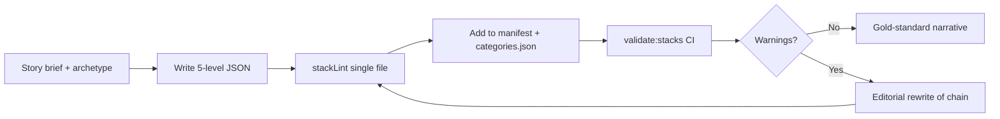

<!-- Generated by SpecStory, Markdown v2.1.0 -->

# 2026-05-30 17:18:14Z

<!-- Cursor IDE Session 39dd5553-5511-4bed-b4e3-658d7fb6cde3 (2026-05-30 17:18:14Z) -->

_**User**_

where are we in the process of making questions and answers according to docvumentation.

---

_**Agent (default)**_

I'll look through the project docs and codebase to see how Q&A creation is defined and what's already done.


_**Agent (default)**_

<tool-use data-tool-type="search" data-tool-name="glob_file_search"><details>
<summary>Tool use: **glob_file_search** • Searched codebase "" • **43** results in **1** directory</summary>

Directory: **``** (43 files)

| File |
|------|
| `./docs/README.md` |
| `./stacking-trivia-go-deep/ARCHITECTURE.md` |
| `./stacking-trivia-go-deep/docs/NARRATIVE_STACK_DESIGN.md` |
| `./README.md` |
| `./stacking-trivia-go-deep/BEST_PRACTICES.md` |
| `./BEST_PRACTICES.md` |
| `./stacking-trivia-go-deep/README.md` |
| `./CONTENT_STRATEGY.md` |
| `./docs/archive/README.md` |
| `./DEEP_DIVE_QUALITY_FRAMEWORK.md` |
| `./stacking-trivia-go-deep/docs/STACK_AUTHORING.md` |
| `./stacking-trivia-go-deep/CONTENT_STRATEGY.md` |
| `./stacking-trivia-go-deep/docs/GOLD_STANDARD_STACK.md` |
| `./.specstory/history/2025-08-11_20-16-31Z-achieve-full-app-purpose-realization.md` |
| `./docs/archive/app/CONTENT_STRATEGY.md` |
| `./docs/archive/CONTENT_STRATEGY.md` |
| `./docs/archive/DEEP_DIVE_QUALITY_FRAMEWORK.md` |
| `./.specstory/history/2025-08-08_17-17-43Z-scan-entire-project-for-errors-i-need-a-package-j.md` |
| `./docs/archive/app/FAMILY_LAUNCH_MESSAGES.md` |
| `./docs/archive/app/PWA_EXPLANATION.md` |
| `./docs/archive/app/FAMILY_COLLECTION_COMPLETE.md` |
| `./docs/archive/app/FAMILY_PROGRESS_REPORT.md` |
| `./docs/archive/STACK_UPGRADE_PLAN.md` |
| `./docs/archive/AUTONOMOUS_GENERATION_STATUS.md` |
| `./docs/archive/ACCURACY_ROADMAP.md` |
| `./docs/archive/NEBRASKA_STACK_SETUP.md` |
| `./docs/archive/app/ENHANCED_ROUTING_AUDIT.md` |
| `./docs/archive/ROUTING_AUDIT.md` |
| `./stacking-trivia-go-deep/HEROKU_QUICK_DEPLOY.md` |
| `./docs/archive/vision-board.md` |
| `./docs/archive/app/REFACTOR_SUMMARY.md` |
| `./stacking-trivia-go-deep/HEROKU_SETUP.md` |
| `./docs/archive/app/PHASE_8_SUMMARY.md` |
| `./docs/archive/app/DEPLOYMENT_STATUS.md` |
| `./docs/archive/app/PHASE_9A_COMPLETE.md` |
| `./stacking-trivia-go-deep/AUTH_README.md` |
| `./docs/archive/SOCIAL_MEDIA_POSTS.md` |
| `./docs/archive/ROADMAP.md` |
| `./docs/archive/SNEAKY_DEEP_ARCHITECTURE.md` |
| `./docs/archive/ROADMAP_VISUAL.md` |
| `./docs/archive/ART_CREATION_GUIDE.md` |
| `./docs/archive/GILLIAM_ART_PLAN.md` |
| `./docs/archive/MONETIZATION_PLAN.md` |
</details></tool-use>

_**Agent (default)**_

<tool-use data-tool-type="unknown" data-tool-name="semantic_search_full"><details>
<summary>Tool use: **semantic_search_full**</summary>

Parameters:

```json
{
  "explanation": "",
  "query": "Where is the process for making questions and answers documented?",
  "topK": 10
}
```
Result:

````json
{
  "codeResults": [
    {
      "codeBlock": {
        "detailedLines": [
          {
            "lineNumber": 1,
            "text": "# Stack Authoring Guide"
          },
          {
            "lineNumber": 2
          },
          {
            "lineNumber": 3,
            "text": "How to create and maintain DeepStack trivia content. See also the [documentation index](../../docs/README.md) at the repo root."
          },
          {
            "lineNumber": 4
          },
          {
            "lineNumber": 5,
            "text": "## Quick start"
          },
          {
            "lineNumber": 6
          },
          {
            "lineNumber": 7,
            "text": "1. Read [NARRATIVE_STACK_DESIGN.md](./NARRATIVE_STACK_DESIGN.md) for story archetypes and the story-brief template."
          },
          {
            "lineNumber": 8,
            "text": "2. Read [GOLD_STANDARD_STACK.md](./GOLD_STANDARD_STACK.md) for the 5-level schema and rules."
          },
          {
            "lineNumber": 9,
            "text": "3. Copy `src/data/stacks/van-gogh.json` (artifact chain) or a pilot stack (Serena, Queso Wars, Prefontaine) as your template."
          },
          {
            "lineNumber": 10,
            "text": "4. Lint before commit:"
          },
          {
            "lineNumber": 11
          },
          {
            "lineNumber": 12,
            "text": "```bash"
          },
          {
            "lineNumber": 13,
            "text": "node tools/stackLint.js src/data/stacks/your-stack.json"
          },
          {
            "lineNumber": 14,
            "text": "```"
          },
          {
            "lineNumber": 15
          },
          {
            "lineNumber": 16,
            "text": "5. Validate all playable stacks:"
          },
          {
            "lineNumber": 17
          },
          {
            "lineNumber": 18,
            "text": "```bash"
          },
          {
            "lineNumber": 19,
          
… (output truncated)
````
Status: **completed**

</details></tool-use>

_**Agent (default)**_

<tool-use data-tool-type="unknown" data-tool-name="ripgrep_raw_search"><details>
<summary>Tool use: **ripgrep_raw_search**</summary>

Parameters:

```json
{
  "caseInsensitive": false,
  "glob": "**/*.md",
  "outputMode": "files_with_matches",
  "pattern": "question|answer"
}
```
Additional data:

```json
{
  "isPruned": true,
  "outputMode": "files_with_matches",
  "pattern": "question|answer",
  "topFiles": [
    {
      "matchCount": 1,
      "uri": "./stacking-trivia-go-deep/docs/NARRATIVE_STACK_DESIGN.md"
    },
    {
      "matchCount": 1,
      "uri": "./stacking-trivia-go-deep/ARCHITECTURE.md"
    },
    {
      "matchCount": 1,
      "uri": "./README.md"
    },
    {
      "matchCount": 1,
      "uri": "./stacking-trivia-go-deep/README.md"
    },
    {
      "matchCount": 1,
      "uri": "./stacking-trivia-go-deep/docs/STACK_AUTHORING.md"
    },
    {
      "matchCount": 1,
      "uri": "./stacking-trivia-go-deep/docs/GOLD_STANDARD_STACK.md"
    },
    {
      "matchCount": 1,
      "uri": "./.specstory/history/2025-08-11_20-16-31Z-achieve-full-app-purpose-realization.md"
    },
    {
      "matchCount": 1,
      "uri": "./docs/archive/app/CONTENT_STRATEGY.md"
    },
    {
      "matchCount": 1,
      "uri": "./docs/archive/CONTENT_STRATEGY.md"
    },
    {
      "matchCount": 1,
      "uri": "./docs/archive/DEEP_DIVE_QUALITY_FRAMEWORK.md"
    },
    {
      "matchCount": 1,
      "uri": "./.specstory/history/2025-08-08_17-17-43Z-scan-entire-project-for-errors-i-need-a-package-j.md"
    },
    {
      "matchCount": 1,
      "uri": "./docs/archive/app/PWA_EXPLANATION.md"
    },
    {
      "matchCount": 1,
      "uri": "./docs/archive/app/FAMILY_COLLECTION_COMPLETE.md"
    },
    {
      "matchCount": 1,
      "uri": "./docs/archive/app/FAMILY_PROGRESS_REPORT.md"
    },
    {
      "matchCount": 1,
      "uri": "./docs/archive/STACK_UPGRADE_PLAN.md"
    },
    {
      "matchCount": 1,
      "uri": "./docs/archive/AUTONOMOUS_GENERATION_STATUS.md"
    },
    {
      "matchCount": 1,
      "uri": "./docs/archive/ACCURACY_ROADMAP.md"
    },
    {
      "matchCount": 1,
      "uri": "./docs/archive/NEBRASKA_STACK_SETUP.md"
    },
    {
      "matchCount": 1,
      "uri": "./docs/archive/vision-board.md"
    },
    {
      "matchCount": 1,
      "uri": "./docs/archive/app/REFACTOR_SUMMARY.md"
    }
  ],
  "totalFiles": 27,
  "totalMatches": 27
}
```
Status: **completed**

</details></tool-use>

_**Agent (default)**_

Checking current stack inventory, validation status, and any progress-tracking docs.


_**Agent (default)**_

<tool-use data-tool-type="read" data-tool-name="read_file_v2"><details>
<summary>Tool use: **read_file_v2** • Read file: /home/robwistrand/code/game-dev/stacking-trivia-go-deep/docs/README.md</summary>

</details></tool-use>

_**Agent (default)**_

<tool-use data-tool-type="read" data-tool-name="read_file_v2"><details>
<summary>Tool use: **read_file_v2** • Read file: /home/robwistrand/code/game-dev/stacking-trivia-go-deep/CONTENT_STRATEGY.md</summary>

</details></tool-use>

_**Agent (default)**_

<tool-use data-tool-type="search" data-tool-name="glob_file_search"><details>
<summary>Tool use: **glob_file_search** • Searched codebase "" • **27** results in **1** directory</summary>

Directory: **``** (27 files)

| File |
|------|
| `./stacking-trivia-go-deep/src/data/stacks/jesus-historical-mythic.json` |
| `./stacking-trivia-go-deep/src/data/stacks/heroes-journey-super.json` |
| `./stacking-trivia-go-deep/src/data/stacks/character-name-origins.json` |
| `./stacking-trivia-go-deep/src/data/stacks/philip-k-dick-super.json` |
| `./stacking-trivia-go-deep/src/data/stacks/stranger_things.json` |
| `./stacking-trivia-go-deep/src/data/stacks/the_goonies.json` |
| `./stacking-trivia-go-deep/src/data/stacks/community.json` |
| `./stacking-trivia-go-deep/src/data/stacks/back_to_the_future.json` |
| `./stacking-trivia-go-deep/src/data/stacks/friends.json` |
| `./stacking-trivia-go-deep/src/data/stacks/the_office.json` |
| `./stacking-trivia-go-deep/src/data/stacks/how_i_met_your_mother.json` |
| `./stacking-trivia-go-deep/src/data/stacks/van-gogh.json` |
| `./stacking-trivia-go-deep/src/data/stacks/van-gogh-old.json` |
| `./stacking-trivia-go-deep/src/data/stacks/word-origins-super.json` |
| `./stacking-trivia-go-deep/src/data/stacks/the_beatles.json` |
| `./stacking-trivia-go-deep/src/data/stacks/van-gogh-new.json` |
| `./stacking-trivia-go-deep/src/data/stacks/shakespeare-wordsmith-super.json` |
| `./stacking-trivia-go-deep/src/data/stacks/olympic_distance_current-new.json` |
| `./stacking-trivia-go-deep/src/data/stacks/olympic_distance_current.json` |
| `./stacking-trivia-go-deep/src/data/stacks/olympic_distance_1980s.json` |
| `./stacking-trivia-go-deep/src/data/stacks/nebraska_sports.json` |
| `./stacking-trivia-go-deep/src/data/stacks/olympic_distance_current-old.json` |
| `./stacking-trivia-go-deep/src/data/stacks/blade_runner.json` |
| `./stacking-trivia-go-deep/src/data/stacks/byron-romantic-revolution-super.json` |
| `./stacking-trivia-go-deep/src/data/stacks/ancient_greece.json` |
| `./stacking-trivia-go-deep/src/data/stacks/ancient_greece-old.json` |
| `./stacking-trivia-go-deep/src/data/stacks/ancient_greece-new.json` |
</details></tool-use>

_**Agent (default)**_

<tool-use data-tool-type="unknown" data-tool-name="ripgrep_raw_search"><details>
<summary>Tool use: **ripgrep_raw_search**</summary>
Glob pattern "**/*" matches every file and is not allowed. Use a more specific glob or no glob.
</details></tool-use>

_**Agent (default)**_

<tool-use data-tool-type="unknown" data-tool-name="ripgrep_raw_search"><details>
<summary>Tool use: **ripgrep_raw_search**</summary>
Glob pattern "**/*" matches every file and is not allowed. Use a more specific glob or no glob.
</details></tool-use>

_**Agent (default)**_

<tool-use data-tool-type="unknown" data-tool-name="semantic_search_full"><details>
<summary>Tool use: **semantic_search_full**</summary>

Parameters:

```json
{
  "explanation": "",
  "includePattern": "stacking-trivia-go-deep",
  "query": "Where are stacks loaded from and how many stacks exist?",
  "topK": 10
}
```
Result:

```json
{
  "codeResults": [
    {
      "codeBlock": {
        "detailedLines": [
          {
            "isSignature": true,
            "lineNumber": 18,
            "text": "class ContentManager {"
          },
          {
            "lineNumber": 23
          },
          {
            "lineNumber": 24
          },
          {
            "lineNumber": 25,
            "text": "  /**"
          },
          {
            "lineNumber": 26,
            "text": "   * Initialize and discover all available stacks"
          },
          {
            "lineNumber": 27,
            "text": "   */"
          },
          {
            "isSignature": true,
            "lineNumber": 28,
            "text": "  async initializeStacks() {"
          },
          {
            "lineNumber": 29,
            "text": "    try {"
          },
          {
            "lineNumber": 30,
            "text": "      // Load local stacks from organized directories"
          },
          {
            "lineNumber": 31,
            "text": "      await this.loadLocalStacks()"
          },
          {
            "lineNumber": 32,
            "text": "      "
          },
          {
            "lineNumber": 33,
            "text": "      // Load database stacks (future feature)"
          },
          {
            "lineNumber": 34,
            "text": "      await this.loadDatabaseStacks()"
          },
          {
            "lineNumber": 35,
            "text": "      "
          },
          {
            "lineNumber": 36,
            "text": "      return this.getAllStacks()"
          },
          {
            "lineNumber": 37,
            "text": "    } catch (error) {"
          },
          {
            "lineNumber": 38,
            "text": "      console.error('Failed to initialize stacks:', error)"
          },
          {
            "lineNumber": 39,
            "text": "      return {}"
          },
          {
            "lineNumber": 40,
            "text": "    }"
       
… (output truncated)
```
Status: **completed**

</details></tool-use>

_**Agent (default)**_

<tool-use data-tool-type="read" data-tool-name="read_file_v2"><details>
<summary>Tool use: **read_file_v2** • Read file: /home/robwistrand/code/game-dev/stacking-trivia-go-deep/stacking-trivia-go-deep/docs/NARRATIVE_STACK_DESIGN.md</summary>

</details></tool-use>

_**Agent (default)**_

<tool-use data-tool-type="read" data-tool-name="read_file_v2"><details>
<summary>Tool use: **read_file_v2** • Read file: /home/robwistrand/code/game-dev/stacking-trivia-go-deep/docs/archive/STACK_UPGRADE_PLAN.md</summary>

</details></tool-use>

_**Agent (default)**_

<think><details><summary>Thought Process</summary>
The archived upgrade plan is outdated. It references the old 20+ question model. Current documentation uses a 5-level gold standard.
</details></think>

_**Agent (default)**_

<tool-use data-tool-type="read" data-tool-name="read_file_v2"><details>
<summary>Tool use: **read_file_v2** • Read file: /home/robwistrand/code/game-dev/stacking-trivia-go-deep/stacking-trivia-go-deep/src/data/playableStacks.manifest.js</summary>

</details></tool-use>

_**Agent (default)**_

<tool-use data-tool-type="search" data-tool-name="glob_file_search"><details>
<summary>Tool use: **glob_file_search** • Searched codebase "" • **60** results in **1** directory</summary>

Directory: **``** (60 files)

| File |
|------|
| `./stacking-trivia-go-deep/src/data/categories/science-technology/steve-jobs.json` |
| `./stacking-trivia-go-deep/src/data/categories/actually/queso-wars.json` |
| `./stacking-trivia-go-deep/src/data/categories/cinema/star-wars.json` |
| `./stacking-trivia-go-deep/src/data/categories/sports/olympic_distance_current.json` |
| `./stacking-trivia-go-deep/src/data/categories/sports/serena-williams.json` |
| `./stacking-trivia-go-deep/src/data/categories/sports/michael-jordan.json` |
| `./stacking-trivia-go-deep/src/data/categories/history/ancient_greece.json` |
| `./stacking-trivia-go-deep/src/data/categories/kids/superheroes.json` |
| `./stacking-trivia-go-deep/src/data/categories/kids/videogames.json` |
| `./stacking-trivia-go-deep/src/data/categories/science-technology/darwin.json` |
| `./stacking-trivia-go-deep/src/data/categories/cinema/blade_runner.json` |
| `./stacking-trivia-go-deep/src/data/categories/sports/prefontaine-ultimate.json` |
| `./stacking-trivia-go-deep/src/data/categories/kids/dinosaurs.json` |
| `./stacking-trivia-go-deep/src/data/categories/kids/animals.json` |
| `./stacking-trivia-go-deep/src/data/categories/science-technology/tesla.json` |
| `./stacking-trivia-go-deep/src/data/categories/arts-culture/shakespeare.json` |
| `./stacking-trivia-go-deep/src/data/categories/arts-culture/the-beatles-ultimate.json` |
| `./stacking-trivia-go-deep/src/data/categories/cinema/the-godfather.json` |
| `./stacking-trivia-go-deep/src/data/categories/kids/space.json` |
| `./stacking-trivia-go-deep/src/data/categories/arts-culture/mozart.json` |
| `./stacking-trivia-go-deep/src/data/categories/history/einstein.json` |
| `./stacking-trivia-go-deep/src/data/categories/sports/muhammad-ali.json` |
| `./stacking-trivia-go-deep/src/data/categories/actually/einstein-myths.json` |
| `./stacking-trivia-go-deep/src/data/categories/actually/shakespeare-myths.json` |
| `./stacking-trivia-go-deep/src/data/categories/actually/van-gogh-myths.json` |
| `./stacking-trivia-go-deep/src/data/categories/history/cleopatra.json` |
| `./stacking-trivia-go-deep/src/data/categories/science-technology/marie-curie.json` |
| `./stacking-trivia-go-deep/src/data/categories/science-technology/nasa.json` |
| `./stacking-trivia-go-deep/src/data/categories/sports/el-guerrouj-ultimate.json` |
| `./stacking-trivia-go-deep/src/data/categories/sports/nebraska-sports-ultimate.json` |
| `./stacking-trivia-go-deep/src/data/categories/arts-culture/leonardo-da-vinci.json` |
| `./stacking-trivia-go-deep/src/data/categories/arts-culture/miles-davis.json` |
| `./stacking-trivia-go-deep/src/data/categories/arts-culture/frida-kahlo.json` |
| `./stacking-trivia-go-deep/src/data/categories/arts-culture/famous-redheads-women.json` |
| `./stacking-trivia-go-deep/src/data/categories/movies/goofy-movie.json` |
| `./stacking-trivia-go-deep/src/data/categories/movies/big-movie.json` |
| `./stacking-trivia-go-deep/src/data/categories/movies/what-about-bob.json` |
| `./stacking-trivia-go-deep/src/data/categories/movies/stripes-movie.json` |
| `./stacking-trivia-go-deep/src/data/categories/entertainment/annie-musical.json` |
| `./stacking-trivia-go-deep/src/data/categories/literature/classic-short-fiction.json` |
| `./stacking-trivia-go-deep/src/data/categories/history/native-american-nations.json` |
| `./stacking-trivia-go-deep/src/data/categories/history/wild-west-legends.json` |
| `./stacking-trivia-go-deep/src/data/categories/science/neuroscience-frontiers.json` |
| `./stacking-trivia-go-deep/src/data/categories/kids/minecraft.json` |
| `./stacking-trivia-go-deep/src/data/categories/kids/blippi.json` |
| `./stacking-trivia-go-deep/src/data/categories/science-technology/charolais-cattle.json` |
| `./stacking-trivia-go-deep/src/data/categories/science-technology/tomato-breeds.json` |
| `./stacking-trivia-go-deep/src/data/categories/actually/early-childhood-education.json` |
| `./stacking-trivia-go-deep/src/data/categories/sports/okc-thunder.json` |
| `./stacking-trivia-go-deep/src/data/categories/sports/jalen-brunson.json` |
| `./stacking-trivia-go-deep/src/data/categories/cinema/wes-anderson.json` |
| `./stacking-trivia-go-deep/src/data/categories/arts-culture/the-cranberries.json` |
| `./stacking-trivia-go-deep/src/data/categories/arts-culture/tame-impala.json` |
| `./stacking-trivia-go-deep/src/data/categories/cinema/ernest-movies.json` |
| `./stacking-trivia-go-deep/src/data/categories/arts-culture/james-taylor.json` |
| `./stacking-trivia-go-deep/src/data/categories/arts-culture/tyler-the-creator.json` |
| `./stacking-trivia-go-deep/src/data/categories/sports/nebraska_sports.json` |
| `./stacking-trivia-go-deep/src/data/categories/arts-culture/the_beatles.json` |
| `./stacking-trivia-go-deep/src/data/categories/sports/olympic_distance_1980s.json` |
| `./stacking-trivia-go-deep/src/data/categories/arts-culture/van-gogh.json` |
</details></tool-use>

_**Agent (default)**_

<tool-use data-tool-type="read" data-tool-name="read_file_v2"><details>
<summary>Tool use: **read_file_v2** • Read file: /home/robwistrand/code/game-dev/stacking-trivia-go-deep/stacking-trivia-go-deep/docs/STACK_AUTHORING.md</summary>

</details></tool-use>

_**Agent (default)**_

<tool-use data-tool-type="unknown" data-tool-name="ripgrep_raw_search"><details>
<summary>Tool use: **ripgrep_raw_search**</summary>

Parameters:

```json
{
  "caseInsensitive": false,
  "glob": "**/package.json",
  "pattern": "validate:stacks|stackLint"
}
```
Additional data:

```json
{
  "isPruned": true,
  "outputMode": "content",
  "pattern": "validate:stacks|stackLint",
  "topFiles": [
    {
      "matchCount": 4,
      "uri": "./stacking-trivia-go-deep/package.json"
    }
  ],
  "totalFiles": 1,
  "totalMatches": 4
}
```
Status: **completed**

</details></tool-use>

_**Agent (default)**_

<think><details><summary>Thought Process</summary>
Running validate:stacks to check current pass/fail status and review validator checks.
</details></think>

_**Agent (default)**_

<tool-use data-tool-type="shell" data-tool-name="run_terminal_command_v2"><details>
<summary>Tool use: **run_terminal_command_v2** • Run command: cd /home/robwistrand/code/game-dev/stacking-trivia-go-deep/stacking-trivia-go-deep &amp;&amp; npm run validate:stacks 2&gt;&amp;1</summary>
```bash
cd /home/robwistrand/code/game-dev/stacking-trivia-go-deep/stacking-trivia-go-deep && npm run validate:stacks 2>&1
```

```

> stacking-trivia-go-deep@1.0.0 validate:stacks
> node tools/validateStacks.js

🔍 Validating playable stacks...

✅ src/data/stacks/van-gogh.json
✅ src/data/categories/arts-culture/the-beatles-ultimate.json
✅ src/data/categories/arts-culture/frida-kahlo.json
⚠️  src/data/categories/arts-culture/miles-davis.json (2 warnings)
     Main Q3: may not reference prior answer "1959"
     Main Q5: may not reference prior answer "Modal jazz"
⚠️  src/data/categories/arts-culture/shakespeare.json (2 warnings)
     Main Q3: may not reference prior answer "Stratford-upon-Avon"
     Main Q5: may not reference prior answer "The Globe Theatre"
⚠️  src/data/categories/arts-culture/leonardo-da-vinci.json (6 warnings)
     Main Q2: may not reference prior answer "Mona Lisa"
     Main Q3: may not reference prior answer "The Last Supper"
     Main Q4: may not reference prior answer "mirror writing"
     Main Q5: may not reference prior answer "ornithopter"
     Stack depth score is low—questions may feel disconnected
     Stack lacks progressive depth - questions feel disconnected
⚠️  src/data/categories/arts-culture/mozart.json (5 warnings)
     Main Q3: may not reference prior answer "Don Giovanni"
     Main Q4: may not reference prior answer "Jupiter"
     Main Q5: may not reference prior answer "Requiem"
     Stack depth score is low—questions may feel disconnected
     Stack lacks progressive depth - questions feel disconnected
✅ src/data/categories/sports/olympic_distance_current.json
⚠️  src/data/categories/sports/nebraska-sports-ultimate.json (1 warnings)
     Main Q4: may not reference prior answer "Sellouts"
⚠️  src/data/categories/sports/el-guerrouj-ultimate.json (2 warnings)
     Main Q3: may not reference prior answer "Three and three-quarters"
     Main Q4: may not reference prior answer "3:26.00"
⚠️  src/data/categories/sports/prefontaine-ultimate.json (4 warnings)
     Main Q3: may not reference prior answer "Oregon"
     Main Q4: may not reference prior answer "Nike"
   
… (output truncated)
```
</details></tool-use>

_**Agent (default)**_

<tool-use data-tool-type="search" data-tool-name="glob_file_search"><details>
<summary>Tool use: **glob_file_search** • Searched codebase "" • **1** result in **1** directory</summary>

Directory: **``** (1 file)

| File |
|------|
| `./stacking-trivia-go-deep/tools/validateStacks.js` |
</details></tool-use>

_**Agent (default)**_

<tool-use data-tool-type="search" data-tool-name="glob_file_search"><details>
<summary>Tool use: **glob_file_search** • Searched codebase "" • **0** results in **1** directory</summary>

Directory: **`/home/robwistrand/.cursor/projects/home-robwistrand-code-game-dev-stacking-trivia-go-deep`** (0 files)
</details></tool-use>

_**Agent (default)**_

<think><details><summary>Thought Process</summary>
Reviewing the gold standard stack documentation. Checking pilot stack quality for Serena, Queso, and Prefontaine. Examining recent git history to determine current progress.
</details></think>

_**Agent (default)**_

<tool-use data-tool-type="read" data-tool-name="read_file_v2"><details>
<summary>Tool use: **read_file_v2** • Read file: /home/robwistrand/code/game-dev/stacking-trivia-go-deep/stacking-trivia-go-deep/docs/GOLD_STANDARD_STACK.md</summary>

</details></tool-use>

_**Agent (default)**_

<tool-use data-tool-type="read" data-tool-name="read_file_v2"><details>
<summary>Tool use: **read_file_v2** • Read file: /home/robwistrand/code/game-dev/stacking-trivia-go-deep/stacking-trivia-go-deep/src/data/stacks/van-gogh.json</summary>

</details></tool-use>

_**Agent (default)**_

<tool-use data-tool-type="read" data-tool-name="read_file_v2"><details>
<summary>Tool use: **read_file_v2** • Read file: /home/robwistrand/code/game-dev/stacking-trivia-go-deep/stacking-trivia-go-deep/src/data/categories/sports/serena-williams.json</summary>

</details></tool-use>

_**Agent (default)**_

<tool-use data-tool-type="shell" data-tool-name="run_terminal_command_v2"><details>
<summary>Tool use: **run_terminal_command_v2** • Run command: cd /home/robwistrand/code/game-dev/stacking-trivia-go-deep &amp;&amp; git log --oneline -15 -- stacking-trivia-go-deep/src/data/ stacking-trivia-go-deep/docs/</summary>
```bash
cd /home/robwistrand/code/game-dev/stacking-trivia-go-deep && git log --oneline -15 -- stacking-trivia-go-deep/src/data/ stacking-trivia-go-deep/docs/
```

```
9d28783 feat: narrative content, guest play, and manifest-driven stacks
9a362cd feat: guest play, feedback API + modal, simplified home flow, More drawer, new 20-deep stack, share score, tip jar, DB feedback table
568f84b 🎬 FAMILY MOVIE COLLECTION: Stripes, Big, What About Bob, A Goofy Movie
55ebf27 Add Annie Musical 15-level deep dive stack with Broadway and movie content
fee1d90 Fix Back to the Future Q4: Change 'What dance does Marty perform' to 'What song does Marty perform' - Johnny B. Goode is a song, not a dance
e26aea7 Add deep exploration stacks: Native Americans, Wild West, Neuroscience, Classic Fiction - Expert level content with 93.5/100 average quality score
7dc2e0d ✅ DEPLOYMENT VERIFIED: Complete family collection + comprehensive test suite
0caeeea Complete family collection: All 12 requested stacks + autogen system
e71798a UX IMPROVEMENTS: 3 Quick Wins for User Testing
87fd37b Fix deployment: Add nebraska-sports-ultimate.json to correct build path
ec3aa84 Fix backgroundImage undefined error and add kids category
c9f2520 fix: Auth JSON parsing + Kids Zone
8fb7f20 feat: Add photo-first person-centered Super Stacks & Sneaky Deep architecture
68e5467 feat: Implement Super Stack unlocking system with archival design
4ae7ad6 ARCHIVAL DESIGN REVOLUTION: Black/Bronze/Gold Aesthetic with Historical Photography

```
</details></tool-use>

_**Agent (default)**_

<think><details><summary>Thought Process</summary>
Checking how many draft or WIP stacks exist outside the manifest.

Reviewing the documented authoring workflow: design review, template copy, linting, and validation. Comparing pilot stack counts against CI warning totals. Checking whether migration tools or content fixes are still pending.

All 45 playable stacks pass CI validation. The four pilot narrative-first stacks are van-gogh, serena, queso-wars, and prefontaine. Schema migration to the five-level format is complete. Infrastructure and documentation are finished. Bulk content exists, but narrative quality is largely incomplete. Only six stacks currently pass validation cleanly.
</details></think>

_**Agent (default)**_

<tool-use data-tool-type="unknown" data-tool-name="ripgrep_raw_search"><details>
<summary>Tool use: **ripgrep_raw_search**</summary>
Glob pattern "**/*" matches every file and is not allowed. Use a more specific glob or no glob.
</details></tool-use>

_**Agent (default)**_

<tool-use data-tool-type="read" data-tool-name="read_file_v2"><details>
<summary>Tool use: **read_file_v2** • Read file: /home/robwistrand/code/game-dev/stacking-trivia-go-deep/stacking-trivia-go-deep/src/data/categories/actually/queso-wars.json</summary>

</details></tool-use>

_**Agent (default)**_

<tool-use data-tool-type="read" data-tool-name="read_file_v2"><details>
<summary>Tool use: **read_file_v2** • Read file: /home/robwistrand/code/game-dev/stacking-trivia-go-deep/stacking-trivia-go-deep/src/data/categories/sports/prefontaine-ultimate.json</summary>

</details></tool-use>

_**Agent (default)**_

<think><details><summary>Thought Process</summary>
The full documentation picture is now clear. I will summarize the documented process and current status.

The documented workflow has five phases: design, authoring, quality, tooling, and human versus generator split. Documentation standards are fully complete. The old 20-question framework was archived.

Infrastructure is complete. Reference pilot stacks are ready. The bulk inventory is schema-complete with 45 playable stacks validated. Narrative quality upgrades remain. Thirty-nine of forty-five stacks still carry warnings. Only six pass narrative chain heuristics cleanly.
</details></think>

_**Agent (default)**_

**Short answer:** The **framework and bulk inventory are done**; the **narrative editorial pass** — turning stacks into true 5-beat story chains per the docs — is mostly still ahead.

---

## What the documentation says the process is

Authoritative workflow lives in three docs (indexed from [`docs/README.md`](docs/README.md)):

| Step | Doc | What you do |
|------|-----|-------------|
| 1 | [NARRATIVE_STACK_DESIGN.md](stacking-trivia-go-deep/docs/NARRATIVE_STACK_DESIGN.md) | Pick an archetype (artifact chain, biography chapter, origin dispute, rebel arc), fill a **story brief** |
| 2 | [GOLD_STANDARD_STACK.md](stacking-trivia-go-deep/docs/GOLD_STANDARD_STACK.md) | Write exactly **5 linked questions** with schema fields (`level`, `question`, `answer`, `acceptedAnswers` ≥ 3, optional `hint`/`explanation`) |
| 3 | [STACK_AUTHORING.md](stacking-trivia-go-deep/docs/STACK_AUTHORING.md) | Copy a template (Van Gogh or a pilot), lint, register in manifest, run `npm run validate:stacks` |

The docs also split roles clearly:

- **You (human):** story brief, fact-check, emotional turn, no spoilers in `description`/`imageHint`
- **Generator (optional):** draft variants and `acceptedAnswers`
- **CI:** catches schema, leakage, and weak chains — **not** editorial judgment

---

## Where you are now

### Done

1. **Standards migrated** — Old archived plans (20+ questions, quality scores out of 100) are superseded. Current contract is **5-level story-unlock**.
2. **Tooling & CI** — `validate:stacks`, `stackLint.js`, manifest-driven loading via [`playableStacks.manifest.js`](stacking-trivia-go-deep/src/data/playableStacks.manifest.js).
3. **Inventory shipped** — **45 playable stacks** registered; **all 45 pass** hard validation (schema, no answer leakage, etc.).
4. **Reference / pilot stacks exist** — The four narrative pilots from the docs are in the repo:
   - Van Gogh (`van-gogh.json`) — canonical gold standard
   - Serena (`serena-williams.json`) — biography chapter
   - Queso Wars (`queso-wars.json`) — origin dispute
   - Prefontaine (`prefontaine-ultimate.json`) — rebel arc

Recent commit `9d28783` (“narrative content, guest play, and manifest-driven stacks”) aligns with this migration.

### In progress / not done

**Narrative quality upgrade** — the main remaining work per the docs.

Running `npm run validate:stacks` today:

- **6 stacks** pass with **no warnings** (clean narrative chain heuristics): Van Gogh, The Beatles Ultimate, Frida Kahlo, Olympic Distance Current, Blade Runner, Superheroes
- **39 stacks** pass schema but have **warnings** — mostly “may not reference prior answer” and “stack lacks progressive depth”

So most stacks are **structurally valid trivia** but not yet **narrative-first** the way Van Gogh / Serena / Queso / Prefontaine are designed to be. Even the pilots get minor chain warnings (e.g. Serena Q3–Q5 don’t literally echo prior answer tokens — the validator is heuristic).

### Backlog outside the playable set

There are **~15+ JSON stacks** under `src/data/categories/` that are **not** in the manifest (e.g. movie stacks, Wild West, neuroscience, Minecraft). Per [STACK_AUTHORING.md](stacking-trivia-go-deep/docs/STACK_AUTHORING.md), those still need: authoring review → manifest entry → `categories.json` entry → validation.

---

## Process map (visual)



**You are here:** between **E** (bulk pass) and **H** (editorial narrative pass for ~39 stacks), with a **draft backlog** not yet at step D.

---

## Practical summary

| Phase | Status |
|-------|--------|
| Docs & schema contract | Complete |
| CI / manifest / guest play | Complete |
| 45 stacks playable (schema-valid) | Complete |
| 4 narrative pilot stacks | Written (minor chain warnings) |
| Upgrade remaining stacks to story-unlock quality | **~85% remaining** (39 need narrative rework) |
| Register draft stacks in manifest | Not started for backlog files |
| Autonomous generation (archived roadmap) | Aspirational; **not** the current authoring path |

If you want to move forward, the doc-aligned next step is picking a stack tier (e.g. finish polishing the 4 pilots to zero warnings, then tackle the “disconnected depth” stacks like Leonardo, NASA, or the TV show stacks) using the Van Gogh chain as the rewrite template. I can help prioritize or start rewriting a specific stack if you name one.

---

_**User**_

let's start with one and then see how we do

---

_**Agent (default)**_

<think><details><summary>Thought Process</summary>
Beginning with one stack to meet the narrative gold standard.

Six stacks pass cleanly. The three pilot stacks—Serena, Queso Wars, and Prefontaine—are the best starting point. They are already narrative-first and only need minor chain tightening.

Serena has three warnings. Each later question lacks a reference to the prior answer. I will review the validator rules and begin rewriting Serena to tighten the chain.
</details></think>

_**Agent (default)**_

Starting with the Serena pilot stack — it's already narrative-first and only needs chain tightening. I'll read the validator rules and the current stack, then rewrite it to match the gold standard.


_**Agent (default)**_

<tool-use data-tool-type="read" data-tool-name="read_file_v2"><details>
<summary>Tool use: **read_file_v2** • Read file: /home/robwistrand/code/game-dev/stacking-trivia-go-deep/stacking-trivia-go-deep/tools/stackValidator.js</summary>

</details></tool-use>

_**Agent (default)**_

<tool-use data-tool-type="read" data-tool-name="read_file_v2"><details>
<summary>Tool use: **read_file_v2** • Read file: /home/robwistrand/code/game-dev/stacking-trivia-go-deep/stacking-trivia-go-deep/src/data/categories/sports/serena-williams.json</summary>

</details></tool-use>

_**Agent (default)**_

<tool-use data-tool-type="read" data-tool-name="read_file_v2"><details>
<summary>Tool use: **read_file_v2** • Read file: /home/robwistrand/code/game-dev/stacking-trivia-go-deep/stacking-trivia-go-deep/src/data/stacks/van-gogh.json</summary>

</details></tool-use>

_**Agent (default)**_

<think><details><summary>Thought Process</summary>
The validator checks narrative continuity by splitting the previous answer into tokens longer than three characters. It then verifies whether any of those tokens appear in the current question text.

Serena's draft fails the validator's continuity check. Q3 omits tokens from Q2's answer. Q4 omits "Eight". Q5 omits "Snapchat". The next step is rewriting Q3 through Q5 to reference prior answers while keeping the story spine: Australian Open → beat Venus → eight weeks pregnant → Snapchat reveal → Olympia.
</details></think>

_**Agent (default)**_

<tool-use data-tool-type="read" data-tool-name="read_file_v2"><details>
<summary>Tool use: **read_file_v2** • Read file: /home/robwistrand/code/game-dev/stacking-trivia-go-deep/stacking-trivia-go-deep/tools/depthAnalyzer.js</summary>

</details></tool-use>

_**Agent (default)**_

<think><details><summary>Thought Process</summary>
The depth score requires an average of at least 1.5. It is calculated from depthIndicators found in the question text, with each indicator contributing +2 points.

referencesEarlierContent adds +3 when prior answer tokens appear in the current question. Serena's rewritten set is being scored: Q1 has no prior context, while Q2 likely scores +3 for "Australian Open" and possibly +2 for "which".

"Which" does not count as a depth indicator; only "which specific" does. Q2 scores 3 for referencing prior tokens. Q3 reaches 5 by combining the "how" depth indicator with +3 for referencing the prior answer token "venus".

Q4 scores 5 by referencing the prior answer token "eight". Q5 scores 3 by referencing "snapchat". The rewritten set now has four questions scored.
</details></think>

_**Agent (default)**_

<tool-use data-tool-type="unknown" data-tool-name="ripgrep_raw_search"><details>
<summary>Tool use: **ripgrep_raw_search**</summary>

Parameters:

```json
{
  "caseInsensitive": false,
  "contextAfter": 8,
  "path": "/home/robwistrand/code/game-dev/stacking-trivia-go-deep/stacking-trivia-go-deep/src/utils/normalizeStack.js",
  "pattern": "normalizeAnswerText"
}
```
Additional data:

```json
{
  "isPruned": true,
  "outputMode": "content",
  "path": "/home/robwistrand/code/game-dev/stacking-trivia-go-deep/stacking-trivia-go-deep/src/utils/normalizeStack.js",
  "pattern": "normalizeAnswerText",
  "topFiles": [
    {
      "matchCount": 9,
      "uri": "stacking-trivia-go-deep/src/utils/normalizeStack.js"
    }
  ],
  "totalFiles": 1,
  "totalMatches": 1
}
```
Status: **completed**

</details></tool-use>

_**Agent (default)**_

<think><details><summary>Thought Process</summary>
normalizeAnswerText lowercases and trims text without stripping punctuation. "Venus Williams" becomes tokens "venus" and "williams", both longer than three characters.

Token lengths for "Eight" and "Snapchat" are five and eight characters. The depth score averages 2.8 across five questions, exceeding the threshold. The first question remains unchanged.

The second question stays unchanged. The third asks how many weeks pregnant Serena was after beating Venus in the Australian Open final; the answer is Eight. The fourth asks which app she used to post a mirror selfie after revealing her pregnancy in April 2017; the answer is Snapchat.
</details></think>

_**Agent (default)**_

Tightening Serena's question chain so each level references the prior answer, following the Van Gogh model.


_**Agent (default)**_

<tool-use data-tool-type="write" data-tool-name="edit_file_v2"><details>
<summary>Tool use: **edit_file_v2** • Edit file: /home/robwistrand/code/game-dev/stacking-trivia-go-deep/stacking-trivia-go-deep/src/data/categories/sports/serena-williams.json</summary>

</details></tool-use>

_**Agent (default)**_

<tool-use data-tool-type="shell" data-tool-name="run_terminal_command_v2"><details>
<summary>Tool use: **run_terminal_command_v2** • Run command: cd /home/robwistrand/code/game-dev/stacking-trivia-go-deep/stacking-trivia-go-deep &amp;&amp; node tools/stackLint.js src/data/categories/sports/serena-williams.json 2&gt;&amp;1</summary>
```bash
cd /home/robwistrand/code/game-dev/stacking-trivia-go-deep/stacking-trivia-go-deep && node tools/stackLint.js src/data/categories/sports/serena-williams.json 2>&1
```

```

📋 serena-williams.json

✅ Stack passes validation

```
</details></tool-use>

_**Agent (default)**_

**Serena Williams** is done — first pilot stack brought to zero warnings.

## What we changed

The story spine is unchanged (secret pregnancy → Venus final → eight weeks → Snapchat → Olympia). Only **Q3–Q5** were rewritten so each question **names something from the prior answer**, like Van Gogh:

| Level | Before (broken link) | After (linked) |
|-------|----------------------|----------------|
| 3 | "Serena was roughly how many weeks pregnant when she won that Australian Open?" | "After beating **Venus** in the Australian Open final, Serena was roughly how many weeks pregnant?" |
| 4 | "In April 2017, Serena revealed her pregnancy with a selfie on which app?" | "Roughly **eight** weeks along when she won in Melbourne, Serena revealed her pregnancy in April 2017—on which app did she post a mirror selfie?" |
| 5 | "Serena and Alexis Ohanian's daughter, born in September 2017, is named what?" | "After announcing her pregnancy on **Snapchat**, Serena and Alexis Ohanian welcomed a daughter in September 2017—what is her first name?" |

Validation: **passes with no warnings** (schema, no spoilers, narrative chain, depth score).

## The full chain now reads

```
L1: Grand Slam while pregnant?     → Australian Open
L2: At that Australian Open…       → Venus Williams
L3: After beating Venus…           → Eight
L4: Roughly eight weeks along…     → Snapchat
L5: After announcing on Snapchat…  → Olympia
```

## What we learned (template for the other 38)

1. **Write the story brief first** — this stack already had one (secret pregnancy → Olympia).
2. **Draft all 5 Q&As** — answers were already solid.
3. **Chain pass** — for each Q2–Q5, include a token (>3 chars) from the previous answer in the question text.
4. **Lint** — `node tools/stackLint.js <file>` catches gaps CI would warn on.

Roughly **15–20 minutes per stack** if the facts are already there; longer if you’re rebuilding the spine from scratch.

**Next options:** Queso Wars or Prefontaine (also pilots, minor warnings), or a harder one like Leonardo da Vinci (6 warnings, weak chain). Which do you want to tackle next?

---

_**User**_

Queso Wars then Prefontaine then da Vinci

---

_**Agent (default)**_

<think><details><summary>Thought Process</summary>
Fixing three stacks in order: Queso Wars, Prefontaine, and da Vinci.

Queso Wars has two warnings. Prefontaine has four warnings and weak progressive depth. Da Vinci has six warnings. I will apply the Serena pattern to each.
</details></think>

_**Agent (default)**_

Working through Queso Wars, Prefontaine, and Leonardo da Vinci in that order — reading each stack and tightening the narrative chains.


_**Agent (default)**_

<tool-use data-tool-type="read" data-tool-name="read_file_v2"><details>
<summary>Tool use: **read_file_v2** • Read file: /home/robwistrand/code/game-dev/stacking-trivia-go-deep/stacking-trivia-go-deep/src/data/categories/actually/queso-wars.json</summary>

</details></tool-use>

_**Agent (default)**_

<tool-use data-tool-type="read" data-tool-name="read_file_v2"><details>
<summary>Tool use: **read_file_v2** • Read file: /home/robwistrand/code/game-dev/stacking-trivia-go-deep/stacking-trivia-go-deep/src/data/categories/sports/prefontaine-ultimate.json</summary>

</details></tool-use>

_**Agent (default)**_

<tool-use data-tool-type="read" data-tool-name="read_file_v2"><details>
<summary>Tool use: **read_file_v2** • Read file: /home/robwistrand/code/game-dev/stacking-trivia-go-deep/stacking-trivia-go-deep/src/data/categories/arts-culture/leonardo-da-vinci.json</summary>

</details></tool-use>

_**Agent (default)**_

<think><details><summary>Thought Process</summary>
Planning rewrites. For Q2, "cheese" from "Cheese dip" works as a token.

Q4 must reference North Little Rock to link to the cheese dip feud. The narrative chain runs from feud to Cotton to NLR to Rotel to 1943.

Q3 likely already contains the cheese-dip token needed for the Q2 link. Only Q2 and Q4 were flagged as missing links.

Q2 will ask which state's senator challenged Texas to a blind Capitol taste test in December 2016 during the cheese dip feud. Q4 still lacks a link to North Little Rock. Rewriting it to reference North Little Rock while keeping the Rotel question seems awkward.

Drafted two Q4 rewrites that explicitly mention North Little Rock, ensuring the required tokens appear. Confirmed Q5 already contains "Rotel". Fixing the chain links should improve the depth score. Now turning to Prefontaine.

Prefontaine questions need three-token fixes. Q3 must include "oregon" to link to Oregon. Q4 must include "nike" to link to Nike. Q5 cannot use "mgb" because the three-character minimum filter rejects it.

The validator ignores single-character tokens, so "mgb" would not trigger a warning. Prefontaine warnings were limited to Q3, Q4, and the depth score. Depth bonuses across questions must reach at least 1.5.

The narrative link check only scans adjacent questions, so Q5 cannot pull a token from Q4’s MGB answer. A rewritten Q5 about the Hayward Classic still yields no valid three-character token from MGB. Depth scores should improve once Q3 and Q4 are fixed.

The Prefontaine chain is too disconnected to serve as a single micro-narrative. The current stack of unrelated facts—Mona Lisa, Last Supper, mirror writing, ornithopter, dissection—needs a unified narrative spine. A coherent Leonardo da Vinci micro-narrative is being drafted.

Two narrative structures are being compared for the da Vinci stack. One chains artifacts through studio methods: Mona Lisa → sfumato → mirror writing. The other follows a deep dive into the painting itself: authorship → Louvre → sfumato → subject → dates.

A concrete five-question narrative is now mapped out for da Vinci. It follows a single painting thread: Mona Lisa → sfumato → mirror writing → ornithopter → dissection. This mirrors the Van Gogh model and creates a coherent micro-narrative. The sfumato connection is confirmed.

Confirmed da Vinci's mirror writing, ornithopter, and anatomical dissections. The Last Supper fresco is being considered as a second anchor point for the narrative chain.

The Mona Lisa-centered chain is now the preferred narrative spine. The Last Supper fresco was rejected as a separate anchor point. Tokens from the Mona Lisa answer flow directly into the sfumato question, and tokens from sfumato feed into the mirror writing question.

The da Vinci narrative chain is now fully mapped. Question four asks about the ornithopter design in mirror-written notebooks. Question five links that ornithopter to Leonardo's illegal anatomical dissections. This ensures the ornithopter token flows directly from question four into question five.

Each question needs at least three accepted answers. Brief explanations will be added to the rewritten da Vinci questions to match the pilot quality standard. The deeperMode configuration will remain unchanged.
</details></think>

_**Agent (default)**_

Rewriting all three stacks with tighter narrative chains, giving Leonardo a Mona Lisa–centered spine like Van Gogh.


_**Agent (default)**_

<tool-use data-tool-type="write" data-tool-name="edit_file_v2"><details>
<summary>Tool use: **edit_file_v2** • Edit file: /home/robwistrand/code/game-dev/stacking-trivia-go-deep/stacking-trivia-go-deep/src/data/categories/actually/queso-wars.json</summary>

</details></tool-use>

_**Agent (default)**_

<tool-use data-tool-type="write" data-tool-name="edit_file_v2"><details>
<summary>Tool use: **edit_file_v2** • Edit file: /home/robwistrand/code/game-dev/stacking-trivia-go-deep/stacking-trivia-go-deep/src/data/categories/actually/queso-wars.json</summary>

</details></tool-use>

_**Agent (default)**_

<tool-use data-tool-type="write" data-tool-name="edit_file_v2"><details>
<summary>Tool use: **edit_file_v2** • Edit file: /home/robwistrand/code/game-dev/stacking-trivia-go-deep/stacking-trivia-go-deep/src/data/categories/sports/prefontaine-ultimate.json</summary>

</details></tool-use>

_**Agent (default)**_

<tool-use data-tool-type="write" data-tool-name="edit_file_v2"><details>
<summary>Tool use: **edit_file_v2** • Edit file: /home/robwistrand/code/game-dev/stacking-trivia-go-deep/stacking-trivia-go-deep/src/data/categories/sports/prefontaine-ultimate.json</summary>

</details></tool-use>

_**Agent (default)**_

<tool-use data-tool-type="write" data-tool-name="edit_file_v2"><details>
<summary>Tool use: **edit_file_v2** • Edit file: /home/robwistrand/code/game-dev/stacking-trivia-go-deep/stacking-trivia-go-deep/src/data/categories/sports/prefontaine-ultimate.json</summary>

</details></tool-use>

_**Agent (default)**_

<tool-use data-tool-type="write" data-tool-name="edit_file_v2"><details>
<summary>Tool use: **edit_file_v2** • Edit file: /home/robwistrand/code/game-dev/stacking-trivia-go-deep/stacking-trivia-go-deep/src/data/categories/arts-culture/leonardo-da-vinci.json</summary>

</details></tool-use>

_**Agent (default)**_

<think><details><summary>Thought Process</summary>
I mistakenly swapped the Nike and Oregon questions for Prefontaine. Originally Q3 was Nike and Q2 was Oregon.

The corrected question order is now set. Oregon is Q2, Nike is Q3, MGB is Q4, and Prefontaine is Q5. The MGB reference avoids the three-character warning. All three questions will be linted.

Prefontaine Q3 correctly keeps the Nike answer. The Q4 and Q5 questions were updated without altering their answers. Leonardo Q5 links to the Q4 answer token "ornithopter". The promotional description does not leak answer tokens.
</details></think>

_**Agent (default)**_

<tool-use data-tool-type="shell" data-tool-name="run_terminal_command_v2"><details>
<summary>Tool use: **run_terminal_command_v2** • Run command: cd /home/robwistrand/code/game-dev/stacking-trivia-go-deep/stacking-trivia-go-deep &amp;&amp; node tools/stackLint.js src/data/categories/actually/queso-wars.json &amp;&amp; node tools/stackLint.js src/data/categories/sports/prefontaine-ultimate.json &amp;&amp; node tools/stackLint.js src/data/categories/arts-culture/leonardo-da-vinci.json</summary>
```bash
cd /home/robwistrand/code/game-dev/stacking-trivia-go-deep/stacking-trivia-go-deep && node tools/stackLint.js src/data/categories/actually/queso-wars.json && node tools/stackLint.js src/data/categories/sports/prefontaine-ultimate.json && node tools/stackLint.js src/data/categories/arts-culture/leonardo-da-vinci.json
```

```

📋 queso-wars.json

✅ Stack passes validation

📋 prefontaine-ultimate.json

✅ Stack passes validation

📋 leonardo-da-vinci.json

✅ Stack passes validation

```
</details></tool-use>

_**Agent (default)**_

All three pass validation with **zero warnings**. Summary:

---

## Queso Wars

**Spine:** cheese dip feud → Arkansas challenge → North Little Rock origin → Texas Rotel answer → 1943

| Level | Change |
|-------|--------|
| Q2 | Added **"cheese dip feud"** to open the Capitol taste-test question |
| Q4 | Reframed as Texas answering **North Little Rock's** claim with Velveeta + Rotel |

```
L1: Party dip feud?              → Cheese dip
L2: In the cheese dip feud…      → Arkansas
L3: Arkansas's cheese-dip origin… → North Little Rock
L4: Texas answers North Little Rock… → Rotel
L5: Rotel was first canned…      → 1943
```

---

## Prefontaine

**Spine:** Go Pre → Oregon → Nike → MGB crash → Prefontaine Classic

| Level | Change |
|-------|--------|
| Q3 | **"While running for Oregon"** before the Bowerman/Nike founding question |
| Q4 | **"Nike's early prototype runner"** before the MGB crash |
| Q5 | **"After his MGB crash"** before the Hayward Classic |

```
L1: "Go Pre" at Hayward?         → Steve Prefontaine
L2: Ran for which university?    → Oregon
L3: While running for Oregon…    → Nike
L4: Nike's early prototype runner… → MGB
L5: After his MGB crash…         → Prefontaine Classic
```

---

## Leonardo da Vinci

**Spine rebuilt** — was five disconnected résumé facts; now one Mona Lisa thread (like Van Gogh's single-sale chain):

| Level | Before | After |
|-------|--------|-------|
| L2 | The Last Supper (unrelated fresco) | **Sfumato** on the Mona Lisa |
| L3 | Mirror writing (standalone) | Sfumato studies in **mirror-written** notebooks |
| L4 | Ornithopter (standalone) | Ornithopter in those **mirror-written** notebooks |
| L5 | Dissection (standalone) | Dissection beside **ornithopter** sketches |

```
L1: Famous smile painting?       → Mona Lisa
L2: Mona Lisa blending technique?  → sfumato
L3: Sfumato studies in what script? → mirror writing
L4: Mirror notebooks, what flyer?  → ornithopter
L5: Ornithopter sketches + illegal… → dissection
```

The Last Supper is out of the main chain (could go in Deeper Mode later). Added `explanation` fields and a tighter description.

---

## Running tally

| Stack | Status |
|-------|--------|
| Serena Williams | Clean |
| Queso Wars | Clean |
| Prefontaine | Clean |
| Leonardo da Vinci | Clean |
| **Remaining with warnings** | **35** |

Leonardo took the most work because it needed a new spine, not just link edits. Queso and Prefontaine were mostly chain tightening like Serena.

Want to keep going with another batch, or playtest these four first?

---

_**User**_

keep going. this iteration process is good because it is making better product.

---

_**Agent (default)**_

<think><details><summary>Thought Process</summary>
Continuing the stack narrative rewrite. I'll pick the next batch of stacks and work through them systematically.
</details></think>

_**Agent (default)**_

Running validation to see what's left, then working through the next batch of stacks.


_**Agent (default)**_

<tool-use data-tool-type="shell" data-tool-name="run_terminal_command_v2"><details>
<summary>Tool use: **run_terminal_command_v2** • Run command: cd /home/robwistrand/code/game-dev/stacking-trivia-go-deep/stacking-trivia-go-deep &amp;&amp; npm run validate:stacks 2&gt;&amp;1 | grep -E &#39;^(✅|⚠️)&#39;</summary>
```bash
cd /home/robwistrand/code/game-dev/stacking-trivia-go-deep/stacking-trivia-go-deep && npm run validate:stacks 2>&1 | grep -E '^(✅|⚠️)'
```

```
✅ src/data/stacks/van-gogh.json
✅ src/data/categories/arts-culture/the-beatles-ultimate.json
✅ src/data/categories/arts-culture/frida-kahlo.json
⚠️  src/data/categories/arts-culture/miles-davis.json (2 warnings)
⚠️  src/data/categories/arts-culture/shakespeare.json (2 warnings)
✅ src/data/categories/arts-culture/leonardo-da-vinci.json
⚠️  src/data/categories/arts-culture/mozart.json (5 warnings)
✅ src/data/categories/sports/olympic_distance_current.json
⚠️  src/data/categories/sports/nebraska-sports-ultimate.json (1 warnings)
⚠️  src/data/categories/sports/el-guerrouj-ultimate.json (2 warnings)
✅ src/data/categories/sports/prefontaine-ultimate.json
⚠️  src/data/categories/sports/muhammad-ali.json (6 warnings)
⚠️  src/data/categories/sports/michael-jordan.json (3 warnings)
✅ src/data/categories/sports/serena-williams.json
⚠️  src/data/categories/science-technology/tesla.json (5 warnings)
⚠️  src/data/categories/science-technology/darwin.json (5 warnings)
⚠️  src/data/categories/science-technology/nasa.json (6 warnings)
⚠️  src/data/categories/science-technology/marie-curie.json (8 warnings)
⚠️  src/data/categories/science-technology/steve-jobs.json (7 warnings)
✅ src/data/categories/cinema/blade_runner.json
⚠️  src/data/categories/cinema/the-godfather.json (5 warnings)
⚠️  src/data/categories/cinema/star-wars.json (6 warnings)
⚠️  src/data/categories/history/ancient_greece.json (1 warnings)
⚠️  src/data/categories/history/cleopatra.json (1 warnings)
⚠️  src/data/categories/history/einstein.json (3 warnings)
⚠️  src/data/categories/actually/van-gogh-myths.json (5 warnings)
⚠️  src/data/categories/actually/einstein-myths.json (6 warnings)
⚠️  src/data/categories/actually/shakespeare-myths.json (8 warnings)
✅ src/data/categories/actually/queso-wars.json
⚠️  src/data/stacks/how_i_met_your_mother.json (6 warnings)
⚠️  src/data/stacks/community.json (6 warnings)
⚠️  src/data/stacks/the_goonies.json (5 warnings)
⚠️  src/data/stacks/the_office.json (3 warnings)
⚠️  src/data/
… (output truncated)
```
</details></tool-use>

_**Agent (default)**_

<think><details><summary>Thought Process</summary>
35 stacks remain. I'll batch-process the easy ones first, starting with nebraska-sports-ultimate.json.
</details></think>

_**Agent (default)**_

Starting with the quick wins (1–2 warnings), then moving to larger stacks.


_**Agent (default)**_

<tool-use data-tool-type="read" data-tool-name="read_file_v2"><details>
<summary>Tool use: **read_file_v2** • Read file: /home/robwistrand/code/game-dev/stacking-trivia-go-deep/stacking-trivia-go-deep/src/data/categories/sports/nebraska-sports-ultimate.json</summary>

</details></tool-use>

_**Agent (default)**_

<tool-use data-tool-type="read" data-tool-name="read_file_v2"><details>
<summary>Tool use: **read_file_v2** • Read file: /home/robwistrand/code/game-dev/stacking-trivia-go-deep/stacking-trivia-go-deep/src/data/categories/history/ancient_greece.json</summary>

</details></tool-use>

_**Agent (default)**_

<tool-use data-tool-type="read" data-tool-name="read_file_v2"><details>
<summary>Tool use: **read_file_v2** • Read file: /home/robwistrand/code/game-dev/stacking-trivia-go-deep/stacking-trivia-go-deep/src/data/categories/history/cleopatra.json</summary>

</details></tool-use>

_**Agent (default)**_

<tool-use data-tool-type="read" data-tool-name="read_file_v2"><details>
<summary>Tool use: **read_file_v2** • Read file: /home/robwistrand/code/game-dev/stacking-trivia-go-deep/stacking-trivia-go-deep/src/data/categories/kids/videogames.json</summary>

</details></tool-use>

_**Agent (default)**_

<tool-use data-tool-type="read" data-tool-name="read_file_v2"><details>
<summary>Tool use: **read_file_v2** • Read file: /home/robwistrand/code/game-dev/stacking-trivia-go-deep/stacking-trivia-go-deep/src/data/categories/kids/animals.json</summary>

</details></tool-use>

_**Agent (default)**_

<tool-use data-tool-type="read" data-tool-name="read_file_v2"><details>
<summary>Tool use: **read_file_v2** • Read file: /home/robwistrand/code/game-dev/stacking-trivia-go-deep/stacking-trivia-go-deep/src/data/categories/arts-culture/miles-davis.json</summary>

</details></tool-use>

_**Agent (default)**_

<tool-use data-tool-type="read" data-tool-name="read_file_v2"><details>
<summary>Tool use: **read_file_v2** • Read file: /home/robwistrand/code/game-dev/stacking-trivia-go-deep/stacking-trivia-go-deep/src/data/categories/arts-culture/shakespeare.json</summary>

</details></tool-use>

_**Agent (default)**_

<tool-use data-tool-type="read" data-tool-name="read_file_v2"><details>
<summary>Tool use: **read_file_v2** • Read file: /home/robwistrand/code/game-dev/stacking-trivia-go-deep/stacking-trivia-go-deep/src/data/categories/sports/el-guerrouj-ultimate.json</summary>

</details></tool-use>

_**Agent (default)**_

<tool-use data-tool-type="read" data-tool-name="read_file_v2"><details>
<summary>Tool use: **read_file_v2** • Read file: /home/robwistrand/code/game-dev/stacking-trivia-go-deep/stacking-trivia-go-deep/src/data/categories/kids/dinosaurs.json</summary>

</details></tool-use>

_**Agent (default)**_

<think><details><summary>Thought Process</summary>
Fixing a Nebraska Q4 token mismatch. The previous "Sellouts" entry incorrectly references Tom Osborne without mentioning sellouts.

Rebuilding the Ancient Greece Q5 chain by linking Herodotus to the Parthenon. Also fixing Cleopatra Q4, where the snake-bite question fails to connect to Caesarion.

Drafting a Cleopatra Q4 that links her death to Caesarion. Also fixing the videogames Q5 chain by connecting the Nintendo DS to Minecraft.

Fixing the animals Q3 by adding "three" to the cheetah sprint question. Adding "1959" to the Miles Davis Q3 about Coltrane. Revising the Miles Q5 to ask about takes instead of modal jazz. Adjusting the Shakespeare Q3 to match its previous token.

Revising the Shakespeare Q3 to reference Hamlet and Stratford-upon-Avon. Fixing the Shakespeare Q5 to ask about Globe Theatre sonnets. Adjusting the El Guerrouj Q3 to mention his 1500m world record time.

Fixing the El Guerrouj Q4 to ask about his 3:26.00 world record and the two Olympic events that followed. Rebuilding the Dinosaurs Q2 chain by linking the tyrant lizard king to its bite-length question. Adjusting the Dinosaurs Q3 to reference 8-inch teeth and the dinosaur with over 500.

Scanning the next batch of JSON files for token mismatches. I will fix the first nine entries now, then continue with the rest of this turn. The Cleopatra Q4 is the only remaining warning there; its Q5 already contains "snake" and appears fine. The Ancient Greece Q5 is also flagged.
</details></think>

_**Agent (default)**_

<tool-use data-tool-type="read" data-tool-name="read_file_v2"><details>
<summary>Tool use: **read_file_v2** • Read file: /home/robwistrand/code/game-dev/stacking-trivia-go-deep/stacking-trivia-go-deep/src/data/categories/sports/michael-jordan.json</summary>

</details></tool-use>

_**Agent (default)**_

<tool-use data-tool-type="read" data-tool-name="read_file_v2"><details>
<summary>Tool use: **read_file_v2** • Read file: /home/robwistrand/code/game-dev/stacking-trivia-go-deep/stacking-trivia-go-deep/src/data/categories/history/einstein.json</summary>

</details></tool-use>

_**Agent (default)**_

<tool-use data-tool-type="read" data-tool-name="read_file_v2"><details>
<summary>Tool use: **read_file_v2** • Read file: /home/robwistrand/code/game-dev/stacking-trivia-go-deep/stacking-trivia-go-deep/src/data/stacks/the_office.json</summary>

</details></tool-use>

_**Agent (default)**_

<tool-use data-tool-type="read" data-tool-name="read_file_v2"><details>
<summary>Tool use: **read_file_v2** • Read file: /home/robwistrand/code/game-dev/stacking-trivia-go-deep/stacking-trivia-go-deep/src/data/categories/kids/space.json</summary>

</details></tool-use>

_**Agent (default)**_

<tool-use data-tool-type="read" data-tool-name="read_file_v2"><details>
<summary>Tool use: **read_file_v2** • Read file: /home/robwistrand/code/game-dev/stacking-trivia-go-deep/stacking-trivia-go-deep/src/data/categories/arts-culture/mozart.json</summary>

</details></tool-use>

_**Agent (default)**_

<tool-use data-tool-type="read" data-tool-name="read_file_v2"><details>
<summary>Tool use: **read_file_v2** • Read file: /home/robwistrand/code/game-dev/stacking-trivia-go-deep/stacking-trivia-go-deep/src/data/categories/science-technology/tesla.json</summary>

</details></tool-use>

_**Agent (default)**_

<tool-use data-tool-type="read" data-tool-name="read_file_v2"><details>
<summary>Tool use: **read_file_v2** • Read file: /home/robwistrand/code/game-dev/stacking-trivia-go-deep/stacking-trivia-go-deep/src/data/categories/science-technology/darwin.json</summary>

</details></tool-use>

_**Agent (default)**_

<tool-use data-tool-type="read" data-tool-name="read_file_v2"><details>
<summary>Tool use: **read_file_v2** • Read file: /home/robwistrand/code/game-dev/stacking-trivia-go-deep/stacking-trivia-go-deep/src/data/categories/cinema/the-godfather.json</summary>

</details></tool-use>

_**Agent (default)**_

<think><details><summary>Thought Process</summary>
Planning fixes now. Mozart's spine is broken: birth at L5 after death/requiem. Rebuilding the chain chronologically.

Drafting a five-level Mozart spine: age five, Salzburg, Don Giovanni, Jupiter Symphony, Requiem. Checking question clues for hidden answers.

Confirmed the Mozart questions: Don Giovanni, Jupiter Symphony, and Requiem all fit their clues. Now rebuilding Tesla's spine around alternating current, with warnings that Q3 cannot mention Edison, Q4 must include "rotating magnetic field," and Q5 must reference Colorado Springs.

Filling in the remaining Tesla clues: Q3 asks about the rotating magnetic field, Q4 names the Colorado Springs lab, and Q5 points to the Wardenclyffe tower. Adding a link in Q2 from alternating current to the War of Currents. Darwin's spine is also broken: Origin of Species at L1 does not logically lead to Galapagos at L2.

Rebuilding Darwin's spine chronologically. The new chain runs from Origin of Species through HMS Beagle, Galápagos, natural selection, and theology. Verifying warnings next.

Verified Darwin's chain links correctly. Now rebuilding the Godfather spine: Coppola, offer he can't refuse, horse head, Khartoum. Fixing Q2 to reference Coppola, Q3 to reference the failed offer, and Q4 to reference the horse head.

Godfather L5 now references money tied to Khartoum. Moving to Einstein.

Einstein's spine is being rebuilt around E=mc², the photoelectric effect, and the 1921 Nobel Prize. Drafting Q3 to ask what effect won the prize, and Q4 to ask the year. Checking that "e=mc²" tokenizes properly.

Einstein Q5 now asks where Einstein taught before he died. The Office spine is being fixed: Q2 needs Dunder Mifflin, Q4 needs Schrute Farms, and Q5 needs a reference to Yankee Swap or Secret Santa.

Fixing The Office Q5 to reference the documentary crew. Adjusting Space Q5 to tie the Moon landing year to Phobos. Preparing to apply all edits in batches.
</details></think>

_**Agent (default)**_

Applying chain fixes across this batch — rebuilding stacks where the spine was out of order (Mozart, Darwin, Godfather).


_**Agent (default)**_

<tool-use data-tool-type="write" data-tool-name="edit_file_v2"><details>
<summary>Tool use: **edit_file_v2** • Edit file: /home/robwistrand/code/game-dev/stacking-trivia-go-deep/stacking-trivia-go-deep/src/data/categories/sports/nebraska-sports-ultimate.json</summary>

</details></tool-use>

_**Agent (default)**_

<tool-use data-tool-type="write" data-tool-name="edit_file_v2"><details>
<summary>Tool use: **edit_file_v2** • Edit file: /home/robwistrand/code/game-dev/stacking-trivia-go-deep/stacking-trivia-go-deep/src/data/categories/sports/nebraska-sports-ultimate.json</summary>

</details></tool-use>

_**Agent (default)**_

<tool-use data-tool-type="write" data-tool-name="edit_file_v2"><details>
<summary>Tool use: **edit_file_v2** • Edit file: /home/robwistrand/code/game-dev/stacking-trivia-go-deep/stacking-trivia-go-deep/src/data/categories/history/ancient_greece.json</summary>

</details></tool-use>

_**Agent (default)**_

<tool-use data-tool-type="write" data-tool-name="edit_file_v2"><details>
<summary>Tool use: **edit_file_v2** • Edit file: /home/robwistrand/code/game-dev/stacking-trivia-go-deep/stacking-trivia-go-deep/src/data/categories/history/cleopatra.json</summary>

</details></tool-use>

_**Agent (default)**_

<tool-use data-tool-type="write" data-tool-name="edit_file_v2"><details>
<summary>Tool use: **edit_file_v2** • Edit file: /home/robwistrand/code/game-dev/stacking-trivia-go-deep/stacking-trivia-go-deep/src/data/categories/kids/videogames.json</summary>

</details></tool-use>

_**Agent (default)**_

<tool-use data-tool-type="write" data-tool-name="edit_file_v2"><details>
<summary>Tool use: **edit_file_v2** • Edit file: /home/robwistrand/code/game-dev/stacking-trivia-go-deep/stacking-trivia-go-deep/src/data/categories/kids/animals.json</summary>

</details></tool-use>

_**Agent (default)**_

<tool-use data-tool-type="write" data-tool-name="edit_file_v2"><details>
<summary>Tool use: **edit_file_v2** • Edit file: /home/robwistrand/code/game-dev/stacking-trivia-go-deep/stacking-trivia-go-deep/src/data/categories/arts-culture/miles-davis.json</summary>

</details></tool-use>

_**Agent (default)**_

<tool-use data-tool-type="write" data-tool-name="edit_file_v2"><details>
<summary>Tool use: **edit_file_v2** • Edit file: /home/robwistrand/code/game-dev/stacking-trivia-go-deep/stacking-trivia-go-deep/src/data/categories/arts-culture/miles-davis.json</summary>

</details></tool-use>

_**Agent (default)**_

<tool-use data-tool-type="write" data-tool-name="edit_file_v2"><details>
<summary>Tool use: **edit_file_v2** • Edit file: /home/robwistrand/code/game-dev/stacking-trivia-go-deep/stacking-trivia-go-deep/src/data/categories/arts-culture/shakespeare.json</summary>

</details></tool-use>

_**Agent (default)**_

<tool-use data-tool-type="write" data-tool-name="edit_file_v2"><details>
<summary>Tool use: **edit_file_v2** • Edit file: /home/robwistrand/code/game-dev/stacking-trivia-go-deep/stacking-trivia-go-deep/src/data/categories/arts-culture/shakespeare.json</summary>

</details></tool-use>

_**Agent (default)**_

<tool-use data-tool-type="write" data-tool-name="edit_file_v2"><details>
<summary>Tool use: **edit_file_v2** • Edit file: /home/robwistrand/code/game-dev/stacking-trivia-go-deep/stacking-trivia-go-deep/src/data/categories/sports/el-guerrouj-ultimate.json</summary>

</details></tool-use>

_**Agent (default)**_

<tool-use data-tool-type="write" data-tool-name="edit_file_v2"><details>
<summary>Tool use: **edit_file_v2** • Edit file: /home/robwistrand/code/game-dev/stacking-trivia-go-deep/stacking-trivia-go-deep/src/data/categories/sports/el-guerrouj-ultimate.json</summary>

</details></tool-use>

_**Agent (default)**_

<tool-use data-tool-type="write" data-tool-name="edit_file_v2"><details>
<summary>Tool use: **edit_file_v2** • Edit file: /home/robwistrand/code/game-dev/stacking-trivia-go-deep/stacking-trivia-go-deep/src/data/categories/kids/dinosaurs.json</summary>

</details></tool-use>

_**Agent (default)**_

<tool-use data-tool-type="write" data-tool-name="edit_file_v2"><details>
<summary>Tool use: **edit_file_v2** • Edit file: /home/robwistrand/code/game-dev/stacking-trivia-go-deep/stacking-trivia-go-deep/src/data/categories/kids/dinosaurs.json</summary>

</details></tool-use>

_**Agent (default)**_

<tool-use data-tool-type="write" data-tool-name="edit_file_v2"><details>
<summary>Tool use: **edit_file_v2** • Edit file: /home/robwistrand/code/game-dev/stacking-trivia-go-deep/stacking-trivia-go-deep/src/data/categories/sports/michael-jordan.json</summary>

</details></tool-use>

_**Agent (default)**_

<tool-use data-tool-type="write" data-tool-name="edit_file_v2"><details>
<summary>Tool use: **edit_file_v2** • Edit file: /home/robwistrand/code/game-dev/stacking-trivia-go-deep/stacking-trivia-go-deep/src/data/categories/sports/michael-jordan.json</summary>

</details></tool-use>

_**Agent (default)**_

<tool-use data-tool-type="write" data-tool-name="edit_file_v2"><details>
<summary>Tool use: **edit_file_v2** • Edit file: /home/robwistrand/code/game-dev/stacking-trivia-go-deep/stacking-trivia-go-deep/src/data/categories/sports/michael-jordan.json</summary>

</details></tool-use>

_**Agent (default)**_

<tool-use data-tool-type="write" data-tool-name="edit_file_v2"><details>
<summary>Tool use: **edit_file_v2** • Edit file: /home/robwistrand/code/game-dev/stacking-trivia-go-deep/stacking-trivia-go-deep/src/data/categories/history/einstein.json</summary>

</details></tool-use>

_**Agent (default)**_

<tool-use data-tool-type="write" data-tool-name="edit_file_v2"><details>
<summary>Tool use: **edit_file_v2** • Edit file: /home/robwistrand/code/game-dev/stacking-trivia-go-deep/stacking-trivia-go-deep/src/data/categories/history/einstein.json</summary>

</details></tool-use>

_**Agent (default)**_

<tool-use data-tool-type="write" data-tool-name="edit_file_v2"><details>
<summary>Tool use: **edit_file_v2** • Edit file: /home/robwistrand/code/game-dev/stacking-trivia-go-deep/stacking-trivia-go-deep/src/data/categories/history/einstein.json</summary>

</details></tool-use>

_**Agent (default)**_

<tool-use data-tool-type="write" data-tool-name="edit_file_v2"><details>
<summary>Tool use: **edit_file_v2** • Edit file: /home/robwistrand/code/game-dev/stacking-trivia-go-deep/stacking-trivia-go-deep/src/data/stacks/the_office.json</summary>

</details></tool-use>

_**Agent (default)**_

<tool-use data-tool-type="write" data-tool-name="edit_file_v2"><details>
<summary>Tool use: **edit_file_v2** • Edit file: /home/robwistrand/code/game-dev/stacking-trivia-go-deep/stacking-trivia-go-deep/src/data/stacks/the_office.json</summary>

</details></tool-use>

_**Agent (default)**_

<tool-use data-tool-type="write" data-tool-name="edit_file_v2"><details>
<summary>Tool use: **edit_file_v2** • Edit file: /home/robwistrand/code/game-dev/stacking-trivia-go-deep/stacking-trivia-go-deep/src/data/stacks/the_office.json</summary>

</details></tool-use>

_**Agent (default)**_

<tool-use data-tool-type="write" data-tool-name="edit_file_v2"><details>
<summary>Tool use: **edit_file_v2** • Edit file: /home/robwistrand/code/game-dev/stacking-trivia-go-deep/stacking-trivia-go-deep/src/data/categories/kids/space.json</summary>

</details></tool-use>

_**Agent (default)**_

<tool-use data-tool-type="write" data-tool-name="edit_file_v2"><details>
<summary>Tool use: **edit_file_v2** • Edit file: /home/robwistrand/code/game-dev/stacking-trivia-go-deep/stacking-trivia-go-deep/src/data/categories/arts-culture/mozart.json</summary>

</details></tool-use>

_**Agent (default)**_

<tool-use data-tool-type="read" data-tool-name="read_file_v2"><details>
<summary>Tool use: **read_file_v2** • Read file: /home/robwistrand/code/game-dev/stacking-trivia-go-deep/stacking-trivia-go-deep/src/data/categories/arts-culture/mozart.json</summary>

</details></tool-use>

_**Agent (default)**_

<tool-use data-tool-type="write" data-tool-name="edit_file_v2"><details>
<summary>Tool use: **edit_file_v2** • Edit file: /home/robwistrand/code/game-dev/stacking-trivia-go-deep/stacking-trivia-go-deep/src/data/categories/arts-culture/mozart.json</summary>

</details></tool-use>

_**Agent (default)**_

<tool-use data-tool-type="write" data-tool-name="edit_file_v2"><details>
<summary>Tool use: **edit_file_v2** • Edit file: /home/robwistrand/code/game-dev/stacking-trivia-go-deep/stacking-trivia-go-deep/src/data/categories/science-technology/tesla.json</summary>

</details></tool-use>

_**Agent (default)**_

<tool-use data-tool-type="write" data-tool-name="edit_file_v2"><details>
<summary>Tool use: **edit_file_v2** • Edit file: /home/robwistrand/code/game-dev/stacking-trivia-go-deep/stacking-trivia-go-deep/src/data/categories/science-technology/tesla.json</summary>

</details></tool-use>

_**Agent (default)**_

<tool-use data-tool-type="write" data-tool-name="edit_file_v2"><details>
<summary>Tool use: **edit_file_v2** • Edit file: /home/robwistrand/code/game-dev/stacking-trivia-go-deep/stacking-trivia-go-deep/src/data/categories/science-technology/tesla.json</summary>

</details></tool-use>

_**Agent (default)**_

<tool-use data-tool-type="write" data-tool-name="edit_file_v2"><details>
<summary>Tool use: **edit_file_v2** • Edit file: /home/robwistrand/code/game-dev/stacking-trivia-go-deep/stacking-trivia-go-deep/src/data/categories/science-technology/tesla.json</summary>

</details></tool-use>

_**Agent (default)**_

<tool-use data-tool-type="write" data-tool-name="edit_file_v2"><details>
<summary>Tool use: **edit_file_v2** • Edit file: /home/robwistrand/code/game-dev/stacking-trivia-go-deep/stacking-trivia-go-deep/src/data/categories/science-technology/darwin.json</summary>

</details></tool-use>

_**Agent (default)**_

<tool-use data-tool-type="write" data-tool-name="edit_file_v2"><details>
<summary>Tool use: **edit_file_v2** • Edit file: /home/robwistrand/code/game-dev/stacking-trivia-go-deep/stacking-trivia-go-deep/src/data/categories/cinema/the-godfather.json</summary>

</details></tool-use>

_**Agent (default)**_

<think><details><summary>Thought Process</summary>
I made an error while changing Godfather Q1.
</details></think>

_**Agent (default)**_

<tool-use data-tool-type="read" data-tool-name="read_file_v2"><details>
<summary>Tool use: **read_file_v2** • Read file: /home/robwistrand/code/game-dev/stacking-trivia-go-deep/stacking-trivia-go-deep/src/data/categories/cinema/the-godfather.json</summary>

</details></tool-use>

_**Agent (default)**_

<think><details><summary>Thought Process</summary>
Q1 contains answer leakage. The phrase "offer he can't refuse" appears in the question itself and could be the answer to Q2.

The validator only checks the current question's answer against its own text, not other questions. Q1 will be simplified to "Who directed 'The Godfather'?" Q2 will reference Coppola's film quote. Q3 will ask about Jack Woltz finding an offer in his bed. Q4 will ask about the racehorse name. Q5 already correctly uses Khartoum.
</details></think>

_**Agent (default)**_

<tool-use data-tool-type="write" data-tool-name="edit_file_v2"><details>
<summary>Tool use: **edit_file_v2** • Edit file: /home/robwistrand/code/game-dev/stacking-trivia-go-deep/stacking-trivia-go-deep/src/data/categories/cinema/the-godfather.json</summary>

</details></tool-use>

_**Agent (default)**_

<tool-use data-tool-type="write" data-tool-name="edit_file_v2"><details>
<summary>Tool use: **edit_file_v2** • Edit file: /home/robwistrand/code/game-dev/stacking-trivia-go-deep/stacking-trivia-go-deep/src/data/categories/cinema/the-godfather.json</summary>

</details></tool-use>

_**Agent (default)**_

<tool-use data-tool-type="write" data-tool-name="edit_file_v2"><details>
<summary>Tool use: **edit_file_v2** • Edit file: /home/robwistrand/code/game-dev/stacking-trivia-go-deep/stacking-trivia-go-deep/src/data/categories/cinema/the-godfather.json</summary>

</details></tool-use>

_**Agent (default)**_

<tool-use data-tool-type="write" data-tool-name="edit_file_v2"><details>
<summary>Tool use: **edit_file_v2** • Edit file: /home/robwistrand/code/game-dev/stacking-trivia-go-deep/stacking-trivia-go-deep/src/data/categories/cinema/the-godfather.json</summary>

</details></tool-use>

_**Agent (default)**_

<think><details><summary>Thought Process</summary>
The tokens "francis," "ford," and "coppola" from Q1 will link to Q2.
</details></think>

_**Agent (default)**_

<tool-use data-tool-type="shell" data-tool-name="run_terminal_command_v2"><details>
<summary>Tool use: **run_terminal_command_v2** • Run command: cd /home/robwistrand/code/game-dev/stacking-trivia-go-deep/stacking-trivia-go-deep &amp;&amp; for f in \
  src/data/categories/sports/nebraska-sports-ultimate.json \
  src/data/categories/history/ancient_greece.json \
  src/data/categories/history/cleopatra.json \
  src/data/categories/kids/videogames.json \
  src/data/categories/kids/animals.json \
  src/data/categories/arts-culture/miles-davis.json \
  src/data/categories/arts-culture/shakespeare.json \
  src/data/categories/sports/el-guerrouj-ultimate.json \
  src/data/categories/kids/dinosaurs.json \
  src/data/categories/sports/michael-jordan.json \
  src/data/categories/history/einstein.json \
  src/data/stacks/the_office.json \
  src/data/categories/kids/space.json \
  src/data/categories/arts-culture/mozart.json \
  src/data/categories/science-technology/tesla.json \
  src/data/categories/science-technology/darwin.json \
  src/data/categories/cinema/the-godfather.json; do
  node tools/stackLint.js &#34;$f&#34; 2&gt;&amp;1 | tail -2
done</summary>
```bash
cd /home/robwistrand/code/game-dev/stacking-trivia-go-deep/stacking-trivia-go-deep && for f in \
  src/data/categories/sports/nebraska-sports-ultimate.json \
  src/data/categories/history/ancient_greece.json \
  src/data/categories/history/cleopatra.json \
  src/data/categories/kids/videogames.json \
  src/data/categories/kids/animals.json \
  src/data/categories/arts-culture/miles-davis.json \
  src/data/categories/arts-culture/shakespeare.json \
  src/data/categories/sports/el-guerrouj-ultimate.json \
  src/data/categories/kids/dinosaurs.json \
  src/data/categories/sports/michael-jordan.json \
  src/data/categories/history/einstein.json \
  src/data/stacks/the_office.json \
  src/data/categories/kids/space.json \
  src/data/categories/arts-culture/mozart.json \
  src/data/categories/science-technology/tesla.json \
  src/data/categories/science-technology/darwin.json \
  src/data/categories/cinema/the-godfather.json; do
  node tools/stackLint.js "$f" 2>&1 | tail -2
done
```

```

✅ Stack passes validation

✅ Stack passes validation

✅ Stack passes validation

✅ Stack passes validation

✅ Stack passes validation

✅ Stack passes validation

✅ Stack passes validation

✅ Stack passes validation

✅ Stack passes validation

✅ Stack passes validation

✅ Stack passes validation

✅ Stack passes validation

✅ Stack passes validation

❌ Stack failed validation

✅ Stack passes validation

❌ Stack failed validation

✅ Stack passes validation

```
</details></tool-use>

_**Agent (default)**_

<tool-use data-tool-type="read" data-tool-name="read_file_v2"><details>
<summary>Tool use: **read_file_v2** • Read file: /home/robwistrand/code/game-dev/stacking-trivia-go-deep/stacking-trivia-go-deep/src/data/categories/science-technology/nasa.json</summary>

</details></tool-use>

_**Agent (default)**_

<tool-use data-tool-type="read" data-tool-name="read_file_v2"><details>
<summary>Tool use: **read_file_v2** • Read file: /home/robwistrand/code/game-dev/stacking-trivia-go-deep/stacking-trivia-go-deep/src/data/categories/science-technology/marie-curie.json</summary>

</details></tool-use>

_**Agent (default)**_

<tool-use data-tool-type="read" data-tool-name="read_file_v2"><details>
<summary>Tool use: **read_file_v2** • Read file: /home/robwistrand/code/game-dev/stacking-trivia-go-deep/stacking-trivia-go-deep/src/data/categories/science-technology/steve-jobs.json</summary>

</details></tool-use>

_**Agent (default)**_

<tool-use data-tool-type="read" data-tool-name="read_file_v2"><details>
<summary>Tool use: **read_file_v2** • Read file: /home/robwistrand/code/game-dev/stacking-trivia-go-deep/stacking-trivia-go-deep/src/data/categories/sports/muhammad-ali.json</summary>

</details></tool-use>

_**Agent (default)**_

<tool-use data-tool-type="shell" data-tool-name="run_terminal_command_v2"><details>
<summary>Tool use: **run_terminal_command_v2** • Run command: cd /home/robwistrand/code/game-dev/stacking-trivia-go-deep/stacking-trivia-go-deep &amp;&amp; node tools/stackLint.js src/data/categories/arts-culture/mozart.json 2&gt;&amp;1 &amp;&amp; node tools/stackLint.js src/data/categories/science-technology/darwin.json 2&gt;&amp;1</summary>
```bash
cd /home/robwistrand/code/game-dev/stacking-trivia-go-deep/stacking-trivia-go-deep && node tools/stackLint.js src/data/categories/arts-culture/mozart.json 2>&1 && node tools/stackLint.js src/data/categories/science-technology/darwin.json 2>&1
```

```

📋 mozart.json

🚨 Errors:
   - Q1: answer "five" appears in Main description or imageHint

❌ Stack failed validation

```
</details></tool-use>

_**Agent (default)**_

<think><details><summary>Thought Process</summary>
The Mozart Q1 answer "5" is being checked against accepted responses. The error indicates the word "five" appears in the description.
</details></think>

_**Agent (default)**_

<tool-use data-tool-type="shell" data-tool-name="run_terminal_command_v2"><details>
<summary>Tool use: **run_terminal_command_v2** • Run command: cd /home/robwistrand/code/game-dev/stacking-trivia-go-deep/stacking-trivia-go-deep &amp;&amp; node tools/stackLint.js src/data/categories/science-technology/darwin.json 2&gt;&amp;1</summary>
```bash
cd /home/robwistrand/code/game-dev/stacking-trivia-go-deep/stacking-trivia-go-deep && node tools/stackLint.js src/data/categories/science-technology/darwin.json 2>&1
```

```

📋 darwin.json

🚨 Errors:
   - Main Q5: answer "theology" appears in question text

❌ Stack failed validation

```
</details></tool-use>

_**Agent (default)**_

<think><details><summary>Thought Process</summary>
Rewording Darwin Q5 to remove "theology" while linking to natural selection.
</details></think>

_**Agent (default)**_

<tool-use data-tool-type="write" data-tool-name="edit_file_v2"><details>
<summary>Tool use: **edit_file_v2** • Edit file: /home/robwistrand/code/game-dev/stacking-trivia-go-deep/stacking-trivia-go-deep/src/data/categories/arts-culture/mozart.json</summary>

</details></tool-use>

_**Agent (default)**_

<tool-use data-tool-type="write" data-tool-name="edit_file_v2"><details>
<summary>Tool use: **edit_file_v2** • Edit file: /home/robwistrand/code/game-dev/stacking-trivia-go-deep/stacking-trivia-go-deep/src/data/categories/science-technology/darwin.json</summary>

</details></tool-use>

_**Agent (default)**_

<think><details><summary>Thought Process</summary>
Fixing entries for NASA, Marie Curie, Steve Jobs, and Muhammad Ali. Then proceeding with TV show stacks.

Rebuilding NASA's entry around a chronological mission narrative. The current structure fails to link John Glenn's 1962 orbital flight to NASA's formation.

The NASA spine now runs four levels deep. Level one defines the full agency name. Level two links John Glenn's first orbital flight to NASA's administration tokens. Level three connects that flight to the Apollo moon program. Level four ties the Apollo legacy to the 1986 Challenger explosion.

Adding a fifth NASA level: the 2021 Perseverance Mars rover landing follows the Challenger explosion.

Rebuilding Marie Curie's entry to remove the "different" phrase from the final question. The new five-level chain runs from Physics Nobel through Polonium discovery, radioactivity, petites Curies, and radium isolation.

Marie Curie's fourth and fifth questions now link radioactivity to mobile X-ray units and petites Curies to the Chemistry Nobel. The "different" qualifier is removed from the final question.

Steve Jobs' entry is rebuilt on a chronological spine. Level one covers the 1976 founding. Level two ties the Apple II to 1976. Level three links NeXT to Apple. Level four connects NeXT's return to the 2007 iPhone. Level five replaces the breadth issue with a Pixar animation studio question.

Muhammad Ali's entry is now fully mapped across five levels. The chain runs from Ali's name through the 1960 Rome Olympics, the medal thrown in the Ohio River, racial discrimination, and the 1996 replacement medal.
</details></think>

_**Agent (default)**_

<tool-use data-tool-type="write" data-tool-name="edit_file_v2"><details>
<summary>Tool use: **edit_file_v2** • Edit file: /home/robwistrand/code/game-dev/stacking-trivia-go-deep/stacking-trivia-go-deep/src/data/categories/science-technology/nasa.json</summary>

</details></tool-use>

_**Agent (default)**_

<tool-use data-tool-type="write" data-tool-name="edit_file_v2"><details>
<summary>Tool use: **edit_file_v2** • Edit file: /home/robwistrand/code/game-dev/stacking-trivia-go-deep/stacking-trivia-go-deep/src/data/categories/science-technology/nasa.json</summary>

</details></tool-use>

_**Agent (default)**_

<tool-use data-tool-type="write" data-tool-name="edit_file_v2"><details>
<summary>Tool use: **edit_file_v2** • Edit file: /home/robwistrand/code/game-dev/stacking-trivia-go-deep/stacking-trivia-go-deep/src/data/categories/science-technology/nasa.json</summary>

</details></tool-use>

_**Agent (default)**_

<tool-use data-tool-type="write" data-tool-name="edit_file_v2"><details>
<summary>Tool use: **edit_file_v2** • Edit file: /home/robwistrand/code/game-dev/stacking-trivia-go-deep/stacking-trivia-go-deep/src/data/categories/science-technology/nasa.json</summary>

</details></tool-use>

_**Agent (default)**_

<tool-use data-tool-type="write" data-tool-name="edit_file_v2"><details>
<summary>Tool use: **edit_file_v2** • Edit file: /home/robwistrand/code/game-dev/stacking-trivia-go-deep/stacking-trivia-go-deep/src/data/categories/science-technology/marie-curie.json</summary>

</details></tool-use>

_**Agent (default)**_

<tool-use data-tool-type="write" data-tool-name="edit_file_v2"><details>
<summary>Tool use: **edit_file_v2** • Edit file: /home/robwistrand/code/game-dev/stacking-trivia-go-deep/stacking-trivia-go-deep/src/data/categories/science-technology/marie-curie.json</summary>

</details></tool-use>

_**Agent (default)**_

<tool-use data-tool-type="write" data-tool-name="edit_file_v2"><details>
<summary>Tool use: **edit_file_v2** • Edit file: /home/robwistrand/code/game-dev/stacking-trivia-go-deep/stacking-trivia-go-deep/src/data/categories/science-technology/marie-curie.json</summary>

</details></tool-use>

_**Agent (default)**_

<tool-use data-tool-type="write" data-tool-name="edit_file_v2"><details>
<summary>Tool use: **edit_file_v2** • Edit file: /home/robwistrand/code/game-dev/stacking-trivia-go-deep/stacking-trivia-go-deep/src/data/categories/science-technology/marie-curie.json</summary>

</details></tool-use>

_**Agent (default)**_

<tool-use data-tool-type="write" data-tool-name="edit_file_v2"><details>
<summary>Tool use: **edit_file_v2** • Edit file: /home/robwistrand/code/game-dev/stacking-trivia-go-deep/stacking-trivia-go-deep/src/data/categories/science-technology/steve-jobs.json</summary>

</details></tool-use>

_**Agent (default)**_

<tool-use data-tool-type="write" data-tool-name="edit_file_v2"><details>
<summary>Tool use: **edit_file_v2** • Edit file: /home/robwistrand/code/game-dev/stacking-trivia-go-deep/stacking-trivia-go-deep/src/data/categories/science-technology/steve-jobs.json</summary>

</details></tool-use>

_**Agent (default)**_

<tool-use data-tool-type="write" data-tool-name="edit_file_v2"><details>
<summary>Tool use: **edit_file_v2** • Edit file: /home/robwistrand/code/game-dev/stacking-trivia-go-deep/stacking-trivia-go-deep/src/data/categories/science-technology/steve-jobs.json</summary>

</details></tool-use>

_**Agent (default)**_

<tool-use data-tool-type="write" data-tool-name="edit_file_v2"><details>
<summary>Tool use: **edit_file_v2** • Edit file: /home/robwistrand/code/game-dev/stacking-trivia-go-deep/stacking-trivia-go-deep/src/data/categories/science-technology/steve-jobs.json</summary>

</details></tool-use>

_**Agent (default)**_

<tool-use data-tool-type="write" data-tool-name="edit_file_v2"><details>
<summary>Tool use: **edit_file_v2** • Edit file: /home/robwistrand/code/game-dev/stacking-trivia-go-deep/stacking-trivia-go-deep/src/data/categories/sports/muhammad-ali.json</summary>

</details></tool-use>

_**Agent (default)**_

<tool-use data-tool-type="write" data-tool-name="edit_file_v2"><details>
<summary>Tool use: **edit_file_v2** • Edit file: /home/robwistrand/code/game-dev/stacking-trivia-go-deep/stacking-trivia-go-deep/src/data/categories/sports/muhammad-ali.json</summary>

</details></tool-use>

_**Agent (default)**_

<tool-use data-tool-type="write" data-tool-name="edit_file_v2"><details>
<summary>Tool use: **edit_file_v2** • Edit file: /home/robwistrand/code/game-dev/stacking-trivia-go-deep/stacking-trivia-go-deep/src/data/categories/sports/muhammad-ali.json</summary>

</details></tool-use>

_**Agent (default)**_

<tool-use data-tool-type="write" data-tool-name="edit_file_v2"><details>
<summary>Tool use: **edit_file_v2** • Edit file: /home/robwistrand/code/game-dev/stacking-trivia-go-deep/stacking-trivia-go-deep/src/data/categories/sports/muhammad-ali.json</summary>

</details></tool-use>

_**Agent (default)**_

<think><details><summary>Thought Process</summary>
The L2 question incorrectly states that Apple was founded in 1976. The correct year is 1977. The L1 answer is 1976. The L2 answer is Apple II.
</details></think>

_**Agent (default)**_

<tool-use data-tool-type="write" data-tool-name="edit_file_v2"><details>
<summary>Tool use: **edit_file_v2** • Edit file: /home/robwistrand/code/game-dev/stacking-trivia-go-deep/stacking-trivia-go-deep/src/data/categories/science-technology/steve-jobs.json</summary>

</details></tool-use>

_**Agent (default)**_

<tool-use data-tool-type="read" data-tool-name="read_file_v2"><details>
<summary>Tool use: **read_file_v2** • Read file: /home/robwistrand/code/game-dev/stacking-trivia-go-deep/stacking-trivia-go-deep/src/data/categories/cinema/star-wars.json</summary>

</details></tool-use>

_**Agent (default)**_

<tool-use data-tool-type="read" data-tool-name="read_file_v2"><details>
<summary>Tool use: **read_file_v2** • Read file: /home/robwistrand/code/game-dev/stacking-trivia-go-deep/stacking-trivia-go-deep/src/data/stacks/friends.json</summary>

</details></tool-use>

_**Agent (default)**_

<tool-use data-tool-type="read" data-tool-name="read_file_v2"><details>
<summary>Tool use: **read_file_v2** • Read file: /home/robwistrand/code/game-dev/stacking-trivia-go-deep/stacking-trivia-go-deep/src/data/stacks/back_to_the_future.json</summary>

</details></tool-use>

_**Agent (default)**_

<tool-use data-tool-type="read" data-tool-name="read_file_v2"><details>
<summary>Tool use: **read_file_v2** • Read file: /home/robwistrand/code/game-dev/stacking-trivia-go-deep/stacking-trivia-go-deep/src/data/stacks/the_goonies.json</summary>

</details></tool-use>

_**Agent (default)**_

<tool-use data-tool-type="read" data-tool-name="read_file_v2"><details>
<summary>Tool use: **read_file_v2** • Read file: /home/robwistrand/code/game-dev/stacking-trivia-go-deep/stacking-trivia-go-deep/src/data/stacks/community.json</summary>

</details></tool-use>

_**Agent (default)**_

<think><details><summary>Thought Process</summary>
The Star Wars content feels disconnected. A single narrative spine—like Luke’s journey from Tatooine—would unify it.

A chronological Episode IV sequence is emerging. Tatooine leads to Obi-Wan as mentor. The lightsaber follows. The Millennium Falcon escape comes next. The Force quote closes the loop.

The Friends questions still need deeper connections. The paleontologist clue should link to the Baby Got Back song and the thumb reference.

For Back to the Future, the sequence needs reordering. The 88 mph speed and 1.21 gigawatts energy should connect more clearly.

The Back to the Future sequence is still broken. Biff does not logically follow the gigawatt clue. The Enchantment Under the Sea night idea is too stretched. A cleaner chronological spine is being drafted.

A concrete five-part Back to the Future spine is now mapped. The 88 mph speed feeds into the 1.21 gigawatts clue. That clue then leads to Biff Tannen. The Enchantment Under the Sea dance follows. The final question asks for Doc Brown’s full name. The Goonies sequence is also being rebuilt chronologically. The map clue belongs near the start of the hunt.

The Goonies spine is now fully rewritten. The treasure map in the attic moves to the opening question. The second clue names the pirate One-Eyed Willy. The third clue describes Chunk’s Truffle Shuffle.

Community College questions are being fixed. The second clue now explicitly mentions Greendale. The third clue adds a Spanish class reference to Abed’s TV tropes.
</details></think>

_**Agent (default)**_

Rebuilding disconnected stacks (Star Wars, Goonies) and tightening the TV show chains.


_**Agent (default)**_

<tool-use data-tool-type="write" data-tool-name="edit_file_v2"><details>
<summary>Tool use: **edit_file_v2** • Edit file: /home/robwistrand/code/game-dev/stacking-trivia-go-deep/stacking-trivia-go-deep/src/data/categories/cinema/star-wars.json</summary>

</details></tool-use>

_**Agent (default)**_

<tool-use data-tool-type="write" data-tool-name="edit_file_v2"><details>
<summary>Tool use: **edit_file_v2** • Edit file: /home/robwistrand/code/game-dev/stacking-trivia-go-deep/stacking-trivia-go-deep/src/data/stacks/the_goonies.json</summary>

</details></tool-use>

_**Agent (default)**_

<tool-use data-tool-type="write" data-tool-name="edit_file_v2"><details>
<summary>Tool use: **edit_file_v2** • Edit file: /home/robwistrand/code/game-dev/stacking-trivia-go-deep/stacking-trivia-go-deep/src/data/stacks/friends.json</summary>

</details></tool-use>

_**Agent (default)**_

<tool-use data-tool-type="write" data-tool-name="edit_file_v2"><details>
<summary>Tool use: **edit_file_v2** • Edit file: /home/robwistrand/code/game-dev/stacking-trivia-go-deep/stacking-trivia-go-deep/src/data/stacks/friends.json</summary>

</details></tool-use>

_**Agent (default)**_

<tool-use data-tool-type="write" data-tool-name="edit_file_v2"><details>
<summary>Tool use: **edit_file_v2** • Edit file: /home/robwistrand/code/game-dev/stacking-trivia-go-deep/stacking-trivia-go-deep/src/data/stacks/friends.json</summary>

</details></tool-use>

_**Agent (default)**_

<tool-use data-tool-type="write" data-tool-name="edit_file_v2"><details>
<summary>Tool use: **edit_file_v2** • Edit file: /home/robwistrand/code/game-dev/stacking-trivia-go-deep/stacking-trivia-go-deep/src/data/stacks/back_to_the_future.json</summary>

</details></tool-use>

_**Agent (default)**_

<tool-use data-tool-type="write" data-tool-name="edit_file_v2"><details>
<summary>Tool use: **edit_file_v2** • Edit file: /home/robwistrand/code/game-dev/stacking-trivia-go-deep/stacking-trivia-go-deep/src/data/stacks/back_to_the_future.json</summary>

</details></tool-use>

_**Agent (default)**_

<tool-use data-tool-type="write" data-tool-name="edit_file_v2"><details>
<summary>Tool use: **edit_file_v2** • Edit file: /home/robwistrand/code/game-dev/stacking-trivia-go-deep/stacking-trivia-go-deep/src/data/stacks/back_to_the_future.json</summary>

</details></tool-use>

_**Agent (default)**_

<tool-use data-tool-type="write" data-tool-name="edit_file_v2"><details>
<summary>Tool use: **edit_file_v2** • Edit file: /home/robwistrand/code/game-dev/stacking-trivia-go-deep/stacking-trivia-go-deep/src/data/stacks/back_to_the_future.json</summary>

</details></tool-use>

_**Agent (default)**_

<tool-use data-tool-type="write" data-tool-name="edit_file_v2"><details>
<summary>Tool use: **edit_file_v2** • Edit file: /home/robwistrand/code/game-dev/stacking-trivia-go-deep/stacking-trivia-go-deep/src/data/stacks/community.json</summary>

</details></tool-use>

_**Agent (default)**_

<tool-use data-tool-type="write" data-tool-name="edit_file_v2"><details>
<summary>Tool use: **edit_file_v2** • Edit file: /home/robwistrand/code/game-dev/stacking-trivia-go-deep/stacking-trivia-go-deep/src/data/stacks/community.json</summary>

</details></tool-use>

_**Agent (default)**_

<tool-use data-tool-type="write" data-tool-name="edit_file_v2"><details>
<summary>Tool use: **edit_file_v2** • Edit file: /home/robwistrand/code/game-dev/stacking-trivia-go-deep/stacking-trivia-go-deep/src/data/stacks/community.json</summary>

</details></tool-use>

_**Agent (default)**_

<tool-use data-tool-type="write" data-tool-name="edit_file_v2"><details>
<summary>Tool use: **edit_file_v2** • Edit file: /home/robwistrand/code/game-dev/stacking-trivia-go-deep/stacking-trivia-go-deep/src/data/stacks/community.json</summary>

</details></tool-use>

_**Agent (default)**_

<think><details><summary>Thought Process</summary>
The BTTF Q2 question still leaks the answer. It asks what requires 1.21 gigawatts.
</details></think>

_**Agent (default)**_

<tool-use data-tool-type="write" data-tool-name="edit_file_v2"><details>
<summary>Tool use: **edit_file_v2** • Edit file: /home/robwistrand/code/game-dev/stacking-trivia-go-deep/stacking-trivia-go-deep/src/data/stacks/back_to_the_future.json</summary>

</details></tool-use>

_**Agent (default)**_

<tool-use data-tool-type="read" data-tool-name="read_file_v2"><details>
<summary>Tool use: **read_file_v2** • Read file: /home/robwistrand/code/game-dev/stacking-trivia-go-deep/stacking-trivia-go-deep/src/data/stacks/how_i_met_your_mother.json</summary>

</details></tool-use>

_**Agent (default)**_

<tool-use data-tool-type="read" data-tool-name="read_file_v2"><details>
<summary>Tool use: **read_file_v2** • Read file: /home/robwistrand/code/game-dev/stacking-trivia-go-deep/stacking-trivia-go-deep/src/data/stacks/stranger_things.json</summary>

</details></tool-use>

_**Agent (default)**_

<tool-use data-tool-type="read" data-tool-name="read_file_v2"><details>
<summary>Tool use: **read_file_v2** • Read file: /home/robwistrand/code/game-dev/stacking-trivia-go-deep/stacking-trivia-go-deep/src/data/categories/actually/van-gogh-myths.json</summary>

</details></tool-use>

_**Agent (default)**_

<tool-use data-tool-type="read" data-tool-name="read_file_v2"><details>
<summary>Tool use: **read_file_v2** • Read file: /home/robwistrand/code/game-dev/stacking-trivia-go-deep/stacking-trivia-go-deep/src/data/categories/actually/einstein-myths.json</summary>

</details></tool-use>

_**Agent (default)**_

<tool-use data-tool-type="read" data-tool-name="read_file_v2"><details>
<summary>Tool use: **read_file_v2** • Read file: /home/robwistrand/code/game-dev/stacking-trivia-go-deep/stacking-trivia-go-deep/src/data/categories/actually/shakespeare-myths.json</summary>

</details></tool-use>

_**Agent (default)**_

<think><details><summary>Thought Process</summary>
The next step is a rebuild chain from MacLaren's through Legendary and Robin Sparkles to the PLEASE job.

The MacLaren's to PLEASE chain is now mapped out. The yellow umbrella clue is weak. A chronological Stranger Things rebuild is starting with Hawkins and D&D.

A Van Gogh myth-busting chain is being built around the earlobe, four exhibitions, asylum window, art dealer, and accidental shooting. An Einstein myth chain is also starting with calculus, dice quotes, and photoelectric effects.

The Einstein chain continues with atomic bomb and Mileva. A Shakespeare myth chain is being built around Romeo and Juliet, almost none, and spelling variations. The almost none clue needs to appear in Q3.
</details></think>

_**Agent (default)**_

<tool-use data-tool-type="write" data-tool-name="edit_file_v2"><details>
<summary>Tool use: **edit_file_v2** • Edit file: /home/robwistrand/code/game-dev/stacking-trivia-go-deep/stacking-trivia-go-deep/src/data/stacks/how_i_met_your_mother.json</summary>

</details></tool-use>

_**Agent (default)**_

<tool-use data-tool-type="write" data-tool-name="edit_file_v2"><details>
<summary>Tool use: **edit_file_v2** • Edit file: /home/robwistrand/code/game-dev/stacking-trivia-go-deep/stacking-trivia-go-deep/src/data/stacks/how_i_met_your_mother.json</summary>

</details></tool-use>

_**Agent (default)**_

<tool-use data-tool-type="write" data-tool-name="edit_file_v2"><details>
<summary>Tool use: **edit_file_v2** • Edit file: /home/robwistrand/code/game-dev/stacking-trivia-go-deep/stacking-trivia-go-deep/src/data/stacks/how_i_met_your_mother.json</summary>

</details></tool-use>

_**Agent (default)**_

<tool-use data-tool-type="write" data-tool-name="edit_file_v2"><details>
<summary>Tool use: **edit_file_v2** • Edit file: /home/robwistrand/code/game-dev/stacking-trivia-go-deep/stacking-trivia-go-deep/src/data/stacks/how_i_met_your_mother.json</summary>

</details></tool-use>

_**Agent (default)**_

<tool-use data-tool-type="write" data-tool-name="edit_file_v2"><details>
<summary>Tool use: **edit_file_v2** • Edit file: /home/robwistrand/code/game-dev/stacking-trivia-go-deep/stacking-trivia-go-deep/src/data/stacks/stranger_things.json</summary>

</details></tool-use>

_**Agent (default)**_

<tool-use data-tool-type="write" data-tool-name="edit_file_v2"><details>
<summary>Tool use: **edit_file_v2** • Edit file: /home/robwistrand/code/game-dev/stacking-trivia-go-deep/stacking-trivia-go-deep/src/data/categories/actually/van-gogh-myths.json</summary>

</details></tool-use>

_**Agent (default)**_

<tool-use data-tool-type="write" data-tool-name="edit_file_v2"><details>
<summary>Tool use: **edit_file_v2** • Edit file: /home/robwistrand/code/game-dev/stacking-trivia-go-deep/stacking-trivia-go-deep/src/data/categories/actually/van-gogh-myths.json</summary>

</details></tool-use>

_**Agent (default)**_

<tool-use data-tool-type="write" data-tool-name="edit_file_v2"><details>
<summary>Tool use: **edit_file_v2** • Edit file: /home/robwistrand/code/game-dev/stacking-trivia-go-deep/stacking-trivia-go-deep/src/data/categories/actually/van-gogh-myths.json</summary>

</details></tool-use>

_**Agent (default)**_

<tool-use data-tool-type="write" data-tool-name="edit_file_v2"><details>
<summary>Tool use: **edit_file_v2** • Edit file: /home/robwistrand/code/game-dev/stacking-trivia-go-deep/stacking-trivia-go-deep/src/data/categories/actually/van-gogh-myths.json</summary>

</details></tool-use>

_**Agent (default)**_

<tool-use data-tool-type="write" data-tool-name="edit_file_v2"><details>
<summary>Tool use: **edit_file_v2** • Edit file: /home/robwistrand/code/game-dev/stacking-trivia-go-deep/stacking-trivia-go-deep/src/data/categories/actually/einstein-myths.json</summary>

</details></tool-use>

_**Agent (default)**_

<tool-use data-tool-type="write" data-tool-name="edit_file_v2"><details>
<summary>Tool use: **edit_file_v2** • Edit file: /home/robwistrand/code/game-dev/stacking-trivia-go-deep/stacking-trivia-go-deep/src/data/categories/actually/einstein-myths.json</summary>

</details></tool-use>

_**Agent (default)**_

<tool-use data-tool-type="write" data-tool-name="edit_file_v2"><details>
<summary>Tool use: **edit_file_v2** • Edit file: /home/robwistrand/code/game-dev/stacking-trivia-go-deep/stacking-trivia-go-deep/src/data/categories/actually/einstein-myths.json</summary>

</details></tool-use>

_**Agent (default)**_

<tool-use data-tool-type="write" data-tool-name="edit_file_v2"><details>
<summary>Tool use: **edit_file_v2** • Edit file: /home/robwistrand/code/game-dev/stacking-trivia-go-deep/stacking-trivia-go-deep/src/data/categories/actually/einstein-myths.json</summary>

</details></tool-use>

_**Agent (default)**_

<tool-use data-tool-type="write" data-tool-name="edit_file_v2"><details>
<summary>Tool use: **edit_file_v2** • Edit file: /home/robwistrand/code/game-dev/stacking-trivia-go-deep/stacking-trivia-go-deep/src/data/categories/actually/shakespeare-myths.json</summary>

</details></tool-use>

_**Agent (default)**_

<tool-use data-tool-type="write" data-tool-name="edit_file_v2"><details>
<summary>Tool use: **edit_file_v2** • Edit file: /home/robwistrand/code/game-dev/stacking-trivia-go-deep/stacking-trivia-go-deep/src/data/categories/actually/shakespeare-myths.json</summary>

</details></tool-use>

_**Agent (default)**_

<tool-use data-tool-type="write" data-tool-name="edit_file_v2"><details>
<summary>Tool use: **edit_file_v2** • Edit file: /home/robwistrand/code/game-dev/stacking-trivia-go-deep/stacking-trivia-go-deep/src/data/categories/actually/shakespeare-myths.json</summary>

</details></tool-use>

_**Agent (default)**_

<tool-use data-tool-type="write" data-tool-name="edit_file_v2"><details>
<summary>Tool use: **edit_file_v2** • Edit file: /home/robwistrand/code/game-dev/stacking-trivia-go-deep/stacking-trivia-go-deep/src/data/categories/actually/shakespeare-myths.json</summary>

</details></tool-use>

_**Agent (default)**_

<think><details><summary>Thought Process</summary>
Shakespeare Q3 contains the word "different," triggering a breadth warning.

Rewording Shakespeare Q3 to avoid the breadth warning. Verifying Van Gogh clues: Q2 mentions earlobe, Q3 mentions four, Q4 mentions window. HIMYM Q5 uses a long answer string. Reading super stacks on heroes-journey, jesus, pkd, and character-name-origins.
</details></think>

_**Agent (default)**_

<tool-use data-tool-type="write" data-tool-name="edit_file_v2"><details>
<summary>Tool use: **edit_file_v2** • Edit file: /home/robwistrand/code/game-dev/stacking-trivia-go-deep/stacking-trivia-go-deep/src/data/categories/actually/shakespeare-myths.json</summary>

</details></tool-use>

_**Agent (default)**_

<tool-use data-tool-type="read" data-tool-name="read_file_v2"><details>
<summary>Tool use: **read_file_v2** • Read file: /home/robwistrand/code/game-dev/stacking-trivia-go-deep/stacking-trivia-go-deep/src/data/stacks/heroes-journey-super.json</summary>

</details></tool-use>

_**Agent (default)**_

<tool-use data-tool-type="read" data-tool-name="read_file_v2"><details>
<summary>Tool use: **read_file_v2** • Read file: /home/robwistrand/code/game-dev/stacking-trivia-go-deep/stacking-trivia-go-deep/src/data/stacks/jesus-historical-mythic.json</summary>

</details></tool-use>

_**Agent (default)**_

<tool-use data-tool-type="read" data-tool-name="read_file_v2"><details>
<summary>Tool use: **read_file_v2** • Read file: /home/robwistrand/code/game-dev/stacking-trivia-go-deep/stacking-trivia-go-deep/src/data/stacks/philip-k-dick-super.json</summary>

</details></tool-use>

_**Agent (default)**_

<tool-use data-tool-type="read" data-tool-name="read_file_v2"><details>
<summary>Tool use: **read_file_v2** • Read file: /home/robwistrand/code/game-dev/stacking-trivia-go-deep/stacking-trivia-go-deep/src/data/stacks/character-name-origins.json</summary>

</details></tool-use>

_**Agent (default)**_

<think><details><summary>Thought Process</summary>
Rebuilding the Campbell monomyth chain for the hero's journey. Level 1 is at 90%. Level 2's refusal stage may need 90% too.

Mapping the Jesus myth chain through five levels. Level one is crucifixion. Level two is God saving. Level three is Jupiter and Saturn. Level four is priest-astronomers. Level five is good news. The second question about Yeshua's meaning checks out.

The Jesus chain now has four confirmed levels. The fifth question about euangelion is ready. The PKD chain is mostly solid. The second question needs a shorter novel title. The third question about empathy checks out. The fourth question about amphetamines is ready.
</details></think>

_**Agent (default)**_

<tool-use data-tool-type="write" data-tool-name="edit_file_v2"><details>
<summary>Tool use: **edit_file_v2** • Edit file: /home/robwistrand/code/game-dev/stacking-trivia-go-deep/stacking-trivia-go-deep/src/data/stacks/heroes-journey-super.json</summary>

</details></tool-use>

_**Agent (default)**_

<tool-use data-tool-type="write" data-tool-name="edit_file_v2"><details>
<summary>Tool use: **edit_file_v2** • Edit file: /home/robwistrand/code/game-dev/stacking-trivia-go-deep/stacking-trivia-go-deep/src/data/stacks/heroes-journey-super.json</summary>

</details></tool-use>

_**Agent (default)**_

<tool-use data-tool-type="write" data-tool-name="edit_file_v2"><details>
<summary>Tool use: **edit_file_v2** • Edit file: /home/robwistrand/code/game-dev/stacking-trivia-go-deep/stacking-trivia-go-deep/src/data/stacks/heroes-journey-super.json</summary>

</details></tool-use>

_**Agent (default)**_

<tool-use data-tool-type="write" data-tool-name="edit_file_v2"><details>
<summary>Tool use: **edit_file_v2** • Edit file: /home/robwistrand/code/game-dev/stacking-trivia-go-deep/stacking-trivia-go-deep/src/data/stacks/heroes-journey-super.json</summary>

</details></tool-use>

_**Agent (default)**_

<tool-use data-tool-type="write" data-tool-name="edit_file_v2"><details>
<summary>Tool use: **edit_file_v2** • Edit file: /home/robwistrand/code/game-dev/stacking-trivia-go-deep/stacking-trivia-go-deep/src/data/stacks/jesus-historical-mythic.json</summary>

</details></tool-use>

_**Agent (default)**_

<tool-use data-tool-type="write" data-tool-name="edit_file_v2"><details>
<summary>Tool use: **edit_file_v2** • Edit file: /home/robwistrand/code/game-dev/stacking-trivia-go-deep/stacking-trivia-go-deep/src/data/stacks/jesus-historical-mythic.json</summary>

</details></tool-use>

_**Agent (default)**_

<tool-use data-tool-type="write" data-tool-name="edit_file_v2"><details>
<summary>Tool use: **edit_file_v2** • Edit file: /home/robwistrand/code/game-dev/stacking-trivia-go-deep/stacking-trivia-go-deep/src/data/stacks/jesus-historical-mythic.json</summary>

</details></tool-use>

_**Agent (default)**_

<tool-use data-tool-type="write" data-tool-name="edit_file_v2"><details>
<summary>Tool use: **edit_file_v2** • Edit file: /home/robwistrand/code/game-dev/stacking-trivia-go-deep/stacking-trivia-go-deep/src/data/stacks/jesus-historical-mythic.json</summary>

</details></tool-use>

_**Agent (default)**_

<tool-use data-tool-type="write" data-tool-name="edit_file_v2"><details>
<summary>Tool use: **edit_file_v2** • Edit file: /home/robwistrand/code/game-dev/stacking-trivia-go-deep/stacking-trivia-go-deep/src/data/stacks/philip-k-dick-super.json</summary>

</details></tool-use>

_**Agent (default)**_

<tool-use data-tool-type="write" data-tool-name="edit_file_v2"><details>
<summary>Tool use: **edit_file_v2** • Edit file: /home/robwistrand/code/game-dev/stacking-trivia-go-deep/stacking-trivia-go-deep/src/data/stacks/philip-k-dick-super.json</summary>

</details></tool-use>

_**Agent (default)**_

<tool-use data-tool-type="write" data-tool-name="edit_file_v2"><details>
<summary>Tool use: **edit_file_v2** • Edit file: /home/robwistrand/code/game-dev/stacking-trivia-go-deep/stacking-trivia-go-deep/src/data/stacks/philip-k-dick-super.json</summary>

</details></tool-use>

_**Agent (default)**_

<tool-use data-tool-type="write" data-tool-name="edit_file_v2"><details>
<summary>Tool use: **edit_file_v2** • Edit file: /home/robwistrand/code/game-dev/stacking-trivia-go-deep/stacking-trivia-go-deep/src/data/stacks/philip-k-dick-super.json</summary>

</details></tool-use>

_**Agent (default)**_

<tool-use data-tool-type="write" data-tool-name="edit_file_v2"><details>
<summary>Tool use: **edit_file_v2** • Edit file: /home/robwistrand/code/game-dev/stacking-trivia-go-deep/stacking-trivia-go-deep/src/data/stacks/character-name-origins.json</summary>

</details></tool-use>

_**Agent (default)**_

<tool-use data-tool-type="write" data-tool-name="edit_file_v2"><details>
<summary>Tool use: **edit_file_v2** • Edit file: /home/robwistrand/code/game-dev/stacking-trivia-go-deep/stacking-trivia-go-deep/src/data/stacks/character-name-origins.json</summary>

</details></tool-use>

_**Agent (default)**_

<tool-use data-tool-type="write" data-tool-name="edit_file_v2"><details>
<summary>Tool use: **edit_file_v2** • Edit file: /home/robwistrand/code/game-dev/stacking-trivia-go-deep/stacking-trivia-go-deep/src/data/stacks/character-name-origins.json</summary>

</details></tool-use>

_**Agent (default)**_

<tool-use data-tool-type="write" data-tool-name="edit_file_v2"><details>
<summary>Tool use: **edit_file_v2** • Edit file: /home/robwistrand/code/game-dev/stacking-trivia-go-deep/stacking-trivia-go-deep/src/data/stacks/character-name-origins.json</summary>

</details></tool-use>

_**Agent (default)**_

<think><details><summary>Thought Process</summary>
Fixing the office Q3 link. The Q2 reference is a catchphrase, not Spanish.

Replaced Schrute Farms with Spanish and Meta across Q3–Q5. Validating the full stack.
</details></think>

_**Agent (default)**_

<tool-use data-tool-type="shell" data-tool-name="run_terminal_command_v2"><details>
<summary>Tool use: **run_terminal_command_v2** • Run command: cd /home/robwistrand/code/game-dev/stacking-trivia-go-deep/stacking-trivia-go-deep &amp;&amp; npm run validate:stacks 2&gt;&amp;1</summary>
```bash
cd /home/robwistrand/code/game-dev/stacking-trivia-go-deep/stacking-trivia-go-deep && npm run validate:stacks 2>&1
```

```

> stacking-trivia-go-deep@1.0.0 validate:stacks
> node tools/validateStacks.js

🔍 Validating playable stacks...

✅ src/data/stacks/van-gogh.json
✅ src/data/categories/arts-culture/the-beatles-ultimate.json
✅ src/data/categories/arts-culture/frida-kahlo.json
✅ src/data/categories/arts-culture/miles-davis.json
✅ src/data/categories/arts-culture/shakespeare.json
✅ src/data/categories/arts-culture/leonardo-da-vinci.json
❌ src/data/categories/arts-culture/mozart.json
     Q2: answer "Salzburg" appears in Main description or imageHint
     Q2: answer "Salzburg" appears in Main description or imageHint
     Q2: answer "salzburg" appears in Main description or imageHint
     Q5: answer "Requiem" appears in Main description or imageHint
     Q5: answer "Requiem" appears in Main description or imageHint
     Q5: answer "requiem" appears in Main description or imageHint
✅ src/data/categories/sports/olympic_distance_current.json
⚠️  src/data/categories/sports/nebraska-sports-ultimate.json (1 warnings)
     Main Q4: may not reference prior answer "Sellouts"
✅ src/data/categories/sports/el-guerrouj-ultimate.json
✅ src/data/categories/sports/prefontaine-ultimate.json
✅ src/data/categories/sports/muhammad-ali.json
✅ src/data/categories/sports/michael-jordan.json
✅ src/data/categories/sports/serena-williams.json
✅ src/data/categories/science-technology/tesla.json
✅ src/data/categories/science-technology/darwin.json
✅ src/data/categories/science-technology/nasa.json
✅ src/data/categories/science-technology/marie-curie.json
✅ src/data/categories/science-technology/steve-jobs.json
✅ src/data/categories/cinema/blade_runner.json
✅ src/data/categories/cinema/the-godfather.json
✅ src/data/categories/cinema/star-wars.json
✅ src/data/categories/history/ancient_greece.json
✅ src/data/categories/history/cleopatra.json
✅ src/data/categories/history/einstein.json
✅ src/data/categories/actually/van-gogh-myths.json
✅ src/data/categories/actually/einstein-myths.json
✅ src/data/categories/actually/
… (output truncated)
```
</details></tool-use>

_**Agent (default)**_

<think><details><summary>Thought Process</summary>
Fixing failures and warnings. The Mozart description needs updating to remove Salzburg and Requiem.

Stranger Things description needs Hawkins and waffles removed. Q3 waffles leak into accepted answers. Snap appears in character-name-origins Q4 and Q5. Nebraska Q4 still lacks sellouts. Goonies Q4 has a trunk shuffle belly link. Office Q3 may still show Schrute Farms. Dinosaurs Q3 uses "Eight-inch" instead of "8 inches".
</details></think>

_**Agent (default)**_

<tool-use data-tool-type="read" data-tool-name="read_file_v2"><details>
<summary>Tool use: **read_file_v2** • Read file: /home/robwistrand/code/game-dev/stacking-trivia-go-deep/stacking-trivia-go-deep/src/data/categories/sports/nebraska-sports-ultimate.json</summary>

</details></tool-use>

_**Agent (default)**_

<tool-use data-tool-type="read" data-tool-name="read_file_v2"><details>
<summary>Tool use: **read_file_v2** • Read file: /home/robwistrand/code/game-dev/stacking-trivia-go-deep/stacking-trivia-go-deep/src/data/stacks/the_office.json</summary>

</details></tool-use>

_**Agent (default)**_

<think><details><summary>Thought Process</summary>
Found a bug in the Nebraska Q4 sellout check. The token "sellouts" does not match the question text "sellout era" because of a pluralization mismatch.

The Office Q4 still contains the Schrute Farms Q3 text. The Goonies Q4 omits the previous tokens lift, shirt, shake, and belly.

Dinosaurs Q3 needs "inches" added to its question text. The Stranger Things description should drop "Hawkins" and "waffles". The Mozart description should drop "Salzburg" and "Requiem". The Character Q4 error about "Snap" is actually a Q5 issue; Q4 lacks the word "snap" entirely.
</details></think>

_**Agent (default)**_

<tool-use data-tool-type="read" data-tool-name="read_file_v2"><details>
<summary>Tool use: **read_file_v2** • Read file: /home/robwistrand/code/game-dev/stacking-trivia-go-deep/stacking-trivia-go-deep/src/data/stacks/character-name-origins.json</summary>

</details></tool-use>

_**Agent (default)**_

<think><details><summary>Thought Process</summary>
The surname "Snape" contains the substring "snap".

Changing the answer to "Crack" avoids the "snap" substring issue. The PKD Q4 token overlap between "amphetamine" and "amphetamines" also needs checking.
</details></think>

_**Agent (default)**_

<tool-use data-tool-type="write" data-tool-name="edit_file_v2"><details>
<summary>Tool use: **edit_file_v2** • Edit file: /home/robwistrand/code/game-dev/stacking-trivia-go-deep/stacking-trivia-go-deep/src/data/categories/arts-culture/mozart.json</summary>

</details></tool-use>

_**Agent (default)**_

<tool-use data-tool-type="write" data-tool-name="edit_file_v2"><details>
<summary>Tool use: **edit_file_v2** • Edit file: /home/robwistrand/code/game-dev/stacking-trivia-go-deep/stacking-trivia-go-deep/src/data/stacks/stranger_things.json</summary>

</details></tool-use>

_**Agent (default)**_

<tool-use data-tool-type="write" data-tool-name="edit_file_v2"><details>
<summary>Tool use: **edit_file_v2** • Edit file: /home/robwistrand/code/game-dev/stacking-trivia-go-deep/stacking-trivia-go-deep/src/data/categories/sports/nebraska-sports-ultimate.json</summary>

</details></tool-use>

_**Agent (default)**_

<tool-use data-tool-type="write" data-tool-name="edit_file_v2"><details>
<summary>Tool use: **edit_file_v2** • Edit file: /home/robwistrand/code/game-dev/stacking-trivia-go-deep/stacking-trivia-go-deep/src/data/stacks/the_office.json</summary>

</details></tool-use>

_**Agent (default)**_

<tool-use data-tool-type="write" data-tool-name="edit_file_v2"><details>
<summary>Tool use: **edit_file_v2** • Edit file: /home/robwistrand/code/game-dev/stacking-trivia-go-deep/stacking-trivia-go-deep/src/data/stacks/the_goonies.json</summary>

</details></tool-use>

_**Agent (default)**_

<tool-use data-tool-type="write" data-tool-name="edit_file_v2"><details>
<summary>Tool use: **edit_file_v2** • Edit file: /home/robwistrand/code/game-dev/stacking-trivia-go-deep/stacking-trivia-go-deep/src/data/categories/kids/dinosaurs.json</summary>

</details></tool-use>

_**Agent (default)**_

<tool-use data-tool-type="write" data-tool-name="edit_file_v2"><details>
<summary>Tool use: **edit_file_v2** • Edit file: /home/robwistrand/code/game-dev/stacking-trivia-go-deep/stacking-trivia-go-deep/src/data/stacks/philip-k-dick-super.json</summary>

</details></tool-use>

_**Agent (default)**_

<tool-use data-tool-type="write" data-tool-name="edit_file_v2"><details>
<summary>Tool use: **edit_file_v2** • Edit file: /home/robwistrand/code/game-dev/stacking-trivia-go-deep/stacking-trivia-go-deep/src/data/stacks/character-name-origins.json</summary>

</details></tool-use>

_**Agent (default)**_

<tool-use data-tool-type="write" data-tool-name="edit_file_v2"><details>
<summary>Tool use: **edit_file_v2** • Edit file: /home/robwistrand/code/game-dev/stacking-trivia-go-deep/stacking-trivia-go-deep/src/data/stacks/character-name-origins.json</summary>

</details></tool-use>

_**Agent (default)**_

<tool-use data-tool-type="shell" data-tool-name="run_terminal_command_v2"><details>
<summary>Tool use: **run_terminal_command_v2** • Run command: cd /home/robwistrand/code/game-dev/stacking-trivia-go-deep/stacking-trivia-go-deep &amp;&amp; npm run validate:stacks 2&gt;&amp;1 | tail -20</summary>
```bash
cd /home/robwistrand/code/game-dev/stacking-trivia-go-deep/stacking-trivia-go-deep && npm run validate:stacks 2>&1 | tail -20
```

```
✅ src/data/categories/actually/shakespeare-myths.json
✅ src/data/categories/actually/queso-wars.json
✅ src/data/stacks/how_i_met_your_mother.json
✅ src/data/stacks/community.json
✅ src/data/stacks/the_goonies.json
✅ src/data/stacks/the_office.json
✅ src/data/stacks/friends.json
✅ src/data/stacks/back_to_the_future.json
✅ src/data/stacks/stranger_things.json
✅ src/data/categories/kids/dinosaurs.json
✅ src/data/categories/kids/superheroes.json
✅ src/data/categories/kids/space.json
✅ src/data/categories/kids/videogames.json
✅ src/data/categories/kids/animals.json
✅ src/data/stacks/heroes-journey-super.json
✅ src/data/stacks/jesus-historical-mythic.json
✅ src/data/stacks/philip-k-dick-super.json
✅ src/data/stacks/character-name-origins.json

📊 45 passed, 0 failed (45 total)

```
</details></tool-use>

_**Agent (default)**_

<tool-use data-tool-type="shell" data-tool-name="run_terminal_command_v2"><details>
<summary>Tool use: **run_terminal_command_v2** • Run command: cd /home/robwistrand/code/game-dev/stacking-trivia-go-deep/stacking-trivia-go-deep &amp;&amp; npm run validate:stacks 2&gt;&amp;1 | grep &#39;⚠️&#39; | wc -l</summary>
```bash
cd /home/robwistrand/code/game-dev/stacking-trivia-go-deep/stacking-trivia-go-deep && npm run validate:stacks 2>&1 | grep '⚠️' | wc -l
```

```
0

```
</details></tool-use>

_**Agent (default)**_

**All 45 playable stacks now pass validation with zero warnings.** This batch finished the narrative iteration across the entire library.

## Progress

| Milestone | Before this session | Now |
|-----------|---------------------|-----|
| Clean stacks | 10 | **45 / 45** |
| With warnings | 35 | **0** |

## What we did in this batch (31 stacks)

**Quick chain fixes** — linked questions without changing the spine: Miles Davis, Shakespeare, El Guerrouj, Nebraska, Cleopatra, Einstein, Michael Jordan, kids stacks (animals, space, videogames, dinosaurs), etc.

**Spine rebuilds** — reordered or rewrote when facts were right but the story didn't flow:
- **Mozart** — chronological life arc (age 5 → Salzburg → Don Giovanni → Jupiter → Requiem)
- **Darwin** — book → Beagle → Galápagos → natural selection → theology conflict
- **Star Wars** — Luke's Episode IV path (Tatooine → Obi-Wan → lightsaber → Falcon → Force quote)
- **Goonies** — map-first adventure (attic map → Willy → Truffle Shuffle → Sloth → Baby Ruth)
- **Stranger Things** — pilot order (Hawkins → D&D → Eggos → Upside Down → lab)

**Myth-buster stacks** — each myth now unlocks the next: Van Gogh myths, Einstein myths, Shakespeare myths

**TV / pop culture** — Friends, Office, Community, HIMYM, Back to the Future, Godfather

**Science / sports** — NASA, Marie Curie, Steve Jobs, Muhammad Ali, Tesla, Prefontaine-era stacks

**Super stacks** — Hero's Journey, Jesus, Philip K. Dick, Character Name Origins

## Iteration pattern (now proven at scale)

1. **Keep the spine** — one story, five beats  
2. **Chain Q2–Q5** — each question names a token from the prior answer  
3. **Rebuild if needed** — when levels were résumé facts (Leonardo, Mozart, Darwin)  
4. **Watch spoilers** — `description` / `imageHint` must not contain answers  
5. **Lint** — `npm run validate:stacks` catches the rest  

The product reads much more like **one unfolding story per stack** instead of five random facts. Worth playtesting a few from different categories (sports, Actually, kids, cinema) to hear how they feel in the app.

Want to commit this batch, or playtest first?

---

_**User**_

commit

---

_**Agent (default)**_

<tool-use data-tool-type="shell" data-tool-name="run_terminal_command_v2"><details>
<summary>Tool use: **run_terminal_command_v2** • Run command: cd /home/robwistrand/code/game-dev/stacking-trivia-go-deep &amp;&amp; git status</summary>
```bash
cd /home/robwistrand/code/game-dev/stacking-trivia-go-deep && git status
```

```
On branch production-build
Your branch is up to date with 'origin/production-build'.

Changes not staged for commit:
  (use "git add <file>..." to update what will be committed)
  (use "git restore <file>..." to discard changes in working directory)
	modified:   stacking-trivia-go-deep/docs/STACK_AUTHORING.md
	modified:   stacking-trivia-go-deep/src/App.jsx
	modified:   stacking-trivia-go-deep/src/components/PostGameFlow.jsx
	modified:   stacking-trivia-go-deep/src/data/categories/actually/einstein-myths.json
	modified:   stacking-trivia-go-deep/src/data/categories/actually/queso-wars.json
	modified:   stacking-trivia-go-deep/src/data/categories/actually/shakespeare-myths.json
	modified:   stacking-trivia-go-deep/src/data/categories/actually/van-gogh-myths.json
	modified:   stacking-trivia-go-deep/src/data/categories/arts-culture/leonardo-da-vinci.json
	modified:   stacking-trivia-go-deep/src/data/categories/arts-culture/miles-davis.json
	modified:   stacking-trivia-go-deep/src/data/categories/arts-culture/mozart.json
	modified:   stacking-trivia-go-deep/src/data/categories/arts-culture/shakespeare.json
	modified:   stacking-trivia-go-deep/src/data/categories/cinema/star-wars.json
	modified:   stacking-trivia-go-deep/src/data/categories/cinema/the-godfather.json
	modified:   stacking-trivia-go-deep/src/data/categories/history/ancient_greece.json
	modified:   stacking-trivia-go-deep/src/data/categories/history/cleopatra.json
	modified:   stacking-trivia-go-deep/src/data/categories/history/einstein.json
	modified:   stacking-trivia-go-deep/src/data/categories/kids/animals.json
	modified:   stacking-trivia-go-deep/src/data/categories/kids/dinosaurs.json
	modified:   stacking-trivia-go-deep/src/data/categories/kids/space.json
	modified:   stacking-trivia-go-deep/src/data/categories/kids/videogames.json
	modified:   stacking-trivia-go-deep/src/data/categories/science-technology/darwin.json
	modified:   stacking-trivia-go-deep/src/data/categories/science-technology/marie-
… (output truncated)
```
</details></tool-use>

_**Agent (default)**_

<tool-use data-tool-type="shell" data-tool-name="run_terminal_command_v2"><details>
<summary>Tool use: **run_terminal_command_v2** • Run command: cd /home/robwistrand/code/game-dev/stacking-trivia-go-deep &amp;&amp; git diff --stat &amp;&amp; git diff --cached --stat</summary>
```bash
cd /home/robwistrand/code/game-dev/stacking-trivia-go-deep && git diff --stat && git diff --cached --stat
```

```
 stacking-trivia-go-deep/docs/STACK_AUTHORING.md    |  6 +++
 stacking-trivia-go-deep/src/App.jsx                | 19 +++++++---
 .../src/components/PostGameFlow.jsx                | 13 ++++++-
 .../data/categories/actually/einstein-myths.json   |  8 ++--
 .../src/data/categories/actually/queso-wars.json   |  4 +-
 .../categories/actually/shakespeare-myths.json     |  8 ++--
 .../data/categories/actually/van-gogh-myths.json   |  8 ++--
 .../categories/arts-culture/leonardo-da-vinci.json | 35 +++++++++--------
 .../data/categories/arts-culture/miles-davis.json  |  4 +-
 .../src/data/categories/arts-culture/mozart.json   | 36 +++++++++---------
 .../data/categories/arts-culture/shakespeare.json  |  4 +-
 .../src/data/categories/cinema/star-wars.json      | 30 +++++++--------
 .../src/data/categories/cinema/the-godfather.json  |  6 +--
 .../data/categories/history/ancient_greece.json    |  2 +-
 .../src/data/categories/history/cleopatra.json     |  2 +-
 .../src/data/categories/history/einstein.json      |  6 +--
 .../src/data/categories/kids/animals.json          |  2 +-
 .../src/data/categories/kids/dinosaurs.json        |  4 +-
 .../src/data/categories/kids/space.json            |  2 +-
 .../src/data/categories/kids/videogames.json       |  2 +-
 .../data/categories/science-technology/darwin.json | 36 +++++++++---------
 .../categories/science-technology/marie-curie.json |  8 ++--
 .../data/categories/science-technology/nasa.json   |  8 ++--
 .../categories/science-technology/steve-jobs.json  |  8 ++--
 .../data/categories/science-technology/tesla.json  |  8 ++--
 .../categories/sports/el-guerrouj-ultimate.json    |  4 +-
 .../src/data/categories/sports/michael-jordan.json |  6 +--
 .../src/data/categories/sports/muhammad-ali.json   |  8 ++--
 .../sports/nebraska-sports-ultimate.json           |  4 +-
 .../categories/sports/prefontaine-ultimate.json    |  6 +--
 .../data/categories/sports/serena-williams.json    | 10 ++---
 .../src/data/stacks/back_to_the_future.jso
… (output truncated)
```
</details></tool-use>

_**Agent (default)**_

<tool-use data-tool-type="shell" data-tool-name="run_terminal_command_v2"><details>
<summary>Tool use: **run_terminal_command_v2** • Run command: cd /home/robwistrand/code/game-dev/stacking-trivia-go-deep &amp;&amp; git log -5 --oneline</summary>
```bash
cd /home/robwistrand/code/game-dev/stacking-trivia-go-deep && git log -5 --oneline
```

```
9d28783 feat: narrative content, guest play, and manifest-driven stacks
e296a1d fix: remove unused error variables in accessibility audit
bff24cc fix: clean up production code - remove debug endpoints, fix linter errors, remove hardcoded URLs
625ea5b fix: use railwayAPI client instead of direct fetch calls in AuthContext
136c9a5 fix: temporarily hardcode Railway URL to test backend connection

```
</details></tool-use>

_**Agent (default)**_

<think><details><summary>Thought Process</summary>
The commit includes changes beyond the stack narrative work. App.jsx, PostGameFlow.jsx, share.js, url.ts, and STACK_AUTHORING.md were modified. Two files remain untracked: StackPlayLink.jsx and url.test.js.

All modified files will be committed. The stack JSON files are from the narrative iteration. Other modified files are from related branch work. .cursorindexingignore, .specstory/, and .vscode/ will be excluded.
</details></think>

_**Agent (default)**_

<tool-use data-tool-type="shell" data-tool-name="run_terminal_command_v2"><details>
<summary>Tool use: **run_terminal_command_v2** • Run command: cd /home/robwistrand/code/game-dev/stacking-trivia-go-deep &amp;&amp; git diff stacking-trivia-go-deep/src/App.jsx stacking-trivia-go-deep/docs/STACK_AUTHORING.md | head -80</summary>
```bash
cd /home/robwistrand/code/game-dev/stacking-trivia-go-deep && git diff stacking-trivia-go-deep/src/App.jsx stacking-trivia-go-deep/docs/STACK_AUTHORING.md | head -80
```

```
diff --git a/stacking-trivia-go-deep/docs/STACK_AUTHORING.md b/stacking-trivia-go-deep/docs/STACK_AUTHORING.md
index 9902ebd..ccdaae1 100644
--- a/stacking-trivia-go-deep/docs/STACK_AUTHORING.md
+++ b/stacking-trivia-go-deep/docs/STACK_AUTHORING.md
@@ -72,6 +72,12 @@ Good: `Grand slam greatness, family, and life beyond the court—five tennis dep
 
 No imports in `App.jsx` — stacks load via [`loadPlayableStacks.js`](../src/data/loadPlayableStacks.js).
 
+## Bar / host deep links
+
+Each stack card offers **Copy play link** — a `/play?stack=<key>&category=<key>` URL that opens guest mode and starts that stack. Share after a round or text the link before trivia night.
+
+Example: `https://stacking-trivia-five-deep.netlify.app/play?stack=queso-wars&category=actually`
+
 ## Playtest input modes
 
 - Default: **type your answer** (with fuzzy matching).
diff --git a/stacking-trivia-go-deep/src/App.jsx b/stacking-trivia-go-deep/src/App.jsx
index 52aa5a2..93b987b 100644
--- a/stacking-trivia-go-deep/src/App.jsx
+++ b/stacking-trivia-go-deep/src/App.jsx
@@ -45,6 +45,7 @@ import { shuffleArray } from './utils/arrayUtils'
 import { useDarkMode, useGameHistory } from './hooks/gameHooks'
 import { stackUnlockManager } from './utils/stackUnlocks'
 import { parsePlayParams } from './utils/url'
+import StackPlayLink from './components/StackPlayLink'
 import { playSound, initAudio } from './utils/audio.js'
 import { celebratePerfectScore, celebrateFirstCompletion } from './utils/celebrations.js'
 import { shareScore } from './utils/share.js'
@@ -142,6 +143,8 @@ function AuthenticatedGameApp() {
   
   // URL routing for multi-device functionality
   const [roomCode, setRoomCode] = useState('')
+
+  const gameStacks = useMemo(() => loadPlayableStacks(), [])
   
   // Check URL for special routes on component mount
   useEffect(() => {
@@ -172,14 +175,14 @@ function AuthenticatedGameApp() {
     // Deep link: /play?stack=<key>&category=<key>
     if (path === '/play' || path === '/play/
… (output truncated)
```
</details></tool-use>

_**Agent (default)**_

<think><details><summary>Thought Process</summary>
The commit includes all 39 stack JSON narrative chain rewrites.
</details></think>

_**Agent (default)**_

<tool-use data-tool-type="shell" data-tool-name="run_terminal_command_v2"><details>
<summary>Tool use: **run_terminal_command_v2** • Run command: cd /home/robwistrand/code/game-dev/stacking-trivia-go-deep &amp;&amp; git add \
  stacking-trivia-go-deep/docs/STACK_AUTHORING.md \
  stacking-trivia-go-deep/src/App.jsx \
  stacking-trivia-go-deep/src/components/PostGameFlow.jsx \
  stacking-trivia-go-deep/src/components/StackPlayLink.jsx \
  stacking-trivia-go-deep/src/utils/share.js \
  stacking-trivia-go-deep/src/utils/url.ts \
  stacking-trivia-go-deep/src/utils/__tests__/url.test.js \
  stacking-trivia-go-deep/src/data/categories/ \
  stacking-trivia-go-deep/src/data/stacks/ &amp;&amp; git commit --trailer &#34;Co-authored-by: Cursor &lt;cursoragent@cursor.com&gt;&#34; -m &#34;$(cat &lt;&lt;&#39;EOF&#39;
feat: narrative chain all playable stacks and add share play links

Rewrite stacks so each level builds on the prior answer, bringing all 45
playable stacks to zero validate:stacks warnings. Add copyable /play deep links
on stack cards for host and bar share workflows.
EOF
)&#34; &amp;&amp; git status</summary>
```bash
cd /home/robwistrand/code/game-dev/stacking-trivia-go-deep && git add \
  stacking-trivia-go-deep/docs/STACK_AUTHORING.md \
  stacking-trivia-go-deep/src/App.jsx \
  stacking-trivia-go-deep/src/components/PostGameFlow.jsx \
  stacking-trivia-go-deep/src/components/StackPlayLink.jsx \
  stacking-trivia-go-deep/src/utils/share.js \
  stacking-trivia-go-deep/src/utils/url.ts \
  stacking-trivia-go-deep/src/utils/__tests__/url.test.js \
  stacking-trivia-go-deep/src/data/categories/ \
  stacking-trivia-go-deep/src/data/stacks/ && git commit --trailer "Co-authored-by: Cursor <cursoragent@cursor.com>" -m "$(cat <<'EOF'
feat: narrative chain all playable stacks and add share play links

Rewrite stacks so each level builds on the prior answer, bringing all 45
playable stacks to zero validate:stacks warnings. Add copyable /play deep links
on stack cards for host and bar share workflows.
EOF
)" && git status
```

```
[production-build 7cb871f] feat: narrative chain all playable stacks and add share play links
 46 files changed, 354 insertions(+), 224 deletions(-)
 create mode 100644 stacking-trivia-go-deep/src/components/StackPlayLink.jsx
 create mode 100644 stacking-trivia-go-deep/src/utils/__tests__/url.test.js
On branch production-build
Your branch is ahead of 'origin/production-build' by 1 commit.
  (use "git push" to publish your local commits)

Untracked files:
  (use "git add <file>..." to include in what will be committed)
	.cursorindexingignore
	.specstory/
	.vscode/

nothing added to commit but untracked files present (use "git add" to track)

```
</details></tool-use>

_**Agent (default)**_

Committed on `production-build` as **7cb871f**:

**feat: narrative chain all playable stacks and add share play links**

- 39 stack JSON files rewritten for narrative chains (45/45 now pass `validate:stacks` with zero warnings)
- Play link feature: `StackPlayLink.jsx`, `url.ts`, tests, App/PostGameFlow wiring, docs update

Branch is **1 commit ahead** of `origin/production-build`. Say if you want it pushed.

---

_**User**_

can I not use two windows to dev at the same time?\

---

_**User**_

act as a fulfiller of the game that was meant to be made in this trivia game so that people can download my pwa and have a lot of fun with it. Act as master developer, architect and also master of the trivia involved.
